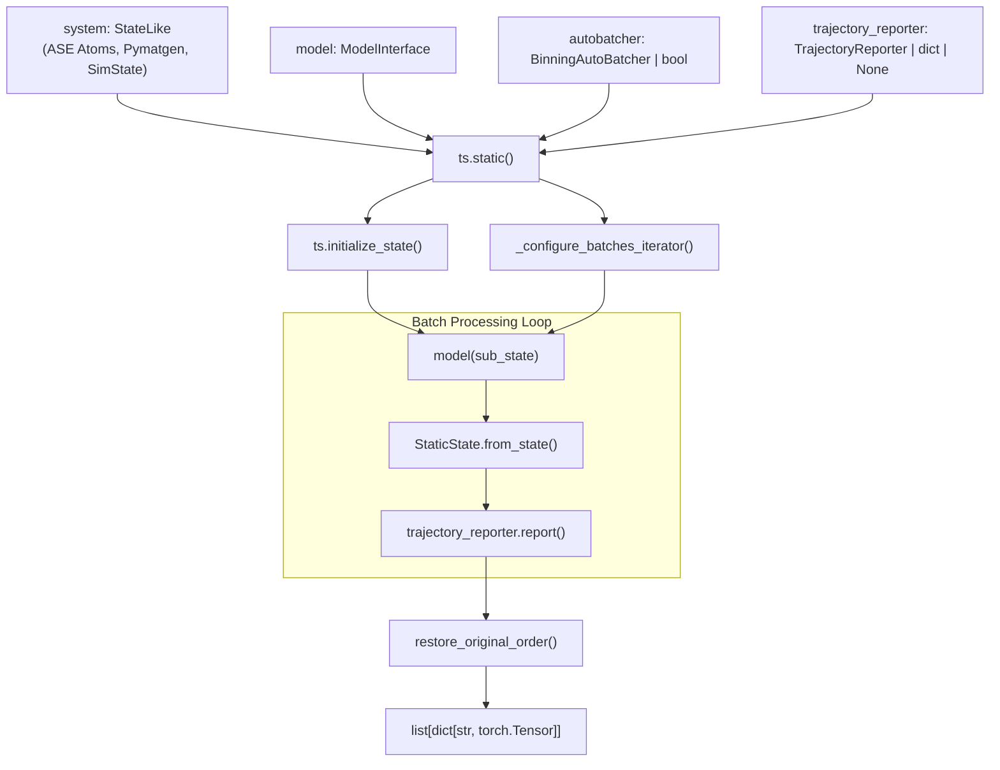
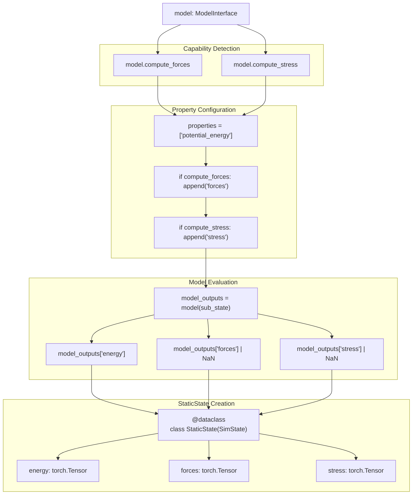
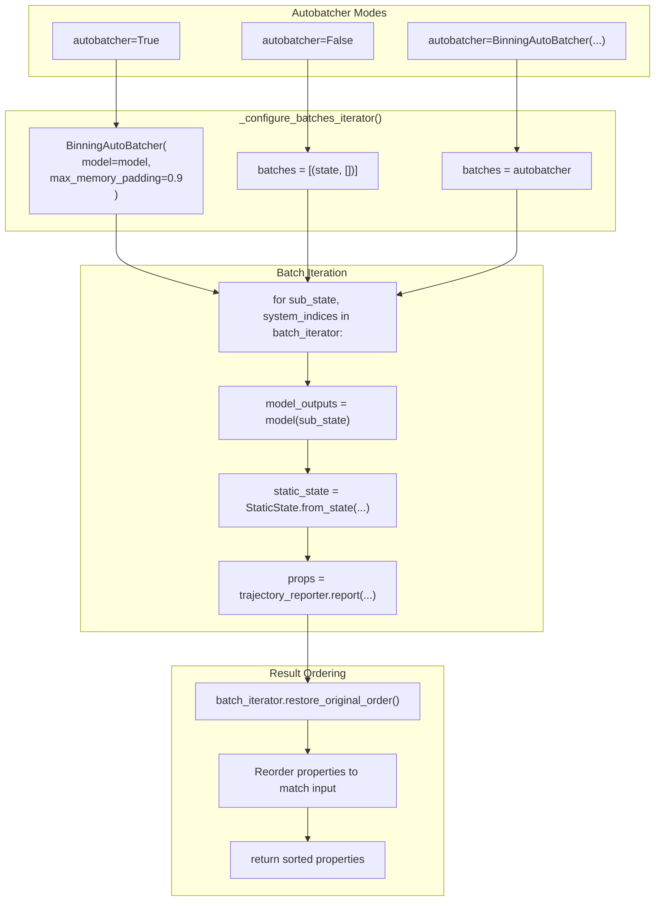
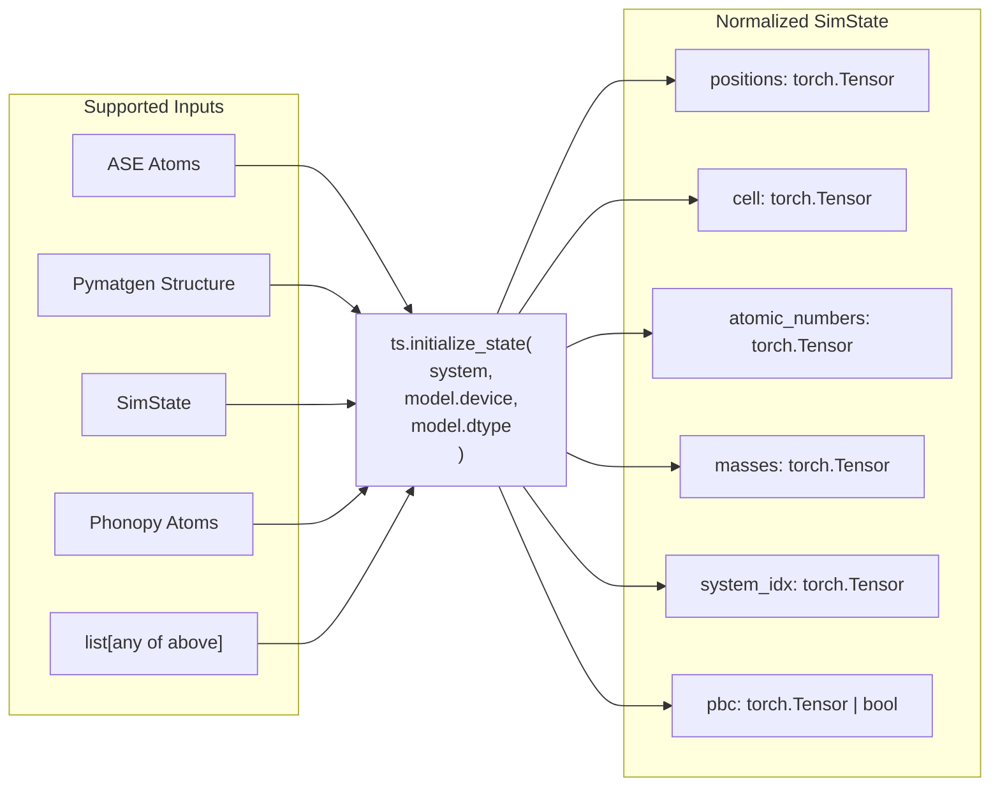
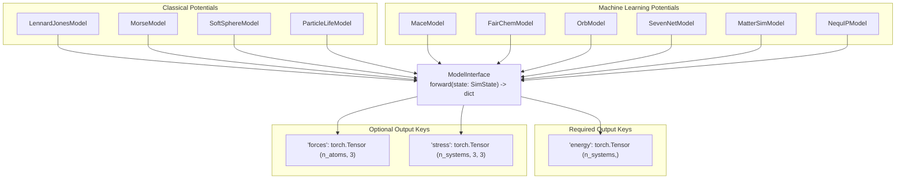

# Static Property Calculations

<details>
<summary>Relevant source files</summary>

The following files were used as context for generating this wiki page:

- [tests/test_runners.py](tests/test_runners.py)
- [tests/test_trajectory.py](tests/test_trajectory.py)
- [torch_sim/runners.py](torch_sim/runners.py)
- [torch_sim/trajectory.py](torch_sim/trajectory.py)

</details>


Static property calculations perform single-point evaluations of atomistic properties without evolving the system state over time. Unlike molecular dynamics simulations (page 4.1) or geometry optimizations (page 5.1), static calculations compute energies, forces, and stresses at fixed atomic configurations.

## Purpose and Scope

The `ts.static()` function enables efficient single-point property calculations for individual structures or batches of systems. Key use cases include:

- Computing energies, forces, and stresses for datasets
- Post-processing optimized or equilibrated structures
- Model validation against reference data
- High-throughput property screening

## High-Level API

The `ts.static()` function provides the primary interface for static property calculations. It handles state initialization, memory-managed batching, model evaluation, and optional trajectory output.



**Static Calculation Execution Flow**

Sources: [torch_sim/runners.py:734-853]()

## Function Signature

```python
def static(
    system: StateLike,
    model: ModelInterface,
    *,
    trajectory_reporter: TrajectoryReporter | dict | None = None,
    autobatcher: BinningAutoBatcher | bool = False,
    pbar: bool | dict[str, Any] = False,
) -> list[dict[str, torch.Tensor]]
```

### Parameters

| Parameter | Type | Default | Description |
|-----------|------|---------|-------------|
| `system` | `StateLike` | Required | Input structure(s): ASE Atoms, Pymatgen Structure, or SimState |
| `model` | `ModelInterface` | Required | Model for property computation (MACE, ORB, classical potentials, etc.) |
| `trajectory_reporter` | `TrajectoryReporter \| dict \| None` | `None` | Optional output configuration. If `dict`, must include `filenames` key |
| `autobatcher` | `BinningAutoBatcher \| bool` | `False` | Memory management: `True` for automatic, `False` for single batch, or custom `BinningAutoBatcher` |
| `pbar` | `bool \| dict` | `False` | Progress bar: `True` to enable, `dict` for tqdm kwargs |

### Returns

`list[dict[str, torch.Tensor]]`: Property dictionaries, one per system in input order. Each dictionary contains properties computed by the model and trajectory reporter.

Sources: [torch_sim/runners.py:734-769]()

## Property Computation

The `static` function automatically determines which properties to compute based on model capabilities:



**Property Detection and State Creation**

The function dynamically creates a `StaticState` dataclass at runtime that extends `SimState` with computed properties:

- `energy`: Always populated from `model_outputs["energy"]`
- `forces`: Populated if `model.compute_forces` is `True`, otherwise filled with NaN
- `stress`: Populated if `model.compute_stress` is `True`, otherwise filled with NaN

This ensures consistent output structure regardless of model capabilities.

Sources: [torch_sim/runners.py:774-837]()

## Batching and Memory Management

Static calculations use the `BinningAutoBatcher` (page 7.1) to manage GPU memory efficiently when processing multiple systems:



**Batching Configuration and Processing**

The autobatcher groups systems by size to maximize GPU utilization while staying within memory limits. When `autobatcher=True`, memory is automatically estimated based on the model's `memory_scales_with` attribute.

Sources: [torch_sim/runners.py:773](), [torch_sim/runners.py:71-105](), [torch_sim/runners.py:847-851]()

## Input Format Handling

The `static` function accepts multiple input formats via `ts.initialize_state()` (page 3.1):



**State Initialization for Static Calculations**

All inputs are converted to a `SimState` object with consistent tensor shapes and dtypes matching the model's requirements. The `system_idx` tensor enables batched processing of multiple systems.

Sources: [torch_sim/runners.py:770](), [torch_sim/io.py]()

## Trajectory Reporting

The `trajectory_reporter` parameter enables optional output to HDF5 files (page 7.2):

### Default Property Calculators

When `trajectory_reporter` is provided as a dict, default property calculators are configured:

| Property | Frequency | Condition |
|----------|-----------|-----------|
| `potential_energy` | Every report | Always |
| `forces` | Every report | If `model.compute_forces` is `True` |
| `stress` | Every report | If `model.compute_stress` is `True` |

### Configuration

The reporter can be specified in two ways:

**As TrajectoryReporter:**
```python
reporter = ts.TrajectoryReporter(
    filenames=["system_0.h5", "system_1.h5"],
    state_frequency=1,
    prop_calculators={1: {"custom_prop": lambda state: ...}}
)
ts.static(systems, model, trajectory_reporter=reporter)
```

**As dict (auto-configured):**
```python
ts.static(
    systems, 
    model, 
    trajectory_reporter=dict(
        filenames=["system_0.h5", "system_1.h5"],
        state_frequency=1
    )
)
```

When using a dict, the function automatically sets `variable_atomic_numbers=True` and `variable_masses=True` in `state_kwargs` to support heterogeneous batches.

Sources: [torch_sim/runners.py:774-790]()

## Model Compatibility

The `static` function works with any model implementing `ModelInterface` (page 3.2):



**Supported Model Types**

All models must implement the `forward(state: SimState) -> dict[str, torch.Tensor]` interface. The energy key is required; forces and stress are optional depending on model capabilities.

Sources: [torch_sim/runners.py:823-836](), [torch_sim/models/interface.py]()

## Return Value Structure

The `static` function returns a list of property dictionaries, one per input system. Each dictionary contains:

- All properties computed by the trajectory reporter
- Consistent structure across all systems
- Proper ordering matching input system order (when using autobatching)

For autobatched calculations, the function automatically reorders results to match the original input order using the batch iterator's index tracking.

Sources: [torch_sim/runners.py:590-596]()

---