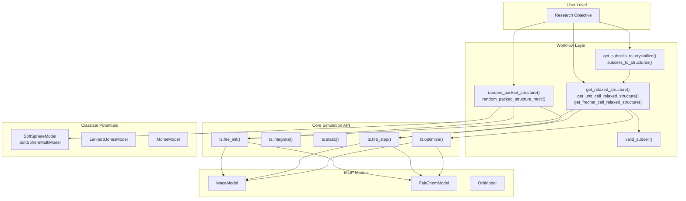
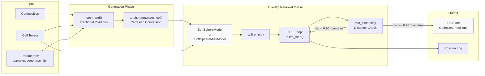
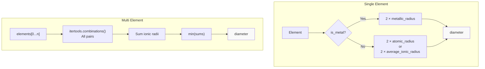
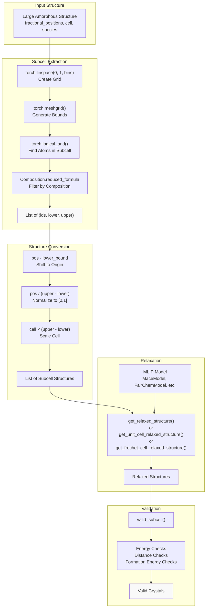
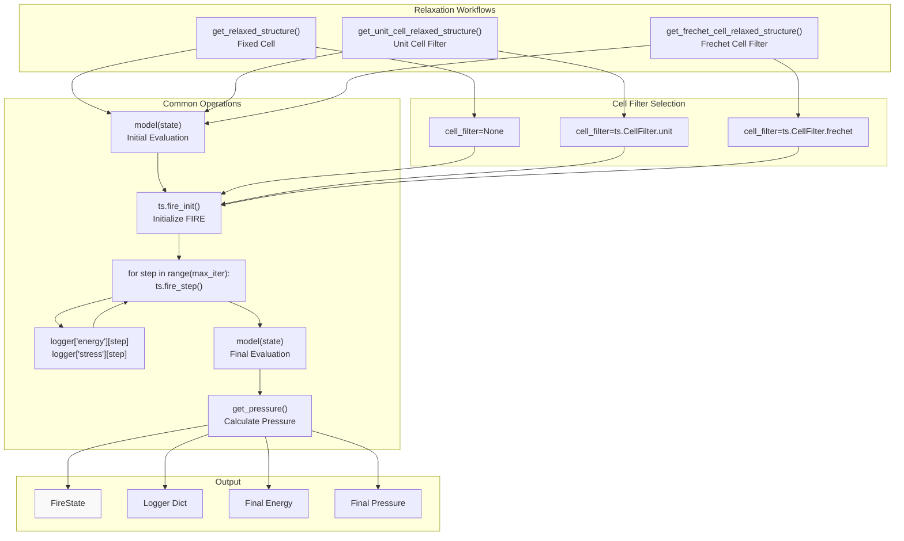
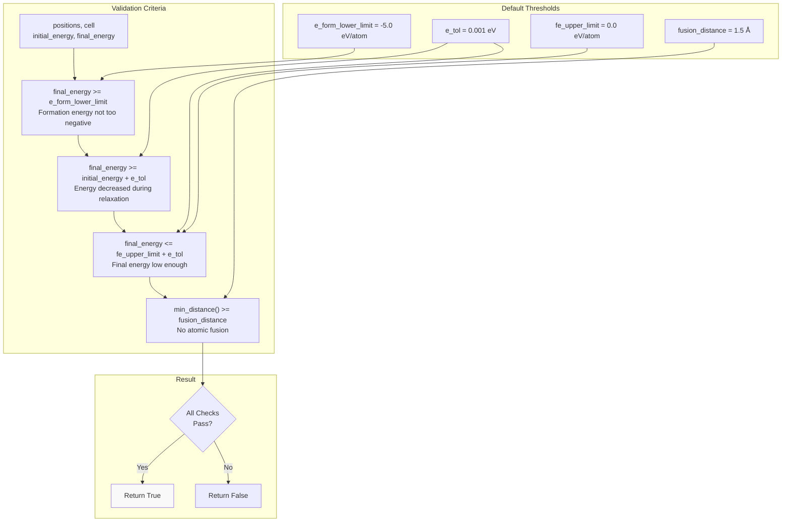
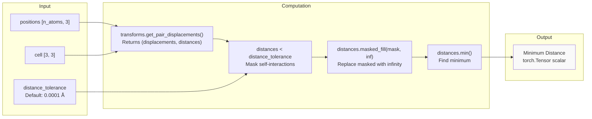
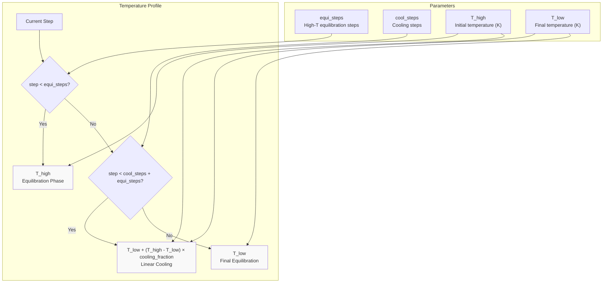
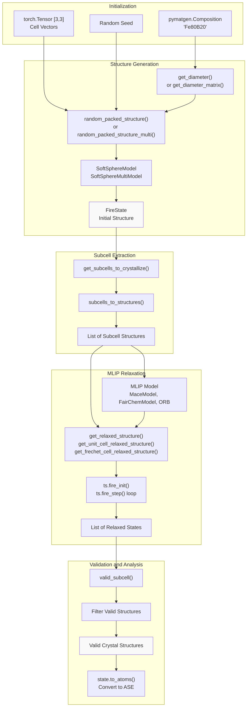
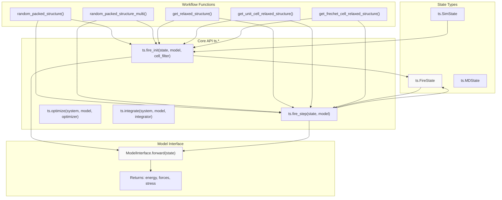

# Workflows and Applications

Relevant source files

The following files were used as context for generating this wiki page:

- [.github/workflows/test.yml](.github/workflows/test.yml)
- [README.md](README.md)
- [pyproject.toml](pyproject.toml)
- [torch_sim/models/lennard_jones.py](torch_sim/models/lennard_jones.py)
- [torch_sim/models/morse.py](torch_sim/models/morse.py)
- [torch_sim/models/particle_life.py](torch_sim/models/particle_life.py)
- [torch_sim/models/soft_sphere.py](torch_sim/models/soft_sphere.py)
- [torch_sim/workflows/a2c.py](torch_sim/workflows/a2c.py)

## Purpose and Scope

This page documents the workflow and application-level functionality in torch-sim, which combines core simulation primitives into complete scientific pipelines. Workflows orchestrate multiple simulation steps—structure generation, relaxation, MD simulation, and analysis—to accomplish research objectives.

For information about individual simulation primitives that workflows build upon, see:
- Structure optimization algorithms: [Structure Optimization](#5)
- Molecular dynamics integration: [Molecular Dynamics](#4)
- Classical potentials used in workflows: [Classical Potentials](#6.7)
- I/O for converting workflow results: [I/O and Format Conversion](#3.4)

The workflow module provides functions for generating initial structures, removing atomic overlaps, extracting crystalline subcells from amorphous systems, and validating relaxed structures.

**Sources:** [torch_sim/workflows/a2c.py:1-8]()

## Workflow Architecture

The workflow layer sits above the core simulation API and combines multiple operations into research pipelines:

**Sources:** [torch_sim/workflows/a2c.py:1-893](), [README.md:27-90]()

## Structure Generation Components

### Random Packing Workflow

The structure generation workflow creates initial atomic configurations with controlled interatomic distances:

**Key Functions:**

| Function | Purpose | File Location |
|----------|---------|---------------|
| `random_packed_structure()` | Generate single-species random packed structure | [torch_sim/workflows/a2c.py:210-313]() |
| `random_packed_structure_multi()` | Generate multi-species random packed structure | [torch_sim/workflows/a2c.py:316-432]() |
| `min_distance()` | Calculate minimum interatomic distance | [torch_sim/workflows/a2c.py:26-70]() |
| `get_diameter()` | Calculate atomic diameter from composition | [torch_sim/workflows/a2c.py:73-137]() |
| `get_diameter_matrix()` | Calculate diameter matrix for multiple species | [torch_sim/workflows/a2c.py:140-207]() |

**Sources:** [torch_sim/workflows/a2c.py:210-432](), [torch_sim/models/soft_sphere.py:175-246](), [torch_sim/models/soft_sphere.py:248-377]()

### Diameter Calculation

The workflow uses atomic radii from pymatgen to automatically determine appropriate soft-sphere diameters:

**Sources:** [torch_sim/workflows/a2c.py:73-137](), [torch_sim/workflows/a2c.py:140-207]()

## Amorphous-to-Crystalline (A2C) Pipeline

The A2C workflow extracts crystalline subcells from larger amorphous structures and relaxes them to find stable crystal structures:

**Key Functions:**

| Function | Purpose | Return Type |
|----------|---------|-------------|
| `get_subcells_to_crystallize()` | Extract subcell candidates from structure | `list[tuple[torch.Tensor, torch.Tensor, torch.Tensor]]` |
| `subcells_to_structures()` | Convert subcell candidates to structures | `list[tuple[torch.Tensor, torch.Tensor, list[str]]]` |
| `get_relaxed_structure()` | Relax positions at fixed cell | `tuple[FireState, dict, list[float], list[float]]` |
| `get_unit_cell_relaxed_structure()` | Relax positions and cell (unit filter) | `tuple[FireState, dict, list[float], list[float]]` |
| `get_frechet_cell_relaxed_structure()` | Relax positions and cell (Frechet filter) | `tuple[FireState, dict, list[float], list[float]]` |
| `valid_subcell()` | Validate relaxed structure | `bool` |

**Sources:** [torch_sim/workflows/a2c.py:505-658](), [torch_sim/workflows/a2c.py:685-892]()

## Relaxation Workflows

Three relaxation workflow functions provide different levels of cell optimization:

### Relaxation Function Comparison

| Feature | `get_relaxed_structure()` | `get_unit_cell_relaxed_structure()` | `get_frechet_cell_relaxed_structure()` |
|---------|---------------------------|-------------------------------------|----------------------------------------|
| Optimize Positions | ✓ | ✓ | ✓ |
| Optimize Cell | ✗ | ✓ | ✓ |
| Cell Filter | None | `CellFilter.unit` | `CellFilter.frechet` |
| Stress Logging | Initial/Final only | All steps | All steps |
| Use Case | Fixed cell relaxation | Isotropic cell optimization | Anisotropic cell optimization |
| File Location | [a2c.py:830-892]() | [a2c.py:685-754]() | [a2c.py:757-827]() |

**Sources:** [torch_sim/workflows/a2c.py:685-892]()

## Structure Validation

The `valid_subcell()` function implements multi-criteria validation for relaxed structures:

**Sources:** [torch_sim/workflows/a2c.py:435-502]()

## Utility Functions

### Distance Calculation

The `min_distance()` function computes minimum interatomic separation using periodic boundary conditions:

**Sources:** [torch_sim/workflows/a2c.py:26-70]()

### Temperature Profile

The `get_target_temperature()` function implements a melt-quench-equilibrate temperature schedule:

**Sources:** [torch_sim/workflows/a2c.py:661-682]()

## Classical Potentials for Workflows

Workflows frequently use classical potentials for initial structure preparation and overlap removal:

| Model | Use Case | Key Parameters | File Location |
|-------|----------|----------------|---------------|
| `SoftSphereModel` | Single-species overlap removal | `sigma`, `epsilon`, `alpha` | [torch_sim/models/soft_sphere.py:175-246]() |
| `SoftSphereMultiModel` | Multi-species overlap removal | `atomic_numbers`, `sigma_matrix`, `epsilon_matrix` | [torch_sim/models/soft_sphere.py:248-377]() |
| `LennardJonesModel` | Van der Waals interactions | `sigma`, `epsilon`, `cutoff` | [torch_sim/models/lennard_jones.py:74-141]() |
| `MorseModel` | Bonded interactions | `sigma`, `epsilon`, `alpha` | [torch_sim/models/morse.py:78-144]() |
| `ParticleLifeModel` | Emergent behavior simulations | `sigma`, `epsilon`, `beta` | [torch_sim/models/particle_life.py:57-122]() |

**Sources:** [torch_sim/models/soft_sphere.py:1-378](), [torch_sim/models/lennard_jones.py:1-142](), [torch_sim/models/morse.py:1-145](), [torch_sim/models/particle_life.py:1-123]()

## Workflow Data Flow

The complete data flow through a typical workflow pipeline:

**Sources:** [torch_sim/workflows/a2c.py:1-893](), [torch_sim/models/soft_sphere.py:1-378]()

## Integration with Core API

Workflows build upon the core torch-sim API functions:

**Sources:** [torch_sim/workflows/a2c.py:1-893](), [README.md:36-90]()

---