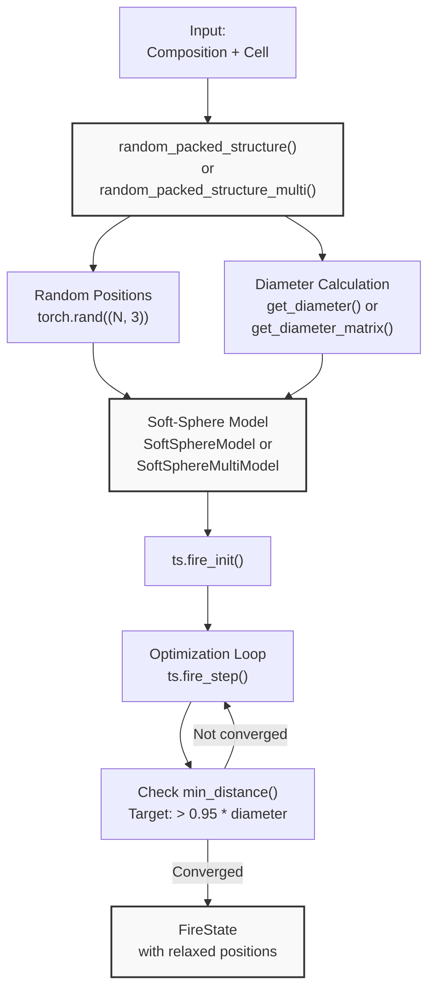
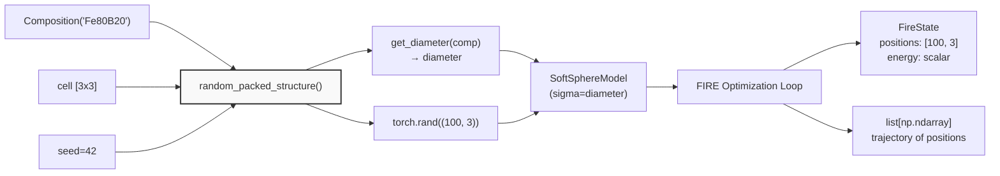
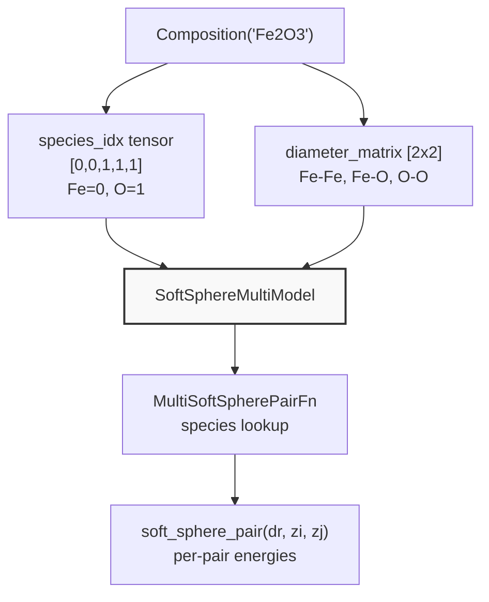
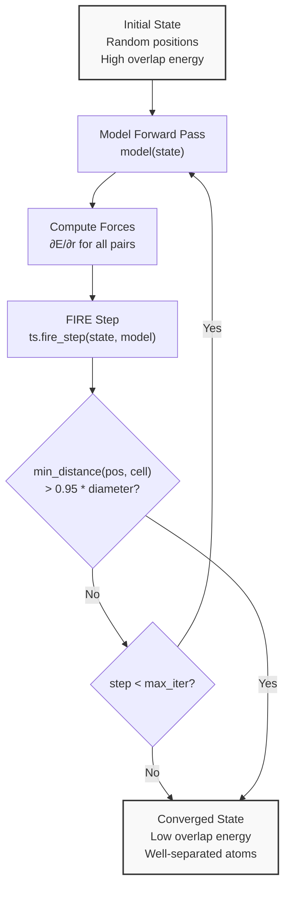
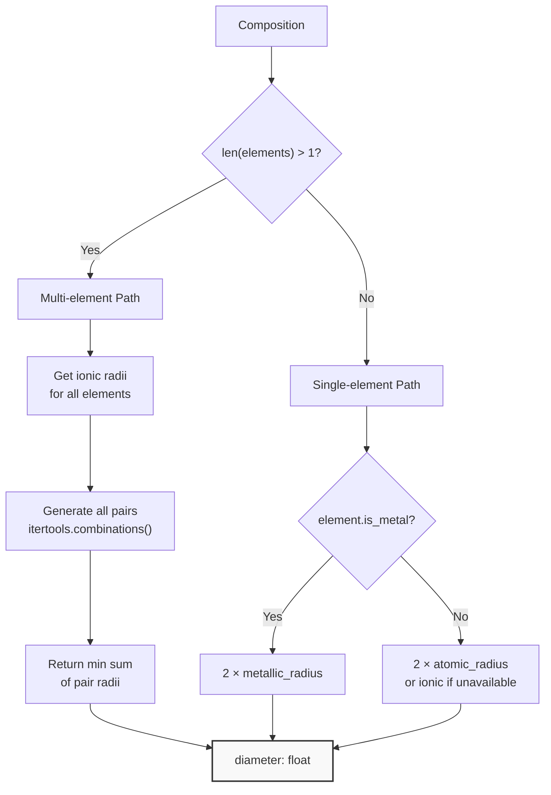
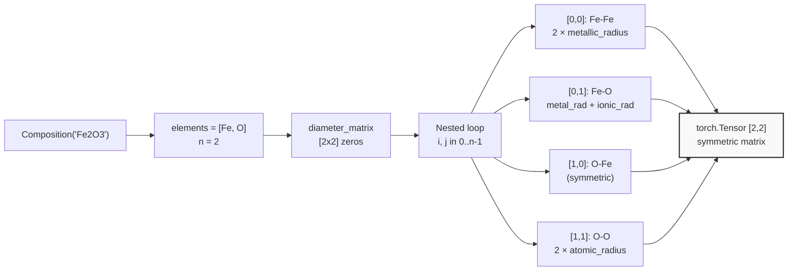
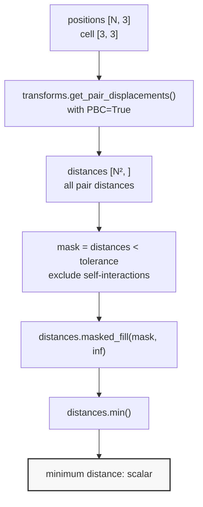
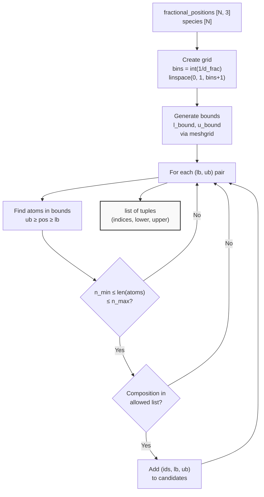
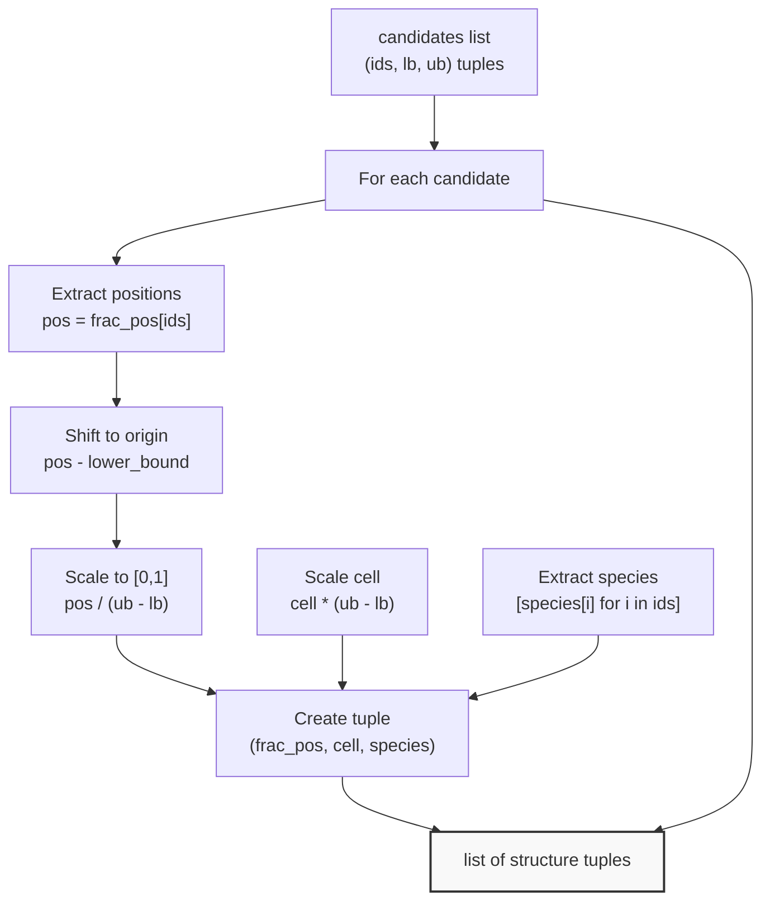
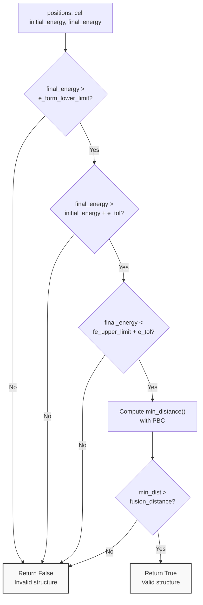

# Structure Generation

<details>
<summary>Relevant source files</summary>

The following files were used as context for generating this wiki page:

- [torch_sim/models/lennard_jones.py](torch_sim/models/lennard_jones.py)
- [torch_sim/models/morse.py](torch_sim/models/morse.py)
- [torch_sim/models/particle_life.py](torch_sim/models/particle_life.py)
- [torch_sim/models/soft_sphere.py](torch_sim/models/soft_sphere.py)
- [torch_sim/workflows/a2c.py](torch_sim/workflows/a2c.py)

</details>


## Purpose and Scope

This page documents torch-sim's capabilities for generating initial atomic structures, particularly random packed structures with controlled interatomic distances. The primary use case is creating starting configurations for simulations, especially amorphous or liquid structures that need reasonable initial geometry before further processing.

Structure generation in torch-sim involves:
- Creating random atomic positions within a simulation cell
- Using soft-sphere repulsive potentials to remove atomic overlaps
- Handling single and multi-species systems with appropriate diameter constraints
- Extracting subcells from larger structures for crystallization workflows

For information about the complete amorphous-to-crystalline pipeline that uses these structure generation capabilities, see [Amorphous-to-Crystalline (A2C) Workflow](#9.2). For details about the soft-sphere model itself as a general-purpose potential, see [Classical Potentials](#6.7). For optimization methods used during overlap removal, see [Structure Optimization](#5).

**Sources:** [torch_sim/workflows/a2c.py:1-893]()

## Structure Generation Workflow

The structure generation process follows a two-stage workflow: random initialization followed by overlap minimization. The workflow takes a chemical composition and simulation cell as input, generates random atomic positions, then uses a soft-sphere repulsive potential to push overlapping atoms apart.



**Sources:** [torch_sim/workflows/a2c.py:210-313](), [torch_sim/workflows/a2c.py:316-432]()

## Random Packing Functions

Torch-sim provides two main functions for random structure generation, differing in how they handle multiple atomic species.

### Single-Species Random Packing

The `random_packed_structure()` function generates structures where all atoms use the same interaction diameter, regardless of their chemical identity. This is suitable for single-element systems or multi-element systems where species-specific interactions are not critical.

| Parameter | Type | Default | Description |
|-----------|------|---------|-------------|
| `composition` | `Composition` | required | Pymatgen composition specifying atom counts |
| `cell` | `torch.Tensor` | required | 3×3 tensor defining simulation box |
| `seed` | `int` | `42` | Random seed for reproducibility |
| `diameter` | `float \| None` | `None` | Minimum interatomic distance |
| `auto_diameter` | `bool` | `False` | Automatically calculate diameter from radii |
| `max_iter` | `int` | `100` | Maximum FIRE optimization steps |
| `distance_tolerance` | `float` | `0.0001` | Threshold for distance comparisons |
| `device` | `torch.device \| None` | `None` | PyTorch device (CPU/GPU) |
| `dtype` | `torch.dtype` | `torch.float32` | Data type for computations |



**Key Code Entities:**
- Function: `random_packed_structure()` at [torch_sim/workflows/a2c.py:210-313]()
- Model: `SoftSphereModel` at [torch_sim/models/soft_sphere.py:175-246]()
- Initialization: `ts.fire_init()` at [torch_sim/workflows/a2c.py:299]()
- Optimization: `ts.fire_step()` at [torch_sim/workflows/a2c.py:309]()

**Sources:** [torch_sim/workflows/a2c.py:210-313](), [torch_sim/models/soft_sphere.py:175-246]()

### Multi-Species Random Packing

The `random_packed_structure_multi()` function generates structures with species-specific interaction parameters. Each pair of atomic species can have different diameter, energy scale, and repulsion exponent values, allowing more realistic initial configurations for multi-component systems.

| Parameter | Type | Default | Description |
|-----------|------|---------|-------------|
| `composition` | `Composition` | required | Pymatgen composition specifying atom counts |
| `cell` | `torch.Tensor` | required | 3×3 tensor defining simulation box |
| `seed` | `int` | `42` | Random seed for reproducibility |
| `diameter_matrix` | `torch.Tensor \| None` | `None` | [n_species, n_species] matrix of diameters |
| `auto_diameter` | `bool` | `False` | Automatically calculate diameter matrix |
| `max_iter` | `int` | `100` | Maximum FIRE optimization steps |
| `distance_tolerance` | `float` | `0.0001` | Threshold for distance comparisons |
| `device` | `torch.device \| None` | `None` | PyTorch device (CPU/GPU) |
| `dtype` | `torch.dtype` | `torch.float32` | Data type for computations |



**Key Code Entities:**
- Function: `random_packed_structure_multi()` at [torch_sim/workflows/a2c.py:316-432]()
- Model: `SoftSphereMultiModel` at [torch_sim/models/soft_sphere.py:248-377]()
- Pair function: `MultiSoftSpherePairFn` at [torch_sim/models/soft_sphere.py:90-168]()
- Species mapping: `z_to_idx` buffer at [torch_sim/models/soft_sphere.py:142-146]()

**Sources:** [torch_sim/workflows/a2c.py:316-432](), [torch_sim/models/soft_sphere.py:248-377](), [torch_sim/models/soft_sphere.py:90-168]()

## Soft-Sphere Potential for Overlap Removal

The soft-sphere potential is a purely repulsive potential used to push overlapping atoms apart during structure initialization. Unlike Lennard-Jones or other potentials with attractive components, the soft-sphere potential only creates repulsion, making it ideal for removing initial overlaps without introducing artificial structure.

### Potential Form

The soft-sphere energy has the form:

```
V(r) = ε/α * (1 - r/σ)^α  for r < σ
V(r) = 0                    for r ≥ σ
```

Where:
- `σ` (sigma): Interaction diameter / cutoff distance
- `ε` (epsilon): Energy scale parameter
- `α` (alpha): Repulsion exponent (default: 2.0)
- `r`: Distance between atom pair

The corresponding force is:

```
F(r) = (ε/σ) * (1 - r/σ)^(α-1)  for r < σ
F(r) = 0                          for r ≥ σ
```

**Key Code Entities:**
- Energy function: `soft_sphere_pair()` at [torch_sim/models/soft_sphere.py:35-59]()
- Force function: `soft_sphere_pair_force()` at [torch_sim/models/soft_sphere.py:62-88]()

**Sources:** [torch_sim/models/soft_sphere.py:1-22](), [torch_sim/models/soft_sphere.py:35-88]()

### Optimization Process

The overlap removal process uses the FIRE (Fast Inertial Relaxation Engine) optimizer to minimize the soft-sphere potential energy. The optimization continues until either:
1. The minimum interatomic distance exceeds 95% of the target diameter
2. The maximum iteration count is reached



**Key Code Entities:**
- Distance check: `min_distance()` at [torch_sim/workflows/a2c.py:26-70]()
- FIRE initialization: `ts.fire_init()` used at [torch_sim/workflows/a2c.py:299](), [torch_sim/workflows/a2c.py:421]()
- FIRE stepping: `ts.fire_step()` used at [torch_sim/workflows/a2c.py:309](), [torch_sim/workflows/a2c.py:429]()
- Convergence check: [torch_sim/workflows/a2c.py:304](), [torch_sim/workflows/a2c.py:426-428]()

**Sources:** [torch_sim/workflows/a2c.py:26-70](), [torch_sim/workflows/a2c.py:302-309](), [torch_sim/workflows/a2c.py:424-429]()

## Diameter Estimation

Torch-sim provides automatic diameter estimation based on atomic and ionic radii from Pymatgen's element database. This eliminates the need for manual parameter selection when creating structures.

### Single Diameter Calculation

The `get_diameter()` function returns a single diameter value appropriate for the composition:

**For multi-element systems:**
- Uses average ionic radii for all elements
- Returns minimum sum of ionic radii across all element pairs
- Example: For Fe₂O₃, returns min(Fe-Fe, Fe-O, O-O) separations

**For single-element systems:**
- Metals: Uses 2 × metallic radius
- Non-metals: Uses 2 × atomic radius (or ionic if atomic unavailable)



**Key Code Entities:**
- Function: `get_diameter()` at [torch_sim/workflows/a2c.py:73-137]()
- Multi-element logic: [torch_sim/workflows/a2c.py:114-123]()
- Single-element logic: [torch_sim/workflows/a2c.py:125-136]()

**Sources:** [torch_sim/workflows/a2c.py:73-137]()

### Diameter Matrix Calculation

The `get_diameter_matrix()` function creates a symmetric [n_species, n_species] matrix containing minimum diameters for each pair of elements. This is used by `random_packed_structure_multi()` and `SoftSphereMultiModel`.

**Matrix construction rules:**
- **Same element (diagonal):** Same as single-element calculation
- **Metal-metal pairs:** Sum of metallic radii
- **Other pairs:** Sum of atomic/ionic radii



**Key Code Entities:**
- Function: `get_diameter_matrix()` at [torch_sim/workflows/a2c.py:140-207]()
- Diagonal elements: [torch_sim/workflows/a2c.py:182-192]()
- Off-diagonal (metal-metal): [torch_sim/workflows/a2c.py:194-196]()
- Off-diagonal (other): [torch_sim/workflows/a2c.py:197-201]()

**Sources:** [torch_sim/workflows/a2c.py:140-207]()

## Distance Calculation

The `min_distance()` function computes the minimum interatomic distance in a periodic structure, which is essential for checking overlap removal convergence.

**Algorithm:**
1. Compute all pairwise distances using `transforms.get_pair_displacements()`
2. Apply periodic boundary conditions (minimum image convention)
3. Mask out self-interactions (distances < tolerance)
4. Return smallest remaining distance



**Key Code Entities:**
- Function: `min_distance()` at [torch_sim/workflows/a2c.py:26-70]()
- Pairwise distances: `transforms.get_pair_displacements()` at [torch_sim/workflows/a2c.py:56-60]()
- Masking logic: [torch_sim/workflows/a2c.py:64-67]()

**Sources:** [torch_sim/workflows/a2c.py:26-70]()

## Subcell Extraction

Torch-sim provides functions for extracting smaller subcells from larger structures, which is useful for crystallization workflows where you want to relax many candidate structures from different regions of an amorphous system.

### Subcell Generation

The `get_subcells_to_crystallize()` function systematically slices a structure using a grid-based approach, generating overlapping subcells that satisfy size and composition constraints.

| Parameter | Type | Default | Description |
|-----------|------|---------|-------------|
| `fractional_positions` | `torch.Tensor` | required | Atomic positions in fractional coordinates [N, 3] |
| `species` | `list[str]` | required | Element symbols for each atom |
| `d_frac` | `float` | `0.05` | Grid spacing in fractional coordinates |
| `n_min` | `int` | `1` | Minimum atoms per subcell |
| `n_max` | `int` | `48` | Maximum atoms per subcell |
| `restrict_to_compositions` | `Sequence[str] \| None` | `None` | Allowed chemical formulas |
| `max_coeff` | `int \| None` | `None` | Maximum stoichiometric coefficient |
| `elements` | `Sequence[str] \| None` | `None` | Elements for stoichiometry generation |

**Grid Construction:**
1. Divide unit cell into grid with spacing `d_frac`
2. Generate all possible (lower_bound, upper_bound) pairs
3. For each subcell, check which atoms fall within bounds
4. Filter by atom count (`n_min` to `n_max`)
5. Optionally filter by chemical composition



**Key Code Entities:**
- Function: `get_subcells_to_crystallize()` at [torch_sim/workflows/a2c.py:505-614]()
- Grid generation: [torch_sim/workflows/a2c.py:578-590]()
- Atom masking: [torch_sim/workflows/a2c.py:597-601]()
- Size filtering: [torch_sim/workflows/a2c.py:604]()
- Composition filtering: [torch_sim/workflows/a2c.py:606-612]()

**Sources:** [torch_sim/workflows/a2c.py:505-614]()

### Subcell to Structure Conversion

The `subcells_to_structures()` function converts subcell candidates into properly formatted structure tuples ready for relaxation.

**Transformation steps:**
1. Extract atomic positions for selected indices
2. Shift positions to start from origin: `pos - lower_bound`
3. Scale to [0,1] range: `pos / (upper_bound - lower_bound)`
4. Scale cell vectors: `cell * (upper_bound - lower_bound)`
5. Extract species labels for selected atoms



**Key Code Entities:**
- Function: `subcells_to_structures()` at [torch_sim/workflows/a2c.py:617-658]()
- Position transformation: [torch_sim/workflows/a2c.py:641-647]()
- Cell transformation: [torch_sim/workflows/a2c.py:650]()
- Species extraction: [torch_sim/workflows/a2c.py:654]()

**Sources:** [torch_sim/workflows/a2c.py:617-658]()

## Subcell Validation

After relaxation, subcells must be validated to ensure they represent physically reasonable structures. The `valid_subcell()` function checks multiple criteria.

### Validation Criteria

| Criterion | Parameter | Default | Description |
|-----------|-----------|---------|-------------|
| Formation energy lower bound | `e_form_lower_limit` | `-5.0` eV/atom | Reject unphysically negative energies |
| Energy reduction | `e_tol` | `0.001` eV | Optimization should reduce energy |
| Formation energy upper bound | `fe_upper_limit` | `0.0` eV/atom | Final energy should be reasonable |
| Atomic fusion | `fusion_distance` | `1.5` Å | Minimum allowed interatomic distance |



**Key Code Entities:**
- Function: `valid_subcell()` at [torch_sim/workflows/a2c.py:435-502]()
- Formation energy check: [torch_sim/workflows/a2c.py:482-483]()
- Energy reduction check: [torch_sim/workflows/a2c.py:487-488]()
- Convergence check: [torch_sim/workflows/a2c.py:491-492]()
- Fusion check: [torch_sim/workflows/a2c.py:496-499]()

**Sources:** [torch_sim/workflows/a2c.py:435-502]()

## Integration with Other Models

While soft-sphere potentials are the standard choice for structure generation, torch-sim supports other classical potentials that can be used for overlap removal in specialized cases.

| Model | Use Case | Energy Form |
|-------|----------|-------------|
| `SoftSphereModel` | Standard overlap removal | `ε/α * (1 - r/σ)^α` for r < σ |
| `LennardJonesModel` | When attraction is desired | `4ε[(σ/r)¹² - (σ/r)⁶]` |
| `MorseModel` | Bond-like interactions | `ε(1 - exp(-α(r-σ)))² - ε` |
| `ParticleLifeModel` | Asymmetric forces | Custom piecewise force |

**Note:** For pure overlap removal, `SoftSphereModel` is recommended because it has zero energy beyond the cutoff and no attractive component.

**Sources:** [torch_sim/models/soft_sphere.py:1-378](), [torch_sim/models/lennard_jones.py:1-142](), [torch_sim/models/morse.py:1-145](), [torch_sim/models/particle_life.py:1-123]()

---