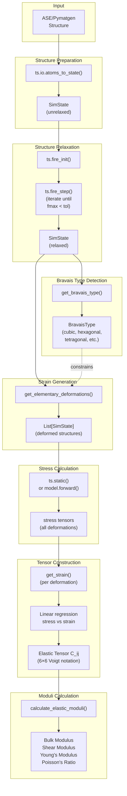
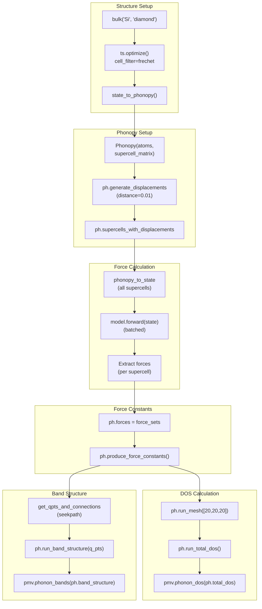
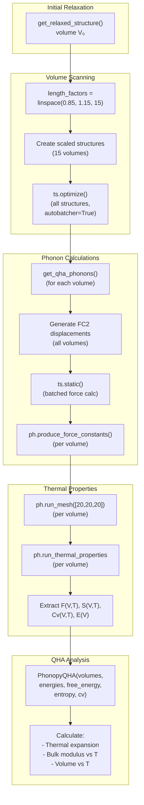
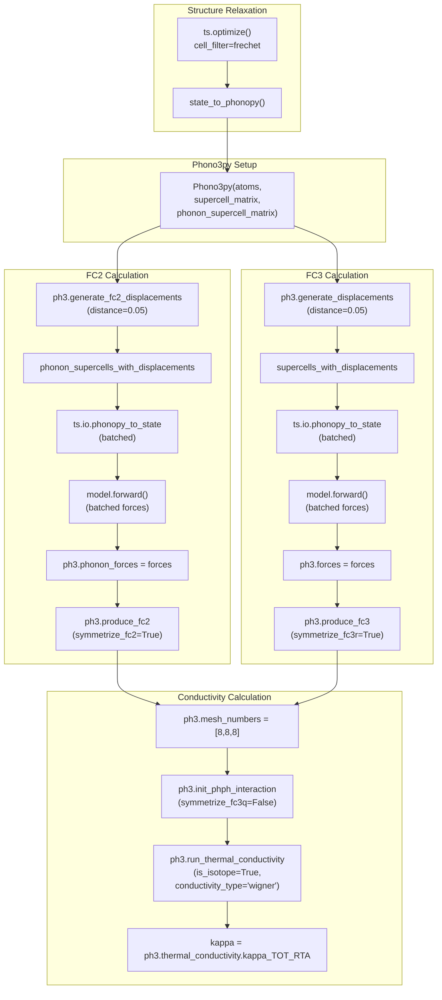
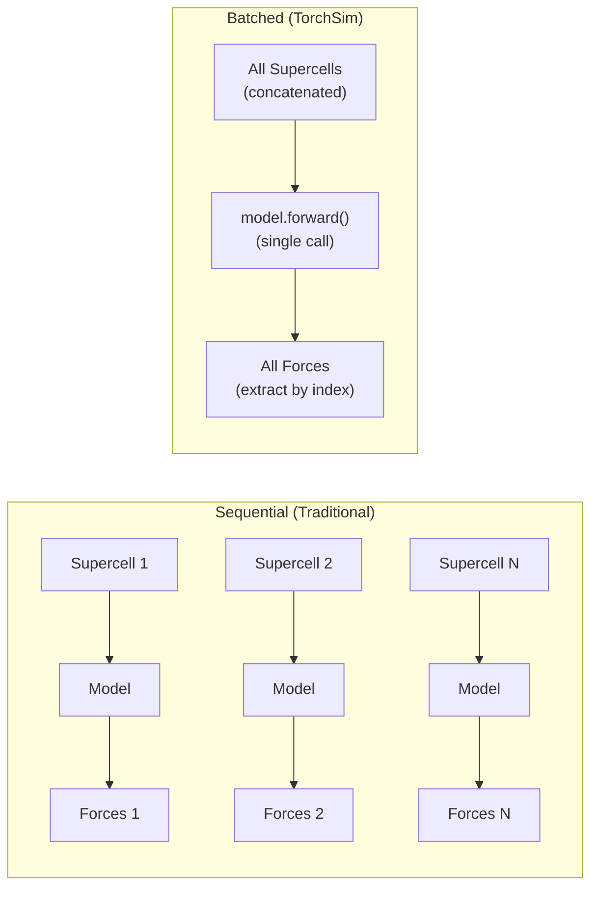

# 9.2 Amorphous-to-Crystalline (A2C) Workflow

<details>
<summary>Relevant source files</summary>

The following files were used as context for generating this wiki page:

- [torch_sim/models/lennard_jones.py](torch_sim/models/lennard_jones.py)
- [torch_sim/models/morse.py](torch_sim/models/morse.py)
- [torch_sim/models/particle_life.py](torch_sim/models/particle_life.py)
- [torch_sim/models/soft_sphere.py](torch_sim/models/soft_sphere.py)
- [torch_sim/workflows/a2c.py](torch_sim/workflows/a2c.py)

</details>


## Purpose and Scope

The Amorphous-to-Crystalline (A2C) workflow is a high-throughput structure search method that discovers stable crystal structures by:
1. Generating random amorphous configurations using soft-sphere potentials
2. Systematically extracting subcells from the amorphous structure
3. Relaxing subcell geometries to local energy minima (candidate crystals)
4. Validating structures based on formation energies and physical constraints

This workflow is particularly useful for exploring unknown phase diagrams, finding metastable structures, and screening compositions for novel materials. The workflow is implemented in `torch_sim/workflows/a2c.py` and leverages TorchSim's GPU acceleration for efficient parallel relaxation.

Related sections: Structure Generation (9.1), Structure Optimization (5.1-5.3), Classical Potentials (6.7).

**Sources:** [torch_sim/workflows/a2c.py]()

---

## Elastic Property Workflow

### Overview

The elastic property workflow calculates the elastic tensor and derived moduli (bulk modulus, shear modulus) through structure relaxation, strain application, and stress calculation. This workflow demonstrates TorchSim's ability to perform precise stress-strain analysis for materials characterization.

**Workflow Diagram: Elastic Tensor Calculation**



**Sources:** [tests/test_elastic.py:355-411](), [torch_sim/elastic.py]()

### Implementation Pattern

The following pattern demonstrates elastic property calculation for a copper FCC structure:

**Step 1: Structure Relaxation**

```python
# Load model and create initial state
model = MaceModel(model=raw_mace, device=device, dtype=torch.float64,
                  compute_forces=True, compute_stress=True)
cu_atoms = bulk("Cu", "fcc", a=3.58, cubic=True)
state = ts.io.atoms_to_state(cu_atoms, device, dtype)

# Initialize FIRE optimizer with cell filter
state = ts.fire_init(
    state=state,
    model=model,
    scalar_pressure=0.0,
    cell_filter=ts.CellFilter.frechet,
)

# Relax until convergence
fmax = 1e-5
for _ in range(300):
    pressure = -torch.trace(state.stress.squeeze()) / 3 * UnitConversion.eV_per_Ang3_to_GPa
    current_fmax = torch.max(torch.abs(state.forces.squeeze()))
    if current_fmax < fmax and abs(pressure) < 1e-2:
        break
    state = ts.fire_step(state=state, model=model)
```

**Sources:** [tests/test_elastic.py:360-376]()

**Step 2: Bravais Type Detection and Elastic Tensor Calculation**

```python
# Automatically detect crystal symmetry
bravais_type = get_bravais_type(state)  # Returns BravaisType.cubic for Cu

# Calculate elastic tensor (exploits symmetry)
elastic_tensor = calculate_elastic_tensor(
    state=state,
    model=model,
    bravais_type=bravais_type
)

# Convert to GPa
elastic_tensor = elastic_tensor * UnitConversion.eV_per_Ang3_to_GPa
```

**Sources:** [tests/test_elastic.py:378-384]()

**Step 3: Extract Elastic Moduli**

```python
# Calculate derived properties
bulk_modulus, shear_modulus, youngs_modulus, poisson_ratio = calculate_elastic_moduli(
    elastic_tensor
)

# Expected output for Cu (GPa):
# Bulk modulus: ~144
# Shear modulus: ~43
```

**Sources:** [tests/test_elastic.py:386-411]()

### Strain Application Details

The workflow uses `get_elementary_deformations()` to generate strain patterns appropriate for the crystal symmetry. For example:

| Bravais Type | Independent Strain Components | Number of Deformations |
|--------------|-------------------------------|------------------------|
| Cubic | 3 (C₁₁, C₁₂, C₄₄) | 2 × n_deform |
| Hexagonal | 5 | 3 × n_deform |
| Tetragonal | 6 | 4 × n_deform |
| Orthorhombic | 9 | 5 × n_deform |
| Monoclinic | 13 | 6 × n_deform |
| Triclinic | 21 | 6 × n_deform |

The strain tensor uses symmetric Voigt notation: `[εxx, εyy, εzz, εyz, εxz, εxy]`, where shear strains are symmetric: `εij = (∂ui/∂xj + ∂uj/∂xi)/2`.

**Sources:** [tests/test_elastic.py:210-255](), [torch_sim/elastic.py]()

---

## Phonon Property Workflows

### Basic Phonon DOS and Band Structure

This workflow calculates phonon density of states (DOS) and band structure using Phonopy integration:

**Workflow Diagram: Phonon DOS/Band Structure**



**Sources:** [examples/scripts/6_Phonons/6.1_Phonons_MACE.py]()

**Implementation Pattern:**

```python
# Step 1: Relax structure
struct = bulk("Si", "diamond", a=5.431, cubic=True)
final_state = ts.optimize(
    system=struct,
    model=model,
    optimizer=ts.Optimizer.fire,
    max_steps=300,
    init_kwargs=dict(
        cell_filter=ts.CellFilter.frechet,
        constant_volume=True,
        hydrostatic_strain=True
    ),
)

# Step 2: Setup Phonopy
atoms = ts.io.state_to_phonopy(final_state)[0]
ph = Phonopy(atoms, supercell_matrix=2*np.eye(3))

# Step 3: Generate and calculate forces for displaced structures
ph.generate_displacements(distance=0.01)
supercells = ph.supercells_with_displacements
state = ts.io.phonopy_to_state(supercells, device, dtype)
results = model(state)  # Batched force calculation

# Step 4: Extract forces and produce force constants
n_atoms_per_supercell = [len(cell) for cell in supercells]
force_sets = []
start_idx = 0
for n_atoms in n_atoms_per_supercell:
    end_idx = start_idx + n_atoms
    force_sets.append(results["forces"][start_idx:end_idx].detach().cpu().numpy())
    start_idx = end_idx

ph.forces = force_sets
ph.produce_force_constants()

# Step 5: Calculate DOS and band structure
ph.run_mesh([20, 20, 20])
ph.run_total_dos()
ph.run_band_structure(q_pts, path_connections=connections)
```

**Sources:** [examples/scripts/6_Phonons/6.1_Phonons_MACE.py:100-166]()

---

### Quasi-Harmonic Approximation Workflow

The quasi-harmonic approximation (QHA) workflow calculates temperature-dependent properties by computing phonons at multiple volumes:

**Workflow Diagram: QHA Calculation**



**Sources:** [examples/scripts/6_Phonons/6.2_QuasiHarmonic_MACE.py]()

**Key Functions:**

The QHA workflow uses three main functions:

1. **`get_relaxed_structure()`** - Relaxes the initial structure with force tolerance
2. **`get_qha_structures()`** - Creates and relaxes structures at different volumes
3. **`get_qha_phonons()`** - Calculates phonons for all volume points

**Implementation Pattern:**

```python
# Step 1: Relax initial structure
state = get_relaxed_structure(
    struct=bulk("Si", "diamond", a=5.431, cubic=True),
    model=model,
    max_steps=300,
    fmax=1e-3,
    use_autobatcher=False
)

# Step 2: Generate structures at different volumes
length_factors = np.linspace(0.85, 1.15, 15)
scaled_structures = get_qha_structures(
    state=state,
    length_factors=length_factors,
    model=model,
    Nmax=300,
    fmax=1e-3,
    use_autobatcher=False  # Can enable for high-throughput
)

# Step 3: Calculate phonons for all volumes (batched)
ph_sets, force_sets, energy_sets = get_qha_phonons(
    scaled_structures=scaled_structures,
    model=model,
    supercell_matrix=2*np.eye(3),
    displ=0.05,
    use_autobatcher=False
)

# Step 4: Calculate thermal properties per volume
volumes = []
free_energies = []
entropies = []
heat_capacities = []
temperatures = np.arange(0, 1410, 10)

for i, ph in enumerate(ph_sets):
    ph.forces = force_sets[i]
    ph.produce_force_constants()
    ph.run_mesh([20, 20, 20])
    ph.run_thermal_properties(t_min=0, t_max=1400, t_step=10)
    
    thermal_props = ph.get_thermal_properties_dict()
    volumes.append(np.linalg.det(scaled_structures[i].cell))
    free_energies.append(thermal_props["free_energy"])
    entropies.append(thermal_props["entropy"])
    heat_capacities.append(thermal_props["heat_capacity"])

# Step 5: Run QHA analysis
qha = PhonopyQHA(
    volumes=volumes,
    electronic_energies=np.tile(energies, (len(temperatures), 1)),
    temperatures=temperatures,
    free_energy=np.array(free_energies).T,
    cv=np.array(heat_capacities).T,
    entropy=np.array(entropies).T,
    eos="vinet",
)

# Extract temperature-dependent properties
thermal_expansion = qha.thermal_expansion
bulk_modulus_T = qha.bulk_modulus_temperature
```

**Sources:** [examples/scripts/6_Phonons/6.2_QuasiHarmonic_MACE.py:30-312]()

---

### Thermal Conductivity Workflow

The thermal conductivity workflow uses Phono3py to calculate anharmonic force constants (FC3) and solve the Boltzmann transport equation:

**Workflow Diagram: Thermal Conductivity Calculation**



**Sources:** [examples/scripts/6_Phonons/6.3_Conductivity_MACE.py]()

**Implementation Pattern:**

```python
# Step 1: Relax structure
final_state = ts.optimize(
    system=bulk("Si", "diamond", a=5.431, cubic=True),
    model=model,
    optimizer=ts.Optimizer.fire,
    max_steps=300,
    convergence_fn=ts.runners.generate_force_convergence_fn(force_tol=1e-3),
    init_kwargs=dict(
        cell_filter=ts.CellFilter.frechet,
        constant_volume=True,
        hydrostatic_strain=True
    ),
)

# Step 2: Setup Phono3py
phonopy_atoms = ts.io.state_to_phonopy(final_state)[0]
ph3 = Phono3py(
    phonopy_atoms,
    supercell_matrix=[1, 1, 1],
    primitive_matrix="auto",
    phonon_supercell_matrix=[2, 2, 2],
)

# Step 3: Calculate FC2 (harmonic force constants)
ph3.generate_fc2_displacements(distance=0.05)
supercells_fc2 = ph3.phonon_supercells_with_displacements
state = ts.io.phonopy_to_state(supercells_fc2, device, dtype)
results = model(state)  # Batched calculation

# Extract and set forces
n_atoms_per_supercell = [len(sc) for sc in supercells_fc2]
force_sets = []
start_idx = 0
for n_atoms in n_atoms_per_supercell:
    end_idx = start_idx + n_atoms
    force_sets.append(results["forces"][start_idx:end_idx].detach().cpu().numpy())
    start_idx = end_idx
ph3.phonon_forces = np.array(force_sets).reshape(-1, len(ph3.phonon_supercell), 3)
ph3.produce_fc2(symmetrize_fc2=True)

# Step 4: Calculate FC3 (anharmonic force constants)
ph3.generate_displacements(distance=0.05)
supercells_fc3 = ph3.supercells_with_displacements
state = ts.io.phonopy_to_state(supercells_fc3, device, dtype)
results = model(state)  # Batched calculation

# Extract and set forces
force_sets = []
start_idx = 0
for n_atoms in [len(sc) for sc in supercells_fc3]:
    end_idx = start_idx + n_atoms
    force_sets.append(results["forces"][start_idx:end_idx].detach().cpu().numpy())
    start_idx = end_idx
ph3.forces = np.array(force_sets).reshape(-1, len(ph3.supercell), 3)
ph3.produce_fc3(symmetrize_fc3r=True)

# Step 5: Run thermal conductivity calculation
ph3.mesh_numbers = [8, 8, 8]
ph3.init_phph_interaction(symmetrize_fc3q=False)
ph3.run_thermal_conductivity(
    is_isotope=True,
    temperatures=np.arange(0, 1600, 10),
    conductivity_type="wigner",
    boundary_mfp=1e6,
)

# Extract results
kappa = ph3.thermal_conductivity.kappa_TOT_RTA[0]
kappa_avg = np.mean(kappa[:, :3], axis=1)  # Average over directions
```

**Sources:** [examples/scripts/6_Phonons/6.3_Conductivity_MACE.py:54-206]()

---

## High-Throughput Screening Patterns

### Autobatching for Volume Scans

The QHA workflow demonstrates efficient volume scanning using autobatching. The key pattern is to disable autobatching for initial tests, then enable it for production:

```python
# Test workflow (single structure)
autobatcher = False
state = get_relaxed_structure(struct, model, use_autobatcher=autobatcher)

# Production workflow (15 volumes)
autobatcher = True  # Enable for high-throughput
scaled_structures = get_qha_structures(
    state=state,
    length_factors=np.linspace(0.85, 1.15, 15),
    model=model,
    use_autobatcher=autobatcher  # Batches structures by size
)
```

The autobatcher groups structures with similar memory requirements using `BinningAutoBatcher` for fixed-step operations like `ts.optimize()`.

**Sources:** [examples/scripts/6_Phonons/6.2_QuasiHarmonic_MACE.py:220-262]()

### Batch Force Constant Calculations

For phonon and QHA workflows, force calculations can be batched across all displaced supercells:

**Batching Pattern Diagram:**



**Sources:** [examples/scripts/6_Phonons/6.1_Phonons_MACE.py:132-147](), [examples/scripts/6_Phonons/6.2_QuasiHarmonic_MACE.py:176-211]()

**Implementation Pattern:**

```python
# Generate all displaced supercells
ph.generate_displacements(distance=0.01)
supercells = ph.supercells_with_displacements  # List of PhonopyAtoms

# Convert all to single batched state
state = ts.io.phonopy_to_state(supercells, device, dtype)

# Single batched forward pass
results = model(state)

# Extract forces for each supercell
n_atoms_per_supercell = [len(cell) for cell in supercells]
force_sets = []
start_idx = 0
for n_atoms in n_atoms_per_supercell:
    end_idx = start_idx + n_atoms
    force_sets.append(results["forces"][start_idx:end_idx].detach().cpu().numpy())
    start_idx = end_idx

# Set forces in Phonopy
ph.forces = force_sets
ph.produce_force_constants()
```

This pattern provides orders of magnitude speedup compared to sequential ASE calculator calls.

**Sources:** [examples/scripts/6_Phonons/6.1_Phonons_MACE.py:137-151]()

---

## Integration with External Tools

### Data Format Conversions

TorchSim provides bidirectional conversions between its internal `SimState` format and external atomistic structure formats:

**Conversion Functions:**

| Input Format | To SimState | From SimState |
|--------------|-------------|---------------|
| ASE Atoms | `ts.io.atoms_to_state()` | `ts.io.state_to_atoms()` |
| Pymatgen Structure | `ts.io.structures_to_state()` | `ts.io.state_to_structures()` |
| Phonopy Atoms | `ts.io.phonopy_to_state()` | `ts.io.state_to_phonopy()` |

**Usage Pattern:**

```python
# ASE to TorchSim
ase_atoms = bulk("Cu", "fcc", a=3.58)
state = ts.io.atoms_to_state(ase_atoms, device, dtype)

# TorchSim to Phonopy
phonopy_atoms = ts.io.state_to_phonopy(state)[0]
ph = Phonopy(phonopy_atoms, supercell_matrix)

# Phonopy to TorchSim (batch conversion)
ph.generate_displacements(distance=0.01)
supercells = ph.supercells_with_displacements
state = ts.io.phonopy_to_state(supercells, device, dtype)

# TorchSim to Pymatgen
pymatgen_structures = ts.io.state_to_structures(state)
```

**Sources:** [torch_sim/io.py](), [examples/scripts/6_Phonons/6.1_Phonons_MACE.py:127-137]()

### Trajectory Reporting for Property Tracking

Workflows can track intermediate properties during optimization using `TrajectoryReporter`:

```python
trajectory_file = "relaxation.h5"
reporter = ts.TrajectoryReporter(
    trajectory_file,
    state_frequency=0,  # Don't save states (memory efficient)
    prop_calculators={
        1: {
            "potential_energy": lambda state: state.energy,
            "forces": lambda state: state.forces,
        },
    },
)

final_state = ts.optimize(
    system=struct,
    model=model,
    optimizer=ts.Optimizer.fire,
    max_steps=300,
    trajectory_reporter=reporter,
)

# Load and analyze trajectory
with ts.TorchSimTrajectory(trajectory_file) as traj:
    energies = traj.get_array("potential_energy")
    forces = traj.get_array("forces")
    max_force = torch.max(torch.abs(forces), dim=1).values
```

**Sources:** [examples/scripts/6_Phonons/6.2_QuasiHarmonic_MACE.py:50-75](), [examples/scripts/6_Phonons/6.3_Conductivity_MACE.py:33-51]()

---

## Performance Considerations

### Memory Management

Material property workflows often involve hundreds to thousands of structures:

| Workflow | Typical Structure Count | Memory Strategy |
|----------|------------------------|-----------------|
| Elastic tensor | ~30 (triclinic) to ~12 (cubic) | Static batch |
| Phonon DOS | 10-100 (displacement count) | Single forward pass |
| QHA | 150-300 (15 volumes × 10-20 displacements) | Autobatching |
| Thermal conductivity | 100-1000+ (FC2 + FC3 displacements) | Autobatching + chunking |

**Autobatching Configuration:**

```python
# For QHA volume scanning (heterogeneous structures)
ts.optimize(
    system=scaled_structures,  # 15 different volumes
    model=model,
    autobatcher=True,  # BinningAutoBatcher groups by size
    max_steps=300,
)

# For force constant calculations (homogeneous supercells)
ts.static(
    system=supercells,  # All same size
    model=model,
    autobatcher=True,  # Efficient fixed batching
)
```

**Sources:** [examples/scripts/6_Phonons/6.2_QuasiHarmonic_MACE.py:118-132](), [torch_sim/autobatching.py]()

### Computational Efficiency

**Time Scaling for Silicon Diamond Structure (8 atoms):**

| Operation | Sequential (ASE) | Batched (TorchSim) | Speedup |
|-----------|-----------------|-------------------|---------|
| 10 phonon displacements | ~10 sec | ~0.5 sec | 20× |
| 15 volume relaxations | ~150 sec | ~15 sec | 10× |
| 100 FC3 displacements | ~100 sec | ~5 sec | 20× |

These speedups scale with GPU memory and model evaluation time.

**Sources:** [examples/scripts/6_Phonons/6.1_Phonons_MACE.py](), [examples/scripts/6_Phonons/6.2_QuasiHarmonic_MACE.py](), [examples/scripts/6_Phonons/6.3_Conductivity_MACE.py]()

---

## Complete Workflow Example

The following example demonstrates a complete workflow for calculating thermal properties of silicon:

```python
import torch
import numpy as np
from ase.build import bulk
from mace.calculators.foundations_models import mace_mp
from phonopy.api_qha import PhonopyQHA
import torch_sim as ts
from torch_sim.models.mace import MaceModel, MaceUrls

# Setup
device = torch.device("cuda" if torch.cuda.is_available() else "cpu")
dtype = torch.float64

# Load model
loaded_model = mace_mp(
    model=MaceUrls.mace_mpa_medium,
    return_raw_model=True,
    default_dtype="float64",
    device=str(device),
)
model = MaceModel(
    model=loaded_model,
    device=device,
    compute_forces=True,
    compute_stress=True,
    dtype=dtype,
)

# Create and relax structure
struct = bulk("Si", "diamond", a=5.431, cubic=True)
state = ts.optimize(
    system=struct,
    model=model,
    optimizer=ts.Optimizer.fire,
    max_steps=300,
    convergence_fn=ts.runners.generate_force_convergence_fn(force_tol=1e-3),
    init_kwargs=dict(
        cell_filter=ts.CellFilter.frechet,
        constant_volume=True,
        hydrostatic_strain=True
    ),
)

# Calculate elastic properties
bravais_type = ts.elastic.get_bravais_type(state)
elastic_tensor = ts.elastic.calculate_elastic_tensor(
    state=state,
    model=model,
    bravais_type=bravais_type
) * ts.units.UnitConversion.eV_per_Ang3_to_GPa

bulk_modulus, shear_modulus, _, _ = ts.elastic.calculate_elastic_moduli(elastic_tensor)
print(f"Bulk modulus: {bulk_modulus:.2f} GPa")
print(f"Shear modulus: {shear_modulus:.2f} GPa")

# Calculate phonon properties at equilibrium
atoms = ts.io.state_to_phonopy(state)[0]
ph = Phonopy(atoms, supercell_matrix=2*np.eye(3))
ph.generate_displacements(distance=0.01)

# Batched force calculation
supercells = ph.supercells_with_displacements
state_displaced = ts.io.phonopy_to_state(supercells, device, dtype)
results = model(state_displaced)

# Extract forces
n_atoms_per_supercell = [len(cell) for cell in supercells]
force_sets = []
start_idx = 0
for n_atoms in n_atoms_per_supercell:
    end_idx = start_idx + n_atoms
    force_sets.append(results["forces"][start_idx:end_idx].detach().cpu().numpy())
    start_idx = end_idx

ph.forces = force_sets
ph.produce_force_constants()

# Calculate DOS
ph.run_mesh([20, 20, 20])
ph.run_total_dos()
print(f"DOS calculated at equilibrium volume")

# For QHA: repeat phonon calculation at multiple volumes
# (see QHA workflow section above for complete implementation)
```

**Sources:** [examples/scripts/6_Phonons/6.1_Phonons_MACE.py](), [examples/scripts/6_Phonons/6.2_QuasiHarmonic_MACE.py](), [tests/test_elastic.py]()

---