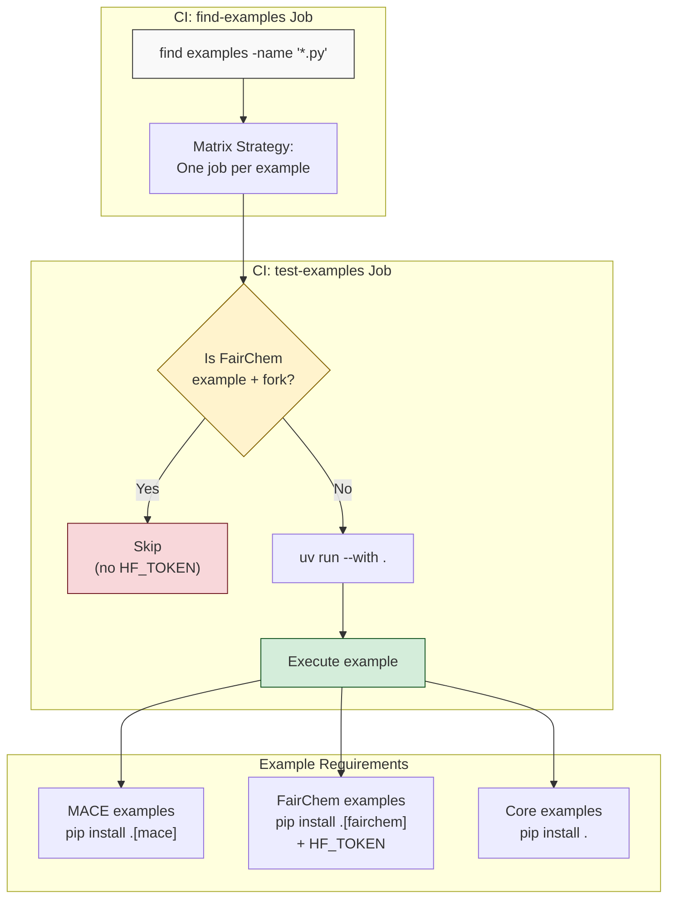
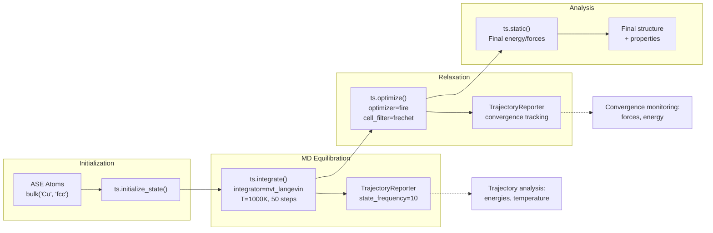
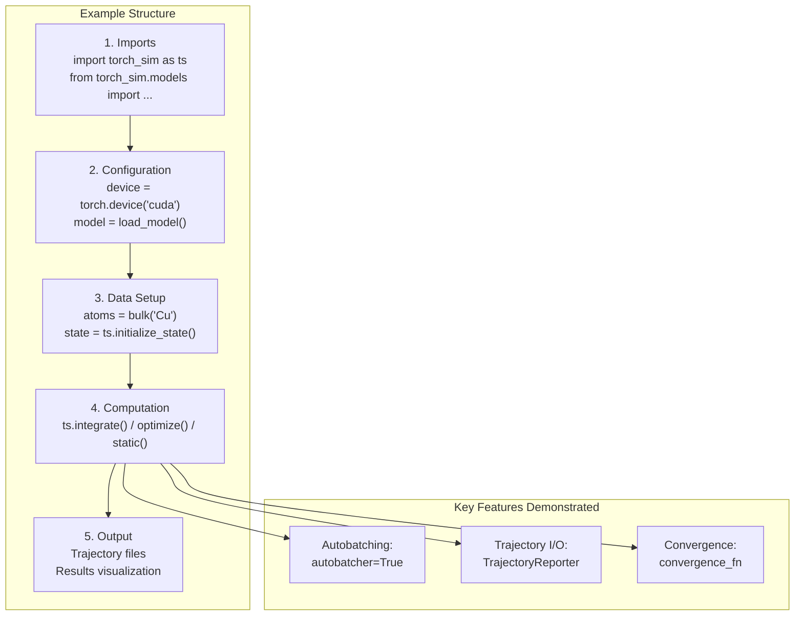
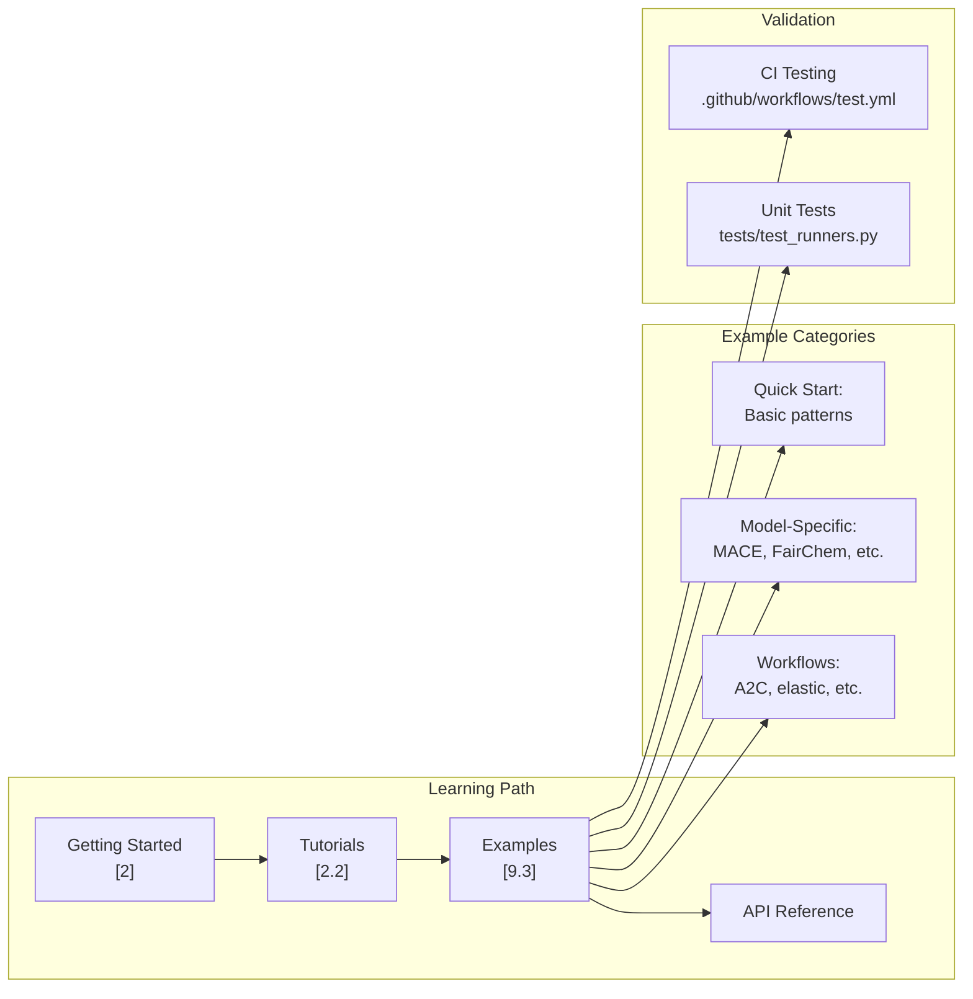

# Example Gallery

<details>
<summary>Relevant source files</summary>

The following files were used as context for generating this wiki page:

- [.github/workflows/test.yml](.github/workflows/test.yml)
- [README.md](README.md)
- [pyproject.toml](pyproject.toml)
- [tests/test_runners.py](tests/test_runners.py)
- [tests/test_trajectory.py](tests/test_trajectory.py)
- [torch_sim/runners.py](torch_sim/runners.py)
- [torch_sim/trajectory.py](torch_sim/trajectory.py)

</details>


This page documents the complete working examples in the `examples/` directory that demonstrate torch-sim's capabilities. Each example is self-contained, tested in CI, and showcases specific features or workflows.

For detailed tutorials on core concepts, see [Quick Start Tutorial](#2.2). For workflow-specific documentation, see [Structure Generation](#9.1) and [Amorphous-to-Crystalline (A2C) Workflow](#9.2).

---

## Overview

The torch-sim repository includes a collection of executable examples that demonstrate:

- **Core API usage**: `ts.integrate()`, `ts.optimize()`, and `ts.static()`
- **Model integration**: Using different MLIP backends (MACE, FairChem, ORB, etc.)
- **Advanced features**: Autobatching, trajectory I/O, custom workflows
- **Best practices**: Memory management, batching strategies, convergence criteria

All examples are automatically discovered and tested in CI to ensure they remain functional as the codebase evolves.

**Sources:** [.github/workflows/test.yml:146-188](), [README.md:122-167]()

---

## Example Categories

### Quick Start Examples

These examples demonstrate the most common use cases and serve as entry points for new users.

| Example | Description | Key Features |
|---------|-------------|--------------|
| Batched MD | Run multiple MD simulations simultaneously | `ts.integrate()`, batching, trajectory I/O |
| Batched Relaxation | Relax multiple structures with FIRE optimizer | `ts.optimize()`, cell filters, autobatching |
| Single-Point Calculations | Compute energies and forces for structures | `ts.static()`, model evaluation |

**Example: Batched MD Simulation**

The README demonstrates running 50 identical Cu systems simultaneously:

```python
import torch
import torch_sim as ts

# Load model (MACE-MP or other MLIP)
final_state = ts.integrate(
    system=many_cu_atoms,  # List of ASE Atoms
    model=mace_model,
    n_steps=50,
    timestep=0.002,
    temperature=1000,
    integrator=ts.Integrator.nvt_langevin,
    trajectory_reporter=dict(filenames=trajectory_files, state_frequency=10),
)
```

This pattern is tested in [tests/test_runners.py:877-915]() as `test_readme_example`.

**Sources:** [README.md:29-90](), [tests/test_runners.py:877-915]()

---

### Model-Specific Examples

Examples demonstrating integration with different MLIP backends.

| Model Backend | Example Path | Required Extra | Key Features |
|---------------|--------------|----------------|--------------|
| MACE | `examples/*mace*` | `[mace]` | CuEq acceleration, charge/spin |
| FairChem | `examples/*fairchem*` | `[fairchem]` | Task types (omat, omol, oc20) |
| ORB | `examples/*orb*` | `[orb]` | ORB model usage |
| SevenNet | `examples/*sevenn*` | `[sevenn]` | SevenNet integration |
| MatterSim | `examples/*mattersim*` | `[mattersim]` | MatterSim models |
| Classical | `examples/*lj*` or `*morse*` | None | Built-in potentials |

**CI Testing Strategy**

Examples requiring optional dependencies are isolated in CI to avoid conflicts:



**Sources:** [.github/workflows/test.yml:146-188](), [pyproject.toml:39-75]()

---

### Workflow Examples

Complete workflows combining multiple torch-sim features.

#### Structure Generation and Relaxation

Typical workflow for generating and optimizing structures:



This pattern appears in [tests/test_runners.py:877-915]() and demonstrates the typical pipeline.

**Sources:** [tests/test_runners.py:877-915](), [README.md:75-90]()

---

## Running Examples

### Basic Execution

Examples are designed to run with minimal setup using `uv`:

```bash
# Run an example directly
uv run --with . examples/basic_md.py

# Run with specific model dependency
uv run --with .[mace] examples/mace_example.py

# Run with all dependencies (for testing)
uv run --with .[test] examples/complete_workflow.py
```

**Sources:** [.github/workflows/test.yml:179-187]()

### Environment Requirements

Some examples require additional configuration:

| Requirement | Purpose | Examples |
|-------------|---------|----------|
| `HF_TOKEN` | Access FairChem models from Hugging Face | FairChem examples |
| GPU | Demonstrate GPU acceleration | Large-scale batching examples |
| I/O extras | ASE/Pymatgen interop | Structure conversion examples |

**Example: FairChem with Hugging Face Token**

```bash
# Set token for FairChem examples
export HF_TOKEN=<your_token>
uv run --with .[fairchem] examples/fairchem_example.py
```

**Sources:** [.github/workflows/test.yml:181-186](), [pyproject.toml:49-58]()

---

## Example Testing Infrastructure

### Automatic Discovery

The CI system automatically discovers and tests all examples:

```yaml
# From .github/workflows/test.yml
- name: Find example scripts
  run: |
    EXAMPLES=$(find examples -name "*.py" | jq -R -s -c 'split("\n")[:-1]')
    echo "examples=$EXAMPLES" >> $GITHUB_OUTPUT
```

This ensures:
- **No manual maintenance**: New examples are automatically included
- **Comprehensive coverage**: All `.py` files in `examples/` are tested
- **Isolation**: Each example runs in a separate job to catch dependency issues

**Sources:** [.github/workflows/test.yml:154-158]()

### Test Validation

Examples are validated by:

1. **Execution**: The example must run without errors
2. **Output**: Any output files (trajectories, plots) must be created
3. **Results**: Numerical results must be reasonable (tested in specific cases)

The `test_readme_example` in [tests/test_runners.py:877-915]() demonstrates validation:

```python
def test_readme_example(lj_model: LennardJonesModel, tmp_path: Path) -> None:
    # Run the README example
    final_state = ts.integrate(
        system=many_cu_atoms,
        model=lj_model,
        n_steps=50,
        timestep=0.002,
        temperature=1000,
        integrator=ts.Integrator.nvt_langevin,
        trajectory_reporter=dict(filenames=trajectory_files, state_frequency=10),
    )
    
    # Validate results
    assert len(final_energies) == len(trajectory_files)
    assert relaxed_state.energy.shape == (final_state.n_systems,)
```

**Sources:** [tests/test_runners.py:877-915]()

---

## Example Structure and Best Practices

### Recommended Example Template

Well-structured examples follow this pattern:



### Common Patterns

**Pattern 1: Single System**
```python
# Minimal example for one structure
final_state = ts.optimize(
    system=atoms,  # Single ASE Atoms
    model=model,
    optimizer=ts.Optimizer.fire,
)
```

**Pattern 2: Multiple Systems**
```python
# Batched processing
final_states = ts.integrate(
    system=[atoms1, atoms2, atoms3],  # List of structures
    model=model,
    integrator=ts.Integrator.nvt_langevin,
    autobatcher=True,  # Automatic memory management
    trajectory_reporter=dict(filenames=traj_files),
)
```

**Pattern 3: Trajectory Analysis**
```python
# Post-processing trajectory data
with ts.TorchSimTrajectory(filename) as traj:
    energies = traj.get_array("potential_energy")
    final_structure = traj.get_structure(frame=-1)
```

**Sources:** [README.md:36-90](), [tests/test_runners.py:18-53]()

---

## Integration with Documentation

Examples complement the documentation ecosystem:



**Sources:** [README.md:122-167](), [.github/workflows/test.yml:146-205]()

---

## Key Components Reference

### Core Functions Used in Examples

| Function | Module | Purpose in Examples |
|----------|--------|-------------------|
| `ts.initialize_state()` | `torch_sim.runners` | Convert ASE/Pymatgen to SimState |
| `ts.integrate()` | `torch_sim.runners` | Molecular dynamics simulations |
| `ts.optimize()` | `torch_sim.runners` | Structure relaxation |
| `ts.static()` | `torch_sim.runners` | Single-point calculations |
| `TrajectoryReporter` | `torch_sim.trajectory` | Save simulation data to HDF5 |
| `TorchSimTrajectory` | `torch_sim.trajectory` | Read trajectory files |

### Model Classes Featured

| Class | Module | Installation |
|-------|--------|--------------|
| `MaceModel` | `torch_sim.models.mace` | `pip install .[mace]` |
| `FairChemModel` | `torch_sim.models.fairchem` | `pip install .[fairchem]` |
| `OrbModel` | `torch_sim.models.orb` | `pip install .[orb]` |
| `LennardJonesModel` | `torch_sim.models.lennard_jones` | Built-in |
| `MorseModel` | `torch_sim.models.morse` | Built-in |

**Sources:** [torch_sim/runners.py:1-854](), [pyproject.toml:39-75]()

---

## Summary

The example gallery provides:

- **Entry points** for new users through quick start examples
- **Model diversity** demonstrating 8+ MLIP integrations
- **Workflow patterns** for common simulation tasks
- **Quality assurance** through automated CI testing
- **Best practices** for batching, memory management, and I/O

All examples are self-contained, tested in CI ([.github/workflows/test.yml:146-188]()), and designed to run with minimal setup using the `uv run --with .` command pattern.

**Sources:** [.github/workflows/test.yml:146-205](), [README.md:27-167](), [tests/test_runners.py:877-915](), [pyproject.toml:1-231]()

---