# Testing and Validation

<details>
<summary>Relevant source files</summary>

The following files were used as context for generating this wiki page:

- [tests/conftest.py](tests/conftest.py)
- [tests/models/test_lennard_jones.py](tests/models/test_lennard_jones.py)
- [tests/models/test_mace.py](tests/models/test_mace.py)
- [tests/models/test_orb.py](tests/models/test_orb.py)
- [tests/models/test_sevennet.py](tests/models/test_sevennet.py)
- [tests/test_elastic.py](tests/test_elastic.py)
- [torch_sim/io.py](torch_sim/io.py)
- [torch_sim/models/orb.py](torch_sim/models/orb.py)

</details>


This document describes the testing infrastructure and validation strategies used in torch-sim to ensure correctness, reliability, and consistency with established atomistic simulation packages. The framework emphasizes three core validation approaches: comparison with ASE calculators, physics-based property testing, and reproducibility verification.

For information about the CI/CD pipeline and workflows, see [Continuous Integration](#11.2). For model-specific implementation details, see [Model Ecosystem Overview](#6.1).

---

## Testing Infrastructure Overview

The torch-sim testing framework is organized around three key components: reusable fixtures, parameterized test factories, and multi-level validation strategies. Tests are structured to validate individual components (unit tests), integration between systems, model implementations, and complete workflows.

### Test Organization Structure

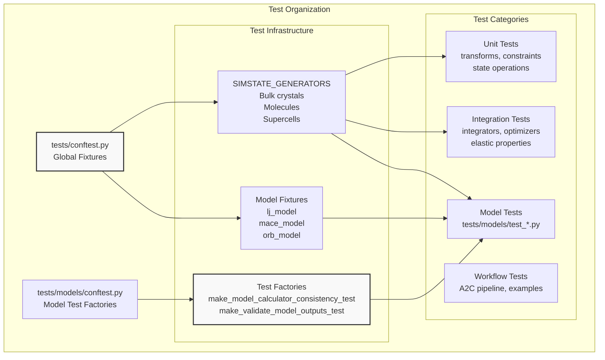

**Sources:** [tests/conftest.py:1-151](), [tests/models/test_mace.py:1-176](), [tests/models/test_orb.py:1-82]()

---

## Test Fixtures and Generators

The testing framework provides a comprehensive set of fixtures to create consistent, reproducible test cases across different structural types and chemical systems.

### SIMSTATE_GENERATORS Registry

The `SIMSTATE_GENERATORS` dictionary in the testing module provides factory functions for creating diverse `SimState` objects. These generators are automatically converted to pytest fixtures in `conftest.py`:

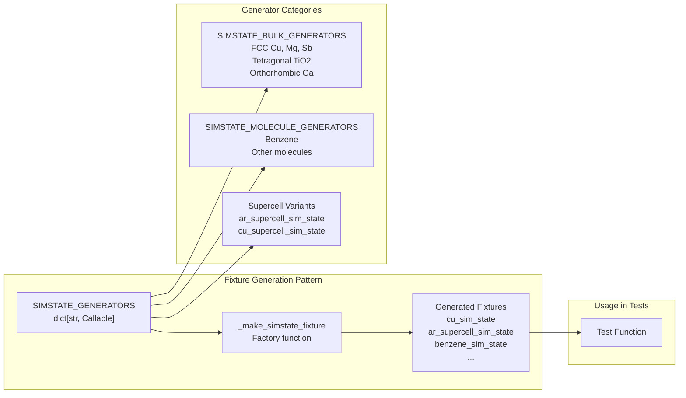

**Sources:** [tests/conftest.py:13-33]()

The fixture generation pattern at [tests/conftest.py:20-32]() programmatically creates pytest fixtures from the generator registry:

```python
def _make_simstate_fixture(name: str) -> Callable[[], ts.SimState]:
    """Create a pytest fixture for a sim_state generator."""
    @pytest.fixture(name=name)
    def _fixture() -> ts.SimState:
        return SIMSTATE_GENERATORS[name](DEVICE, DTYPE)
    return _fixture

# Programmatically generate fixtures for all sim_state generators
for _name in SIMSTATE_GENERATORS:
    globals()[_name] = _make_simstate_fixture(_name)
```

**Sources:** [tests/conftest.py:20-32]()

### Structure Fixtures

Standard structure fixtures provide common test cases using ASE, Pymatgen, and Phonopy formats:

| Fixture Name | Chemical System | Structure Type | Format | Line Reference |
|--------------|-----------------|----------------|--------|----------------|
| `ar_atoms` | Argon | FCC crystal | ASE Atoms | [tests/conftest.py:49-52]() |
| `fe_atoms` | Iron | FCC crystal | ASE Atoms | [tests/conftest.py:55-58]() |
| `si_atoms` | Silicon | Diamond | ASE Atoms | [tests/conftest.py:61-64]() |
| `benzene_atoms` | C₆H₆ | Molecule | ASE Atoms | [tests/conftest.py:67-70]() |
| `si_structure` | Silicon | Diamond | Pymatgen Structure | [tests/conftest.py:73-88]() |
| `si_phonopy_atoms` | Silicon | Diamond | PhonopyAtoms | [tests/conftest.py:91-111]() |

**Sources:** [tests/conftest.py:49-111]()

### Model Fixtures

Model fixtures instantiate pre-configured force fields for testing. The pattern separates model creation from calculator creation for comparison tests:

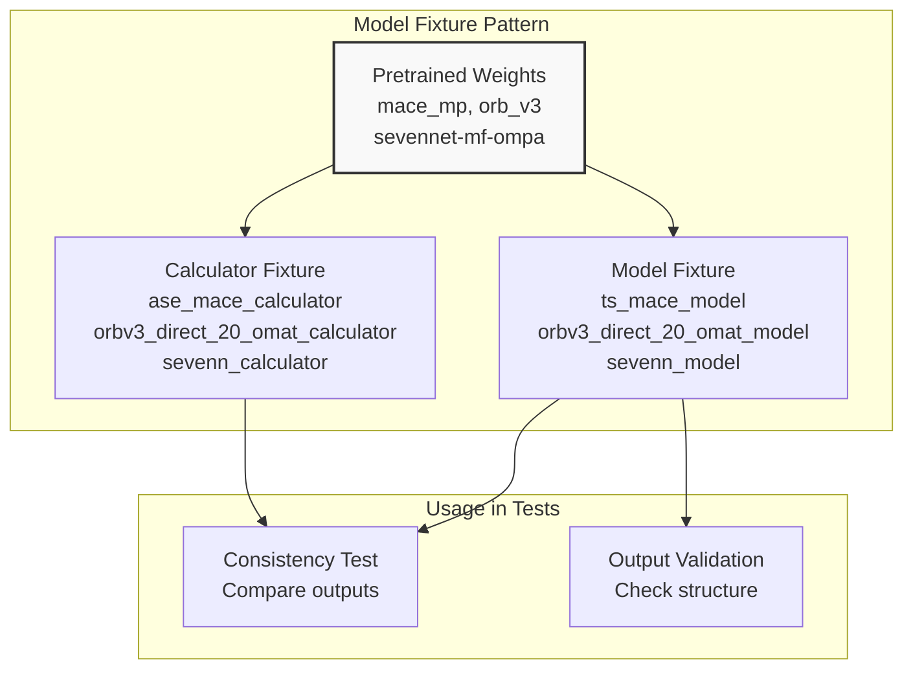

**Example: MACE model fixture pattern** from [tests/models/test_mace.py:35-56]():

```python
raw_mace_mp = mace_mp(model=MaceUrls.mace_mp_small, return_raw_model=True)

@pytest.fixture
def ase_mace_calculator() -> MACECalculator:
    dtype = str(DTYPE).removeprefix("torch.")
    return mace_mp(
        model=MaceUrls.mace_mp_small, device="cpu", default_dtype=dtype, dispersion=False
    )

@pytest.fixture
def ts_mace_model() -> MaceModel:
    return MaceModel(
        model=raw_mace_mp,
        device=DEVICE,
        dtype=DTYPE,
        compute_forces=True,
        compute_stress=True,
    )
```

**Sources:** [tests/models/test_mace.py:35-56](), [tests/models/test_orb.py:23-45](), [tests/models/test_sevennet.py:33-53]()

### Batched State Fixtures

Batched fixtures test multi-system processing capabilities:

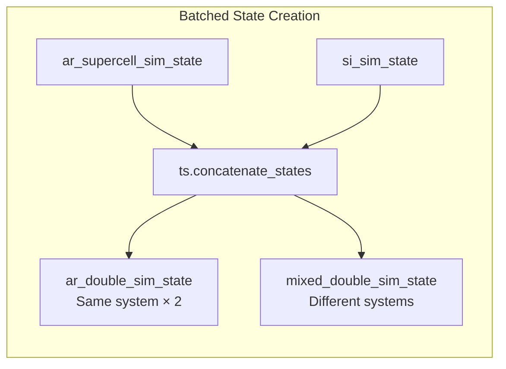

**Sources:** [tests/conftest.py:124-150]()

---

## Model Testing Framework

The model testing framework uses factory patterns to generate consistent, parameterized tests across different MLIP backends while isolating incompatible dependencies.

### Test Factory Pattern

Test factories generate parameterized tests that validate models against multiple structural configurations. Two primary factory functions are provided in `tests/models/conftest.py`:

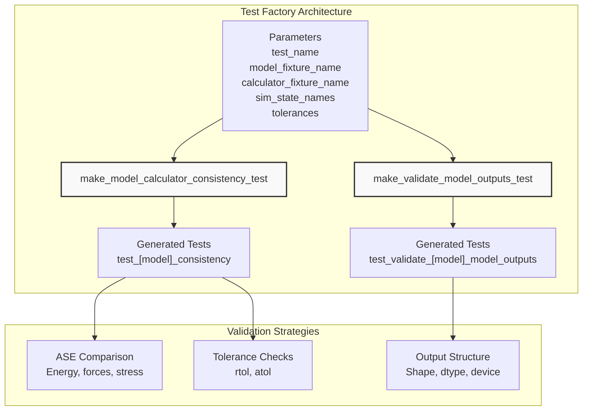

**Sources:** Referenced in [tests/models/test_mace.py:59-65](), [tests/models/test_orb.py:57-73]()

### Consistency Testing with ASE

Consistency tests compare torch-sim model outputs with ASE calculator outputs to verify correctness. The test pattern validates:

1. **Energy agreement**: Per-system total energies
2. **Force agreement**: Per-atom forces (3D vectors)
3. **Stress agreement**: Per-system stress tensors (3×3)
4. **Tolerance specifications**: Configurable `rtol` and `atol` per model

**Example: ORB model consistency test** from [tests/models/test_orb.py:57-73]():

```python
test_orb_conservative_consistency = make_model_calculator_consistency_test(
    test_name="orbv3_conservative_inf_omat",
    model_fixture_name="orbv3_conservative_inf_omat_model",
    calculator_fixture_name="orbv3_conservative_inf_omat_calculator",
    sim_state_names=tuple(SIMSTATE_GENERATORS.keys()),
    energy_rtol=5e-5,
    energy_atol=5e-5,
)
```

The factory generates parameterized tests that:
- Loop over all specified `sim_state_names`
- Convert `SimState` to ASE `Atoms` via [torch_sim/io.py:35-102]()
- Compute outputs using both model and calculator
- Assert numerical agreement within tolerances

**Sources:** [tests/models/test_orb.py:57-73](), [tests/models/test_mace.py:59-65](), [tests/models/test_sevennet.py:66-72]()

### Output Validation Tests

Output validation tests verify that models return properly structured dictionaries with correct tensor shapes and properties:

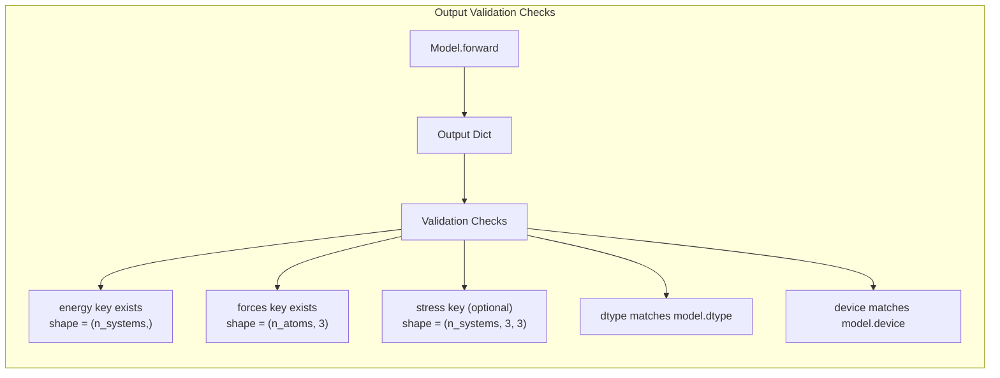

**Sources:** [tests/models/test_mace.py:104-106](), [tests/models/test_orb.py:75-81]()

### Model-Specific Test Examples

Each MLIP integration includes comprehensive tests demonstrating the complete testing pattern:

#### MACE Model Tests

**Key test coverage** from [tests/models/test_mace.py:1-176]():

| Test Name | Purpose | Line Reference |
|-----------|---------|----------------|
| `test_mace_consistency` | Compare with ASE MACECalculator | [tests/models/test_mace.py:59-65]() |
| `test_mace_dtype_working` | Verify float32/float64 support | [tests/models/test_mace.py:68-78]() |
| `test_mace_off_consistency` | MACE-OFF molecular model | [tests/models/test_mace.py:96-102]() |
| `test_mace_charge_spin` | Charge/spin handling for molecules | [tests/models/test_mace.py:124-176]() |

**Charge and spin testing** demonstrates molecular property handling at [tests/models/test_mace.py:124-176]():

```python
@pytest.mark.parametrize(
    ("charge", "spin"),
    [
        (0.0, 0.0),  # Neutral, no spin
        (1.0, 1.0),  # +1 charge, spin=1 (doublet)
        (-1.0, 0.0), # -1 charge, no spin (singlet)
        (0.0, 2.0),  # Neutral, spin=2 (triplet)
    ],
)
def test_mace_charge_spin(benzene_sim_state: ts.SimState, charge: float, spin: float) -> None:
    # Test verifies charge/spin extraction and forward pass
```

**Sources:** [tests/models/test_mace.py:1-176]()

#### ORB Model Tests

**Key test coverage** from [tests/models/test_orb.py:1-82]():

- Two pretrained model variants: `orbv3_conservative_inf_omat` and `orbv3_direct_20_omat`
- Consistency tests for both variants
- Output validation tests for both variants
- Custom tolerance settings (`energy_rtol=5e-5`)

**Sources:** [tests/models/test_orb.py:1-82]()

#### SevenNet Model Tests

**Key test coverage** from [tests/models/test_sevennet.py:1-78]():

- Uses modal-specific loading (`modal="mpa"`)
- Tests on bulk structures only (molecular structures excluded due to numerics)
- float32 precision testing

**Sources:** [tests/models/test_sevennet.py:1-78]()

#### Lennard-Jones Classical Potential Tests

Classical potential tests validate analytical implementations and physical properties:

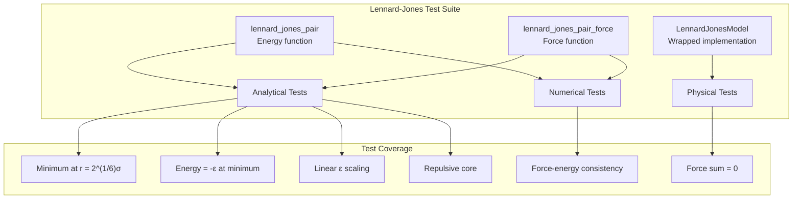

**Key validation tests** from [tests/models/test_lennard_jones.py:1-138]():

| Test Name | Physical Property | Line Reference |
|-----------|-------------------|----------------|
| `test_lennard_jones_pair_minimum` | Well location at r = 2^(1/6)σ | [tests/models/test_lennard_jones.py:17-23]() |
| `test_lennard_jones_pair_energy_at_minimum` | Well depth = -ε | [tests/models/test_lennard_jones.py:26-31]() |
| `test_lennard_jones_pair_epsilon_scaling` | Linear ε dependence | [tests/models/test_lennard_jones.py:34-40]() |
| `test_lennard_jones_force_energy_consistency` | Force = -∇E | [tests/models/test_lennard_jones.py:87-97]() |
| `test_lennard_jones_model_force_conservation` | Σᵢ Fᵢ = 0 | [tests/models/test_lennard_jones.py:119-137]() |

**Sources:** [tests/models/test_lennard_jones.py:1-138]()

---

## Physics Validation

Physics-based validation tests verify that simulations obey fundamental physical principles and produce thermodynamically consistent results. These tests go beyond numerical accuracy to validate conservation laws, symmetry properties, and material properties.

### Elastic Property Calculations

The elastic tensor testing framework validates both the computational approach and the resulting material properties through multi-level checks:

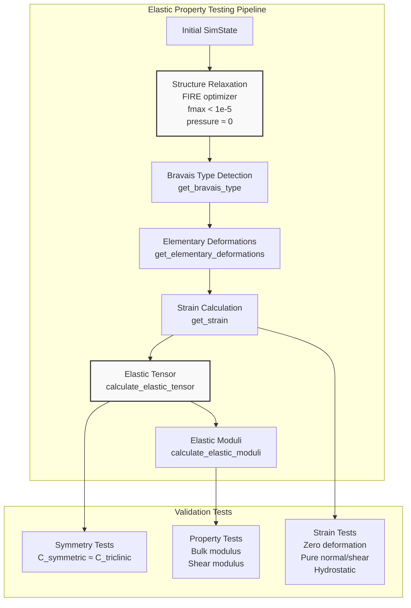

**Sources:** [tests/test_elastic.py:1-412]()

### Strain Tensor Validation

Strain tensor calculations are validated through a comprehensive suite of geometric tests:

**Test coverage** from [tests/test_elastic.py:28-208]():

| Test Name | Physical Scenario | Validation | Line Reference |
|-----------|-------------------|------------|----------------|
| `test_get_strain_zero_deformation` | No deformation | ε = 0 | [tests/test_elastic.py:28-34]() |
| `test_get_strain_pure_normal_strain` | Uniaxial extension | εᵢᵢ ≠ 0, others = 0 | [tests/test_elastic.py:37-70]() |
| `test_get_strain_pure_shear_strain` | Simple shear | εᵢⱼ = (uᵢⱼ + uⱼᵢ)/2 | [tests/test_elastic.py:73-108]() |
| `test_get_strain_hydrostatic_strain` | Isotropic expansion | εₓₓ = εᵧᵧ = εᵧᵧ | [tests/test_elastic.py:111-143]() |
| `test_get_strain_symmetry_property` | Asymmetric deformation | ε = (u + uᵀ)/2 | [tests/test_elastic.py:146-208]() |

The **symmetric strain tensor calculation** is explicitly validated at [tests/test_elastic.py:84-88]():

```python
# For shear deformation, the displacement gradient u will have:
# u[1, 2] = shear_magnitude, but the symmetric strain is (u + u^T)/2
# So εyz = (u[1,2] + u[2,1])/2 = (shear_magnitude + 0)/2 = shear_magnitude/2
expected_strain[3] = shear_magnitude / 2  # εyz = symmetric shear strain
```

**Sources:** [tests/test_elastic.py:28-208]()

### Crystal Symmetry Testing

Elastic tensors are validated against known symmetries for different Bravais lattice types:

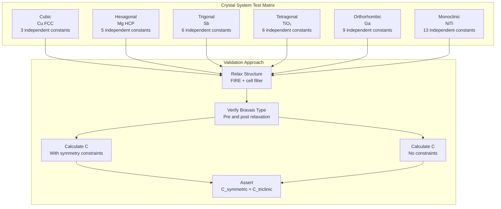

**Parameterized crystal system tests** from [tests/test_elastic.py:271-353]():

```python
@pytest.mark.parametrize(
    ("sim_state_name", "expected_bravais_type", "atol"),
    [
        ("cu_sim_state", BravaisType.cubic, 2e-1),
        ("mg_sim_state", BravaisType.hexagonal, 5e-1),
        ("sb_sim_state", BravaisType.trigonal, 5e-1),
        ("tio2_sim_state", BravaisType.tetragonal, 5e-1),
        ("ga_sim_state", BravaisType.orthorhombic, 5e-1),
        ("niti_sim_state", BravaisType.monoclinic, 5e-1),
    ],
)
def test_elastic_tensor_symmetries(...)
```

**Sources:** [tests/test_elastic.py:271-353]()

### Material Property Validation

The copper elastic properties test validates calculated moduli against expected values:

**Test implementation** from [tests/test_elastic.py:355-411]():

```python
def test_copper_elastic_properties(mace_model: MaceModel, cu_sim_state: ts.SimState):
    # Relax structure
    # Calculate elastic tensor
    # Calculate elastic moduli
    
    expected_bulk_modulus = 144.12  # GPa
    expected_shear_modulus = 43.11  # GPa
    
    assert abs(bulk_modulus - expected_bulk_modulus) < 1e-2 * expected_bulk_modulus
    assert abs(shear_modulus - expected_shear_modulus) < 1e-2 * expected_shear_modulus
```

The test validates both the full elastic tensor (6×6 matrix in Voigt notation) and derived scalar properties.

**Sources:** [tests/test_elastic.py:355-411]()

---

## I/O and Format Conversion Testing

Format conversion functions are critical for interoperability with ASE, Pymatgen, and Phonopy. Testing ensures bidirectional conversions preserve all relevant information:

### Conversion Test Coverage

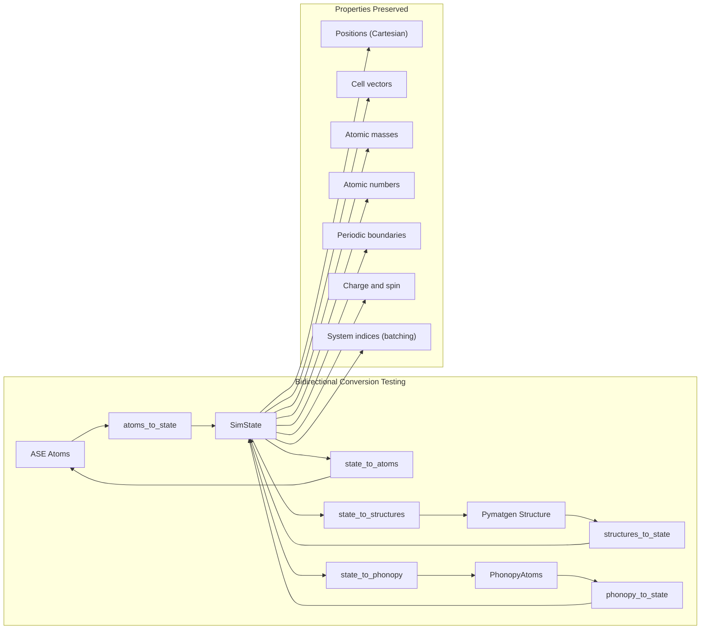

**Key conversion functions** from [torch_sim/io.py:1-487]():

| Function | Direction | Key Features | Line Reference |
|----------|-----------|--------------|----------------|
| `atoms_to_state` | ASE → SimState | Handles single/list, charge/spin | [torch_sim/io.py:243-317]() |
| `state_to_atoms` | SimState → ASE | Preserves charge/spin in info | [torch_sim/io.py:35-102]() |
| `structures_to_state` | Pymatgen → SimState | Validates consistent PBC | [torch_sim/io.py:325-398]() |
| `state_to_structures` | SimState → Pymatgen | Cartesian coordinates | [torch_sim/io.py:110-173]() |
| `phonopy_to_state` | Phonopy → SimState | Assumes PBC=True | [torch_sim/io.py:406-486]() |
| `state_to_phonopy` | SimState → Phonopy | Crystal structures only | [torch_sim/io.py:186-235]() |

**Cell matrix convention**: torch-sim uses column vectors for cell basis, requiring transpose operations during conversion. From [torch_sim/io.py:287-288]():

```python
cell = torch.tensor(  # Transpose cell from ASE convention to TorchSim convention
    np.stack([at.cell.array.T for at in atoms_list]), dtype=dtype, device=device
)
```

**Sources:** [torch_sim/io.py:1-487]()

### Charge and Spin Preservation

Molecular systems with charge and spin states require careful handling during conversions:

**Charge/spin storage** in ASE atoms.info from [torch_sim/io.py:94-98]():

```python
# Preserve charge and spin in atoms.info (as integers for FairChem compatibility)
if charge is not None:
    atoms.info["charge"] = int(charge[sys_idx].item())
if spin is not None:
    atoms.info["spin"] = int(spin[sys_idx].item())
```

**Extraction during conversion** at [torch_sim/io.py:301-306]():

```python
charge = torch.tensor(
    [at.info.get("charge", 0.0) for at in atoms_list], dtype=dtype, device=device
)
spin = torch.tensor(
    [at.info.get("spin", 0.0) for at in atoms_list], dtype=dtype, device=device
)
```

**Sources:** [torch_sim/io.py:94-98](), [torch_sim/io.py:301-306]()

---

## Continuous Integration Strategy

The CI workflow implements a three-tier isolation strategy to handle dependency conflicts while maintaining comprehensive test coverage. For full CI/CD details, see [Continuous Integration](#11.2).

### Test Matrix Architecture

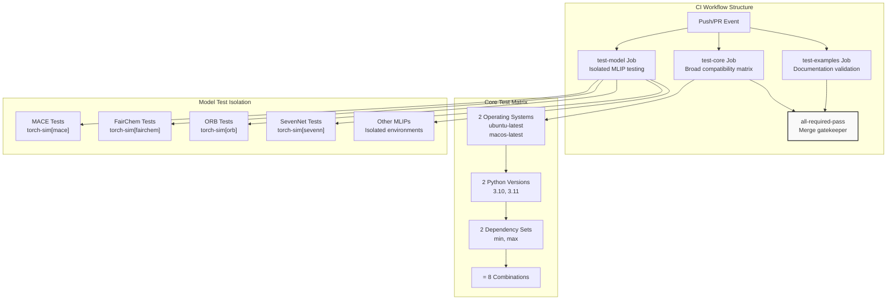

**Key isolation features**:
- Model tests run in separate jobs to avoid `e3nn` version conflicts
- Core tests validate framework without MLIP dependencies
- Examples run dynamically discovered from `examples/` directory

**Sources:** Referenced in architecture diagram "Diagram 5: Testing and Quality Assurance Infrastructure"

---

## Test Execution and Coverage

### Running Tests Locally

Tests can be executed at different granularities:

```bash
# Run all tests
pytest

# Run core tests only (no MLIP models)
pytest tests/ --ignore=tests/models/

# Run specific model tests
pytest tests/models/test_mace.py
pytest tests/models/test_orb.py

# Run with specific markers
pytest -m "not slow"
pytest -k "consistency"

# Run with coverage
pytest --cov=torch_sim --cov-report=html
```

### Skip Patterns

Model tests automatically skip when dependencies are unavailable using conditional imports:

```python
try:
    from orb_models.forcefield import pretrained
    from torch_sim.models.orb import OrbModel
except ImportError:
    pytest.skip(
        f"ORB not installed: {traceback.format_exc()}", 
        allow_module_level=True
    )
```

**Sources:** [tests/models/test_orb.py:13-20](), [tests/models/test_mace.py:16-23](), [tests/models/test_sevennet.py:14-25]()

---

## Best Practices for Adding Tests

When contributing new functionality, follow these testing patterns:

### For New Models

1. **Create model fixtures** in `tests/models/test_[model].py`:
   - Model wrapper fixture
   - ASE calculator fixture (if available)
   - Use pretrained weights when possible

2. **Generate consistency tests** using factories:
   ```python
   test_[model]_consistency = make_model_calculator_consistency_test(
       test_name="[model]",
       model_fixture_name="[model]_model",
       calculator_fixture_name="[model]_calculator",
       sim_state_names=tuple(SIMSTATE_GENERATORS.keys()),
   )
   ```

3. **Add output validation**:
   ```python
   test_validate_[model]_model_outputs = make_validate_model_outputs_test(
       model_fixture_name="[model]_model",
   )
   ```

4. **Update CI configuration** to isolate incompatible dependencies

### For New Physics Validation

1. **Create analytical test cases** with known solutions
2. **Implement numerical gradient checks** for force-energy consistency
3. **Test conservation laws** (energy, momentum, etc.)
4. **Validate against literature values** for material properties

### For New Transformations

1. **Test identity operations**: f(f⁻¹(x)) = x
2. **Test edge cases**: empty inputs, single atoms, large systems
3. **Test consistency** with ASE/Pymatgen implementations
4. **Test batching behavior** with multi-system inputs

**Sources:** Testing patterns observed throughout [tests/models/test_*.py]() files

---