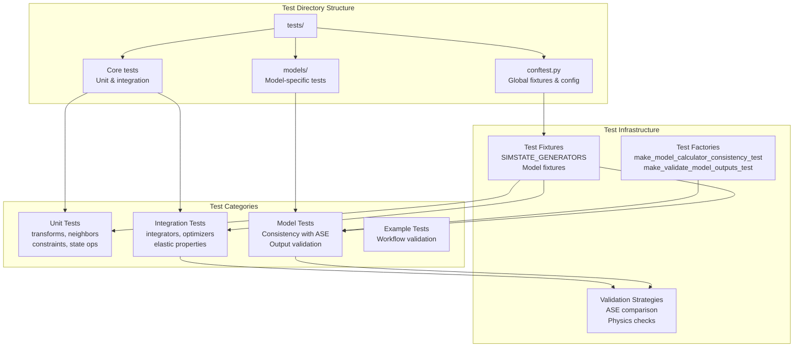
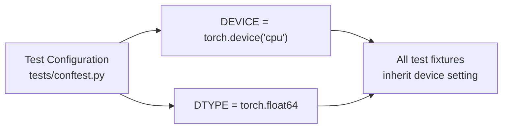
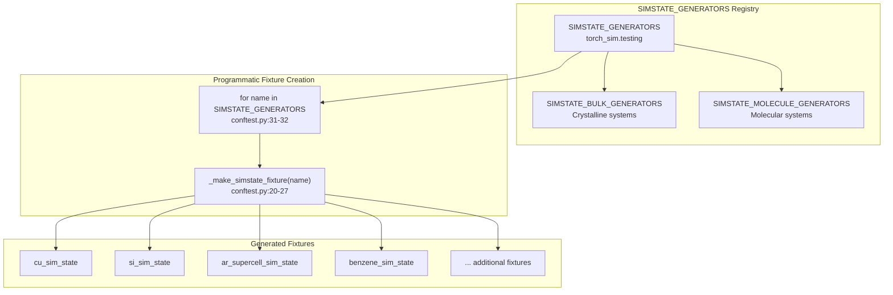
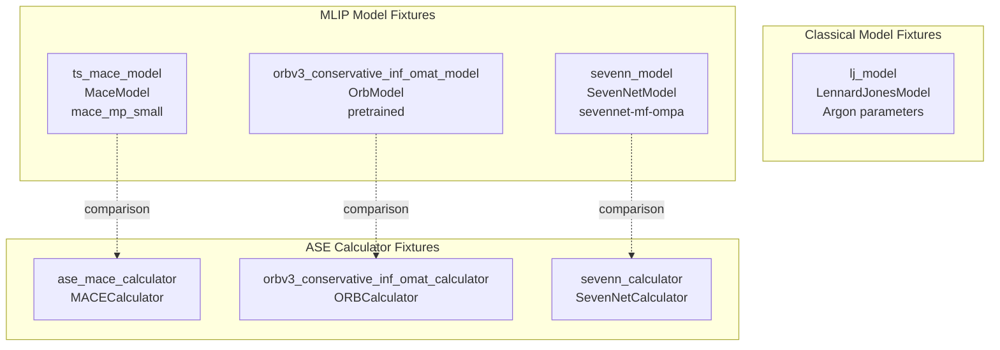
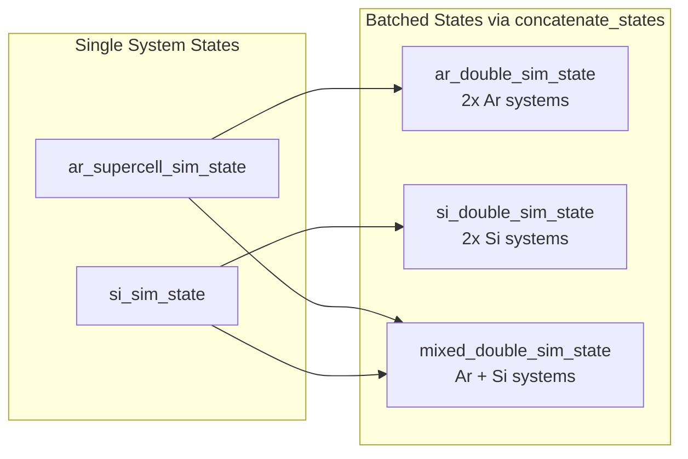
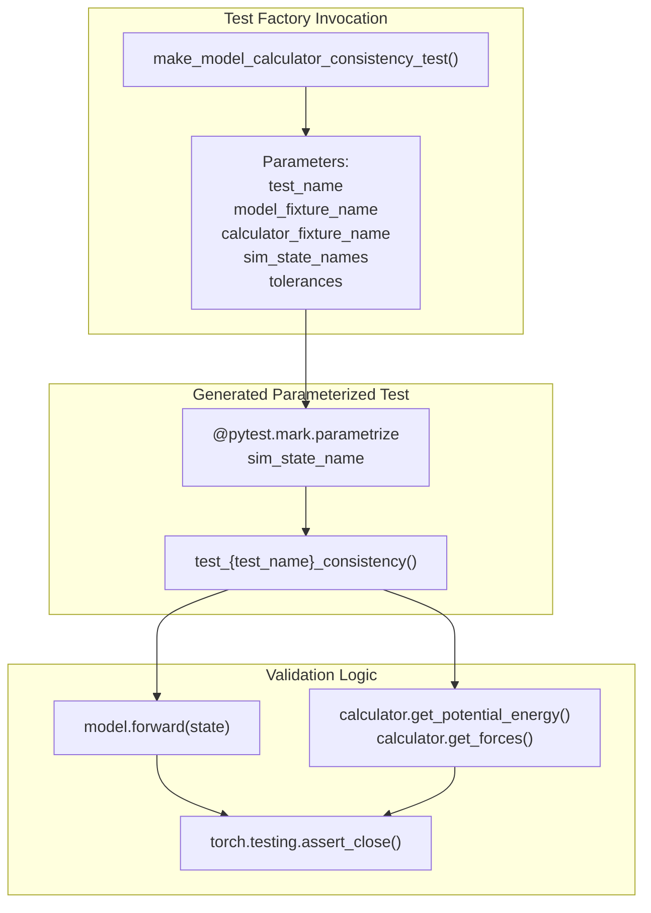
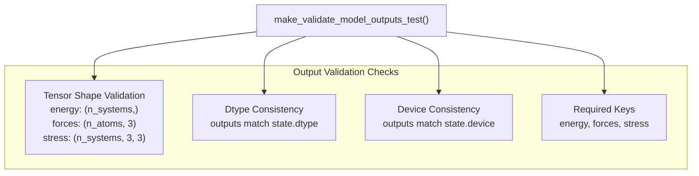
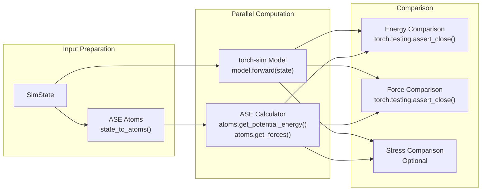
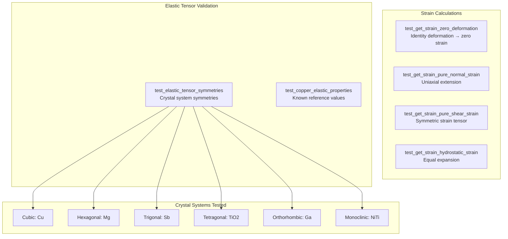
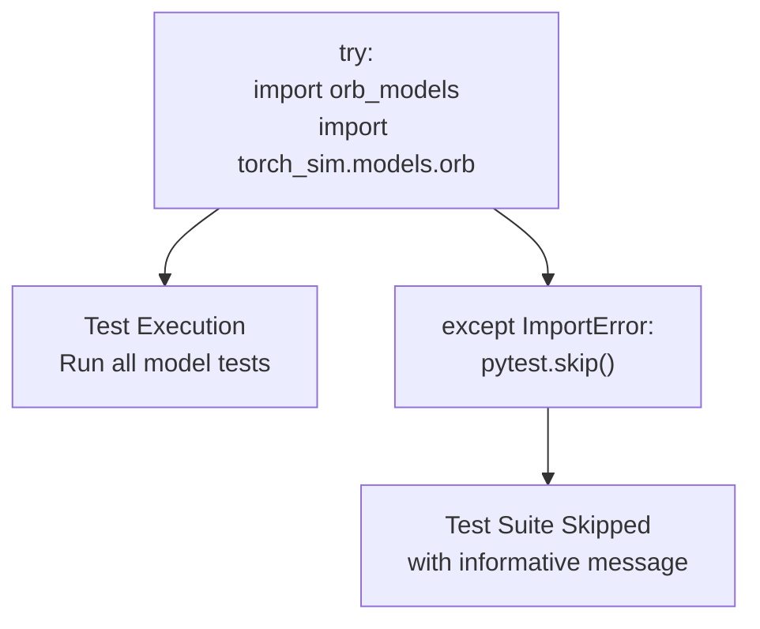

# Testing Framework

<details>
<summary>Relevant source files</summary>

The following files were used as context for generating this wiki page:

- [tests/conftest.py](tests/conftest.py)
- [tests/models/test_lennard_jones.py](tests/models/test_lennard_jones.py)
- [tests/models/test_mace.py](tests/models/test_mace.py)
- [tests/models/test_orb.py](tests/models/test_orb.py)
- [tests/models/test_sevennet.py](tests/models/test_sevennet.py)
- [tests/test_elastic.py](tests/test_elastic.py)
- [torch_sim/io.py](torch_sim/io.py)
- [torch_sim/models/orb.py](torch_sim/models/orb.py)

</details>


## Purpose and Scope

This page documents the testing infrastructure in torch-sim, including test organization, fixtures, generators, and factory patterns. The testing framework provides a comprehensive suite of unit tests, integration tests, and validation strategies to ensure correctness and consistency across the codebase.

For information about physics-based validation (energy conservation, temperature control, etc.), see [Physics Validation](#10.2). For CI/CD workflows and test execution strategies, see [Continuous Integration](#11.2).

---

## Test Organization

The testing infrastructure is organized into several categories, each with specific responsibilities:



**Sources:** [tests/conftest.py:1-151](), [tests/models/test_mace.py:1-176](), [tests/models/test_orb.py:1-82]()

### Test File Organization

| Test Category | Location | Purpose |
|--------------|----------|---------|
| Core tests | `tests/test_*.py` | Unit and integration tests for core functionality |
| Model tests | `tests/models/test_*.py` | Model-specific consistency and validation tests |
| Configuration | `tests/conftest.py` | Global fixtures and test configuration |
| Elastic properties | `tests/test_elastic.py` | Material property calculations |

---

## Test Configuration

The global test configuration is defined in `tests/conftest.py`, which establishes device and dtype settings for all tests:



**Key Configuration Constants:**

- `DEVICE = torch.device("cpu")` - All tests run on CPU for consistency
- `DTYPE = torch.float64` - Default dtype for high-precision testing

**Sources:** [tests/conftest.py:16-17]()

---

## Test Fixtures

The testing framework uses pytest fixtures extensively to provide reusable test data and model instances. Fixtures are categorized into several types:

### SimState Generators

The `SIMSTATE_GENERATORS` dictionary from `torch_sim.testing` provides a collection of pre-configured atomic structures for testing:



**Sources:** [tests/conftest.py:20-32](), [torch_sim/testing.py]()

### Programmatic Fixture Generation

The test suite automatically generates pytest fixtures for all entries in `SIMSTATE_GENERATORS`:

**Implementation Pattern:**

```python
def _make_simstate_fixture(name: str) -> Callable[[], ts.SimState]:
    """Create a pytest fixture for a sim_state generator."""
    
    @pytest.fixture(name=name)
    def _fixture() -> ts.SimState:
        return SIMSTATE_GENERATORS[name](DEVICE, DTYPE)
    
    return _fixture

# Programmatically generate fixtures for all sim_state generators
for _name in SIMSTATE_GENERATORS:
    globals()[_name] = _make_simstate_fixture(_name)
```

This pattern enables:
- Automatic fixture creation from generator registry
- Consistent device and dtype across all fixtures
- Easy addition of new test structures

**Sources:** [tests/conftest.py:20-32]()

### Model Fixtures

Model fixtures provide pre-configured force field instances for testing:



**Sources:** [tests/conftest.py:35-46](), [tests/models/test_mace.py:40-56](), [tests/models/test_orb.py:23-54](), [tests/models/test_sevennet.py:33-53]()

**Classical Model Fixture Example:**

The `lj_model` fixture provides a Lennard-Jones model configured for Argon:

```python
@pytest.fixture
def lj_model() -> LennardJonesModel:
    """Create a Lennard-Jones model with reasonable parameters for Ar."""
    return LennardJonesModel(
        sigma=3.405,
        epsilon=0.0104,
        device=DEVICE,
        dtype=DTYPE,
        compute_forces=True,
        compute_stress=True,
        cutoff=2.5 * 3.405,
    )
```

**Sources:** [tests/conftest.py:35-46]()

### Structure Fixtures

Structure fixtures provide atomic configurations in various formats:

| Fixture Name | Type | Description |
|-------------|------|-------------|
| `ar_atoms` | `Atoms` | FCC Argon crystal (ASE) |
| `fe_atoms` | `Atoms` | FCC Iron crystal (ASE) |
| `si_atoms` | `Atoms` | Diamond Silicon (ASE) |
| `benzene_atoms` | `Atoms` | Benzene molecule (ASE) |
| `si_structure` | `Structure` | Silicon (Pymatgen) |
| `si_phonopy_atoms` | `PhonopyAtoms` | Silicon (Phonopy) |

**Sources:** [tests/conftest.py:49-111]()

### Batched State Fixtures

Batched state fixtures test multi-system capabilities:



**Implementation Example:**

```python
@pytest.fixture
def ar_double_sim_state(ar_supercell_sim_state: ts.SimState) -> ts.SimState:
    """Create a batched state from ar_fcc_sim_state."""
    return ts.concatenate_states(
        [ar_supercell_sim_state, ar_supercell_sim_state],
        device=ar_supercell_sim_state.device,
    )
```

**Sources:** [tests/conftest.py:124-150]()

---

## Test Factory Patterns

Test factories generate parameterized tests that execute the same validation logic across multiple models and structures. This pattern eliminates code duplication and ensures consistent testing across the model ecosystem.

### make_model_calculator_consistency_test

This factory creates tests that compare torch-sim model outputs with reference ASE calculator implementations:



**Usage Example from ORB Tests:**

```python
test_orb_conservative_consistency = make_model_calculator_consistency_test(
    test_name="orbv3_conservative_inf_omat",
    model_fixture_name="orbv3_conservative_inf_omat_model",
    calculator_fixture_name="orbv3_conservative_inf_omat_calculator",
    sim_state_names=tuple(SIMSTATE_GENERATORS.keys()),
    energy_rtol=5e-5,
    energy_atol=5e-5,
)
```

This single invocation generates a parameterized test that:
1. Tests the ORB model against the ORB calculator
2. Runs across all structures in `SIMSTATE_GENERATORS`
3. Validates energy and forces with specified tolerances

**Sources:** [tests/models/test_orb.py:57-73](), [tests/models/conftest.py]()

### make_validate_model_outputs_test

This factory creates tests that validate model output structure and properties:



**Usage Example:**

```python
test_validate_conservative_model_outputs = make_validate_model_outputs_test(
    model_fixture_name="orbv3_conservative_inf_omat_model",
)
```

**Sources:** [tests/models/test_orb.py:75-81](), [tests/models/test_mace.py:104-106]()

### Consistency Test Implementation

The consistency test pattern compares torch-sim model outputs with ASE calculator outputs:

| Property | torch-sim Source | ASE Calculator Source | Comparison |
|----------|-----------------|----------------------|------------|
| Energy | `model.forward(state)["energy"]` | `calculator.get_potential_energy()` | `torch.testing.assert_close()` with rtol/atol |
| Forces | `model.forward(state)["forces"]` | `calculator.get_forces()` | `torch.testing.assert_close()` with rtol/atol |
| Stress | `model.forward(state)["stress"]` | `calculator.get_stress()` | Optional, model-dependent |

**Sources:** [tests/models/conftest.py]()

---

## Test Execution Patterns

### Parameterized Testing

Parameterized tests execute the same validation logic across multiple inputs:

**MACE Model Testing Example:**

```python
@pytest.mark.parametrize("dtype", [torch.float32, torch.float64])
def test_mace_dtype_working(si_atoms: Atoms, dtype: torch.dtype) -> None:
    model = MaceModel(
        model=raw_mace_mp,
        device=DEVICE,
        dtype=dtype,
        compute_forces=True,
    )
    state = ts.io.atoms_to_state([si_atoms], DEVICE, dtype)
    model.forward(state)
```

This pattern tests MACE model functionality with both float32 and float64 dtypes.

**Sources:** [tests/models/test_mace.py:68-78]()

### Charge and Spin Testing

Models supporting molecular properties are tested with various charge/spin configurations:

**Charge/Spin Test Matrix:**

| Test Case | Charge | Spin | System State |
|-----------|--------|------|-------------|
| Neutral singlet | 0.0 | 0.0 | Ground state |
| Cation doublet | +1.0 | 1.0 | Positively charged |
| Anion singlet | -1.0 | 0.0 | Negatively charged |
| Neutral triplet | 0.0 | 2.0 | Excited state |

**Implementation:**

```python
@pytest.mark.parametrize(
    ("charge", "spin"),
    [
        (0.0, 0.0),  # Neutral, no spin
        (1.0, 1.0),  # +1 charge, spin=1 (doublet)
        (-1.0, 0.0), # -1 charge, no spin (singlet)
        (0.0, 2.0),  # Neutral, spin=2 (triplet)
    ],
)
def test_mace_charge_spin(
    benzene_sim_state: ts.SimState, charge: float, spin: float
) -> None:
    # Test implementation...
```

**Sources:** [tests/models/test_mace.py:124-176]()

---

## Validation Strategies

### ASE Calculator Comparison

The primary validation strategy compares torch-sim implementations against established ASE calculators:



**Tolerance Configuration:**

Different models require different numerical tolerances based on their implementation precision:

| Model | Energy rtol/atol | Reason |
|-------|-----------------|--------|
| ORB | 5e-5 | Neural network precision |
| MACE | Default (1e-7) | High precision implementation |
| SevenNet | Default | Standard tolerance |

**Sources:** [tests/models/test_orb.py:57-73](), [tests/models/test_mace.py:59-65]()

### Output Structure Validation

Each model's output is validated for correct structure:

**Required Output Properties:**

1. **Energy:**
   - Shape: `(n_systems,)` 
   - Dtype: Must match `state.dtype`
   - Device: Must match `state.device`

2. **Forces (if `compute_forces=True`):**
   - Shape: `(n_atoms, 3)`
   - Dtype: Must match `state.dtype`
   - Device: Must match `state.device`

3. **Stress (if `compute_stress=True`):**
   - Shape: `(n_systems, 3, 3)`
   - Dtype: Must match `state.dtype`
   - Device: Must match `state.device`

**Sources:** [tests/models/conftest.py]()

### Conservation Law Validation

Physical conservation laws are tested for correctness:

**Force Conservation Test:**

```python
def test_lennard_jones_model_force_conservation(
    si_double_sim_state: ts.SimState,
) -> None:
    """LennardJonesModel forces sum to zero (Newton's third law)."""
    model = LennardJonesModel(
        sigma=3.405,
        epsilon=0.0104,
        cutoff=2.5 * 3.405,
        dtype=torch.float64,
        compute_forces=True,
    )
    results = model(si_double_sim_state)
    for sys_idx in range(si_double_sim_state.n_systems):
        mask = si_double_sim_state.system_idx == sys_idx
        assert torch.allclose(
            results["forces"][mask].sum(dim=0),
            torch.zeros(3, dtype=torch.float64),
            atol=1e-10,
        )
```

This validates Newton's third law: forces within each system must sum to zero.

**Sources:** [tests/models/test_lennard_jones.py:119-138]()

---

## Elastic Properties Testing

Elastic property calculations have dedicated tests with multiple validation strategies:



**Sources:** [tests/test_elastic.py:28-411]()

### Strain Tensor Validation

The strain calculation tests verify the symmetric strain tensor computation:

**Mathematical Validation:**

For a deformation gradient `u`, the symmetric strain tensor is:
```
ε = (u + u^T) / 2
```

**Test Implementation:**

```python
def test_get_strain_pure_shear_strain(cu_sim_state: ts.SimState) -> None:
    """Test pure shear strain calculations and verify symmetric strain tensor."""
    shear_magnitude = 0.08
    deformed_state = get_cart_deformed_cell(cu_sim_state, axis=3, size=shear_magnitude)
    calculated_strain = get_strain(deformed_state, cu_sim_state)
    
    # Symmetric strain: εyz = shear_magnitude / 2
    expected_strain = torch.zeros(6)
    expected_strain[3] = shear_magnitude / 2
    
    torch.testing.assert_close(calculated_strain, expected_strain, atol=1e-12, rtol=1e-12)
```

**Sources:** [tests/test_elastic.py:73-109]()

### Crystal Symmetry Testing

Elastic tensors are validated against crystal symmetries:

**Test Matrix:**

| Crystal System | Test Structure | Bravais Type | Tolerance |
|----------------|----------------|--------------|-----------|
| Cubic | Copper (Cu) | `BravaisType.cubic` | 2e-1 GPa |
| Hexagonal | Magnesium (Mg) | `BravaisType.hexagonal` | 5e-1 GPa |
| Trigonal | Antimony (Sb) | `BravaisType.trigonal` | 5e-1 GPa |
| Tetragonal | Rutile (TiO2) | `BravaisType.tetragonal` | 5e-1 GPa |
| Orthorhombic | Gallium (Ga) | `BravaisType.orthorhombic` | 5e-1 GPa |
| Monoclinic | NiTi | `BravaisType.monoclinic` | 5e-1 GPa |

**Validation Strategy:**

1. Relax structure to zero stress/pressure
2. Calculate elastic tensor with full triclinic deformations
3. Calculate elastic tensor with symmetry-constrained deformations
4. Verify both methods produce equivalent results

**Sources:** [tests/test_elastic.py:271-352]()

---

## Import Error Handling

Model tests gracefully handle missing optional dependencies:



**Implementation Pattern:**

```python
try:
    from orb_models.forcefield import pretrained
    from orb_models.forcefield.inference.calculator import ORBCalculator
    from torch_sim.models.orb import OrbModel

except ImportError:
    pytest.skip(
        f"ORB not installed: {traceback.format_exc()}", 
        allow_module_level=True
    )
```

This pattern:
- Skips entire test modules when dependencies are missing
- Provides diagnostic information via traceback
- Allows CI to test only installed models

**Sources:** [tests/models/test_orb.py:13-20](), [tests/models/test_mace.py:16-23](), [tests/models/test_sevennet.py:14-25]()

---

## Summary

The testing framework provides:

1. **Comprehensive Fixtures:** Programmatically generated fixtures for structures, models, and calculators
2. **Test Factories:** Reusable patterns for consistency and validation testing
3. **Multi-Level Validation:** ASE comparison, output structure, and physics-based checks
4. **Flexible Configuration:** Parameterized tests with configurable tolerances
5. **Graceful Degradation:** Proper handling of optional dependencies

This infrastructure ensures consistent, reliable testing across the entire torch-sim codebase while minimizing test code duplication.

---