# Physics Validation

<details>
<summary>Relevant source files</summary>

The following files were used as context for generating this wiki page:

- [tests/test_integrators.py](tests/test_integrators.py)

</details>


## Purpose and Scope

This document describes the physics-based validation infrastructure used to verify the correctness of molecular dynamics integrators and thermostats in torch-sim. Physics validation ensures that integrators correctly implement the fundamental laws of statistical mechanics and thermodynamics, including energy conservation, temperature control, and pressure maintenance.

For information about the general testing framework, fixtures, and test organization, see [Testing Framework](#10.1). For information about the integrators themselves, see sections [NVE Ensemble](#4.2), [NVT Ensemble](#4.3), and [NPT Ensemble](#4.4).

## Overview

Physics validation in torch-sim employs a comprehensive strategy to verify that molecular dynamics simulations obey fundamental physical principles:

- **Energy Conservation**: Verifying that NVE integrators preserve total energy
- **Temperature Control**: Validating that NVT thermostats maintain target temperatures
- **Pressure Control**: Ensuring NPT barostats maintain target pressures
- **Invariant Conservation**: Checking that extended system variables remain stable
- **Reproducibility**: Confirming deterministic behavior with seeded random number generation
- **Batching Consistency**: Verifying identical results between single and batched simulations

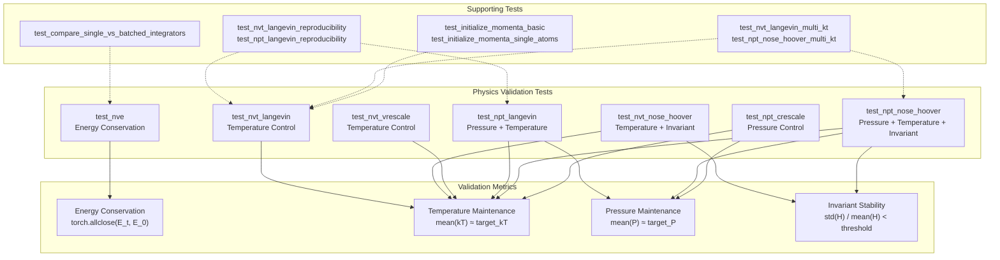

**Sources:** [tests/test_integrators.py:1-1118]()

## Energy Conservation Testing

Energy conservation is the fundamental test for microcanonical (NVE) ensemble simulations. The `test_nve` function verifies that the total energy (kinetic + potential) remains constant throughout the simulation to within numerical precision.

### NVE Energy Conservation Test

The NVE test initializes a system with random velocities and verifies that energy is conserved over 100 integration steps:

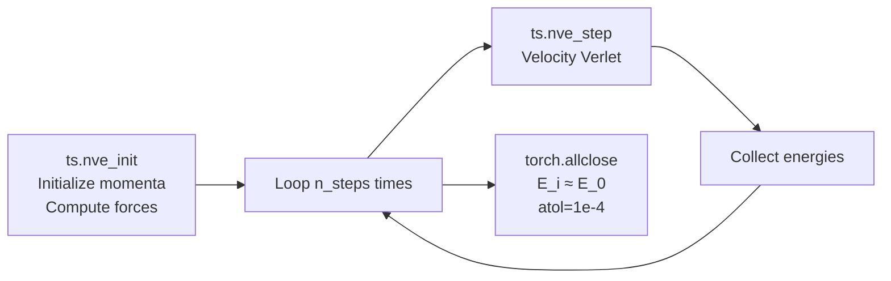

The implementation uses the velocity Verlet algorithm with small timesteps (0.001 in metal units) to ensure numerical stability. Energy conservation is checked independently for each system in batched simulations:

| Test Component | Implementation | Validation Criteria |
|---------------|----------------|---------------------|
| Initialization | `ts.nve_init(state, model, kT)` | Initialize momenta from temperature |
| Integration | `ts.nve_step(state, model, dt)` | Velocity Verlet algorithm |
| Energy Collection | `state.energy` per step | Store energy for each system |
| Validation | `torch.allclose(energies[:, i], energies[0, i])` | Energy constant within 1e-4 tolerance |

**Sources:** [tests/test_integrators.py:929-950]()

### Batching Consistency for NVE

The `test_compare_single_vs_batched_integrators` function verifies that running a single system produces identical results to extracting that system from a batched simulation. This is critical for ensuring that batching optimizations do not introduce numerical artifacts:

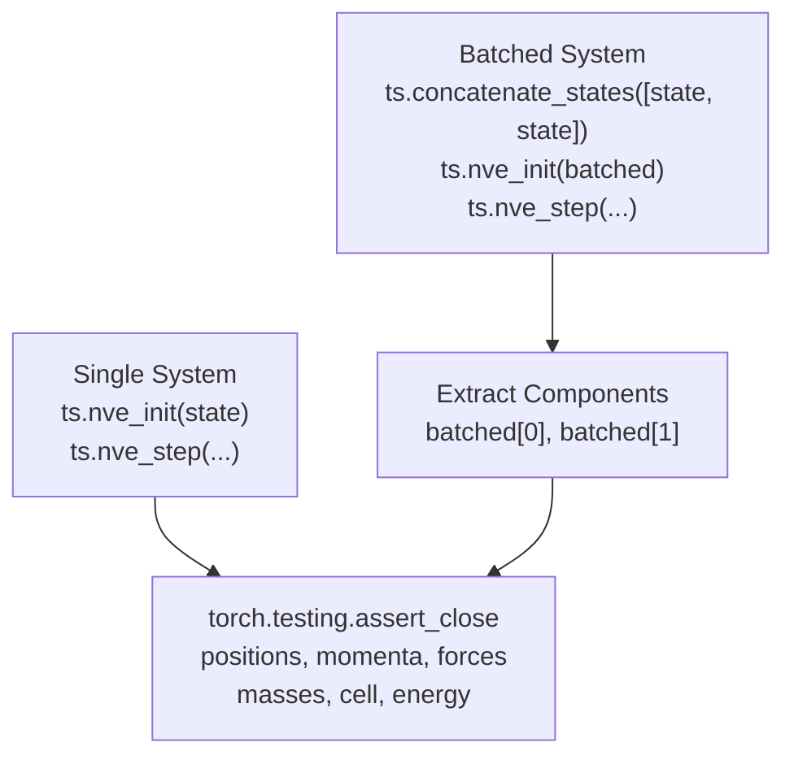

The test runs 100 steps starting from zero momentum and verifies that all state components match exactly between single and batched execution paths. This test uses both orthorhombic and triclinic cell geometries to verify proper periodic boundary condition handling.

**Sources:** [tests/test_integrators.py:952-1006]()

## Temperature Control Validation

Temperature control is validated for all NVT ensemble integrators by monitoring the instantaneous temperature calculated from kinetic energy and comparing it to the target temperature over the course of a simulation.

### Temperature Calculation

Temperature is computed using the `ts.calc_kT` function, which converts kinetic energy to temperature:

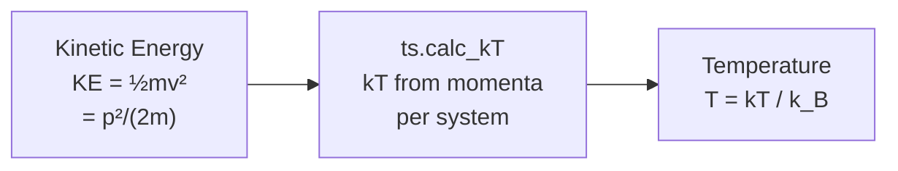

### NVT Langevin Thermostat

The Langevin thermostat test validates stochastic temperature control using friction and random forces:

| Test Parameter | Value | Purpose |
|---------------|-------|---------|
| Steps | 100-200 | Equilibration time |
| Timestep | 0.001 (metal units) | Numerical stability |
| Target Temperature | 300 K or multi-kT | Test temperature control |
| Validation Tolerance | ±100-150 K | Allow thermal fluctuations |

The test collects instantaneous temperatures at each step and validates that the mean temperature matches the target:

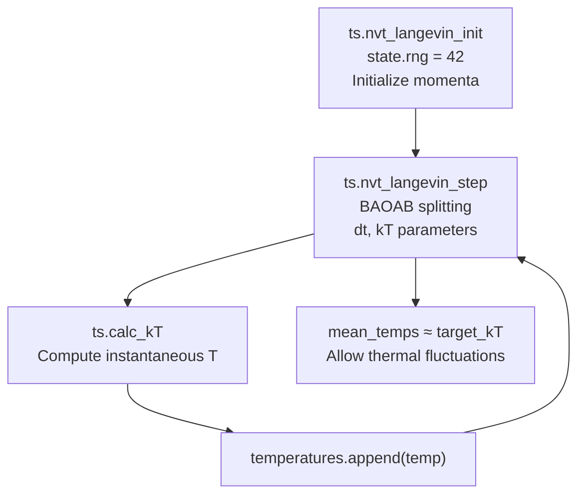

**Sources:** [tests/test_integrators.py:216-267](), [tests/test_integrators.py:269-305]()

### NVT Nose-Hoover Thermostat

The Nose-Hoover thermostat is a deterministic extended system method that requires validation of both temperature control and invariant conservation:

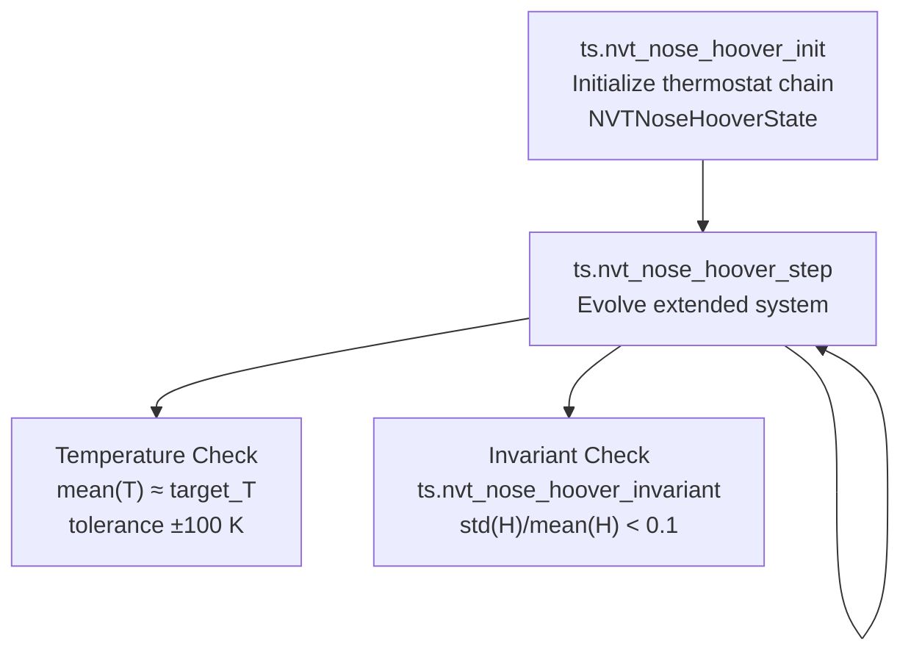

The Nose-Hoover invariant is computed using `ts.nvt_nose_hoover_invariant(state, kT)`, which returns the conserved quantity for the extended system. The test verifies that this invariant has less than 10% relative variation, indicating proper energy exchange between the physical system and thermostat.

**Sources:** [tests/test_integrators.py:307-382]()

### NVT Velocity Rescaling

The velocity rescaling thermostat test follows a similar pattern but uses stochastic rescaling of velocities:

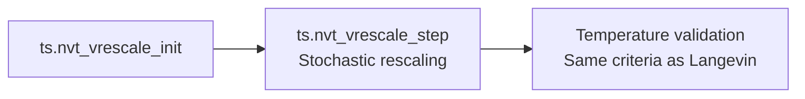

**Sources:** [tests/test_integrators.py:491-542]()

### Multi-Temperature Testing

Multi-temperature tests verify that different systems in a batch can maintain different target temperatures simultaneously:

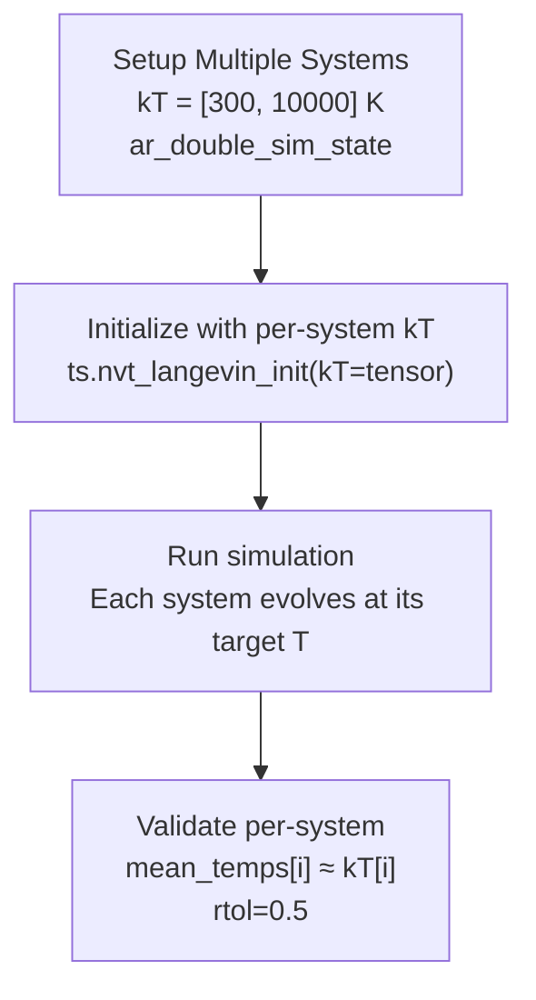

This capability is essential for high-throughput screening where multiple chemical compositions or thermodynamic states are simulated simultaneously.

**Sources:** [tests/test_integrators.py:269-305](), [tests/test_integrators.py:438-489]()

## Pressure Control Validation

Pressure control validation ensures that NPT ensemble integrators maintain the target pressure while also controlling temperature. This requires monitoring the stress tensor and validating pressure equilibration.

### NPT Langevin Barostat

The NPT Langevin test validates stochastic pressure control combined with temperature control:

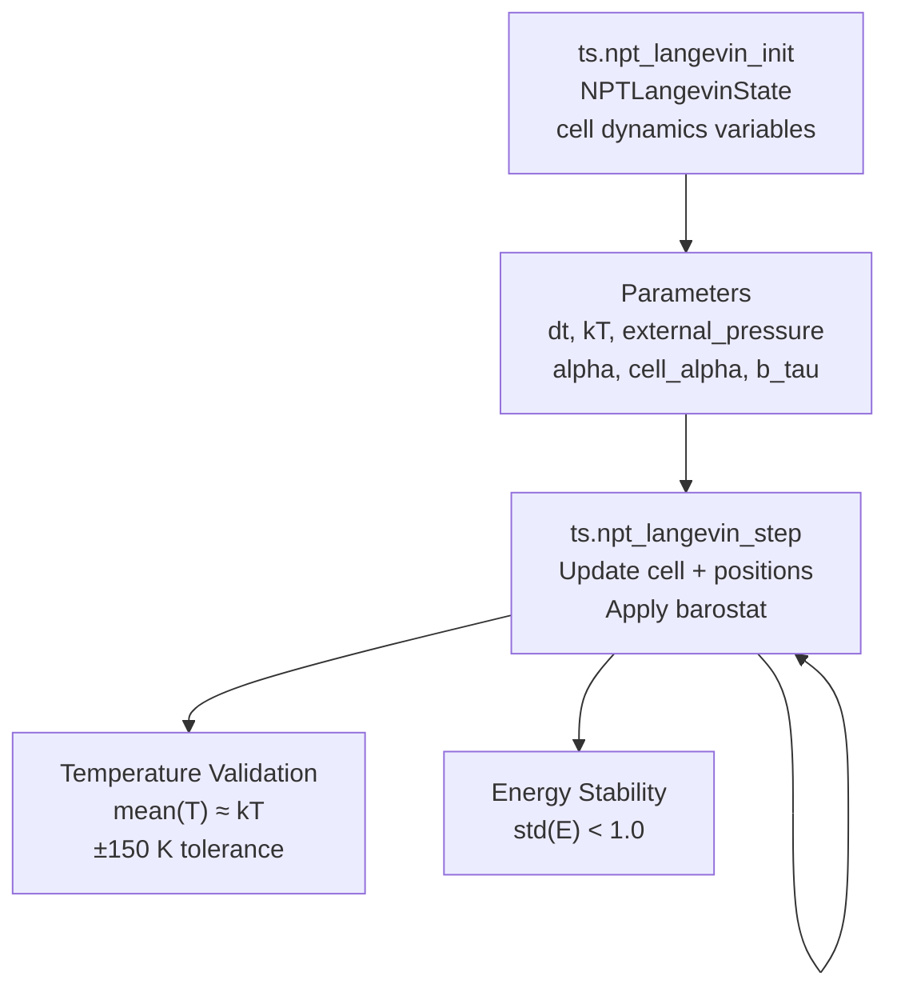

The NPT Langevin test uses several coupling parameters:
- `alpha`: Friction coefficient for atomic motion
- `cell_alpha`: Friction coefficient for cell dynamics
- `b_tau`: Barostat coupling timescale

The test validates that both temperature and energy remain stable, acknowledging that NPT simulations allow energy fluctuations due to volume changes.

**Sources:** [tests/test_integrators.py:83-156](), [tests/test_integrators.py:158-214]()

### NPT Nose-Hoover Barostat

The NPT Nose-Hoover integrator is a deterministic extended system method that controls both temperature and pressure:

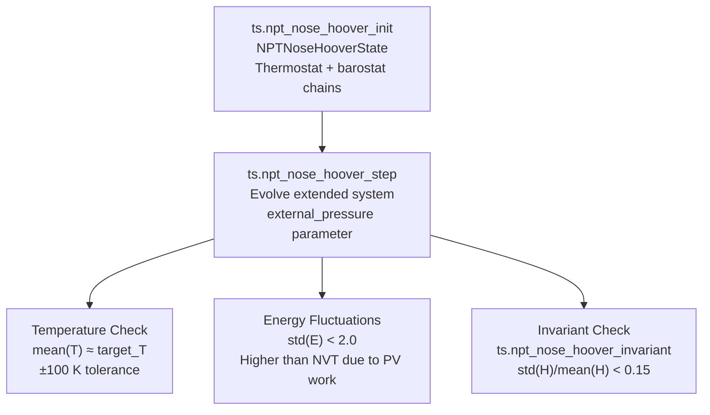

The NPT Nose-Hoover invariant includes contributions from the barostat variables and is computed using `ts.npt_nose_hoover_invariant(state, kT, external_pressure)`. The test allows for slightly higher invariant variation (15%) compared to NVT (10%) due to the additional barostat degrees of freedom.

**Sources:** [tests/test_integrators.py:690-771](), [tests/test_integrators.py:865-927]()

### NPT C-Rescale Methods

The C-Rescale barostats provide both isotropic and anisotropic pressure control through stochastic cell rescaling:

| Method | Function | Cell Update Mode |
|--------|----------|------------------|
| Isotropic | `ts.npt_crescale_isotropic_step` | Uniform scaling in all directions |
| Anisotropic | `ts.npt_crescale_anisotropic_step` | Independent scaling per axis |

Both methods share the same initialization function `ts.npt_crescale_init` and use the same validation criteria as NPT Langevin.

**Sources:** [tests/test_integrators.py:544-615](), [tests/test_integrators.py:617-688]()

### Cell Force Scaling

A critical validation test ensures that cell forces scale correctly with the number of atoms per system. The `test_compute_cell_force_atoms_per_system` verifies that systems with different numbers of atoms experience proportional cell forces:

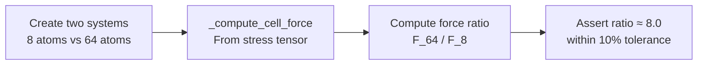

This test catches a common error where cell forces are not properly normalized by system size, which would cause incorrect pressure control in batched simulations.

**Sources:** [tests/test_integrators.py:1008-1042]()

## Thermodynamic Invariants

For extended system methods (Nose-Hoover chains), the conservation of thermodynamic invariants provides a rigorous test of implementation correctness. The invariant represents the total conserved quantity of the extended system.

### Invariant Functions

| Ensemble | Function | Invariant Components |
|----------|----------|----------------------|
| NVT | `ts.nvt_nose_hoover_invariant(state, kT)` | H + KE_thermostat + PE_thermostat |
| NPT | `ts.npt_nose_hoover_invariant(state, kT, P_ext)` | H + KE_thermostat + PE_thermostat + KE_barostat + PE_barostat |

### Invariant Validation Criteria

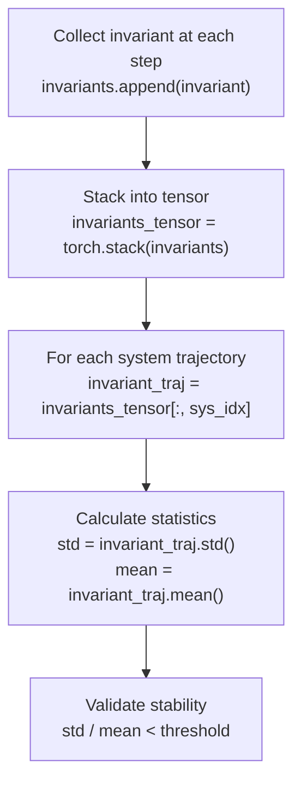

The acceptance criteria for invariant conservation are:
- **NVT**: Relative variation < 10% (`std(H) / mean(H) < 0.1`)
- **NPT**: Relative variation < 15% (`std(H) / mean(H) < 0.15`)

NPT ensembles allow slightly higher variation due to the additional complexity of the barostat dynamics.

**Sources:** [tests/test_integrators.py:366-373](), [tests/test_integrators.py:755-761]()

## Reproducibility Testing

Reproducibility tests ensure that molecular dynamics simulations produce identical results when initialized with the same random seed. This is essential for debugging and for verifying that GPU operations are deterministic.

### Reproducibility Test Pattern

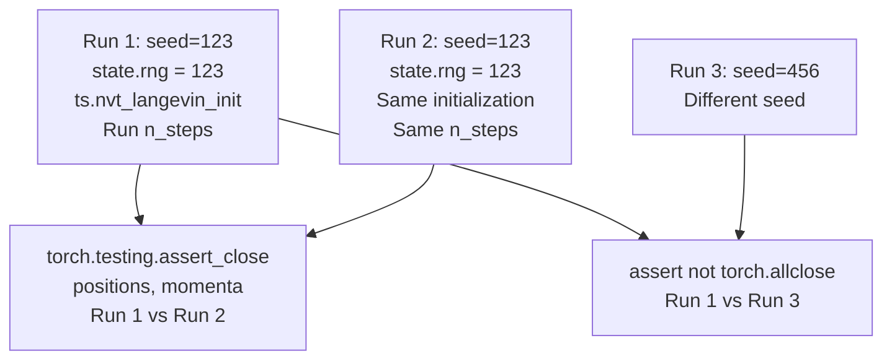

### Tested Integrators

| Integrator | Test Function | Validated State Components |
|------------|---------------|----------------------------|
| NVT Langevin | `test_nvt_langevin_reproducibility` | positions, momenta |
| NPT Langevin | `test_npt_langevin_reproducibility` | positions, momenta, cell |

The reproducibility tests verify:
1. **Same seed → identical trajectories**: Two runs with seed=123 produce bit-exact results
2. **Different seeds → divergent trajectories**: Runs with different seeds produce different results

NPT tests additionally verify cell reproducibility since the simulation box evolves under pressure control.

**Sources:** [tests/test_integrators.py:1044-1069](), [tests/test_integrators.py:1071-1118]()

## Momenta Initialization Testing

Proper initialization of momenta is critical for all MD simulations. The momenta initialization tests verify that velocities are correctly sampled from the Maxwell-Boltzmann distribution and that center-of-mass motion is properly removed.

### Momenta Initialization Validation

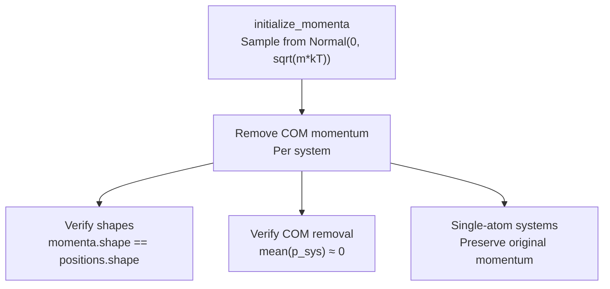

### Test Coverage

| Test | Validation | Constraint |
|------|------------|------------|
| `test_initialize_momenta_basic` | COM momentum = 0 per system | `torch.allclose(com_momentum, 0, atol=1e-10)` |
| `test_initialize_momenta_single_atoms` | Single-atom systems unchanged | Raw momenta preserved |

The tests ensure that:
1. Each system has zero center-of-mass momentum
2. Single-atom systems retain their initial momentum (COM removal would be meaningless)
3. The momenta distribution is correctly scaled by mass and temperature

**Sources:** [tests/test_integrators.py:13-81]()

## Multi-System Validation

Multi-system validation ensures that batched simulations correctly handle multiple systems with different parameters (temperatures, pressures) and that systems remain independent throughout the simulation.

### System Independence Test Pattern

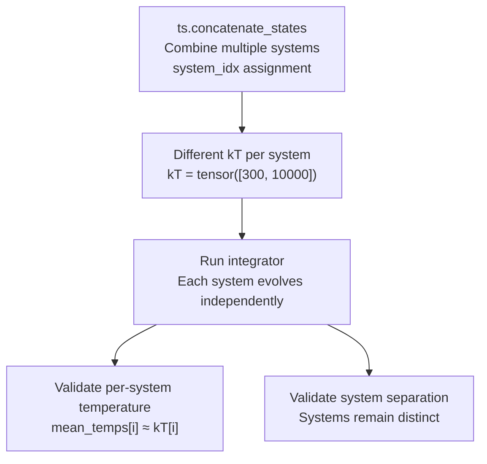

### Equivalence Tests

The "multi-equivalent-to-single" tests verify that a multi-system simulation with identical parameters produces the same results as running individual simulations:

| Test Function | Verification |
|---------------|-------------|
| `test_nvt_nose_hoover_multi_equivalent_to_single` | Split systems → run separately → compare to batched |
| `test_npt_nose_hoover_multi_equivalent_to_single` | Same verification for NPT ensemble |

These tests:
1. Run each system individually with same seed
2. Concatenate systems and run batched with same seed
3. Verify final temperatures match exactly: `torch.allclose(final_temps_separate, final_temps_batched)`

**Sources:** [tests/test_integrators.py:384-436](), [tests/test_integrators.py:796-863]()

### System Separation Validation

All batched tests include a check that systems remain spatially separated:

```python
pos_diff = torch.norm(
    state.positions[:n_atoms].mean(0) - state.positions[n_atoms:].mean(0)
)
assert pos_diff > 0.0001  # Systems should remain separated
```

This verifies that the periodic boundary conditions and neighbor lists correctly respect system boundaries.

**Sources:** [tests/test_integrators.py:152-156](), [tests/test_integrators.py:262-266](), [tests/test_integrators.py:377-381]()

## Validation Metrics Summary

The following table summarizes the validation metrics used across different integrator tests:

| Property | Metric | Threshold | Ensembles |
|----------|--------|-----------|-----------|
| Energy Conservation | `torch.allclose(E_t, E_0)` | atol=1e-4 | NVE |
| Temperature | `abs(mean(T) - target_T)` | < 100-150 K | NVT, NPT |
| Multi-Temperature | `torch.allclose(mean(T), target_T)` | rtol=0.5 | NVT, NPT |
| Energy Stability | `std(E)` | < 1.0 (NVT), < 2.0 (NPT) | NVT, NPT |
| Invariant Conservation | `std(H) / mean(H)` | < 0.1 (NVT), < 0.15 (NPT) | Nose-Hoover |
| Reproducibility | `torch.testing.assert_close` | Bit-exact | All stochastic |
| System Separation | `norm(pos_diff)` | > 0.0001 | All batched |
| Cell Force Scaling | `abs(ratio - expected) / expected` | < 0.1 | NPT |

## Code Entity Reference

### Key Functions Under Test

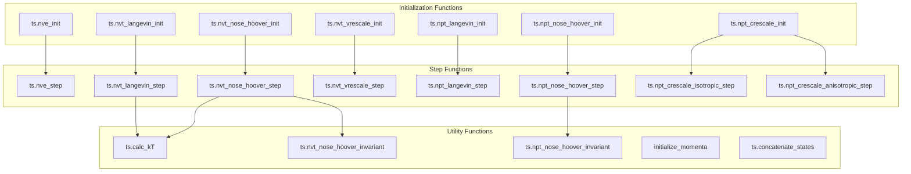

**Sources:** [tests/test_integrators.py:1-11]()

---