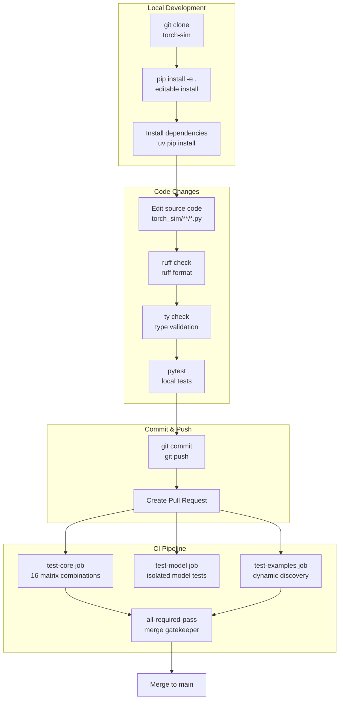
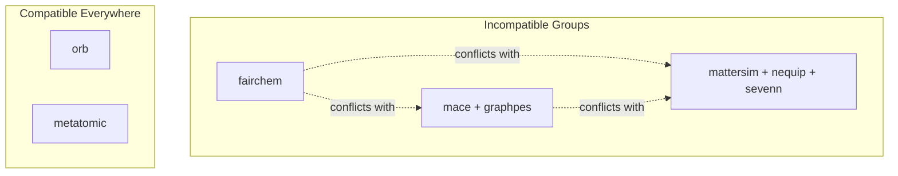
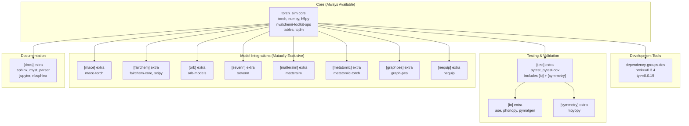
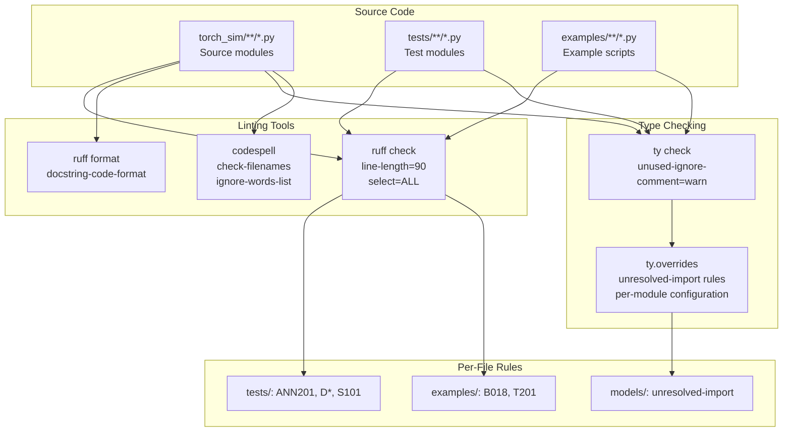
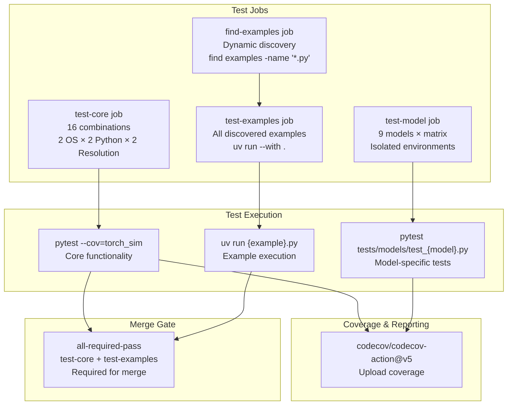

# Development and Contributing

<details>
<summary>Relevant source files</summary>

The following files were used as context for generating this wiki page:

- [.github/workflows/test.yml](.github/workflows/test.yml)
- [README.md](README.md)
- [pyproject.toml](pyproject.toml)

</details>


This document provides an overview of the development workflow, code quality standards, and contribution process for torch-sim. It covers setting up a development environment, understanding the dependency structure, code quality tools, and testing infrastructure.

For detailed information about specific topics, see:
- Project structure and repository organization: [Project Structure](#11.1)
- CI/CD pipeline details: [Continuous Integration](#11.2)
- Contribution guidelines and PR process: [Contributing Guidelines](#11.3)

## Development Environment Setup

### Installing from Source

To set up a development environment, clone the repository and install in editable mode:

```bash
git clone https://github.com/TorchSim/torch-sim
cd torch-sim
pip install -e .
```

The project uses `uv_build` as its build backend [pyproject.toml:79-85]().

### Development Dependencies

Install the development dependency group for additional tooling:

```bash
pip install -e ".[test]"
# Or for development tools:
uv pip install --group dev
```

The development group includes:
- `prek>=0.3.4` - Code quality utilities
- `ty>=0.0.19` - Type checking tool

The test group includes ASE, Pymatgen, Phonopy, pytest, and related testing utilities [pyproject.toml:40-48]().

**Development Workflow Diagram**



Sources: [.github/workflows/test.yml:1-205](), [pyproject.toml:1-231]()

## Dependency Architecture

The project uses a modular dependency structure to avoid conflicts between incompatible MLIP models while maintaining a minimal core.

### Core Dependencies

The core package requires only:
- `torch>=2` - PyTorch framework
- `numpy` - Version depends on Python version
- `h5py>=3.15.1` - HDF5 file I/O
- `nvalchemi-toolkit-ops>=0.2.0` - Neighbor list operations
- `tables>=3.11.1` - PyTables for trajectory files
- `tqdm>=4.67` - Progress bars

[pyproject.toml:29-37]()

### Optional Dependency Groups

| Extra | Purpose | Key Packages |
|-------|---------|--------------|
| `io` | Format conversion | `ase>=3.26`, `phonopy>=2.37.0`, `pymatgen>=2025.6.14` |
| `symmetry` | Crystal symmetry preservation | `moyopy>=0.7.8` |
| `test` | Testing infrastructure | `pytest>=8`, `pytest-cov>=6`, includes `io` and `symmetry` |
| `docs` | Documentation generation | `sphinx`, `myst_parser`, `nbsphinx` |
| `mace` | MACE model support | `mace-torch>=0.3.15` |
| `fairchem` | FairChem model support | `fairchem-core>=2.7`, `scipy<1.17.0` |
| `orb` | ORB model support | `orb-models>=0.6.0` |
| `sevenn` | SevenNet model support | `sevenn[torchsim]>=0.12.1` |
| `mattersim` | MatterSim model support | `mattersim>=0.1.2` |
| `metatomic` | Metatomic model support | `metatomic-torch>=0.1.3`, `metatrain[pet]` |
| `graphpes` | GraphPES model support | `graph-pes>=0.1`, `mace-torch>=0.3.12` |
| `nequip` | NequIP model support | `nequip>=0.17.0` |

[pyproject.toml:39-74]()

### Dependency Conflicts

Several MLIP models cannot coexist due to incompatible `e3nn` versions. The `[tool.uv.conflicts]` section declares these mutual exclusions:



**Dependency Group Architecture**



Sources: [pyproject.toml:39-189]()

## Code Quality Standards

### Ruff Linting and Formatting

The project uses Ruff for both linting and code formatting with strict standards.

**Configuration:**
- Target: Python 3.12+ [pyproject.toml:88]()
- Line length: 90 characters [pyproject.toml:89]()
- Select: `ALL` rules enabled by default [pyproject.toml:93]()
- Docstring convention: Google style [pyproject.toml:121]()
- Import sorting: `isort` with no trailing comma splits [pyproject.toml:122-123]()

**Key Ignored Rules:**
- `ANN002`, `ANN003` - Type annotations for `*args`/`**kwargs` not required
- `PLR0913` - No limit on function arguments
- `PTH` - pathlib not enforced (allows `os.path`)
- `TD`, `FIX002` - TODOs allowed
- `D205` - No blank line required between summary and description

Per-file ignores:
- Tests: `ANN201`, `D*`, `INP001`, `S101` [pyproject.toml:127]()
- Examples: `B018`, `T201` [pyproject.toml:128]()
- Tutorials: All rules relaxed [pyproject.toml:129]()

**Running Ruff:**
```bash
ruff check .          # Lint all files
ruff check --fix .    # Auto-fix issues
ruff format .         # Format code
```

[pyproject.toml:87-133]()

### Type Checking with ty

The `ty` tool provides type checking with configurable overrides for different parts of the codebase.

**Global Rules:**
- `unused-ignore-comment = "warn"` [pyproject.toml:192]()

**Module-Specific Overrides:**

| Module Pattern | Ignored Rules |
|----------------|---------------|
| `torch_sim/models/**/*.py`, `torch_sim/io.py`, etc. | `unresolved-import` |
| `tests/**/*.py` | `invalid-argument-type`, `no-matching-overload`, `unresolved-attribute`, `unresolved-import` |
| `docs/**/*.py`, `examples/**/*.py` | `unresolved-import` |
| `torch_sim/neighbors/alchemiops.py` | `call-non-callable` |

[pyproject.toml:191-231]()

**Running Type Checks:**
```bash
ty check torch_sim/    # Check specific module
ty check .            # Check entire project
```

### Codespell

Spell checking is configured to check filenames and code with custom ignore list [pyproject.toml:134-136]().

**Code Quality Tools Architecture**



Sources: [pyproject.toml:87-231]()

## Testing Infrastructure Overview

The testing infrastructure is organized into three tiers with different scopes and purposes. For detailed information about the testing framework and CI configuration, see [Testing Framework](#10.1) and [Continuous Integration](#11.2).

### Test Categories

**Core Tests** (`test-core` job):
- Run on all combinations of OS (Ubuntu, macOS), Python version (3.12, 3.14), and dependency resolution (highest, lowest-direct)
- Total of 16 matrix combinations (2 OS × 2 Python × 2 resolutions × 2 jobs)
- Cover core functionality without model-specific dependencies
- Include coverage reporting to Codecov

[.github/workflows/test.yml:15-53]()

**Model Tests** (`test-model` job):
- Each MLIP model tested in isolation to avoid dependency conflicts
- 9 different model integrations tested across the matrix
- Excludes certain combinations (e.g., ORB on Python 3.14)
- Uses Hugging Face token for models requiring authentication
- Special handling for legacy fairchem versions

[.github/workflows/test.yml:54-145]()

**Example Tests** (`test-examples` job):
- Dynamically discovers all `examples/**/*.py` files
- Runs each example as a standalone script using `uv run`
- Ensures documentation examples remain functional
- Separate job for dynamic example discovery

[.github/workflows/test.yml:146-188]()

### Running Tests Locally

```bash
# Run all core tests
pytest

# Run with coverage
pytest --cov=torch_sim --cov-report=xml

# Run specific test file
pytest tests/test_integrators.py

# Run specific model test (requires model installed)
pytest tests/models/test_mace.py -v

# Run specific example
python examples/basic_md.py
```

**Test Matrix Diagram**



Sources: [.github/workflows/test.yml:1-205]()

### pytest Configuration

Basic pytest settings are minimal, with warnings disabled for cleaner output:

```toml
[tool.pytest.ini_options]
addopts = ["-p no:warnings"]
testpaths = ["tests"]
```

[pyproject.toml:138-140]()

## Build System

The project uses `uv_build` as its build backend, which is configured in the `[build-system]` section:

```toml
[build-system]
requires = ["uv_build>=0.7.12"]
build-backend = "uv_build"

[tool.uv.build-backend]
module-name = "torch_sim"
module-root = ""
```

This modern build backend integrates with the `uv` package manager for fast, reliable builds [pyproject.toml:79-85]().

## Project Metadata

The project is published to PyPI as `torch-sim-atomistic` (version 0.5.2 as of this writing). Key metadata:

- **Python Support:** 3.12, 3.13, 3.14
- **License:** MIT [pyproject.toml:11]()
- **Repository:** https://github.com/torchsim/torch-sim
- **Classifiers:** Science/Research, AI, Chemistry, Physics

For contribution guidelines and community information, see [Contributing Guidelines](#11.3) and the project README which links to the [Slack community](https://join.slack.com/t/torchsim/shared_invite/zt-3fkiju9ip-XhUH7TYp_ejJT6QqEPKMJQ).

[pyproject.toml:1-78](), [README.md:132-139]()

Sources: [pyproject.toml:1-231](), [.github/workflows/test.yml:1-205](), [README.md:1-167]()

---