# Project Structure

<details>
<summary>Relevant source files</summary>

The following files were used as context for generating this wiki page:

- [.github/workflows/test.yml](.github/workflows/test.yml)
- [README.md](README.md)
- [pyproject.toml](pyproject.toml)

</details>


This document describes the organization of the torch-sim repository, including the module hierarchy, configuration files, and dependency structure. For information about the continuous integration setup and testing strategy, see [Continuous Integration](#11.2). For general contribution guidelines, see [Contributing Guidelines](#11.3).

## Repository Organization

The torch-sim repository follows a standard Python package structure with the core library in the `torch_sim/` directory, tests in `tests/`, examples in `examples/`, and documentation in `docs/`.

### Top-Level Directory Structure

```mermaid
graph TB
    root["torch-sim/"]
    
    subgraph "Core Package"
        torch_sim["torch_sim/"]
        init["__init__.py"]
        runners["runners.py"]
        state["state.py"]
        trajectory["trajectory.py"]
        io["io.py"]
        transforms["transforms.py"]
        autobatching["autobatching.py"]
        constraints["constraints.py"]
    end
    
    subgraph "Subsystem Modules"
        models["models/"]
        integrators["integrators/"]
        optimizers["optimizers/"]
        neighbors["neighbors/"]
        workflows["workflows/"]
    end
    
    subgraph "Configuration & Metadata"
        pyproject["pyproject.toml"]
        readme["README.md"]
        license["LICENSE"]
        contrib["CONTRIBUTING.md"]
    end
    
    subgraph "Supporting Directories"
        tests["tests/"]
        examples["examples/"]
        docs["docs/"]
        github[".github/"]
    end
    
    root --> torch_sim
    root --> pyproject
    root --> readme
    root --> license
    root --> contrib
    root --> tests
    root --> examples
    root --> docs
    root --> github
    
    torch_sim --> init
    torch_sim --> runners
    torch_sim --> state
    torch_sim --> trajectory
    torch_sim --> io
    torch_sim --> transforms
    torch_sim --> autobatching
    torch_sim --> constraints
    torch_sim --> models
    torch_sim --> integrators
    torch_sim --> optimizers
    torch_sim --> neighbors
    torch_sim --> workflows
```

**Sources:** [pyproject.toml:1-231](), [README.md:1-167](), Repository structure inferred from test paths in [.github/workflows/test.yml:1-205]()

## Core Module Organization

The `torch_sim/` package contains the core functionality organized into logical subsystems. The main entry point is `__init__.py`, which exposes the high-level API functions and key classes.

### Main API Entry Points

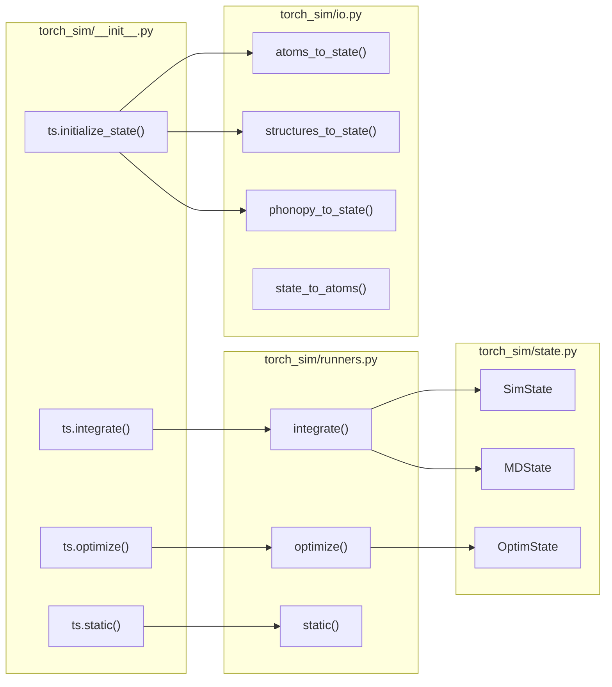

**Sources:** [pyproject.toml:84]() (module-name specification), architecture diagrams showing API structure

### Module Hierarchy

The following table shows the main modules within `torch_sim/` and their responsibilities:

| Module | Key Files | Purpose |
|--------|-----------|---------|
| **Core API** | `runners.py` | High-level `integrate()`, `optimize()`, `static()` functions |
| **State Management** | `state.py` | `SimState`, `MDState`, `OptimState`, `NPTLangevinState`, etc. |
| **I/O** | `io.py` | Conversion to/from ASE Atoms, Pymatgen Structure, Phonopy |
| **Trajectory** | `trajectory.py` | `TrajectoryReporter`, `TorchSimTrajectory` for HDF5 I/O |
| **Transforms** | `transforms.py` | PBC operations, coordinate transformations, neighbor lists |
| **Autobatching** | `autobatching.py` | `BinningAutoBatcher`, `InFlightAutoBatcher` for GPU memory management |
| **Constraints** | `constraints.py` | `Constraint` ABC, `FixAtoms`, `FixCom`, `FixSymmetry` |
| **Integrators** | `integrators/` | NVE, NVT (Langevin, Nose-Hoover, V-Rescale), NPT implementations |
| **Optimizers** | `optimizers/` | FIRE, BFGS, L-BFGS, cell filters |
| **Models** | `models/` | Model interface, MLIP integrations, classical potentials |
| **Neighbors** | `neighbors/` | Neighbor list backends (N², linked-cell, Vesin, Alchemiops) |
| **Workflows** | `workflows/` | High-level workflows like A2C, structure generation |
| **Utilities** | `typing.py`, `elastic.py`, `symmetrize.py` | Type definitions, elastic tensors, symmetry operations |

**Sources:** [pyproject.toml:195-207]() (ty.overrides paths listing module structure)

## Subsystem Details

### Models Directory Structure

```mermaid
graph TB
    models_dir["torch_sim/models/"]
    
    subgraph "Core Interface"
        base["base.py<br/>ModelInterface ABC"]
    end
    
    subgraph "MLIP Integrations"
        mace["mace.py<br/>MaceModel"]
        fairchem["fairchem.py<br/>FairChemModel"]
        orb["orb.py<br/>OrbModel"]
        sevenn["sevenn.py<br/>SevenNetModel"]
        mattersim["mattersim.py<br/>MatterSimModel"]
        metatomic["metatomic.py<br/>MetatomicModel"]
        nequip["nequip.py<br/>NequIPModel"]
        graphpes["graphpes.py<br/>GraphPESModel"]
    end
    
    subgraph "Classical Potentials"
        lj["lennard_jones.py<br/>LennardJonesModel"]
        morse["morse.py<br/>MorseModel"]
        softsphere["soft_sphere.py<br/>SoftSphereModel"]
        particlelife["particle_life.py<br/>ParticleLifeModel"]
    end
    
    models_dir --> base
    models_dir --> mace
    models_dir --> fairchem
    models_dir --> orb
    models_dir --> sevenn
    models_dir --> mattersim
    models_dir --> metatomic
    models_dir --> nequip
    models_dir --> graphpes
    models_dir --> lj
    models_dir --> morse
    models_dir --> softsphere
    models_dir --> particlelife
```

**Sources:** [pyproject.toml:51-58]() (optional dependencies for each model), [pyproject.toml:199]() (models path in ty.overrides)

### Integrators Directory Structure

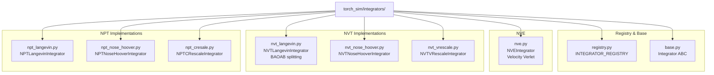

**Sources:** Architecture Diagram 4 (Integrator and Constraint System)

### Neighbors Directory Structure

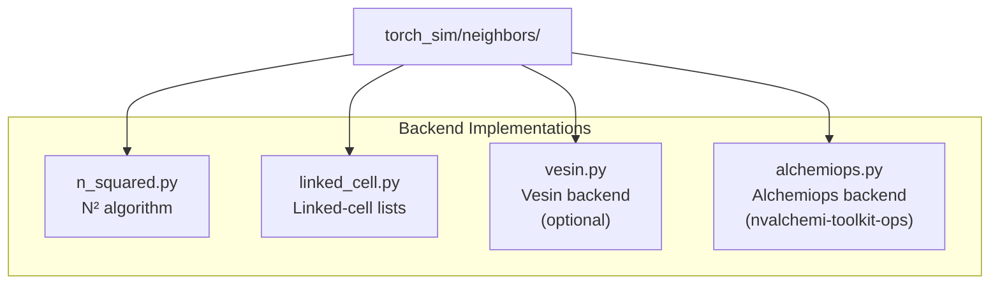

**Sources:** [pyproject.toml:33]() (nvalchemi-toolkit-ops dependency), [pyproject.toml:200-201, 228-230]() (neighbors paths in ty.overrides)

## Configuration Files

### pyproject.toml Structure

The `pyproject.toml` file is the central configuration for the project, defining package metadata, dependencies, build configuration, and tool settings.

```mermaid
graph TB
    pyproject["pyproject.toml"]
    
    subgraph "Package Metadata"
        project["[project]<br/>name, version, authors<br/>description, license<br/>keywords, classifiers"]
        urls["[project.urls]<br/>Repo"]
    end
    
    subgraph "Dependencies"
        deps["dependencies<br/>torch>=2, numpy, h5py<br/>nvalchemi-toolkit-ops<br/>tables, tqdm"]
        extras["[project.optional-dependencies]<br/>test, io, symmetry<br/>mace, fairchem, orb, etc."]
        conflicts["[tool.uv.conflicts]<br/>Mutual exclusion rules"]
    end
    
    subgraph "Build Configuration"
        build["[build-system]<br/>requires: uv_build>=0.7.12"]
        uv_build["[tool.uv.build-backend]<br/>module-name: torch_sim"]
    end
    
    subgraph "Development Tools"
        ruff["[tool.ruff]<br/>[tool.ruff.lint]<br/>[tool.ruff.format]"]
        pytest["[tool.pytest.ini_options]"]
        codespell["[tool.codespell]"]
        ty["[tool.ty.rules]<br/>[[tool.ty.overrides]]"]
    end
    
    subgraph "Dependency Groups"
        dev_group["[dependency-groups]<br/>dev: prek, ty"]
    end
    
    pyproject --> project
    pyproject --> urls
    pyproject --> deps
    pyproject --> extras
    pyproject --> conflicts
    pyproject --> build
    pyproject --> uv_build
    pyproject --> ruff
    pyproject --> pytest
    pyproject --> codespell
    pyproject --> ty
    pyproject --> dev_group
```

**Sources:** [pyproject.toml:1-231]()

#### Dependency Extras and Conflicts

The project uses optional extras to manage incompatible dependencies, particularly for MLIP models that require different versions of `e3nn`:

| Extra | Models/Tools | Conflicts With |
|-------|--------------|----------------|
| `test` | Testing dependencies, includes `io` and `symmetry` | - |
| `io` | `ase>=3.26`, `phonopy>=2.37.0`, `pymatgen>=2025.6.14` | - |
| `symmetry` | `moyopy>=0.7.8` | - |
| `mace` | `mace-torch>=0.3.15` | `fairchem`, `mattersim`, `nequip`, `sevenn` |
| `fairchem` | `fairchem-core>=2.7`, `scipy<1.17.0` | `mace`, `graphpes` |
| `graphpes` | `graph-pes>=0.1`, `mace-torch>=0.3.12` | `fairchem`, `mattersim`, `nequip`, `sevenn` |
| `mattersim` | `mattersim>=0.1.2` | `mace`, `graphpes` |
| `nequip` | `nequip>=0.17.0` | `mace`, `graphpes` |
| `sevenn` | `sevenn[torchsim]>=0.12.1` | `mace`, `graphpes` |
| `metatomic` | `metatomic-torch>=0.1.3`, `metatrain[pet]>=2025.12` | (Compatible with all) |
| `orb` | `orb-models>=0.6.0` | (Compatible with all) |

**Sources:** [pyproject.toml:39-74]() (optional dependencies), [pyproject.toml:142-186]() (conflicts configuration)

### Build Configuration

The project uses the `uv_build` backend for building:

```toml
[build-system]
requires = ["uv_build>=0.7.12"]
build-backend = "uv_build"

[tool.uv.build-backend]
module-name = "torch_sim"
module-root = ""
```

**Sources:** [pyproject.toml:79-85]()

### Tool Configuration

#### Ruff (Linting and Formatting)

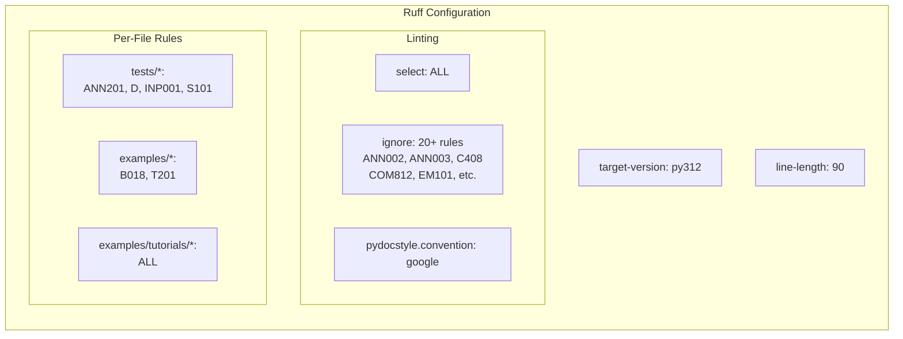

**Sources:** [pyproject.toml:87-132]()

#### Pytest Configuration

The pytest configuration is minimal, disabling warnings and specifying the test directory:

```toml
[tool.pytest.ini_options]
addopts = ["-p no:warnings"]
testpaths = ["tests"]
```

**Sources:** [pyproject.toml:138-140]()

#### Type Checking (ty)

The project uses `ty` for type checking with specific overrides for different file groups:

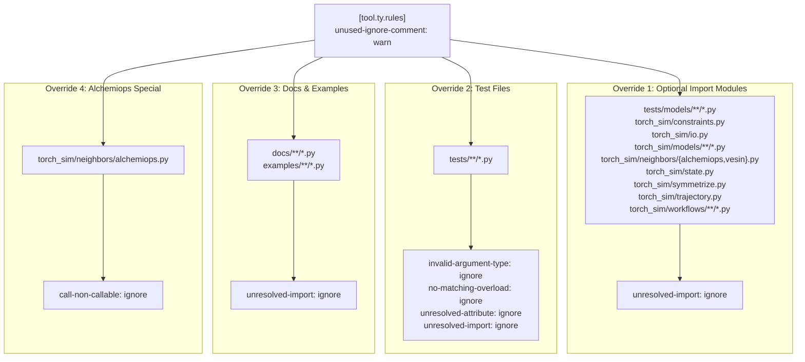

**Sources:** [pyproject.toml:191-231]()

## Testing Infrastructure Organization

### Test Directory Structure

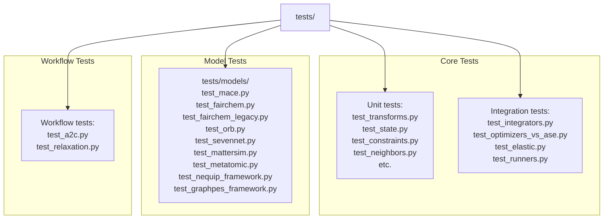

**Sources:** [.github/workflows/test.yml:44-46]() (core tests), [.github/workflows/test.yml:63-73]() (model tests), [pyproject.toml:127]() (test file patterns)

### Test Organization Strategy

The CI workflow organizes tests into three categories:

1. **test-core**: Runs on multiple OS/Python/resolution combinations (16 matrix combinations)
2. **test-model**: Isolates each MLIP model to avoid dependency conflicts (9 models × matrix)
3. **test-examples**: Dynamically discovers and runs all `examples/*.py` files

**Sources:** [.github/workflows/test.yml:15-26]() (test-core), [.github/workflows/test.yml:54-83]() (test-model), [.github/workflows/test.yml:146-188]() (test-examples)

## Examples Directory

The examples directory contains working code demonstrating torch-sim functionality:

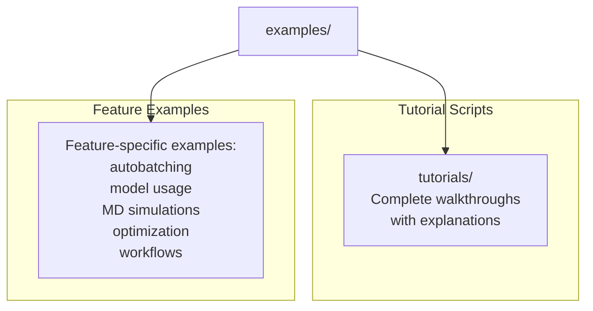

The CI workflow dynamically discovers all `.py` files in the examples directory and runs them to ensure they remain functional:

```yaml
- name: Find example scripts
  run: |
    EXAMPLES=$(find examples -name "*.py" | jq -R -s -c 'split("\n")[:-1]')
```

**Sources:** [.github/workflows/test.yml:146-188](), [README.md:124]() (reference to tutorials), [pyproject.toml:128-129]() (examples file patterns)

## Documentation Structure

The `docs/` directory contains Sphinx-based documentation:

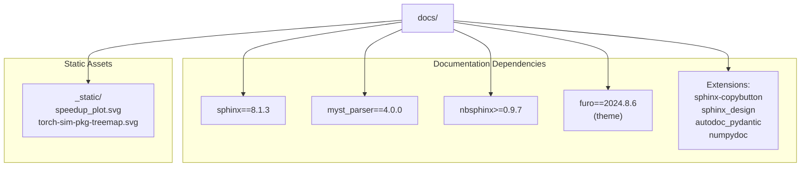

**Sources:** [pyproject.toml:59-74]() (docs dependencies), [README.md:96, 130]() (references to static assets)

## GitHub Workflows

The `.github/workflows/` directory contains CI configuration:

| Workflow File | Purpose |
|---------------|---------|
| `test.yml` | Main test workflow with three job types: `test-core`, `test-model`, `test-examples`, and gatekeeper `all-required-pass` |

The workflow uses a matrix strategy to test across:
- **Operating Systems**: `ubuntu-latest`, `macos-14`
- **Python Versions**: `3.12`, `3.14`
- **Dependency Resolutions**: `highest`, `lowest-direct`
- **Models**: 9 MLIP models tested in isolation

**Sources:** [.github/workflows/test.yml:1-205]()

## Package Metadata

The package is published to PyPI as `torch-sim-atomistic`:

```toml
[project]
name = "torch-sim-atomistic"
version = "0.5.2"
description = "A pytorch toolkit for calculating material properties using MLIPs"
requires-python = ">=3.12"
```

Key package URLs:
- **Repository**: https://github.com/torchsim/torch-sim
- **PyPI**: https://pypi.org/project/torch-sim-atomistic
- **Zenodo**: https://zenodo.org/records/15127004

**Sources:** [pyproject.toml:1-11, 76-77](), [README.md:6-7]()

---