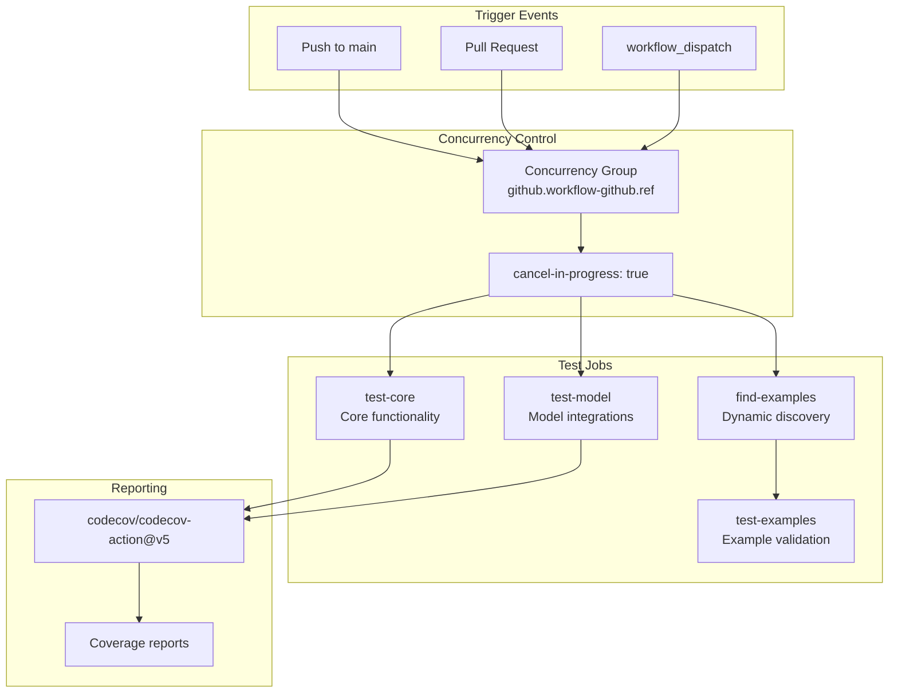
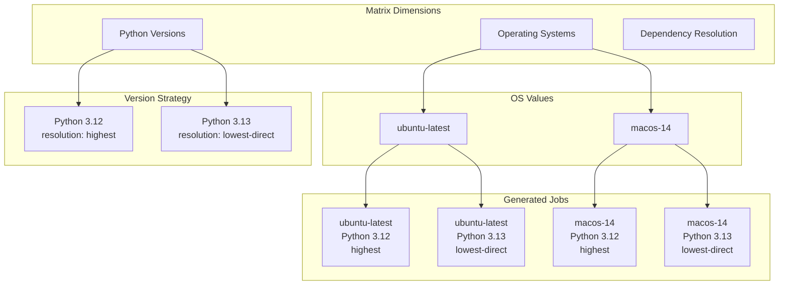
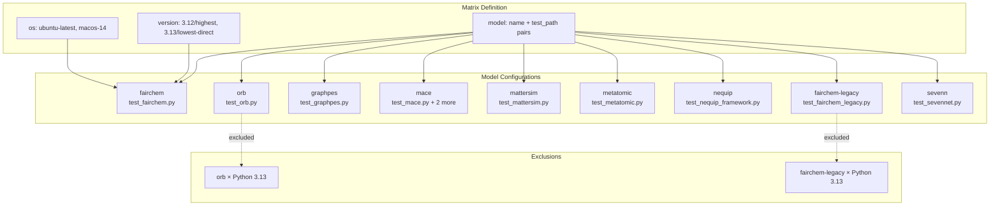
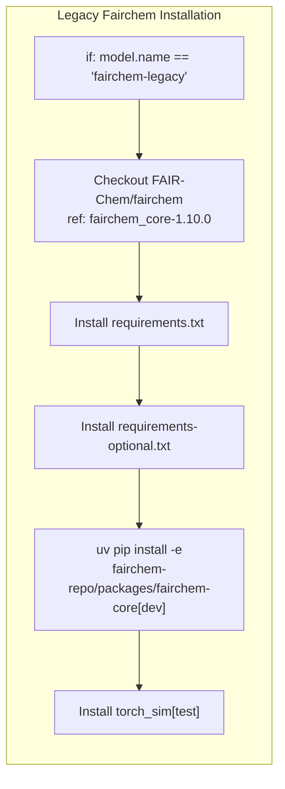
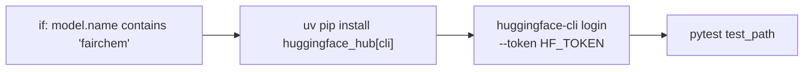
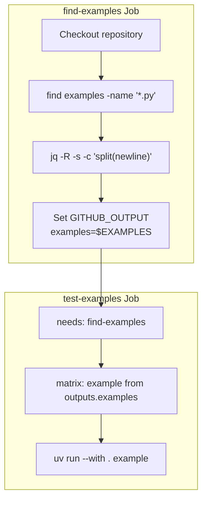
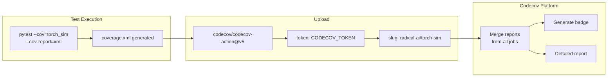
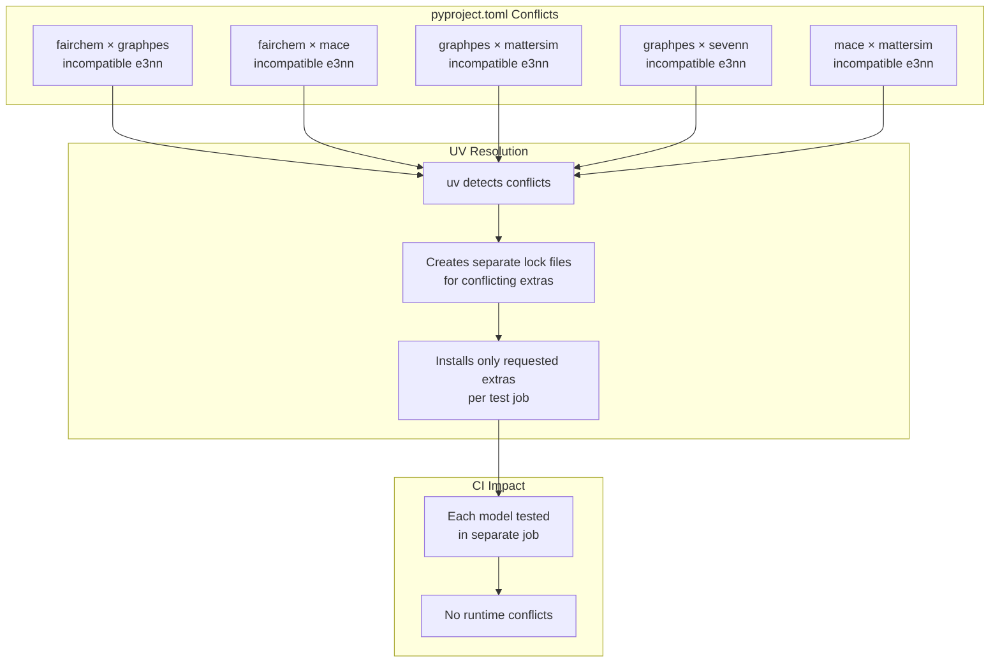
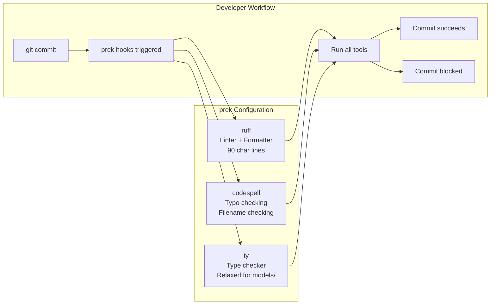
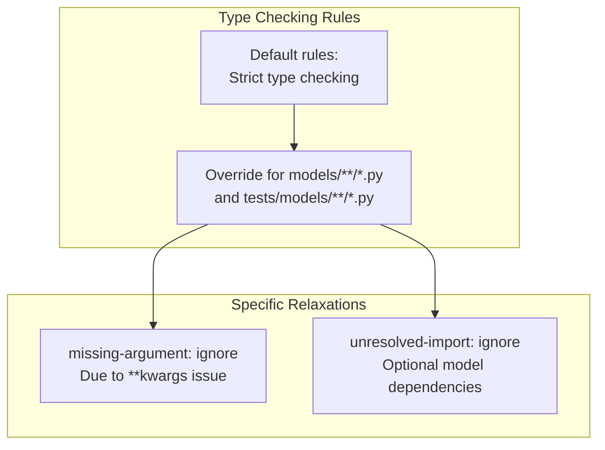

# Continuous Integration

<details>
<summary>Relevant source files</summary>

The following files were used as context for generating this wiki page:

- [.github/workflows/test.yml](.github/workflows/test.yml)
- [README.md](README.md)
- [pyproject.toml](pyproject.toml)

</details>


## Purpose and Scope

This document describes TorchSim's continuous integration (CI) infrastructure, which validates code quality, runs comprehensive test suites, and ensures compatibility across multiple platforms and dependencies. The CI system is implemented using GitHub Actions and consists of three primary testing layers: core functionality tests, model-specific integration tests, and example validation.

For information about the test framework and test organization, see [Testing Framework](#9.3). For details on pre-commit hooks and local development tools, see [Contributing Guidelines and Governance](#9.2).

---

## CI Workflow Architecture

TorchSim's CI pipeline is defined in [.github/workflows/test.yml:1-176]() and orchestrates three parallel testing strategies to ensure code correctness and compatibility.

### Overall Workflow Structure



**Sources:** [.github/workflows/test.yml:1-13]()

The workflow uses concurrency groups to cancel redundant runs when new commits are pushed to the same branch, conserving CI resources. All three test jobs run in parallel except for `test-examples`, which depends on `find-examples` to dynamically discover example scripts.

---

## Core Testing Job

The `test-core` job validates core TorchSim functionality without model-specific dependencies, ensuring the simulation engine, integrators, optimizers, and utilities work correctly.

### Test Matrix Configuration



**Sources:** [.github/workflows/test.yml:15-23]()

The matrix generates 4 test jobs (2 OS × 2 Python versions). The dual resolution strategy ensures compatibility with both the latest dependency versions (`highest`) and the oldest supported versions (`lowest-direct`), catching regressions in either direction.

### Core Test Execution Steps

| Step | Action | Details |
|------|--------|---------|
| 1. Checkout | `actions/checkout@v4` | Clone repository |
| 2. Python Setup | `actions/setup-python@v5` | Install Python from matrix version |
| 3. UV Setup | `astral-sh/setup-uv@v6` | Install `uv` package manager |
| 4. PyTorch Install | `uv pip install` | CPU-only PyTorch from official index |
| 5. Dependencies | `uv pip install -e ".[test]"` | Install TorchSim with test extras |
| 6. Test Execution | `pytest --cov=torch_sim` | Run tests with coverage |
| 7. Coverage Upload | `codecov/codecov-action@v5` | Upload coverage to Codecov |

**Sources:** [.github/workflows/test.yml:25-51]()

The core job installs PyTorch from the CPU-only index (`https://download.pytorch.org/whl/cpu`) to avoid unnecessary CUDA dependencies in CI. The `[test]` optional dependency group includes `ase`, `phonopy`, `pymatgen`, `pytest`, and `pytest-cov` as defined in [pyproject.toml:40-47]().

---

## Model Integration Testing

The `test-model` job validates individual MLIP integrations using a matrix strategy that tests each model wrapper against multiple OS, Python versions, and test files.

### Model Test Matrix Architecture



**Sources:** [.github/workflows/test.yml:52-77]()

The model matrix defines 11 test configurations across 7 models. Some models have multiple test paths (e.g., MACE is tested with `test_mace.py`, `test_elastic.py`, and `test_optimizers_vs_ase.py`). The exclusions prevent testing incompatible configurations where models don't support Python 3.13 in `lowest-direct` mode.

### Special Handling: Legacy Fairchem



**Sources:** [.github/workflows/test.yml:83-109]()

Legacy Fairchem (version 1.10.0) requires special installation from the Fairchem repository source. The CI workflow checks out the specific tag and installs dependencies separately before installing TorchSim. This enables testing compatibility with older Fairchem versions that some users may still use.

### HuggingFace Authentication

For Fairchem models that access gated HuggingFace repositories, the CI workflow performs authentication:



**Sources:** [.github/workflows/test.yml:118-125]()

The `HF_TOKEN` secret (defined in repository settings) is used to authenticate with HuggingFace before running tests. This allows downloading gated model checkpoints required for Fairchem integration tests.

### Model Test Execution

For non-legacy models, the installation is simpler:

| Step | Command | Purpose |
|------|---------|---------|
| Install dependencies | `uv pip install -e ".[test,{model}]"` | Install TorchSim with model-specific extras |
| Run tests | `pytest -vv -ra -rs --cov=torch_sim {test_path}` | Execute model-specific tests |
| Upload coverage | `codecov/codecov-action@v5` | Report coverage for this model |

**Sources:** [.github/workflows/test.yml:112-131]()

The `-vv` flag provides verbose output, while `-ra` shows all test outcomes and `-rs` displays skip reasons. Each model job uploads independent coverage reports that are merged by Codecov.

---

## Example Validation Pipeline

The example validation system dynamically discovers and tests all example scripts, ensuring tutorials and documentation code remains executable.

### Dynamic Example Discovery



**Sources:** [.github/workflows/test.yml:133-176]()

The `find-examples` job uses Unix `find` to locate all Python scripts in the `examples/` directory, then formats them as JSON using `jq`. The `test-examples` job consumes this output as a matrix, creating one job per example script.

### Example Execution Strategy

Each example is executed using `uv run --with .`, which:
1. Creates a temporary virtual environment
2. Installs TorchSim from the current directory
3. Resolves and installs example dependencies automatically
4. Executes the script

This approach ensures examples are tested in isolation with their specific dependencies, mimicking how end users would run them.

**Sources:** [.github/workflows/test.yml:167-175]()

---

## Coverage Reporting System

TorchSim uses Codecov for centralized coverage tracking across all CI jobs.

### Coverage Flow



**Sources:** [.github/workflows/test.yml:44-50](), [.github/workflows/test.yml:127-131]()

Each test job generates its own `coverage.xml` file using `pytest-cov`. The Codecov action uploads these reports, which are then merged on the Codecov platform to provide a unified view of code coverage across all test scenarios.

The coverage badge visible in [README.md:4]() displays the overall coverage percentage and links to detailed reports.

---

## Dependency Resolution Strategies

TorchSim's CI employs sophisticated dependency resolution to handle incompatible MLIP requirements.

### UV Conflict Resolution



**Sources:** [pyproject.toml:136-180]()

The `[tool.uv]` configuration defines mutual exclusivity between extras that require incompatible `e3nn` versions. The UV package manager creates separate resolution contexts for each conflicting set, enabling installation of any single model while preventing incompatible combinations.

### Resolution Mode Impact

| Resolution Mode | Python Version | Purpose | Dependency Versions |
|-----------------|----------------|---------|---------------------|
| `highest` | 3.12 | Newest dependencies | Latest compatible versions |
| `lowest-direct` | 3.13 | Oldest dependencies | Minimum specified versions |

**Sources:** [.github/workflows/test.yml:21-22](), [.github/workflows/test.yml:58-59]()

The dual resolution strategy catches two types of issues:
- **highest**: Ensures code works with the latest library releases (forward compatibility)
- **lowest-direct**: Ensures code doesn't accidentally depend on features from newer versions (backward compatibility)

---

## Pre-commit Validation

While not part of the GitHub Actions CI, pre-commit hooks enforce code quality before commits reach CI.

### Local Quality Tools



**Sources:** [pyproject.toml:182-194]()

The `prek` tool (specified in [pyproject.toml:183]()) orchestrates pre-commit checks:

1. **ruff**: Enforces PEP 8 style, Google docstrings, and custom lint rules ([pyproject.toml:83-127]())
2. **codespell**: Catches common typos in code and documentation ([pyproject.toml:128-130]())
3. **ty**: Performs type checking with relaxed rules for model wrappers ([pyproject.toml:185-194]())

### Ruff Configuration

The ruff configuration ([pyproject.toml:83-127]()) defines:
- **Line length**: 90 characters
- **Target Python version**: 3.12
- **Docstring convention**: Google style
- **Ignored rules**: 20+ specific rules for pragmatic development
- **Per-file ignores**: Test files exempt from docstring requirements

### Type Checking Strategy



**Sources:** [pyproject.toml:185-194]()

The `ty` type checker applies relaxed rules to model integration code because:
1. Model wrappers often use `**kwargs` patterns that ty cannot fully analyze
2. Model imports are optional dependencies that may not be installed during type checking

---

## Configuration Reference

### Pytest Configuration

```toml
[tool.pytest.ini_options]
addopts = ["-p no:warnings"]
testpaths = ["tests"]
```

**Sources:** [pyproject.toml:132-134]()

- **-p no:warnings**: Disables pytest warning plugin for cleaner output
- **testpaths**: Limits test discovery to `tests/` directory

### Coverage Configuration

Coverage reports are generated with XML output format for Codecov compatibility:
```bash
pytest --cov=torch_sim --cov-report=xml
```

**Sources:** [.github/workflows/test.yml:44]()

### Codecov Integration

| Configuration | Value | Purpose |
|---------------|-------|---------|
| Token | `CODECOV_TOKEN` secret | Authentication for uploads |
| Slug | `radical-ai/torch-sim` | Repository identifier |
| Action version | `v5` | Latest Codecov action |

**Sources:** [.github/workflows/test.yml:46-50]()

---

## CI Workflow Summary

TorchSim's CI infrastructure provides comprehensive validation through:

1. **Multi-dimensional testing**: OS × Python version × resolution mode × model matrix
2. **Parallel execution**: Core, model, and example jobs run concurrently
3. **Dependency isolation**: UV conflicts prevent incompatible model combinations
4. **Coverage tracking**: Codecov aggregates reports from all test jobs
5. **Example validation**: Dynamic discovery ensures all tutorials remain functional
6. **Pre-commit enforcement**: Local hooks catch issues before CI runs

The total CI job count scales as:
- Core jobs: 2 OS × 2 Python versions = **4 jobs**
- Model jobs: 2 OS × 2 Python versions × 11 model tests - 4 exclusions = **40 jobs**
- Example jobs: Dynamic (number of `.py` files in `examples/`)

This architecture ensures TorchSim maintains high code quality and compatibility across diverse platforms and model ecosystems.

**Sources:** [.github/workflows/test.yml:1-176](), [pyproject.toml:1-195]()

---