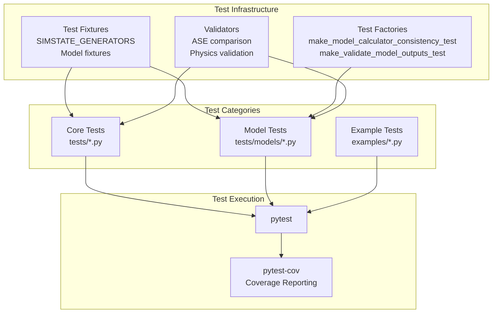
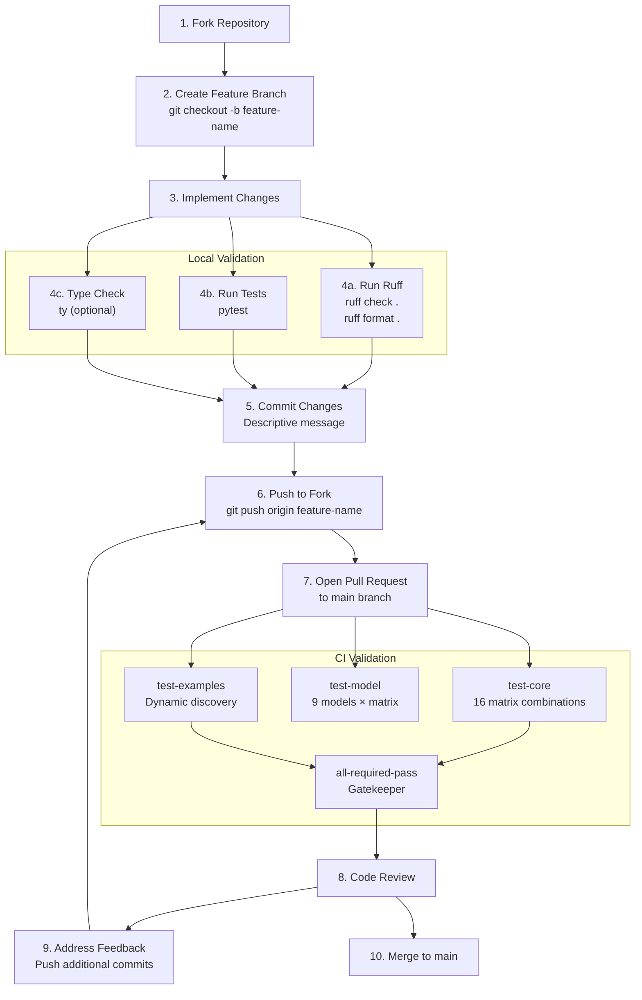
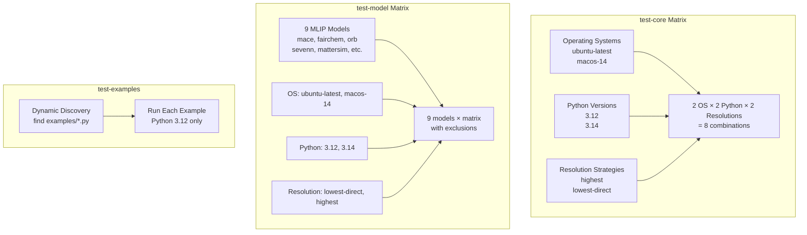
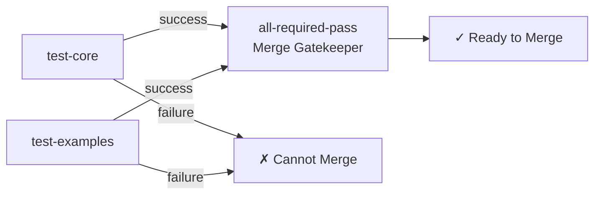
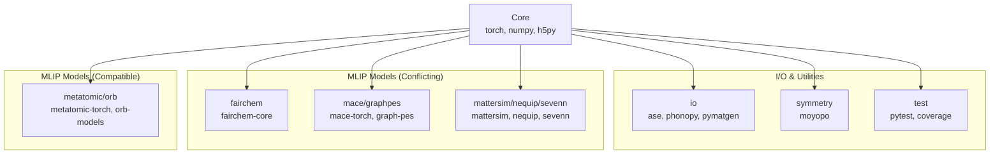

# Contributing Guidelines

<details>
<summary>Relevant source files</summary>

The following files were used as context for generating this wiki page:

- [.github/workflows/test.yml](.github/workflows/test.yml)
- [README.md](README.md)
- [pyproject.toml](pyproject.toml)

</details>


This document provides guidelines for developers who wish to contribute code, documentation, or tests to torch-sim. It covers development environment setup, code style requirements, testing procedures, and the pull request workflow.

For information about the overall project structure, see [Project Structure](#11.1). For details about the CI system, see [Continuous Integration](#11.2).

---

## Overview

Contributing to torch-sim follows a standard fork-and-pull-request workflow with automated quality checks. All contributions must pass linting, type checking, and comprehensive tests before being merged. The project uses modern Python tooling including `ruff` for linting/formatting, `pytest` for testing, and `uv` for dependency management.

---

## Development Environment Setup

### Prerequisites

- Python 3.12 or higher ([pyproject.toml:28]())
- `uv` package manager (recommended)
- Git

### Installation Steps

```bash
# Clone the repository
git clone https://github.com/TorchSim/torch-sim
cd torch-sim

# Install development dependencies
uv pip install -e ".[test]" --system

# Install development tools
uv pip install prek ty --system
```

The `test` extra includes all dependencies needed for running tests ([pyproject.toml:40-48]()):
- Core testing frameworks: `pytest>=8`, `pytest-cov>=6`
- I/O libraries: `ase>=3.26`, `phonopy>=2.37.0`, `pymatgen>=2025.6.14`
- Symmetry support: `moyopo` (via `symmetry` extra)
- Utilities: `platformdirs`, `psutil`, `spglib`

### Optional Model Dependencies

To test specific MLIP models, install the corresponding extras:

```bash
# Individual models
uv pip install -e ".[test,mace]" --system
uv pip install -e ".[test,fairchem]" --system

# Note: Some models have conflicting dependencies
# See pyproject.toml:143-186 for conflict declarations
```

**Sources:** [pyproject.toml:1-231](), [README.md:106-120]()

---

## Code Style and Linting

### Ruff Configuration

The project uses `ruff` for both linting and code formatting with configuration defined in [pyproject.toml:87-133]().

**Key Configuration:**
- **Target Version:** Python 3.12+ ([pyproject.toml:88]())
- **Line Length:** 90 characters ([pyproject.toml:89]())
- **Docstring Convention:** Google style ([pyproject.toml:121]())

### Linting Rules

The project enables "ALL" ruff rules by default ([pyproject.toml:93]()) with specific exceptions ([pyproject.toml:94-120]()). Notable ignored rules include:

| Rule | Description | Rationale |
|------|-------------|-----------|
| `ANN401` | Allow `Any` type annotations | Necessary for flexible interfaces |
| `PLR0913` | Too many function arguments | Scientific code often needs many parameters |
| `PLR2004` | Magic value comparisons | Common in numerical code |
| `PTH` | Use pathlib | Not enforced project-wide |
| `TD`, `FIX002` | TODO/FIXME comments | Allowed in development |

### Per-File Exceptions

Different file types have relaxed rules ([pyproject.toml:126-130]()):

```python
# Tests: Relaxed type hints and docstrings
"**/tests/*" = ["ANN201", "D", "INP001", "S101"]

# Examples: Allow print statements and unused expressions  
"examples/**/*" = ["B018", "T201"]

# Tutorials: All rules disabled
"examples/tutorials/**/*" = ["ALL"]
```

### Running Linting

```bash
# Check code style
ruff check .

# Auto-fix issues
ruff check --fix .

# Format code
ruff format .
```

### Import Sorting

Imports use `isort` integration with specific settings ([pyproject.toml:122-123]()):
- No trailing comma splitting
- 2 blank lines after imports

**Sources:** [pyproject.toml:87-133]()

---

## Testing Requirements

### Test Organization



**Sources:** [.github/workflows/test.yml:14-205](), [pyproject.toml:138-140]()

### Running Tests Locally

```bash
# Run all core tests
pytest --cov=torch_sim --cov-report=xml

# Run specific test file
pytest tests/test_integrators.py -v

# Run specific model tests (requires model installed)
uv pip install -e ".[test,mace]" --system
pytest tests/models/test_mace.py -v

# Run examples as tests
python examples/md_simulation.py
```

### Test Configuration

Pytest configuration is defined in [pyproject.toml:138-140]():

```toml
[tool.pytest.ini_options]
addopts = ["-p no:warnings"]
testpaths = ["tests"]
```

### Writing Tests

All test files in `tests/` directory should:

1. **Use descriptive test names:** `test_<functionality>_<scenario>`
2. **Leverage fixtures:** Use shared fixtures for `SimState` and model initialization
3. **Include docstrings:** Explain what physical/computational property is tested
4. **Be deterministic:** Set random seeds for reproducible results
5. **Compare with ASE:** When possible, validate against ASE reference implementations

Example test structure:

```python
def test_nve_energy_conservation(simstate_generator, lj_model):
    """Test that NVE integrator conserves total energy."""
    state = simstate_generator("bulk_crystal")
    
    # Run simulation
    final_state = ts.integrate(
        system=state,
        model=lj_model,
        n_steps=100,
        timestep=0.001,
        integrator=ts.Integrator.nve,
    )
    
    # Validate energy drift
    energy_drift = abs(final_state.energy - state.energy)
    assert energy_drift < 1e-6
```

**Sources:** [.github/workflows/test.yml:14-145](), [pyproject.toml:138-140]()

---

## Pull Request Process

### PR Workflow Diagram



**Sources:** [.github/workflows/test.yml:1-205](), [README.md:132-134]()

### PR Checklist

Before submitting a pull request, ensure:

- [ ] Code follows ruff style guidelines (`ruff check .` passes)
- [ ] All tests pass locally (`pytest`)
- [ ] New functionality includes tests
- [ ] Public APIs include docstrings (Google style)
- [ ] Examples are updated if API changed
- [ ] Relevant documentation pages updated
- [ ] Commit messages are descriptive

### Commit Message Guidelines

Use clear, descriptive commit messages:

```
Add NVT Nose-Hoover integrator implementation

- Implement thermostat chain for temperature control
- Add NVTNoseHooverState dataclass with chain variables
- Include tests comparing with ASE implementation
- Update documentation with usage examples
```

**Sources:** [README.md:132-134]()

---

## Continuous Integration

### CI Matrix Strategy

The CI system uses a multi-dimensional matrix to test various configurations:



**Sources:** [.github/workflows/test.yml:15-188]()

### Core Tests Job

The `test-core` job runs on every push and PR ([.github/workflows/test.yml:15-53]()):

**Matrix Dimensions:**
- **Operating Systems:** `ubuntu-latest`, `macos-14`
- **Python Versions:** `3.12`, `3.14`
- **Dependency Resolution:** `highest`, `lowest-direct`

**Steps:**
1. Checkout repository
2. Set up Python with specified version
3. Install `uv` package manager
4. Install torch-sim with test dependencies
5. Run pytest with coverage
6. Upload coverage to Codecov

### Model Tests Job

The `test-model` job isolates MLIP models to avoid dependency conflicts ([.github/workflows/test.yml:54-145]()):

**Why Isolation?** Many MLIP packages have incompatible `e3nn` versions as declared in [pyproject.toml:143-186]().

**Model Test Matrix:**

| Model | Test Path | Python Support |
|-------|-----------|----------------|
| `mace` | `tests/models/test_mace.py` | 3.12, 3.14 |
| `fairchem` | `tests/models/test_fairchem.py` | 3.12 only |
| `orb` | `tests/models/test_orb.py` | 3.12 only |
| `sevenn` | `tests/models/test_sevennet.py` | 3.12, 3.14 |
| `mattersim` | `tests/models/test_mattersim.py` | 3.12, 3.14 |
| `metatomic` | `tests/models/test_metatomic.py` | 3.12, 3.14 |
| `nequip` | `tests/models/test_nequip_framework.py` | 3.12 only |
| `graphpes` | `tests/models/test_graphpes_framework.py` | 3.12, 3.14 |

**Special Handling:**
- Legacy fairchem requires checking out separate repository ([.github/workflows/test.yml:89-95]())
- Fairchem tests require HuggingFace token and skip on forks ([.github/workflows/test.yml:131-138]())

### Examples Tests Job

The `test-examples` job validates all example scripts ([.github/workflows/test.yml:146-188]()):

**Process:**
1. `find-examples` job discovers all `.py` files in `examples/` directory
2. `test-examples` job runs each example using `uv run --with .`
3. Examples requiring fairchem skip on forks due to HF token requirement

### Gatekeeper Job

The `all-required-pass` job serves as a merge gatekeeper ([.github/workflows/test.yml:189-205]()):



This job checks that both `test-core` and `test-examples` succeed before allowing merge.

**Note:** `test-model` is **not** required for merge, allowing development to continue even if optional model dependencies have issues.

**Sources:** [.github/workflows/test.yml:1-205]()

---

## Type Checking

The project uses `ty` for type checking with configuration in [pyproject.toml:191-231]().

### Type Checking Rules

Default configuration ([pyproject.toml:191-193]()):
- `unused-ignore-comment`: warn

### Per-Module Overrides

Type checking has specific overrides for different modules ([pyproject.toml:194-231]()):

**Modules with Optional Dependencies** ([pyproject.toml:195-210]()):
- `tests/models/**/*.py`
- `torch_sim/models/**/*.py`
- `torch_sim/constraints.py`
- `torch_sim/io.py`
- `torch_sim/neighbors/vesin.py`
- `torch_sim/symmetrize.py`

These ignore `unresolved-import` errors since dependencies are optional.

**Test Files** ([pyproject.toml:212-219]()):
- Ignore: `invalid-argument-type`, `no-matching-overload`, `unresolved-attribute`, `unresolved-import`

**Documentation and Examples** ([pyproject.toml:221-224]()):
- Ignore: `unresolved-import`

### Running Type Checks

```bash
# Run type checker (optional, not enforced in CI)
ty
```

**Sources:** [pyproject.toml:191-231]()

---

## Documentation Requirements

### Docstring Format

All public APIs must include Google-style docstrings ([pyproject.toml:121]()):

```python
def integrate(
    system: SimState | list[Atoms] | list[Structure],
    model: ModelInterface,
    n_steps: int,
    timestep: float,
    temperature: float | None = None,
    integrator: Integrator = Integrator.nve,
    **kwargs,
) -> MDState:
    """Run molecular dynamics simulation.

    Args:
        system: Initial atomic configuration(s) to simulate.
        model: Potential energy model for force calculations.
        n_steps: Number of integration steps to perform.
        timestep: Time step in picoseconds.
        temperature: Target temperature in Kelvin (required for NVT/NPT).
        integrator: Integration algorithm (nve, nvt_langevin, etc).
        **kwargs: Additional arguments passed to integrator.

    Returns:
        Final MDState after n_steps integration.

    Raises:
        ValueError: If temperature is required but not provided.
    """
```

### Code Comments

- Use comments to explain **why**, not **what**
- Complex algorithms should include references to papers/equations
- Type hints should be clear enough to reduce need for comments

### Example Scripts

When adding new features, include example usage in `examples/` directory:

```bash
examples/
├── md_simulation.py           # Basic MD workflow
├── structure_optimization.py  # Relaxation workflow
└── tutorials/
    └── new_feature.py         # Tutorial for new feature
```

Examples should:
- Be self-contained and runnable
- Include comments explaining key concepts
- Use realistic but minimal datasets
- Print results to demonstrate functionality

**Sources:** [pyproject.toml:121-133](), [.github/workflows/test.yml:146-188]()

---

## Dependency Management

### Core Dependencies

The minimal installation requires ([pyproject.toml:29-37]()):

```toml
dependencies = [
    "h5py>=3.15.1",
    "numpy>=1.26,<3; python_version < '3.13'",
    "numpy>=2.3.2,<3; python_version >= '3.13'",
    "nvalchemi-toolkit-ops>=0.2.0",
    "tables>=3.11.1",
    "torch>=2",
    "tqdm>=4.67",
]
```

### Optional Extras

The project uses extras for optional functionality ([pyproject.toml:39-74]()):



### Dependency Conflicts

Due to incompatible `e3nn` versions, several model combinations cannot coexist ([pyproject.toml:143-186]()):

**Conflict Groups:**
- `fairchem` conflicts with: `mace`, `graphpes`
- `mace` conflicts with: `fairchem`, `mattersim`, `nequip`, `sevenn`
- `graphpes` conflicts with: `fairchem`, `mattersim`, `nequip`, `sevenn`

**Compatible Everywhere:**
- `metatomic`
- `orb`

### Adding New Dependencies

When adding dependencies:

1. **Minimize core dependencies** - Keep `dependencies` list minimal
2. **Use extras** - Add optional dependencies to `[project.optional-dependencies]`
3. **Check conflicts** - Verify compatibility with existing extras
4. **Update CI** - Add to appropriate test matrix if needed
5. **Document** - Update installation instructions and examples

### Version Constraints

- Use **lower bounds** for minimum required versions (`>=`)
- Use **upper bounds** only when necessary (`<`)
- Consider Python version conditionals for `numpy` compatibility

**Sources:** [pyproject.toml:29-186]()

---

## Development Tools

### Ruff (Linting and Formatting)

```bash
# Check all files
ruff check .

# Auto-fix issues
ruff check --fix .

# Format code
ruff format .
```

### Pytest (Testing)

```bash
# Run all tests
pytest

# Run with coverage
pytest --cov=torch_sim --cov-report=html

# Run specific test
pytest tests/test_integrators.py::test_nve_energy_conservation -v
```

### UV (Package Management)

```bash
# Install package in editable mode
uv pip install -e . --system

# Install with extras
uv pip install -e ".[test,mace]" --system

# Run script with dependencies
uv run --with . examples/md_simulation.py
```

### Codespell (Spell Checking)

```bash
# Check for common typos (optional)
codespell .
```

Configuration in [pyproject.toml:134-136]():

```toml
[tool.codespell]
check-filenames = true
ignore-words-list = ["convertor"]
```

**Sources:** [pyproject.toml:87-140]()

---

## Community and Communication

### Slack Workspace

Join the torch-sim Slack for discussions, questions, and collaboration:

[https://join.slack.com/t/torchsim/shared_invite/zt-3fkiju9ip-XhUH7TYp_ejJT6QqEPKMJQ](https://join.slack.com/t/torchsim/shared_invite/zt-3fkiju9ip-XhUH7TYp_ejJT6QqEPKMJQ)

### GitHub Discussions

Use GitHub Discussions for:
- Feature requests
- Design discussions
- General questions

### Bug Reports

Open GitHub Issues for:
- Bug reports with reproducible examples
- Documentation errors
- Test failures

Include:
- Python version
- Operating system
- Minimal reproducible example
- Error messages and stack traces

**Sources:** [README.md:132-134]()

---

## Summary

Contributing to torch-sim requires:

1. **Code Quality:** Pass ruff linting and formatting checks
2. **Testing:** Write and run tests for all new functionality
3. **Documentation:** Include Google-style docstrings and update examples
4. **CI:** Ensure all required CI jobs pass (test-core, test-examples)
5. **Review:** Respond to code review feedback promptly

The project welcomes contributions of all types: bug fixes, new features, documentation improvements, and test enhancements. Join the Slack workspace to discuss ideas before starting major work.

**Sources:** [README.md:132-134](), [pyproject.toml:1-231](), [.github/workflows/test.yml:1-205]()