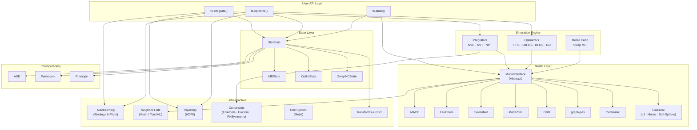

TorchSim is a next-generation atomistic simulation engine built entirely in PyTorch, designed from the ground up to unlock massive performance gains for machine learning interatomic potentials (MLIPs). By rewriting the fundamental primitives of atomistic simulation — state management, force computation, integration, and optimization — as differentiable PyTorch operations, TorchSim achieves up to **100× speedup** over traditional Python-based frameworks like ASE while maintaining a familiar, beginner-friendly API.


This speedup comes from three architectural pillars: **native GPU execution**, **automatic batching** of multiple independent simulations, and **efficient GPU memory management**. Where ASE processes one system at a time on the CPU, TorchSim can run dozens or even hundreds of systems simultaneously on a single GPU, filling available memory to maximize throughput.

Sources: [README.md](README.md#L1-L30)

## Why TorchSim?

Traditional atomistic simulation frameworks were designed for classical force fields running on CPUs. They process one structure at a time, leaving GPU resources underutilized. MLIPs, which are neural network models, are inherently GPU-friendly — but the surrounding simulation infrastructure (integrators, optimizers, neighbor lists, state management) remained CPU-bound, creating a bottleneck. TorchSim eliminates this bottleneck by implementing the entire simulation loop in PyTorch, enabling end-to-end GPU acceleration and unlocking the ability to process many systems in parallel through batching.

The following table summarizes how TorchSim compares to a traditional Python-based simulation workflow:

| Feature | Traditional (ASE) | TorchSim |
|---|---|---|
| Execution device | CPU only | CPU or GPU (CUDA) |
| Simulation parallelism | Sequential (one system at a time) | **Batched** (many systems simultaneously) |
| Memory management | Manual | **Automatic** (adaptive batching) |
| Force models | Classical + MLIP wrappers | Native MLIP adapters + classical potentials |
| Differentiability | Limited | **Fully differentiable** through PyTorch |
| Trajectory format | ASE `.traj` (pickle) | **HDF5-based** binary with compression |
| Unit system | Various | Metal units (Å, eV, amu, ps) |

Sources: [README.md](README.md#L5-L15), [torch_sim/units.py](torch_sim/units.py#L84-L103)

## Architecture at a Glance

TorchSim follows a modular, functional architecture where every simulation method (integrator, optimizer, Monte Carlo propagator) is decomposed into an `init` function and a `step` function. The `init` function creates a specialized state object, and the `step` function advances that state by one iteration. This design enables maximum flexibility: you can use the high-level runners for common workflows, or compose your own simulation loops from the low-level building blocks.



This diagram shows the layered architecture of TorchSim. At the top, high-level runners (`integrate`, `optimize`, `static`) provide a simple entry point. These delegate to the state and simulation engine layers, which in turn depend on models and shared infrastructure. The interoperability layer connects TorchSim to the broader Python materials science ecosystem.

Sources: [torch_sim/__init__.py](torch_sim/__init__.py#L1-L80), [torch_sim/runners.py](torch_sim/runners.py#L1-L10)

## Core Concepts

TorchSim is organized around five core concepts that every user should understand. Each concept is explored in depth in dedicated tutorial notebooks, but here we provide a concise overview of how they fit together.

### SimState — The Heart of Everything

`SimState` is the central data structure in TorchSim. It represents one or more atomistic systems as PyTorch tensors, holding positions, masses, cell matrices, atomic numbers, and periodic boundary conditions. What makes `SimState` powerful is its native support for **batching**: a single `SimState` can represent dozens of independent systems simultaneously, with a `system_idx` tensor mapping each atom to its parent system.


`SimState` supports slicing (`state[[0, 2, 4]]`), cloning, splitting into individual systems, and conversion to ASE `Atoms`, Pymatgen `Structure`, or Phonopy `PhonopyAtoms` objects. All tensor attributes live on the same device, making device transfers a single `.to(device)` call away.

Sources: [torch_sim/state.py](torch_sim/state.py#L70-L125)

### Runners — Your High-Level API

The three runner functions provide a unified, high-level interface for the most common simulation tasks:

| Runner | Purpose | Key Parameters |
|---|---|---|
| `ts.integrate()` | Run molecular dynamics | `integrator`, `n_steps`, `temperature`, `timestep` |
| `ts.optimize()` | Relax atomic positions (and cell) | `optimizer`, `convergence_fn`, `max_steps` |
| `ts.static()` | Single-point energy/force evaluation | (none beyond `system` and `model`) |

All runners accept an ASE `Atoms`, Pymatgen `Structure`, or an existing `SimState` as input. They share a common pattern: you provide a system, a model, and method-specific parameters, and you get back an optimized or evolved state. Autobatching and trajectory reporting can be enabled with simple flags or configuration dictionaries.

Sources: [torch_sim/runners.py](torch_sim/runners.py#L252-L265), [torch_sim/runners.py](torch_sim/runners.py#L551-L565), [torch_sim/runners.py](torch_sim/runners.py#L734-L742)

### Models — Pluggable Force Fields

TorchSim provides a uniform `ModelInterface` that all models implement. This abstract base class, extending `torch.nn.Module`, requires a `forward()` method that takes a `SimState` and returns a dictionary with at minimum `energy` and `forces` (and optionally `stress`). This means switching between models requires changing only the model object — the rest of your simulation code stays identical.

The following MLIP models are supported out of the box:

| Model | Package | Install Extra |
|---|---|---|
| MACE / MACE-MPA | `mace-torch` | `torch-sim[mace]` |
| FairChem (OC20/OC22) | `fairchem-core` | `torch-sim[fairchem]` |
| SevenNet | `sevenn` | `torch-sim[sevenn]` |
| MatterSim | `mattersim` | `torch-sim[mattersim]` |
| ORB | `orb-models` | `torch-sim[orb]` |
| Graph-PES (PET/PET-MAD) | `graph-pes` + `mace-torch` | `torch-sim[graphpes]` |
| Metatomic | `metatomic-torch` | `torch-sim[metatomic]` |
| NequIP | `nequip` | `torch-sim[nequip]` |

Classical potentials — Lennard-Jones, Morse, and soft-sphere — are also included and require no additional dependencies.

> [!TIP]
> All runners use the **metal unit system** (Å for distance, eV for energy, amu for mass, ps for time) internally. When passing temperatures to `integrate()`, convert from Kelvin using `ts.units.temperature` (approximately 8.617e-5 eV/K), or let the runner handle the conversion for you.

Sources: [torch_sim/models/interface.py](torch_sim/models/interface.py#L38-L136), [torch_sim/integrators/__init__.py](torch_sim/integrators/__init__.py#L8-L25), [torch_sim/units.py](torch_sim/units.py#L84-L103)

### Integrators and Optimizers

TorchSim implements a comprehensive set of molecular dynamics integrators and geometry optimizers, each following the `init`/`step` pattern and fully compatible with batched states.

**Integrators** for molecular dynamics:

| Integrator | Ensemble | Thermostat / Barostat |
|---|---|---|
| `ts.Integrator.nve` | Microcanonical | None (constant energy) |
| `ts.Integrator.nvt_langevin` | Canonical | BAOAB Langevin |
| `ts.Integrator.nvt_vrescale` | Canonical | Velocity rescaling (Bussi) |
| `ts.Integrator.nvt_nose_hoover` | Canonical | Nosé-Hoover chain |
| `ts.Integrator.npt_langevin` | Isothermal-isobaric | Langevin thermostat + Langevin barostat |
| `ts.Integrator.npt_nose_hoover` | Isothermal-isobaric | Nosé-Hoover chain |
| `ts.Integrator.npt_isotropic_crescale` | Isothermal-isobaric | C-Rescale (isotropic) |
| `ts.Integrator.npt_anisotropic_crescale` | Isothermal-isobaric | C-Rescale (anisotropic) |

**Optimizers** for geometry relaxation:

| Optimizer | Type | Best For |
|---|---|---|
| `ts.Optimizer.gradient_descent` | First-order | Simple debugging, educational use |
| `ts.Optimizer.fire` | First-order | Robust relaxation of atoms and cell |
| `ts.Optimizer.lbfgs` | Quasi-Newton | Fast convergence, memory-efficient |
| `ts.Optimizer.bfgs` | Quasi-Newton | Fast convergence with full Hessian approx. |

Cell optimization during relaxation is handled by **cell filters** such as `ts.CellFilter.frechet`, which parameterizes the cell deformation space to maintain physical constraints.

Sources: [torch_sim/integrators/__init__.py](torch_sim/integrators/__init__.py#L97-L131), [torch_sim/optimizers/__init__.py](torch_sim/optimizers/__init__.py#L38-L44)

### Autobatching — Maximizing GPU Utilization

One of TorchSim's most distinctive features is its automatic batching system. Different MLIP models consume GPU memory at different rates, and memory usage scales differently depending on the neighbor list algorithm. Manually tuning batch sizes is tedious and error-prone. TorchSim solves this with two complementary strategies:

- **`BinningAutoBatcher`**: Groups systems into fixed bins that fit in GPU memory. Ideal when you have all systems available upfront (e.g., a dataset of candidate structures to relax).
- **`InFlightAutoBatcher`**: Dynamically adds and removes systems from the current batch as they complete. Ideal when systems converge at different rates (e.g., optimizing structures with varying difficulty).

Simply pass `autobatcher=True` to `integrate()` or `optimize()`, and TorchSim will automatically measure GPU memory, determine the optimal batch size, and process systems in memory-safe chunks.

Sources: [torch_sim/autobatching.py](torch_sim/autobatching.py#L520-L574), [torch_sim/autobatching.py](torch_sim/autobatching.py#L813-L878)

## Package Structure

The `torch_sim` package is organized into focused submodules, each responsible for a clear domain of functionality:

```
torch_sim/
├── state.py              # SimState and state utilities
├── runners.py            # High-level integrate/optimize/static API
├── models/               # MLIP and classical model adapters
│   ├── interface.py      # Abstract ModelInterface
│   ├── mace.py           # MACE adapter
│   ├── fairchem.py       # FairChem adapter
│   ├── sevennet.py       # SevenNet adapter
│   ├── mattersim.py      # MatterSim adapter
│   ├── orb.py            # ORB adapter
│   ├── graphpes.py       # Graph-PES adapter
│   ├── metatomic.py      # Metatomic adapter
│   ├── lennard_jones.py  # Classical LJ potential
│   ├── morse.py          # Classical Morse potential
│   └── soft_sphere.py    # Classical soft-sphere potential
├── integrators/          # MD integration schemes
│   ├── md.py             # Base MD state and step logic
│   ├── nve.py            # Velocity Verlet (NVE)
│   ├── nvt.py            # NVT thermostats (Langevin, V-Rescale, NH)
│   └── npt.py            # NPT barostats (Langevin, NH, C-Rescale)
├── optimizers/           # Geometry optimization algorithms
│   ├── gradient_descent.py
│   ├── fire.py
│   ├── lbfgs.py
│   ├── bfgs.py
│   └── cell_filters.py   # Cell parameterization (Frechet, etc.)
├── autobatching.py       # BinningAutoBatcher, InFlightAutoBatcher
├── neighbors/            # Neighbor list backends
│   ├── vesin.py          # Vesin (high-performance, optional)
│   ├── torch_nl.py       # Pure PyTorch neighbor lists
│   └── alchemiops.py     # AlchemiOps integration
├── trajectory.py         # HDF5 trajectory I/O (TorchSimTrajectory, TrajectoryReporter)
├── constraints.py        # FixAtoms, FixCom, FixSymmetry
├── transforms.py         # PBC wrapping, coordinate transforms, linked-cell algorithm
├── monte_carlo.py        # Swap Monte Carlo (Metropolis criterion)
├── elastic.py            # Elastic tensor calculation
├── workflows/            # Higher-level workflows (amorphous-to-crystalline)
├── io.py                 # ASE / Pymatgen / Phonopy conversion
├── units.py              # Metal and Real unit systems
├── quantities.py         # Thermodynamic quantities (KE, temperature, pressure)
├── properties/           # Correlation functions (RDF, S(q))
└── symmetrize.py         # Symmetry analysis utilities
```

Sources: [torch_sim/__init__.py](torch_sim/__init__.py#L1-L80)

## Beyond the Basics

In addition to core molecular dynamics and geometry optimization, TorchSim offers several advanced capabilities that make it a comprehensive platform for computational materials science:

- **Constraints**: Fix specific atoms (`FixAtoms`), remove center-of-mass motion (`FixCom`), or preserve crystal symmetry during relaxation (`FixSymmetry`). All constraints integrate seamlessly with integrators and optimizers in batched mode.
- **Swap Monte Carlo**: Perform atomic species swaps using the Metropolis criterion, enabling solid-state mixing and alloy sampling. Works with the `integrate()` runner and supports trajectory reporting.
- **Elastic Properties**: Calculate the full elastic tensor for any crystal system, with symmetry-aware strain generation and Voigt notation handling.
- **Amorphous-to-Crystalline (A2C) Workflow**: A complete workflow for generating random packed structures, performing simulated crystallization via simulated annealing, and extracting candidate crystal structures from disordered precursors.
- **Trajectory Reporting**: Write simulation trajectories to efficient HDF5 files with on-the-fly compression, supporting arbitrary user-defined properties alongside standard state data.
- **Differentiability**: Because everything is PyTorch, the entire simulation is differentiable — enabling gradient-based inverse design, force-matching, and other ML training workflows that require gradients through the simulation.

Sources: [torch_sim/constraints.py](torch_sim/constraints.py#L28-L34), [torch_sim/monte_carlo.py](torch_sim/monte_carlo.py#L36-L56), [torch_sim/elastic.py](torch_sim/elastic.py#L1-L20), [torch_sim/workflows/a2c.py](torch_sim/workflows/a2c.py#L1-L8), [torch_sim/trajectory.py](torch_sim/trajectory.py#L1-L12)

## Installation

Install TorchSim from PyPI with a single command:

```sh
pip install torch-sim-atomistic
```

Then install the extras for the MLIP models you want to use. For example, to use MACE:

```sh
pip install torch-sim-atomistic[mace]
```

For full interoperability with ASE, Pymatgen, and Phonopy:

```sh
pip install torch-sim-atomistic[io]
```

You can install from source if you want to contribute or use the latest development version:

```sh
git clone https://github.com/TorchSim/torch-sim
cd torch-sim
pip install .
```

TorchSim requires **Python 3.12+** and **PyTorch 2+**.

Sources: [README.md](README.md#L99-L112), [pyproject.toml](pyproject.toml#L33-L60)

## What to Read Next

This overview covers the breadth of TorchSim's capabilities. To get started quickly, follow the logical reading progression below:

1. **[Quick Start](2-quick-start)** — Run your first batched MD simulation in under 10 lines of code.
2. **[Installation and Model Setup](3-installation-and-model-setup)** — Detailed setup instructions for each MLIP model.
3. **[Running Batched MD Simulations](4-running-batched-md-simulations)** — Deep dive into `ts.integrate()` with all integrator options.
4. **[Architecture Overview](6-architecture-overview)** — Understand how the internals fit together for advanced customization.

If you prefer to jump straight to a specific topic, explore the full catalog using the navigation sidebar.