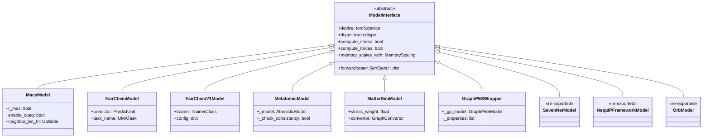

TorchSim provides a unified simulation interface to a growing ecosystem of machine-learned interatomic potentials (MLIPs). Every supported model—whether implemented as a native wrapper or re-exported from an upstream package—conforms to the same `ModelInterface` contract, making them drop-in interchangeable across all TorchSim runners, optimizers, and integrators. This page catalogs each supported MLIP, its initialization patterns, distinctive behaviors, and the upstream dependency requirements.

## Model Interface Contract

All MLIP models in TorchSim inherit from `ModelInterface`, an abstract base class that extends both `torch.nn.Module` and `ABC`. The contract mandates a single `forward(state: SimState) -> dict[str, torch.Tensor]` method that returns at minimum an `"energy"` tensor of shape `[n_systems]`. Models optionally return `"forces"` of shape `[n_atoms, 3]` and `"stress"` of shape `[n_systems, 3, 3]`, controlled by the `compute_forces` and `compute_stress` boolean flags. Every model also exposes `device`, `dtype`, and `memory_scales_with` properties that the autobatching system consults when allocating GPU memory.
Sources: [interface.py](torch_sim/models/interface.py#L38-L136)

The `memory_scales_with` property is particularly important for automatic batching. Models that use radial neighbor cutoffs (where the number of neighbors grows with system density) report `"n_atoms_x_density"`, while models with a fixed neighbor count per atom report `"n_atoms"`. This distinction directly affects how the autobatcher estimates memory consumption for batch size decisions. See [Automatic Batching and GPU Memory](18-automatic-batching-and-gpu-memory) for the full algorithmic details.



## Native MLIP Wrappers

TorchSim ships with first-party wrappers for five MLIP ecosystems. These models are maintained directly within the `torch_sim/models/` directory and handle all data conversion, neighbor list construction, and device management internally.

### MACE (Multi-Atomic Cluster Expansion)

The `MaceModel` wrapper integrates models from the [MACE](https://github.com/ACEsuit/mace-mp) framework, a high-performance equivariant neural network potential based on atomic cluster expansions. It is the most tightly integrated MLIP in TorchSim, managing its own neighbor list construction internally via a configurable `neighbor_list_fn` (defaulting to `torchsim_nl`). This gives MACE direct access to TorchSim's linked-cell neighbor list implementations for optimized batched cutoff computation.
Sources: [mace.py](torch_sim/models/mace.py#L79-L200)

MACE supports an optional CuEq acceleration mode (`enable_cueq=True`) that converts the underlying e3nn operations to a faster implementation, and it accepts pre-computed `atomic_numbers` and `system_idx` tensors at initialization time to avoid redundant per-step setup. Three pretrained checkpoints are available as URL constants in the `MaceUrls` enum for quick access.
Sources: [mace.py](torch_sim/models/mace.py#L170-L172)

```python
from torch_sim.models.mace import MaceModel, MaceUrls

model = MaceModel(
    model="path/to/mace_checkpoint.model",
    device=torch.device("cuda"),
    dtype=torch.float64,
    compute_stress=True,
    enable_cueq=True,  # optional CuEq acceleration
)
```

### FairChem (Open Catalyst Project / OCP)

TorchSim provides **two** FairChem wrappers targeting different versions of the upstream `fairchem-core` package. The `FairChemModel` targets fairchem-core 2.2.0+ and uses the efficient `pretrained_mlip.get_predict_unit` predictor API for batch inference, while the `FairChemV1Model` targets fairchem-core < 2.0.0 and uses the legacy trainer/registry pattern. The distinction matters because the two APIs differ substantially in how models are loaded and configured.
Sources: [fairchem.py](torch_sim/models/fairchem.py#L50-L109), [fairchem_legacy.py](torch_sim/models/fairchem_legacy.py#L39-L47)

Both FairChem wrappers report `memory_scales_with = "n_atoms"`, reflecting their fixed-neighbor-count architecture. Neither supports custom neighbor list functions—they handle neighbor computation internally. The modern `FairChemModel` accepts a `task_name` parameter for Universal Material Approximation (UMA) models, and the legacy `FairChemV1Model` supports YAML configuration files alongside checkpoint paths. Note that `FairChemV1Model` does not support mixed periodic boundary conditions.
Sources: [fairchem.py](torch_sim/models/fairchem.py#L106-L113), [fairchem_legacy.py](torch_sim/models/fairchem_legacy.py#L176-L186)

```python
# Modern FairChem (v2.2.0+)
from torch_sim.models.fairchem import FairChemModel

model = FairChemModel(
    model="path/to/checkpoint.pt",
    device=torch.device("cuda"),
    compute_stress=True,
)

# Legacy FairChem (< v2.0.0)
from torch_sim.models.fairchem_legacy import FairChemV1Model

model = FairChemV1Model(
    model="path/to/checkpoint.pt",
    local_cache="./model_cache",
    device=torch.device("cuda"),
    compute_stress=True,
)
```

### MatterSim

The `MatterSimModel` wraps models from the [MatterSim](https://github.com/microsoft/mattersim) framework, which uses a two-body/three-body graph neural network architecture (based on M3GNet). Unlike other wrappers, `MatterSimModel` requires a pre-loaded `Potential` model object as its input rather than accepting a file path—it expects the caller to handle checkpoint loading externally. Internally, it uses a `GraphConvertor` to transform atomistic data into the format MatterSim expects, with both a two-body cutoff and a separate three-body cutoff extracted from the model's configuration.
Sources: [mattersim.py](torch_sim/models/mattersim.py#L55-L108)

MatterSim applies a configurable `stress_weight` (defaulting to `MetalUnits.pressure * 1e4`, i.e., GPa) to scale the raw stress output into simulation-compatible units. The model reports `memory_scales_with = "n_atoms_x_density"` with a comment noting that it actually scales with density squared due to three-body interactions.
Sources: [mattersim.py](torch_sim/models/mattersim.py#L87-L91)

```python
from torch_sim.models.mattersim import MatterSimModel
from mattersim.forcefield import Potential as MatterSimPotential

# Load model externally, then wrap
loaded_model = MatterSimPotential.load("path/to/mattersim.ckpt")
model = MatterSimModel(model=loaded_model, device=torch.device("cuda"))
```

### Metatomic

The `MetatomicModel` wraps models compatible with the [metatomic](https://github.com/metatensor/metatomic) framework, which provides a standardized interface for atomistic machine learning models. It supports loading models from `.ckpt` files (via `load_model`) or `.pt` files (via `load_atomistic_model`), and includes a predefined `"pet-mad"` model name that downloads from HuggingFace. Metatomic validates that the model's reported capabilities include an `"energy"` output before proceeding.
Sources: [metatomic.py](torch_sim/models/metatomic.py#L62-L147)

A distinctive characteristic of Metatomic is its system-by-system processing approach. Unlike graph-based models that batch all systems into a single computation graph, Metatomic feeds each system as a separate `System` object and uses `torch.autograd.grad` to derive forces and stresses from the energy output. This means forces and stresses are computed via automatic differentiation rather than by the model itself. Neighbor lists are computed using `vesin` on CPU and then transferred back to the target device.
Sources: [metatomic.py](torch_sim/models/metatomic.py#L186-L257)

```python
from torch_sim.models.metatomic import MetatomicModel

# Using the predefined pet-mad model
model = MetatomicModel(model="pet-mad", device=torch.device("cuda"))

# Loading from a checkpoint file
model = MetatomicModel(model="path/to/model.ckpt", device=torch.device("cuda"))
```

> [!TIP]
> **Metatomic dtype enforcement**: The `MetatomicModel` validates that input positions match the model's internal dtype exactly and raises a `TypeError` if they don't. Unlike other wrappers that silently cast, this strict check prevents subtle numerical issues but requires careful dtype alignment when constructing your `SimState`.

## Re-exported Models (Upstream Integration)

TorchSim re-exports model integrations that are implemented and maintained within their respective upstream packages. These wrappers follow a consistent pattern: they attempt to import the upstream integration class at module load time, and if the import fails, they install a placeholder class that raises the captured `ImportError` on instantiation. This ensures that code referencing these models type-checks correctly even when the upstream package is not installed.
Sources: [sevennet.py](torch_sim/models/sevennet.py#L15-L32), [nequip_framework.py](torch_sim/models/nequip_framework.py#L15-L44), [orb.py](torch_sim/models/orb.py#L15-L43)

### SevenNet

The `SevenNetModel` re-exports `sevenn.torchsim.SevenNetModel` from the [SevenNet](https://github.com/MDIL-SNU/SevenNet) package. SevenNet provides PyTorch-based interatomic potentials with a focus on molecular dynamics simulations. The full implementation, including initialization parameters and forward pass logic, lives in the `sevenn` package—TorchSim's wrapper is purely a re-export for convenient importing as `torch_sim.models.SevenNetModel`.
Sources: [sevennet.py](torch_sim/models/sevennet.py#L1-L8)

```python
from torch_sim.models import SevenNetModel

model = SevenNetModel("path/to/sevennet_model.ckpt", device=torch.device("cuda"))
```

### NequIP / Allegro

The `NequIPFrameworkModel` re-exports `nequip.integrations.torchsim.NequIPTorchSimCalc` from the [NequIP](https://github.com/mir-group/nequip) package. NequIP (and its Allegro variant) implements equivariant neural network potentials using irreducible representation layers. The wrapper forces `dtype` to `torch.float64`—the AOTInductor-compiled model may internally use a different dtype but casts to float64 for output. It also provides a `from_compiled_model` classmethod for loading AOT-compiled models from disk.
Sources: [nequip_framework.py](torch_sim/models/nequip_framework.py#L19-L25)

```python
from torch_sim.models.nequip_framework import NequIPFrameworkModel

# From compiled model
model = NequIPFrameworkModel.from_compiled_model("path/to/compiled_model.pt")
```

### ORB Models

The `OrbModel` re-exports `orb_models.forcefield.inference.orb_torchsim.OrbTorchSimModel` from the [orb-models](https://github.com/orbital-materials/orb-models) package by Orbital Materials. The TorchSim wrapper adds one critical behavior on top of the upstream implementation: it detaches all output tensors from the computation graph in the `forward` method. This ensures that downstream simulation code does not inadvertently retain references to the model's autograd graph, which would prevent garbage collection of intermediate activations.
Sources: [orb.py](torch_sim/models/orb.py#L19-L27)

```python
from torch_sim.models import OrbModel

model = OrbModel(device=torch.device("cuda"))
```

### GraphPES

The `GraphPESWrapper` wraps `GraphPESModel` instances from the [graph-pes](https://github.com/jla-gardner/graph-pes) package, a training framework that supports multiple existing model architectures including SchNet, PaiNN, MACE, NequIP, TensorNet, and EDDP. This makes GraphPES the most architecturally flexible wrapper in TorchSim—a single `GraphPESWrapper` can serve as the integration point for any of these underlying architectures simply by loading a different trained model file.
Sources: [graphpes_framework.py](torch_sim/models/graphpes_framework.py#L100-L109)

The wrapper includes an adaptive memory scaling heuristic: it inspects the model's cutoff value and sets `memory_scales_with` to `"n_atoms"` when the cutoff is below 0.5 Å (indicating a model that uses a fixed neighbor count), and defaults to the standard `"n_atoms_x_density"` otherwise. The forward pass converts a `SimState` into an `AtomicGraph` object using a custom `state_to_atomic_graph` helper, then delegates prediction to the upstream model's `predict` method.
Sources: [graphpes_framework.py](torch_sim/models/graphpes_framework.py#L167-L187)

```python
from torch_sim.models.graphpes_framework import GraphPESWrapper

# From a saved model file
model = GraphPESWrapper("path/to/graphpes_model.pt", device=torch.device("cuda"))

# From a GraphPESModel instance
from graph_pes.models import load_model
gp_model = load_model("path/to/model.pt")
model = GraphPESWrapper(gp_model)
```

## Model Comparison Matrix

The following table summarizes the key distinguishing characteristics of each supported MLIP model. Understanding these differences is essential when selecting a model for your simulation workflow and configuring the autobatching system.

| Model | Class | Upstream Package | Initialization Input | Memory Scaling | Neighbor List | Stress Default | Custom NL Support |
|-------|-------|-----------------|---------------------|---------------|---------------|----------------|-------------------|
| MACE | `MaceModel` | `mace-torch` | Path or `nn.Module` | `n_atoms_x_density` | Internal (linked-cell) | `True` | ✅ Configurable |
| FairChem | `FairChemModel` | `fairchem-core` ≥2.2.0 | Path or pretrained name | `n_atoms` | Internal | `False` | ❌ |
| FairChem Legacy | `FairChemV1Model` | `fairchem-core` <2.0.0 | Path, name, or config YAML | `n_atoms` | Internal (OTF graph) | `False` | ❌ |
| MatterSim | `MatterSimModel` | `mattersim` | `Potential` object | `n_atoms_x_density` | Internal (GraphConvertor) | `True` | ❌ |
| Metatomic | `MetatomicModel` | `metatomic-torch` | `.ckpt` or `.pt` path | `n_atoms_x_density` | Internal (vesin on CPU) | `True` | ❌ |
| SevenNet | `SevenNetModel` | `sevenn` | Upstream-defined | Upstream-defined | Upstream-defined | Upstream-defined | Upstream-defined |
| NequIP | `NequIPFrameworkModel` | `nequip` | Compiled model path | Upstream-defined | Upstream-defined | Upstream-defined | Upstream-defined |
| ORB | `OrbModel` | `orb-models` | Upstream-defined | Upstream-defined | Upstream-defined | Upstream-defined | Upstream-defined |
| GraphPES | `GraphPESWrapper` | `graph-pes` | `GraphPESModel` or path | Adaptive (cutoff-based) | Internal | `True` | ❌ |

Sources: [mace.py](torch_sim/models/mace.py#L103-L153), [fairchem.py](torch_sim/models/fairchem.py#L71-L113), [fairchem_legacy.py](torch_sim/models/fairchem_legacy.py#L123-L179), [mattersim.py](torch_sim/models/mattersim.py#L55-L91), [metatomic.py](torch_sim/models/metatomic.py#L62-L147), [graphpes_framework.py](torch_sim/models/graphpes_framework.py#L131-L169)

## Dependency Management and Graceful Degradation

Models with upstream dependencies use a try/except import pattern that captures the `ImportError` and substitutes a placeholder class. This means `from torch_sim.models import MaceModel` will always succeed at the import level, even if `mace-torch` is not installed. The error is deferred to instantiation time, providing a clear message about the missing package. This design allows documentation generators, type checkers, and IDEs to work without installing every optional dependency.
Sources: [sevennet.py](torch_sim/models/sevennet.py#L15-L32), [nequip_framework.py](torch_sim/models/nequip_framework.py#L15-L44), [orb.py](torch_sim/models/orb.py#L15-L43)

For native wrappers like `MaceModel` and `FairChemV1Model`, the import is direct (no try/except), meaning the import itself will fail if the upstream package is not available. These models are expected to be installed when needed—typically via extras like `pip install torch-sim[mace]` or `pip install torch-sim[fairchem]`.

## Testing and Validation

Every MLIP model undergoes two layers of automated testing defined in `tests/models/conftest.py`. The `make_validate_model_outputs_test` factory verifies that a model's forward pass output conforms to the `ModelInterface` contract—correct tensor shapes, detached outputs, and proper device placement. The `make_model_calculator_consistency_test` factory compares the TorchSim model's energy, force, and stress predictions against an ASE calculator wrapping the same underlying model, ensuring numerical equivalence within configurable tolerances. These factory functions are used across all model test modules (`test_mace.py`, `test_fairchem.py`, `test_metatomic.py`, etc.) to maintain a uniform validation standard.
Sources: [tests/models/conftest.py](tests/models/conftest.py#L16-L102)

## Next Steps

- **[Model Interface and Adapters](9-model-interface-and-adapters)** for the detailed `ModelInterface` contract and output validation utilities.
- **[Classical Potential Models](11-classical-potential-models)** for the non-MLIP potentials (Lennard-Jones, Morse, etc.) that follow the same interface.
- **[Automatic Batching and GPU Memory](18-automatic-batching-and-gpu-memory)** for how `memory_scales_with` drives batch size selection across different model types.
- **[Installation and Model Setup](3-installation-and-model-setup)** for environment setup and model-specific installation instructions.