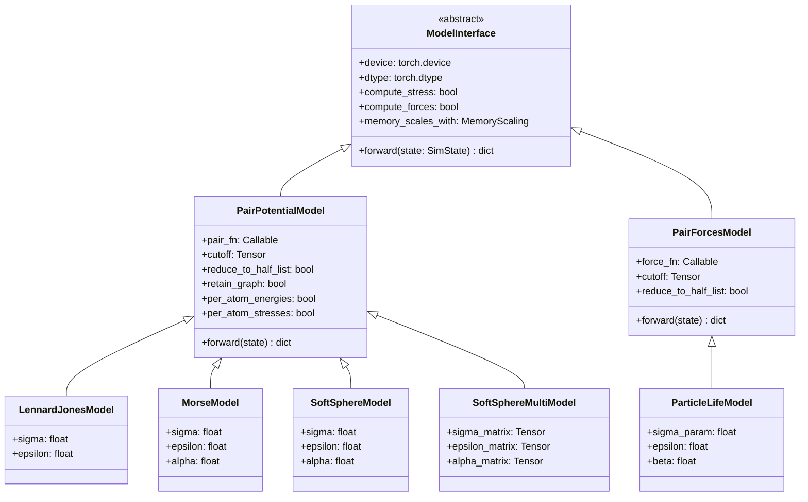

TorchSim provides a layered architecture for classical (non-machine-learned) interatomic potentials. At its foundation lies a generic **pair potential framework** — `PairPotentialModel` — that accepts any callable energy function and automatically derives forces via autograd, computes virial stresses, and operates on batched simulation states. On top of this framework sit thin convenience wrappers for specific well-known potentials: Lennard-Jones, Morse, Soft Sphere, and Particle Life. This page explains the framework's internals, documents every bundled classical model, and demonstrates how to define entirely new potentials with minimal code.

For the abstract interface that all models — classical and ML — must satisfy, see [Model Interface and Adapters](9-model-interface-and-adapters). For the simulation state that these models consume, see [SimState and State Hierarchy](7-simstate-and-state-hierarchy).

## Architecture Overview

The classical potential subsystem is built on a three-tier inheritance hierarchy that separates *what* to compute (the pair function) from *how* to compute it (neighbor lists, batching, stress accumulation).



The key architectural insight is the **separation of pair physics from infrastructure**. `PairPotentialModel` handles all the machinery — neighbor list construction via `torchsim_nl`, PBC-aware displacement vectors, half-list reduction, autograd force derivation, and virial stress accumulation — while the concrete subclass supplies only a single scalar pair energy function. This means adding a brand-new potential requires implementing *one function*, not an entire model class.

## The Pair Potential Framework

### `PairPotentialModel`: Energy-Based Pair Models

`PairPotentialModel` is the central workhorse for any potential that can be expressed as a scalar pairwise energy. It accepts a callable with signature `(distances, atomic_numbers_i, atomic_numbers_j) → pair_energies`, where all tensors are 1-D with length `n_pairs` [pair_potential.py](torch_sim/models/pair_potential.py#L283-L284). Forces are obtained analytically via `torch.autograd.grad` by differentiating the total pair energy with respect to the distance tensor, avoiding any manual derivative derivation.

The forward pass follows a precise pipeline implemented in `_prepare_pairs` [pair_potential.py](torch_sim/models/pair_potential.py#L130-L150): unwrap the `SimState` → build a neighbor list → compute pair displacement vectors `dr_vec` and scalar distances → optionally reduce to half list → evaluate the pair function → accumulate energies and forces per atom and per system.

**Half-list reduction** is a critical optimization controlled by the `reduce_to_half_list` flag [pair_potential.py](torch_sim/models/pair_potential.py#L86-L128). The full neighbor list contains each unordered pair twice (as `(i,j)` and `(j,i)`). For symmetric potentials, this is wasteful. The `full_to_half_list` function retains each pair exactly once: for `i ≠ j`, the copy with `i < j` is kept; for self-image pairs through periodic boundaries (`i == j`, non-zero shift), the copy whose first non-zero shift component is positive is kept. When the half list is active, the energy weight is `1.0` per pair (each pair appears once) instead of `0.5` (each pair appears twice) [pair_potential.py](torch_sim/models/pair_potential.py#L414-L415). Forces use Newton's third law explicitly: `forces.index_add(0, mapping[0], -force_vectors)` and `forces.index_add(0, mapping[1], force_vectors)` [pair_potential.py](torch_sim/models/pair_potential.py#L428-L432). On the full list, only the source atom accumulates to avoid double-counting [pair_potential.py](torch_sim/models/pair_potential.py#L434-L435).

**Virial stress computation** follows the standard pair virial formula: `σ = -1/V Σ_{ij} r_ij ⊗ f_ij` [pair_potential.py](torch_sim/models/pair_potential.py#L206-L214). The `_accumulate_stress` function scales the result by `1.0` (half list) or `0.5` (full list) and optionally distributes per-atom stresses by splitting each pair's contribution equally between its two endpoints [pair_potential.py](torch_sim/models/pair_potential.py#L241-L256).

The full constructor signature exposes every tuning knob:

| Parameter | Type | Default | Purpose |
|-----------|------|---------|---------|
| `pair_fn` | `Callable` | *required* | Pair energy function `(dr, zi, zj) → energies` |
| `cutoff` | `float` | *required* | Neighbor list construction range |
| `device` | `torch.device` | CPU | Computation device |
| `dtype` | `torch.dtype` | `float64` | Tensor precision |
| `compute_forces` | `bool` | `True` | Enable force computation |
| `compute_stress` | `bool` | `False` | Enable virial stress tensor |
| `per_atom_energies` | `bool` | `False` | Return per-atom energies |
| `per_atom_stresses` | `bool` | `False` | Return per-atom stress tensors |
| `neighbor_list_fn` | `Callable` | `torchsim_nl` | Neighbor list builder |
| `reduce_to_half_list` | `bool` | `False` | Use half-list optimization |
| `retain_graph` | `bool` | `False` | Keep autograd graph for meta-learning |

Sources: [pair_potential.py](torch_sim/models/pair_potential.py#L306-L350)

### `PairForcesModel`: Force-Based Pair Models

Some interactions cannot be expressed as the gradient of a scalar energy — they are non-conservative or deliberately asymmetric. For these, `PairForcesModel` accepts a force function with signature `(distances, atomic_numbers_i, atomic_numbers_j) → force_magnitudes` [pair_potential.py](torch_sim/models/pair_potential.py#L473-L514). It skips autograd entirely, assembles force vectors as `(f/r) * r̂_ij`, and accumulates them onto both atoms in the pair. The energy output is always zeros.

This is the correct base class for the Particle Life model and any other artificial or game-physics interaction where energy conservation is not required.

Sources: [pair_potential.py](torch_sim/models/pair_potential.py#L473-L619)

### Output Tensor Contract

Regardless of which base class is used, every classical model returns a dictionary from `forward()` with a consistent schema:

| Key | Shape | Condition | Description |
|-----|-------|-----------|-------------|
| `"energy"` | `[n_systems]` | Always | Total potential energy per system |
| `"forces"` | `[n_atoms, 3]` | `compute_forces=True` | Atomic force vectors |
| `"stress"` | `[n_systems, 3, 3]` | `compute_stress=True` | Virial stress tensor |
| `"energies"` | `[n_atoms]` | `per_atom_energies=True` | Per-atom energy decomposition |
| `"stresses"` | `[n_atoms, 3, 3]` | `per_atom_stresses=True` | Per-atom stress decomposition |

When `retain_graph=False` (the default), all tensors are detached from the computation graph. Setting `retain_graph=True` preserves the graph for differentiable simulation and meta-optimization [pair_potential.py](torch_sim/models/pair_potential.py#L449-L452).

Sources: [pair_potential.py](torch_sim/models/pair_potential.py#L400-L402), [interface.py](torch_sim/models/interface.py#L135-L169)

## Bundled Classical Potentials

### Lennard-Jones 12-6

The Lennard-Jones potential is the canonical model for van der Waals interactions. `LennardJonesModel` wraps `PairPotentialModel` with the `lennard_jones_pair` energy function baked in via `functools.partial` [lennard_jones.py](torch_sim/models/lennard_jones.py#L74-L141).

The pair energy and force functions are:

```
V(r) = 4ε[(σ/r)¹² - (σ/r)⁶]

F(r) = 24ε/r [2(σ/r)¹² - (σ/r)⁶]
```

The equilibrium distance (energy minimum) occurs at `r_min = 2^(1/6) · σ ≈ 1.122σ`, with a well depth of `-ε`. The default cutoff is `2.5σ`, which truncates the potential in the attractive basin. The model sets `reduce_to_half_list=True` since LJ is a symmetric interaction [lennard_jones.py](torch_sim/models/lennard_jones.py#L134).

```python
from torch_sim.models import LennardJonesModel

model = LennardJonesModel(
    sigma=3.405,          # Å (argon)
    epsilon=0.0104,       # eV
    cutoff=2.5 * 3.405,   # ~8.5 Å
    compute_forces=True,
    compute_stress=True,
)
results = model(sim_state)
```

A standalone `lennard_jones_pair_force` function is also exported for direct use with `PairForcesModel` or analytical verification [lennard_jones.py](torch_sim/models/lennard_jones.py#L50-L71).

Sources: [lennard_jones.py](torch_sim/models/lennard_jones.py#L23-L71)

### Morse Potential

The Morse potential models covalent bonds with an asymmetric well — steeper repulsion on the compression side and a softer, exponentially decaying attraction. `MorseModel` is a `PairPotentialModel` subclass [morse.py](torch_sim/models/morse.py#L78-L145).

```
V(r) = ε[1 - exp(-α(r - σ))]² - ε

F(r) = -2αε exp(-α(r-σ)) [1 - exp(-α(r-σ))]
```

The three parameters have clear physical meanings: `σ` is the equilibrium bond length, `ε` is the dissociation energy (well depth), and `α` controls the well width — larger `α` produces a narrower, stiffer bond. The default cutoff is `2.5σ` [morse.py](torch_sim/models/morse.py#L126).

```python
from torch_sim.models import MorseModel

model = MorseModel(
    sigma=2.55,       # equilibrium distance (Å)
    epsilon=0.436,    # well depth (eV)
    alpha=1.359,      # width parameter
    cutoff=6.0,
)
results = model(sim_state)
```

Sources: [morse.py](torch_sim/models/morse.py#L23-L71)

### Soft Sphere

The soft sphere potential is a purely repulsive interaction widely used in granular dynamics, colloidal simulations, and as a starting configuration for geometry optimizations. Two variants are provided.

**`SoftSphereModel`** is the single-species version [soft_sphere.py](torch_sim/models/soft_sphere.py#L175-L246). Its potential is zero beyond `σ`, making `σ` simultaneously the interaction diameter and the natural cutoff:

```
V(r) = (ε/α)(1 - r/σ)^α    for r < σ,  else 0

F(r) = (ε/σ)(1 - r/σ)^(α-1)    for r < σ,  else 0
```

The exponent `α` controls the hardness of the sphere: `α = 2` gives a harmonic-like repulsion (Hertzian contact), while larger values produce steeper walls. The default cutoff equals `σ` [soft_sphere.py](torch_sim/models/soft_sphere.py#L233).

**`SoftSphereMultiModel`** extends this to multi-species systems with per-species-pair parameter matrices [soft_sphere.py](torch_sim/models/soft_sphere.py#L248-L378). Instead of scalar parameters, it takes `sigma_matrix`, `epsilon_matrix`, and optionally `alpha_matrix` — symmetric `[n_species, n_species]` tensors — and dispatches the correct parameters for each interacting pair at runtime. This dispatch is handled by `MultiSoftSpherePairFn`, a `torch.nn.Module` that maps atomic numbers to matrix indices via an internal lookup buffer [soft_sphere.py](torch_sim/models/soft_sphere.py#L90-L168).

```python
from torch_sim.models import SoftSphereMultiModel
import torch

model = SoftSphereMultiModel(
    atomic_numbers=torch.tensor([18, 36]),       # Ar, Kr
    sigma_matrix=torch.tensor([[3.4, 3.6],       # Ar-Ar, Ar-Kr
                                [3.6, 3.7]]),     # Kr-Ar, Kr-Kr
    epsilon_matrix=torch.tensor([[0.01, 0.012],
                                  [0.012, 0.014]]),
    compute_forces=True,
)
```

> [!TIP]
> `SoftSphereMultiModel` validates that all parameter matrices are symmetric (equal to their transpose) at construction time, raising `ValueError` otherwise. This catches a common error where off-diagonal cross-species parameters are specified inconsistently.

Sources: [soft_sphere.py](torch_sim/models/soft_sphere.py#L35-L89), [soft_sphere.py](torch_sim/models/soft_sphere.py#L175-L378)

### Particle Life

Particle Life is an artificial-life simulation model that produces emergent flocking, orbiting, and self-organization from simple distance-dependent force rules. Critically, it is **not derivable from an energy function** — the interaction can be inherently non-conservative — so it inherits from `PairForcesModel` rather than `PairPotentialModel` [particle_life.py](torch_sim/models/particle_life.py#L57-L123).

The force function defines two regimes with an inner radius `β` and outer radius `σ`:

```
F(r) = r/β - 1                   for r < β       (linear repulsion)
F(r) = A(1 - |2r - 1 - β|/(1-β)) for β ≤ r < σ  (triangular attraction/repulsion)
F(r) = 0                          for r ≥ σ
```

The `beta` parameter sets the repulsive core size, `sigma` is the interaction range (the model defaults its cutoff to `2.5σ`), and `epsilon` maps to the amplitude `A` controlling the strength of the outer force regime. Because the interaction can be asymmetric, `reduce_to_half_list` is set to `False` [particle_life.py](torch_sim/models/particle_life.py#L112). The `energy` field in the output dictionary is always zeros.

```python
from torch_sim.models import ParticleLifeModel

model = ParticleLifeModel(
    sigma=1.0,      # outer interaction radius
    epsilon=1.0,    # force amplitude (A)
    beta=0.3,       # inner repulsive core radius
    cutoff=1.0,
)
results = model(sim_state)
```

Sources: [particle_life.py](torch_sim/models/particle_life.py#L24-L55), [particle_life.py](torch_sim/models/particle_life.py#L75-L123)

## Potential Comparison

The following table summarizes the key differences between all bundled classical models to guide model selection.

| Model | Base Class | Parameters | Symmetric | Energy | Default Cutoff | Primary Use Case |
|-------|-----------|------------|-----------|--------|----------------|------------------|
| `LennardJonesModel` | `PairPotentialModel` | `σ`, `ε` | Yes | Conservative | `2.5σ` | Van der Waals gases, noble liquids |
| `MorseModel` | `PairPotentialModel` | `σ`, `ε`, `α` | Yes | Conservative | `2.5σ` | Covalent bonds, diatomic molecules |
| `SoftSphereModel` | `PairPotentialModel` | `σ`, `ε`, `α` | Yes | Conservative | `σ` | Granular media, colloids, repulsive packing |
| `SoftSphereMultiModel` | `PairPotentialModel` | `σ`, `ε`, `α` matrices | Yes | Conservative | `max(σ_matrix)` | Multi-component repulsive mixtures |
| `ParticleLifeModel` | `PairForcesModel` | `σ`, `ε` (A), `β` | No | **Non-conservative** | `2.5σ` | Artificial life, emergent dynamics |

## Defining Custom Pair Potentials

The framework is designed so that adding a new potential requires only a single pair function and (optionally) a thin subclass. The process follows a consistent pattern used by every bundled model.

### Pattern: Pair Energy Function

Write a function with the standard signature `(dr, zi, zj, **params) → pair_energies`. The `zi` and `zj` arguments receive atomic number tensors for type-dependent potentials; for type-independent potentials, mark them as unused with `# noqa: ARG001` as the bundled models do.

```python
import torch
import functools
from torch_sim.models.pair_potential import PairPotentialModel

def born_mayer_pair(
    dr: torch.Tensor,
    zi: torch.Tensor,  # noqa: ARG001
    zj: torch.Tensor,  # noqa: ARG001
    A: float = 1000.0,
    rho: float = 0.3,
    C: float = 50.0,
) -> torch.Tensor:
    """Born-Mayer potential: V(r) = A·exp(-r/ρ) - C/r⁶"""
    repulsive = A * torch.exp(-dr / rho)
    attractive = C / dr.pow(6)
    energy = repulsive - attractive
    return torch.where(dr > 0, energy, torch.zeros_like(energy))

# Bind parameters and create model
pair_fn = functools.partial(born_mayer_pair, A=1000.0, rho=0.3, C=50.0)
model = PairPotentialModel(pair_fn=pair_fn, cutoff=10.0)
```

### Pattern: Type-Dependent Potentials via Atomic Numbers

For potentials where interaction parameters depend on the species pair (like `SoftSphereMultiModel`), use the `zi` and `zj` atomic number tensors to dispatch parameters. The recommended pattern is to create an `nn.Module` that holds parameter matrices and a lookup table, following the `MultiSoftSpherePairFn` design [soft_sphere.py](torch_sim/models/soft_sphere.py#L90-L168):

```python
class MyTypeDependentPairFn(torch.nn.Module):
    def __init__(self, atomic_numbers, param_matrix):
        super().__init__()
        self.register_buffer("atomic_numbers", atomic_numbers)
        self.param_matrix = param_matrix
        max_z = int(atomic_numbers.max()) + 1
        z_to_idx = torch.full((max_z,), -1, dtype=torch.long)
        for idx, z in enumerate(atomic_numbers.tolist()):
            z_to_idx[int(z)] = idx
        self.register_buffer("z_to_idx", z_to_idx)

    def forward(self, dr, zi, zj):
        params = self.param_matrix[self.z_to_idx[zi], self.z_to_idx[zj]]
        # ... compute energy using params and dr ...
        return energy

model = PairPotentialModel(pair_fn=MyTypeDependentPairFn(...), cutoff=10.0)
```

> [!TIP]
> The `PairPotentialModel` docstring includes a complete worked example of implementing the BMHTF (Born-Meyer-Huggins-Tosi-Fumi) ionic crystal potential — a multi-parameter, type-dependent pair function that is directly usable as a reference template.

Sources: [pair_potential.py](torch_sim/models/pair_potential.py#L1-L61), [soft_sphere.py](torch_sim/models/soft_sphere.py#L90-L168)

## dtype Consistency and Runtime Validation

All classical models enforce a strict dtype contract: the `SimState.dtype` must exactly match the model's `dtype` [pair_potential.py](torch_sim/models/pair_potential.py#L397-L403). A `TypeError` is raised immediately on mismatch, with a message indicating how to resolve it (either convert the state or change the model dtype). This prevents the subtle numerical bugs that arise from mixed-precision computation in force calculations.

The default dtype across all classical models is `torch.float64`, which provides sufficient precision for energy differences and force magnitudes in molecular simulation. For GPU memory-constrained workflows, `torch.float32` can be selected at construction time.

Sources: [pair_potential.py](torch_sim/models/pair_potential.py#L397-L403), [pair_potential.py](torch_sim/models/pair_potential.py#L473-L619)

## Validation and Testing

The test suite validates classical models through multiple layers of verification. The `validate_model_outputs` function in `interface.py` [interface.py](torch_sim/models/interface.py#L204-L351) runs a standardized battery against any `ModelInterface` implementation: it checks required properties (`dtype`, `device`, `compute_stress`, `compute_forces`), verifies output dictionary keys and tensor shapes, confirms that the model does not mutate the input `SimState`, and validates batch consistency by comparing single-system and multi-system outputs.

Model-specific tests include analytical verification — for example, confirming that the LJ minimum occurs at `2^(1/6)σ` with energy `-ε`, that forces sum to zero (Newton's third law), and that autograd-derived forces match the analytical force function [test_lennard_jones.py](tests/models/test_lennard_jones.py#L17-L122). The `test_pair_potential.py` suite also validates the framework itself with the BMHTF potential as a realistic type-dependent example [test_pair_potential.py](tests/models/test_pair_potential.py#L1-L60).

Sources: [interface.py](torch_sim/models/interface.py#L204-L351), [test_lennard_jones.py](tests/models/test_lennard_jones.py#L17-L122)

## Next Steps

- **[Model Interface and Adapters](9-model-interface-and-adapters)** — Understand the `ModelInterface` contract that classical models implement and how MLIP adapters follow the same pattern.
- **[Supported MLIP Models](10-supported-mlip-models)** — See how machine-learned interatomic potentials plug into the same framework with different scaling characteristics.
- **[Neighbor List Implementations](23-neighbor-list-implementations)** — Learn about the neighbor list backends (`torchsim_nl`, `torch_nl_n2`, vesin) that classical models rely on for pair construction.
- **[NVE and NVT Integrators](12-nve-and-nvt-integrators)** — Combine classical models with integrators to run molecular dynamics simulations.
- **[Running Batched Geometry Optimizations](5-running-batched-geometry-optimizations)** — Use classical potentials (especially Soft Sphere) for generating initial relaxed configurations.