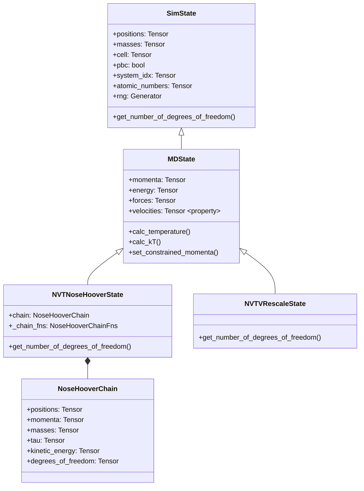
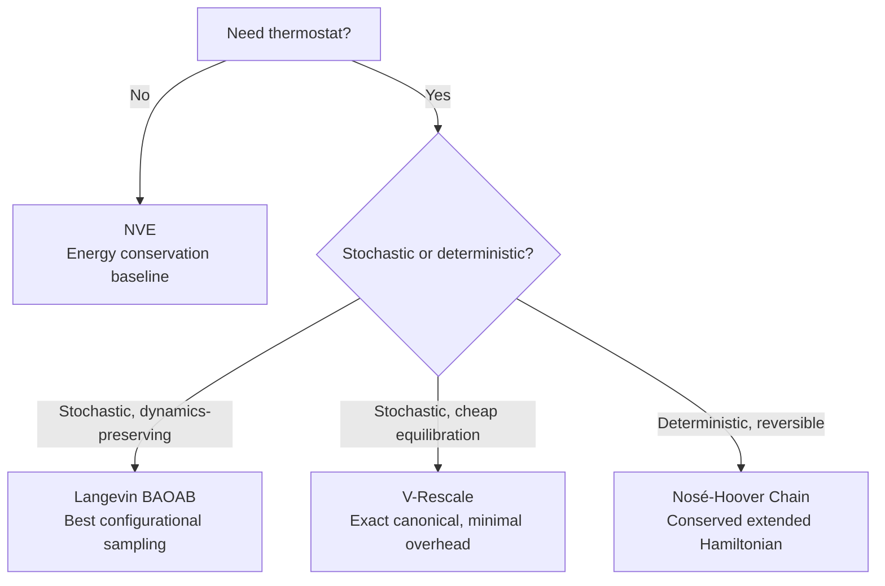

TorchSim provides a family of molecular dynamics integrators for constant-energy (NVE) and constant-temperature (NVT) simulations, all built on a shared infrastructure of composable state operations. Every integrator follows the same **init-then-step** pattern: an initialization function promotes a `SimState` into an `MDState` (or a subclass), and a stepping function advances that state by one timestep. This uniformity makes it straightforward to swap ensembles or combine integrators with [batched simulations](4-running-batched-md-simulations) and [high-level runners](19-high-level-runners-api). This page covers the NVE integrator and the three NVT thermostat variants; for constant-pressure ensembles, see [NPT Integrators and Thermostats](13-npt-integrators-and-thermostats).

## Integrator Architecture

All integrators share a layered design. The base layer lives in [md.py](torch_sim/integrators/md.py) and provides primitive operations — momentum updates, position updates, and the full velocity Verlet scheme — as generic functions parameterized on any `MDState` subclass. On top of this, ensemble-specific modules implement thermostat coupling logic. The [INTEGRATOR_REGISTRY](torch_sim/integrators/__init__.py#L160-L174) maps each `Integrator` enum value to its `(init_fn, step_fn)` pair, enabling selection by name at runtime.



The key primitive functions in [md.py](torch_sim/integrators/md.py) are `momentum_step` (half-kick: `p += F·dt`), `position_step` (drift: `r += v·dt`), and `velocity_verlet_step` (full kick-drift-kick cycle). Both `momentum_step` and `position_step` delegate to constraint handlers via `set_constrained_momenta` and `set_constrained_positions` on the state, ensuring that [constraints](21-constraints-system) are honored at every substep.
Sources: [md.py](torch_sim/integrators/md.py#L159-L198)

## NVE: Velocity Verlet (Microcanonical Ensemble)

The NVE integrator conserves total energy by applying pure Hamiltonian dynamics with no thermostat. It is the simplest ensemble and serves as a baseline for validating energy conservation, testing new models, or studying systems where thermal isolation is physically appropriate.

### Initialization: `nve_init`

The [`nve_init`](torch_sim/integrators/nve.py#L17-L65) function promotes a `SimState` into an `MDState`. It performs a single model evaluation to populate `energy` and `forces`, then samples momenta from a Maxwell-Boltzmann distribution at temperature `kT` if no pre-existing momenta are present on the state. Center-of-mass motion is removed during momentum initialization to prevent drift. The `kT` parameter accepts either a scalar or a per-system tensor of shape `[n_systems]`, enabling different initial temperatures across a batch.
Sources: [nve_init](torch_sim/integrators/nve.py#L17-L65), [initialize_momenta](torch_sim/integrators/md.py#L102-L156)

### Stepping: `nve_step`

The [`nve_step`](torch_sim/integrators/nve.py#L68-L104) function executes one velocity Verlet cycle:

1. Half momentum update: `p += F · dt/2`
2. Full position update: `r += (p/m) · dt`
3. Model evaluation at new positions → updated `energy`, `forces`
4. Half momentum update: `p += F_new · dt/2`

This is a symplectic, second-order, time-reversible integrator. Total energy is conserved to O(dt²) per step and O(dt²) over long trajectories, making it ideal for verifying that an MLIP produces physically reasonable forces. The `dt` parameter may be a scalar or per-system tensor.
Sources: [nve_step](torch_sim/integrators/nve.py#L68-L104)

```python
import torch_sim as ts
from torch_sim.units import MetalUnits

units = MetalUnits()
state = ts.SimState.from_atoms(atoms, device="cuda")
md_state = ts.nve_init(state, model, kT=300.0 * units.temperature)

for _ in range(1000):
    md_state = ts.nve_step(md_state, model, dt=1.0e-3 * units.time)
```

> [!TIP]
> Because NVE conserves energy by design, monitoring `md_state.calc_kT()` over time is an excellent diagnostic: significant temperature drift signals either an unstable timestep or inaccurate model forces.

## NVT Integrators: Thermostatted Dynamics

NVT integrators couple the system to a heat bath at temperature `kT`, enabling canonical ensemble sampling. TorchSim ships three thermostat variants, each with distinct trade-offs between physical accuracy, sampling efficiency, and stochasticity.

| Thermostat | Function Pair | Stochastic? | Key Reference |
|---|---|---|---|
| Langevin (BAOAB) | `nvt_langevin_init` / `nvt_langevin_step` | Yes | Leimkuhler & Matthews 2016 |
| V-Rescale | `nvt_vrescale_init` / `nvt_vrescale_step` | Yes | Bussi, Donadio & Parrinello 2007 |
| Nosé-Hoover Chain | `nvt_nose_hoover_init` / `nvt_nose_hoover_step` | No | Martyna et al. 1996 |

All three share the same initialization contract: they accept a `SimState`, a model, and `kT`, and return an `MDState` (or subclass) with forces, energy, and Maxwell-Boltzmann momenta. The key differences lie in how they thermostat the momenta during stepping.

## Langevin Thermostat (BAOAB Splitting)

The Langevin thermostat injects both friction and stochastic noise into the equations of motion, satisfying the fluctuation-dissipation theorem to sample the canonical ensemble. TorchSim uses the **BAOAB** splitting scheme, which is widely regarded as providing near-optimal configurational sampling for molecular dynamics.

### Initialization: `nvt_langevin_init`

[`nvt_langevin_init`](torch_sim/integrators/nvt.py#L86-L134) is structurally identical to `nve_init`: it evaluates the model, samples Maxwell-Boltzmann momenta at `kT`, and returns a plain `MDState`. No additional thermostat state is needed because the Langevin thermostat is memoryless — each O-step is independent.
Sources: [nvt_langevin_init](torch_sim/integrators/nvt.py#L86-L134)

### Stepping: `nvt_langevin_step`

The [`nvt_langevin_step`](torch_sim/integrators/nvt.py#L137-L195) implements the five-stage BAOAB scheme:

1. **B** — Half momentum kick: `p += F · dt/2`
2. **A** — Half position drift: `r += (p/m) · dt/2`
3. **O** — Ornstein-Uhlenbeck stochastic update on momenta
4. **A** — Half position drift: `r += (p/m) · dt/2`
5. **B** — Half momentum kick with recomputed forces: `p += F_new · dt/2`

The **O step** ([`_ou_step`](torch_sim/integrators/nvt.py#L24-L83)) applies the exact solution of the Ornstein-Uhlenbeck process: `p' = c₁·p + c₂·√m·N(0,1)` where `c₁ = exp(-γ·dt)` and `c₂ = √(kT·(1 - c₁²))`. The friction coefficient `gamma` defaults to `1 / (100·dt)` if not provided, which provides moderate coupling suitable for most systems. Larger `gamma` values give faster thermalization at the cost of distorting dynamical properties; smaller values preserve dynamics but equilibrate more slowly.
Sources: [nvt_langevin_step](torch_sim/integrators/nvt.py#L137-L195), [_ou_step](torch_sim/integrators/nvt.py#L24-L83)

```python
md_state = ts.nvt_langevin_init(state, model, kT=300.0 * units.temperature)

for _ in range(1000):
    md_state = ts.nvt_langevin_step(
        md_state, model,
        dt=1.0e-3 * units.time,
        kT=300.0 * units.temperature,
        gamma=0.01 / units.time,  # explicit friction
    )
```

> [!TIP]
> The O-step uses `state.rng` for noise generation, so setting `state.rng = torch.Generator(device=...).manual_seed(seed)` before `nvt_langevin_init` ensures fully reproducible trajectories — critical for debugging and [reproducibility](3-reproducibility).

## V-Rescale Thermostat

The V-Rescale thermostat (canonical sampling through velocity rescaling) applies a stochastic scaling factor to all momenta at each step. It is computationally cheaper than Langevin dynamics and provides exact canonical sampling, making it a popular choice for equilibration.

### State: `NVTVRescaleState`

The [`NVTVRescaleState`](torch_sim/integrators/nvt.py#L475-L501) extends `MDState` with one behavioral difference: it subtracts 3 degrees of freedom per system (center-of-mass motion) in `get_number_of_degrees_of_freedom`. This is essential because the thermostat's scaling factor is derived from the kinetic energy and the number of degrees of freedom — counting COM motion would bias the temperature calculation.
Sources: [NVTVRescaleState](torch_sim/integrators/nvt.py#L475-L501)

### Initialization and Stepping

[`nvt_vrescale_init`](torch_sim/integrators/nvt.py#L567-L617) follows the same pattern as the other init functions: model evaluation and Maxwell-Boltzmann momentum sampling. The [`nvt_vrescale_step`](torch_sim/integrators/nvt.py#L620-L671) executes two phases:

1. **V-Rescale rescaling** via [`_vrescale_update`](torch_sim/integrators/nvt.py#L504-L564): computes a stochastic scaling factor λ based on the current and target kinetic energies, the relaxation time `tau`, and the degrees of freedom. The factor combines exponential decay toward the target (`c₁ = exp(-dt/τ)`) with a properly distributed random perturbation from a Gamma distribution, ensuring that the rescaled velocities are drawn from the correct canonical distribution.
2. **Velocity Verlet step** using the rescaled momenta.

The `tau` parameter controls coupling strength, defaulting to `100·dt`. Unlike the Berendsen thermostat it generalizes, V-Rescale samples the true canonical distribution rather than a narrowed approximation.
Sources: [nvt_vrescale_step](torch_sim/integrators/nvt.py#L620-L671), [_vrescale_update](torch_sim/integrators/nvt.py#L504-L564)

```python
md_state = ts.nvt_vrescale_init(state, model, kT=300.0 * units.temperature)

for _ in range(1000):
    md_state = ts.nvt_vrescale_step(
        model, md_state,
        dt=1.0e-3 * units.time,
        kT=300.0 * units.temperature,
        tau=100.0 * units.time,  # relaxation time
    )
```

## Nosé-Hoover Chain Thermostat

The Nosé-Hoover chain thermostat is a **deterministic** extended-system approach that couples the physical system to a chain of virtual thermostats. Unlike Langevin and V-Rescale, it produces fully deterministic trajectories (no RNG dependency) and conserves an extended Hamiltonian, making it the preferred choice when both canonical sampling and time-reversibility are required.

### State: `NVTNoseHooverState`

The [`NVTNoseHooverState`](torch_sim/integrators/nvt.py#L198-L245) extends `MDState` with two additional fields: a [`NoseHooverChain`](torch_sim/integrators/md.py#L249-L273) dataclass holding the chain's positions, momenta, masses, relaxation time `tau`, kinetic energy, and degrees of freedom; and a [`NoseHooverChainFns`](torch_sim/integrators/md.py#L276-L288) bundle containing the `initialize`, `half_step`, and `update_mass` callables. These chain functions are constructed at initialization time by [`construct_nose_hoover_chain`](torch_sim/integrators/md.py#L339-L565), which encodes the chain length, substeps, and Suzuki-Yoshida composition order. Like `NVTVRescaleState`, this class subtracts 3 degrees of freedom for COM motion.
Sources: [NVTNoseHooverState](torch_sim/integrators/nvt.py#L198-L245), [NoseHooverChain](torch_sim/integrators/md.py#L249-L273), [NoseHooverChainFns](torch_sim/integrators/md.py#L276-L288)

### Initialization: `nvt_nose_hoover_init`

[`nvt_nose_hoover_init`](torch_sim/integrators/nvt.py#L248-L332) requires both `kT` and `dt` at initialization (the timestep is needed to construct the chain integration functions). It accepts additional parameters that control chain behavior:

| Parameter | Default | Description |
|---|---|---|
| `tau` | `100·dt` | Thermostat relaxation time; larger = gentler coupling |
| `chain_length` | 3 | Number of thermostats in the Nosé-Hoover chain |
| `chain_steps` | 3 | Number of substeps for integrating the chain each half-step |
| `sy_steps` | 3 | Suzuki-Yoshida composition order (must be 1, 3, 5, or 7) |

The function constructs the chain functions via `construct_nose_hoover_chain`, computes initial kinetic energy, and initializes the chain state.
Sources: [nvt_nose_hoover_init](torch_sim/integrators/nvt.py#L248-L332)

### Stepping: `nvt_nose_hoover_step`

The [`nvt_nose_hoover_step`](torch_sim/integrators/nvt.py#L335-L396) interleaves chain evolution with velocity Verlet integration:

1. Update chain masses based on current target temperature
2. First half-step of Nosé-Hoover chain evolution (modifies particle momenta)
3. Full velocity Verlet step (kick-drift-kick with force re-evaluation)
4. Update chain kinetic energy to reflect post-step particle momenta
5. Second half-step of Nosé-Hoover chain evolution

Because the chain is deterministic, the **conserved quantity** — the extended Hamiltonian — can be computed and monitored via [`nvt_nose_hoover_invariant`](torch_sim/integrators/nvt.py#L399-L472), which sums the system's potential energy, kinetic energy, and all chain thermostat energy terms. This invariant should remain approximately constant; drift indicates numerical instability.
Sources: [nvt_nose_hoover_step](torch_sim/integrators/nvt.py#L335-L396), [nvt_nose_hoover_invariant](torch_sim/integrators/nvt.py#L399-L472)

```python
nh_state = ts.nvt_nose_hoover_init(
    state, model,
    kT=300.0 * units.temperature,
    dt=1.0e-3 * units.time,
    tau=0.1 * units.time,
    chain_length=3,
    sy_steps=3,
)

for _ in range(1000):
    nh_state = ts.nvt_nose_hoover_step(
        nh_state, model,
        dt=1.0e-3 * units.time,
        kT=300.0 * units.temperature,
    )

# Verify energy conservation of the extended system
invariant = ts.nvt_nose_hoover_invariant(nh_state, kT=300.0 * units.temperature)
```

## Choosing the Right Integrator



The following table summarizes the practical trade-offs to guide integrator selection:

| Criterion | NVE | Langevin | V-Rescale | Nosé-Hoover |
|---|---|---|---|---|
| Ensemble | Microcanonical | Canonical | Canonical | Canonical |
| Stochastic | No | Yes | Yes | No |
| Time-reversible | Yes | No | No | Yes |
| Conserved quantity | Total energy | None | None | Extended Hamiltonian |
| Dynamics quality | Physical | Good (BAOAB) | Poor (rescaled) | Good |
| Model evaluations per step | 1 | 1 | 1 | 1 |
| Extra state required | None | None | None | Chain (positions, momenta, masses) |
| Best for | Validation, energy checks | Production MD, sampling | Equilibration | Reversible MD, free energy |

## Using the Integrator Registry

All four integrators covered here are accessible through the [`INTEGRATOR_REGISTRY`](torch_sim/integrators/__init__.py#L160-L174) and the [`Integrator`](torch_sim/integrators/__init__.py#L97-L131) enum, which is the mechanism used by the [high-level runners API](19-high-level-runners-api) to dispatch integrators by name. For NVE and NVT, the relevant entries are:

```python
from torch_sim.integrators import Integrator, INTEGRATOR_REGISTRY

# Lookup by enum
init_fn, step_fn = INTEGRATOR_REGISTRY[Integrator.nvt_langevin]

# Programmatically select
integrator_name = "nvt_nose_hoover"  # could come from config
init_fn, step_fn = INTEGRATOR_REGISTRY[Integrator(integrator_name)]
```

Sources: [Integrator enum](torch_sim/integrators/__init__.py#L97-L131), [INTEGRATOR_REGISTRY](torch_sim/integrators/__init__.py#L160-L174)

## Next Steps

- For pressure-controlled ensembles, see [NPT Integrators and Thermostats](13-npt-integrators-and-thermostats) which builds on the same stepping primitives.
- For a deeper treatment of the Nosé-Hoover chain construction including Suzuki-Yoshida composition, see [Nose-Hoover Chain Thermostat](14-nose-hoover-chain-thermostat).
- To run these integrators at scale with automatic batching, see [Automatic Batching and GPU Memory](18-automatic-batching-and-gpu-memory).
- For the state system that underpins all integrators, revisit [SimState and State Hierarchy](7-simstate-and-state-hierarchy).