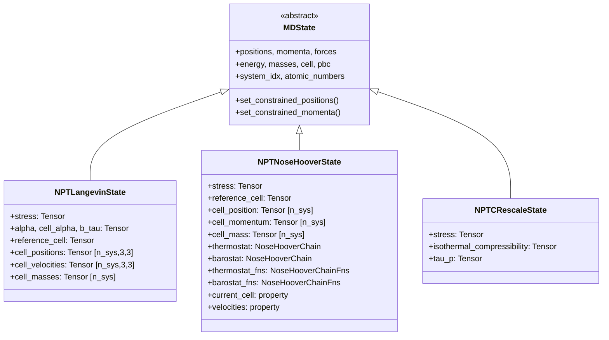
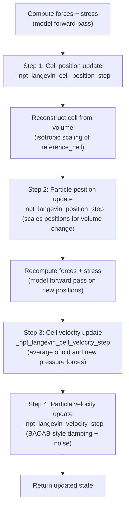
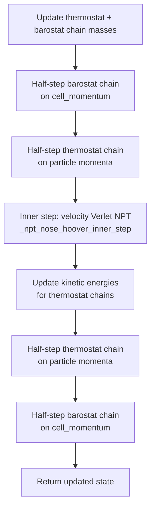
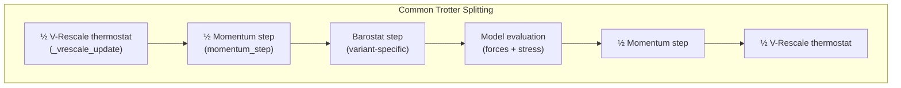

The NPT ensemble — constant particle number, pressure, and temperature — is the workhorse thermodynamic ensemble for materials simulation, enabling realistic equilibration of lattice parameters, density, and phase behavior. TorchSim provides three distinct NPT integrator families, each coupling a **thermostat** (temperature control) with a **barostat** (pressure/volume control) through fundamentally different physical mechanisms. All integrators are fully batched, GPU-accelerated, and follow a uniform `init`/`step` interface registered in `INTEGRATOR_REGISTRY`.

Sources: [__init__.py](torch_sim/integrators/__init__.py#L17-L46), [npt.py](torch_sim/integrators/npt.py#L1-L27)

## Architectural Overview

The NPT integrator subsystem extends the base `MDState` with ensemble-specific state dataclasses, each tracking the stress tensor and cell degrees of freedom alongside the standard positions, momenta, and forces. Every integrator family consists of three components: a **state dataclass**, an **initialization function** (computing initial momenta, cell parameters, and forces), and a **stepping function** (advancing the system by one timestep).



The `INTEGRATOR_REGISTRY` maps each `Integrator` enum member to a `(init_fn, step_fn)` tuple, allowing the high-level runners API to dispatch uniformly across all integrator types.

Sources: [__init__.py](torch_sim/integrators/__init__.py#L160-L174), [npt.py](torch_sim/integrators/npt.py#L34-L91)

## Integrator Family Comparison

Each NPT integrator makes different trade-offs between stochasticity, configurational sampling efficiency, and computational overhead. The following table summarizes the key distinctions.

| Feature | Langevin NPT | Nosé-Hoover NPT | C-Rescale NPT |
|---|---|---|---|
| **Thermostat mechanism** | Friction + stochastic noise (Ornstein-Uhlenbeck) | Deterministic chain thermostat (Suzuki-Yoshida) | Stochastic velocity rescaling |
| **Barostat mechanism** | Langevin on 3×3 cell matrix | Nosé-Hoover chain on scalar log-volume | Stochastic cell rescaling |
| **Cell fluctuations** | Isotropic only | Isotropic (scalar volume) | Isotropic, anisotropic, independent lengths, or average anisotropic |
| **Deterministic** | No (stochastic RNG required) | Yes (time-reversible, energy-conserving) | No (stochastic RNG required) |
| **Conserved quantity** | None (stochastic) | Extended Hamiltonian (`npt_nose_hoover_invariant`) | None (stochastic) |
| **Key references** | Grønbech-Jensen & Farago 2014 | Martyna, Tuckerman, Tobias & Klein 1996 | Bernetti & Bussi 2020; Del Tatto et al. 2022 |
| **State class** | `NPTLangevinState` | `NPTNoseHooverState` | `NPTCRescaleState` |
| **Registry keys** | `npt_langevin` | `npt_nose_hoover` | `npt_isotropic_crescale`, `npt_anisotropic_crescale` |

Sources: [npt.py](torch_sim/integrators/npt.py#L635-L636), [npt.py](torch_sim/integrators/npt.py#L1452-L1453), [npt.py](torch_sim/integrators/npt.py#L2010-L2012), [__init__.py](torch_sim/integrators/__init__.py#L128-L131)

## NPT Langevin Integrator

The Langevin NPT integrator applies stochastic dynamics to both particle and cell degrees of freedom simultaneously, following the Grønbech-Jensen & Farago discretization (2014). A friction term and Gaussian noise term satisfy the fluctuation-dissipation theorem, driving the system toward the target temperature and pressure without requiring a conserved Hamiltonian.

### Cell Dynamics

Cell degrees of freedom are parameterized as a full 3×3 matrix (`cell_positions`, `cell_velocities`) with per-system scalar masses (`cell_masses`). Currently only **isotropic** volume fluctuations are implemented: the cell is uniformly scaled by `(V/V₀)^(1/d)` relative to the stored reference cell. The barostat time constant `b_tau` controls coupling strength — the cell mass is set as `(N_atoms + 1) · kT · b_tau²` at each step, ensuring proper thermalization of volume fluctuations.

Sources: [npt.py](torch_sim/integrators/npt.py#L685-L723)

### Integration Scheme

The step function `npt_langevin_step` executes a 4-stage splitting that couples particle and cell updates:



At each stage, Langevin noise terms are generated via `_npt_langevin_beta` (particle) and `_npt_langevin_cell_beta` (cell), both computing `√(2α·kT·dt)` scaled by per-atom or per-system friction coefficients and mapped through `system_idx` for batched simulations. The velocity update uses a BAOAB-style damping factor `a = (1 - α·dt/M) / (1 + α·dt/M)` that ensures second-order accuracy in the friction-free limit.

Sources: [npt.py](torch_sim/integrators/npt.py#L636-L747), [npt.py](torch_sim/integrators/npt.py#L94-L174), [npt.py](torch_sim/integrators/npt.py#L381-L443)

### Initialization

The `npt_langevin_init` function converts a `SimState` into an `NPTLangevinState` by computing initial momenta (Maxwell-Boltzmann if not provided), running a model forward pass for forces and stress, and setting up cell variables. The `alpha` parameter defaults to `1/(100·dt)`, `cell_alpha` defaults to the same value as `alpha`, and `b_tau` defaults to `1/(1000·dt)`. A warning is issued if constraints are present, since NPT dynamics with constraints requires careful treatment.

Sources: [npt.py](torch_sim/integrators/npt.py#L507-L632)

### Pressure Force Computation

The `_compute_cell_force` function calculates the driving force on the cell as the difference between the internal virial stress and external pressure, with a kinetic energy correction. For scalar external pressure, it constructs a diagonal pressure tensor `P_ext · I₃`, then computes `F_cell = -V · (σ + P_ext) + kT · I₃` where `σ` is the model-returned stress tensor. This force propagates through the Langevin cell dynamics to adjust the simulation volume.

Sources: [npt.py](torch_sim/integrators/npt.py#L446-L505)

## NPT Nosé-Hoover Integrator

The Nosé-Hoover NPT integrator implements a fully deterministic extended system approach based on Martyna, Tuckerman, Tobias & Klein (1996). Two independent Nosé-Hoover chains — one coupled to particle momenta (thermostat) and one coupled to the cell momentum (barostat) — provide smooth, time-reversible sampling of the NPT ensemble. An extended Hamiltonian is conserved, which can be monitored via `npt_nose_hoover_invariant` to verify integration correctness.

### Logarithmic Cell Parameterization

A critical design choice in this integrator is the use of **logarithmic coordinates** for the cell degree of freedom. Instead of tracking volume directly, the state stores `cell_position = (1/d)·ln(V/V₀)`, where `V₀` is the reference volume from `reference_cell` and `d` is the spatial dimension (typically 3). This guarantees volume positivity regardless of integration errors and linearizes the equations of motion. The `current_cell` property reconstructs the actual simulation cell matrix as `scale · reference_cell` where `scale = (V/V₀)^(1/d) = exp(cell_position)`.

Sources: [npt.py](torch_sim/integrators/npt.py#L758-L761), [npt.py](torch_sim/integrators/npt.py#L840-L858)

### Suzuki-Yoshida Integration

The thermostat and barostat chains use Suzuki-Yoshida (SY) composition to achieve high-order accuracy. Three parameters control chain behavior: `chain_length` (number of chain links, default 3), `chain_steps` (inner chain substeps, default 2), and `sy_steps` (SY integration order, default 3). The `t_tau` thermostat relaxation time defaults to `100·dt` and `b_tau` barostat relaxation time defaults to `1000·dt`. Chain masses are dynamically updated at each step to reflect the current temperature, ensuring proper coupling as `kT` varies.

Sources: [npt.py](torch_sim/integrators/npt.py#L1287-L1376), [npt.py](torch_sim/integrators/npt.py#L912-L955)

### Integration Scheme

The `npt_nose_hoover_step` wraps the inner velocity-Verlet dynamics with symmetric chain thermostat updates:



The inner step (`_npt_nose_hoover_inner_step`) performs a standard velocity-Verlet cycle: half-step momenta updates, full-step position/cell updates, model force evaluation, then a second half-step momenta update. The `_npt_nose_hoover_exp_iL1` operator updates particle positions accounting for cell velocity, while `_npt_nose_hoover_exp_iL2` updates momenta with the scaling factor `α = 1 + 1/N_atoms` that couples cell motion to particle motion. The cell force is computed via `_npt_nose_hoover_compute_cell_force`, which includes the virial, kinetic, and external pressure terms.

Sources: [npt.py](torch_sim/integrators/npt.py#L1452-L1526), [npt.py](torch_sim/integrators/npt.py#L1177-L1284), [npt.py](torch_sim/integrators/npt.py#L991-L1114)

### Conserved Quantity

The `npt_nose_hoover_invariant` function computes the extended Hamiltonian that should remain constant throughout a well-integrated Nosé-Hoover NPT simulation. It sums the potential energy, kinetic energy of particles, kinetic energy of the cell degree of freedom, thermostat chain energy (weighted by particle DOF), barostat chain energy (weighted by 1 DOF per system), and the PV work term. Deviations from constancy indicate integration errors or timestep issues.

Sources: [npt.py](torch_sim/integrators/npt.py#L1560-L1622)

## NPT C-Rescale Integrator

The C-Rescale (stochastic cell rescaling) NPT integrator, introduced by Bernetti & Bussi (2020) and extended to anisotropic cells by Del Tatto et al. (2022), applies stochastic volume rescaling at each timestep to couple the system to a pressure bath. Temperature is maintained separately via the V-Rescale (velocity rescaling) thermostat, reused from the NVT module. This integrator family offers the greatest flexibility in cell deformation modes.

### Architecture: Four Barostat Variants

A single `NPTCRescaleState` dataclass serves all four C-Rescale variants. The variant is selected by choosing the appropriate step function, with all sharing a common Trotter-splitting structure:



The four barostat variants differ in how they compute the deformation matrix applied to positions, momenta, and cell vectors:

| Variant | Step Function | Cell DOF | Scales Momenta | Pressure Tensor |
|---|---|---|---|---|
| **Isotropic** | `npt_crescale_isotropic_step` | 1 (volume) | Yes (uniform) | Scalar trace only |
| **Anisotropic** | `npt_crescale_anisotropic_step` | 9 (3×3 matrix) | Yes (matrix multiply) | Full instantaneous |
| **Independent Lengths** | `npt_crescale_independent_lengths_step` | 3 (diagonal) | Yes (per-axis) | Diagonal instantaneous |
| **Average Anisotropic** | `npt_crescale_average_anisotropic_step` | 9 (3×3 matrix) | No (positions only) | Full average (equipartition) |

Sources: [npt.py](torch_sim/integrators/npt.py#L2010-L2307)

### Isotropic Barostat

The isotropic variant (`_crescale_isotropic_barostat_step`) rescales all cell dimensions uniformly. It computes the instantaneous pressure tensor, extracts its trace, and derives a volume change from the difference between external and internal pressure. The square root of volume (`√V`) is propagated stochastically with a prefactor `√(kT · κ · dt / (4·τ_p))`, where `κ` is the isothermal compressibility and `τ_p` is the barostat relaxation time. Both positions and momenta are scaled by the resulting uniform factor.

Sources: [npt.py](torch_sim/integrators/npt.py#L1952-L1987)

### Anisotropic Barostat

The fully anisotropic variant (`_crescale_anisotropic_barostat_step`) operates on the full 3×3 deformation space. After a half-step volume propagation, it computes a traceless symmetric deformation matrix from the off-diagonal stress components, adds stochastic noise, and applies the matrix exponential to obtain the rotation-scaling matrix. This matrix is then orthogonalized via `rotate_gram_schmidt` (Gram-Schmidt QR decomposition to lower-triangular form) before being combined with the volume scaling factor. Positions are transformed by matrix-vector multiplication with the deformation matrix, and momenta by the inverse transpose.

Sources: [npt.py](torch_sim/integrators/npt.py#L1706-L1776), [npt.py](torch_sim/integrators/npt.py#L1654-L1662)

### Independent Lengths Barostat

The independent lengths variant (`_crescale_independent_lengths_barostat_step`) allows each cell vector to change independently while preserving cell angles. It uses only the diagonal elements of the pressure tensor, computing per-axis scaling factors via element-wise exponentiation (rather than matrix exponential). This is computationally cheaper than the full anisotropic variant and corresponds to using a diagonal isothermal compressibility tensor. The cell is updated as `diag(scaling) @ cell`, and positions are scaled per-axis.

Sources: [npt.py](torch_sim/integrators/npt.py#L1779-L1840)

### Average Anisotropic Barostat

The average anisotropic variant (`_crescale_average_anisotropic_step`) uses the same full matrix deformation as the anisotropic variant but replaces the instantaneous pressure tensor with a time-averaged estimate based on the equipartition theorem. The `compute_average_pressure_tensor` function computes `P_avg = (DOF · kT / V) · I - σ`, where DOF uses `n_atoms_per_system` rather than subtracting 3 for center-of-mass motion. Crucially, this variant only scales positions — momenta are not transformed — making it suitable for systems where momentum rescaling would interfere with other constraints.

Sources: [npt.py](torch_sim/integrators/npt.py#L1843-L1870), [npt.py](torch_sim/integrators/npt.py#L1873-L1935)

### Initialization

The `npt_crescale_init` function sets up `NPTCRescaleState` from a `SimState`. The barostat relaxation time `tau_p` defaults to `5000·dt` (approximately 5 ps for a 1 fs timestep), and the isothermal compressibility `isothermal_compressibility` defaults to `0.1` in units of `(eV/ų)⁻¹`. Both parameters are expanded to per-system tensors for batched simulations.

Sources: [npt.py](torch_sim/integrators/npt.py#L2310-L2383)

## Common Patterns and Practical Guidance

### Degrees of Freedom

Both `NPTNoseHooverState` and `NPTCRescaleState` override `get_number_of_degrees_of_freedom` to subtract 3 per system for center-of-mass motion. This is physically correct for NPT: the barostat's single cell degree of freedom replaces the 3 translational degrees of freedom that are meaningless under periodic boundary conditions. The `NPTLangevinState` inherits the base `MDState` computation without this subtraction.

Sources: [npt.py](torch_sim/integrators/npt.py#L860-L863), [npt.py](torch_sim/integrators/npt.py#L1644-L1651)

### Batched Parameter Handling

All NPT integrators accept scalar or per-system tensor parameters for `kT`, `dt`, and pressure/barostat-related constants. Scalar inputs are automatically expanded via `expand(state.n_systems)` to match the batch dimension. Atom-level quantities (friction, temperature) are mapped from system-level tensors through `state.system_idx`, ensuring that each atom in a multi-system batch receives the correct system-specific parameters. This design enables heterogeneous simulations where, for example, different systems in the same batch can target different temperatures or pressures.

Sources: [npt.py](torch_sim/integrators/npt.py#L549-L571), [npt.py](torch_sim/integrators/npt.py#L671-L683)

### Stress Tensor Requirement

All NPT integrators require the model to return a **stress tensor** in addition to forces and energy. The stress tensor is used by `_compute_cell_force` (Langevin), `_npt_nose_hoover_compute_cell_force` (Nosé-Hoover), or `compute_instantaneous_pressure_tensor` (C-Rescale) to determine the internal pressure of the system. Models that do not compute stress cannot be used with NPT integrators.

> [!TIP]
> **Stress sign convention**: The model-returned stress tensor `σ` enters the cell force computation as `-V·(σ + P_ext)`. Verify your model's sign convention matches this expectation — most MLIP frameworks return stress with the convention where tensile stress is positive, which is compatible with torch-sim's formulation.

> [!TIP]
> **Choosing a barostat variant**: For liquid-phase equilibration, the isotropic C-Rescale is simplest and most robust. For solid-phase simulations where anisotropic lattice relaxation is needed (e.g., hexagonal → cubic transitions), use the anisotropic or independent-lengths variants. The Nosé-Hoover integrator is preferred when monitoring the conserved Hamiltonian is important for validation, or when reproducible deterministic trajectories are required.

### Using the Registry

All NPT integrators are accessible through the `INTEGRATOR_REGISTRY` for uniform dispatch:

```python
from torch_sim.integrators import INTEGRATOR_REGISTRY, Integrator

# Select the Langevin NPT integrator
init_fn, step_fn = INTEGRATOR_REGISTRY[Integrator.npt_langevin]
state = init_fn(sim_state, model, kT=300.0 * units.temperature, dt=1e-3 * units.time)
for _ in range(1000):
    state = step_fn(state, model, dt=1e-3 * units.time, kT=300.0 * units.temperature,
                    external_pressure=1.0 * units.pressure)
```

Sources: [__init__.py](torch_sim/integrators/__init__.py#L160-L174)

## Next Steps

- **[Nose-Hoover Chain Thermostat](14-nose-hoover-chain-thermostat)** for a deep dive into the chain construction, Suzuki-Yoshida composition, and the `NoseHooverChain`/`NoseHooverChainFns` internal mechanics that both NVT and NPT Nosé-Hoover integrators depend on.
- **[NVE and NVT Integrators](12-nve-and-nvt-integrators)** to understand the base integration patterns (velocity Verlet, Langevin BAOAB, V-Rescale) that the NPT integrators extend with barostat coupling.
- **[High-Level Runners API](19-high-level-runners-api)** for the recommended way to run production NPT simulations without manually calling init/step functions.