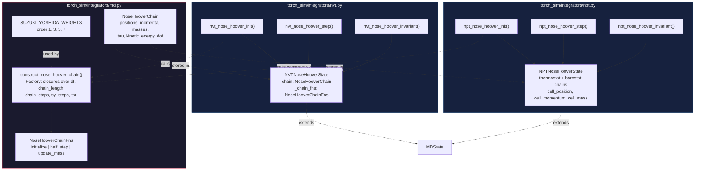

The Nose-Hoover chain thermostat is the deterministic cornerstone of torch-sim's temperature control infrastructure. Unlike stochastic thermostats (Langevin, velocity-rescale), it achieves canonical sampling through an extended Hamiltonian formulation — coupling the physical system to a chain of fictitious thermostats whose collective dynamics drive the system toward the target temperature. This page dissects the chain's mathematical machinery, its integration with NVT and NPT ensembles, the Suzuki-Yoshida composition scheme that governs its accuracy, and the conserved invariant used for validation.

## Architectural Overview

The Nose-Hoover chain implementation spans three files with clear separation of concerns: the core chain data structures and construction logic live in [md.py](torch_sim/integrators/md.py#L249-L565), the NVT ensemble integration in [nvt.py](torch_sim/integrators/nvt.py#L198-L474), and the NPT ensemble integration (which deploys two independent chains — a thermostat and a barostat) in [npt.py](torch_sim/integrators/npt.py#L750-L1625).



The key architectural insight is that `construct_nose_hoover_chain` is a **closure factory**: it captures integration parameters (`dt`, `chain_length`, `chain_steps`, `sy_steps`, `tau`) and returns three callable functions (`initialize`, `half_step`, `update_mass`) that operate on `NoseHooverChain` dataclass instances. This design decouples the chain's physics from any particular ensemble, allowing the same factory to produce both thermostat and barostat chains in NPT simulations.

## The NoseHooverChain Dataclass

The chain's state is encapsulated in a lightweight dataclass defined in [md.py](torch_sim/integrators/md.py#L250-L273). Every tensor carries a batch dimension for the first axis (`[n_systems, chain_length]` or `[n_systems]`), enabling simultaneous evolution of multiple independent systems.

| Field | Shape | Description |
|-------|-------|-------------|
| `positions` | `[n_systems, chain_length]` | Fictitious thermostat coordinates ξᵢ |
| `momenta` | `[n_systems, chain_length]` | Fictitious thermostat momenta pξᵢ |
| `masses` | `[n_systems, chain_length]` | Thermostat masses Qᵢ; element 0 is scaled by DOF |
| `tau` | `[n_systems]` | Relaxation timescale (in time units, not units of dt) |
| `kinetic_energy` | `[n_systems]` | Current kinetic energy of the coupled physical system |
| `degrees_of_freedom` | `[n_systems]` | Number of DOF for the physical system |
| `system_idx` | optional | Index mapping for batched operations |

The mass of the first chain element is special: `Q[0] = kT · τ² · DOF`, while all subsequent elements use `Q[i] = kT · τ²`. This heavier first element couples directly to the physical system's kinetic energy, absorbing larger fluctuations, while lighter outer elements provide fine-grained temperature correction — the hallmark of the Martyna-Tuckerman-Tobias-Klein (MTTK) approach.

Sources: [md.py](torch_sim/integrators/md.py#L250-L273)

## Chain Construction and Suzuki-Yoshida Composition

The `construct_nose_hoover_chain` factory ([md.py](torch_sim/integrators/md.py#L339-L565)) implements the direct translation method from Martyna et al. (J. Chem. Phys. **97**, 2635, 1992). The integration uses a **three-level splitting hierarchy**:

1. **Outer level (chain_steps `nc`):** Each full half-step is divided into `nc` substeps of duration `δ = dt/nc`.
2. **Middle level (Suzuki-Yoshida `sy_steps`):** Each substep is further split using SY composition weights `wᵢ`, yielding micro-steps of duration `δᵢ = δ · wᵢ/nc`.
3. **Inner level (substep_fn):** Each micro-step executes the symmetric chain update — backward momentum sweep, system coupling, rescaling, position update, forward momentum sweep.

The Suzuki-Yoshida weights available in [md.py](torch_sim/integrators/md.py#L310-L335) are:

| Order (sy_steps) | Weights |
|-------------------|---------|
| 1 | `[1.0]` |
| 3 | `[0.829, −0.658, 0.829]` |
| 5 | `[0.297, 0.297, −0.187, 0.297, 0.297]` |
| 7 | `[0.785, 0.236, −1.178, 1.315, −1.178, 0.236, 0.785]` |

Higher order provides better accuracy per effective timestep but at increased computational cost. The default configuration uses `sy_steps=3` with `chain_steps=3` (NVT) or `chain_steps=2` (NPT), striking a balance between accuracy and performance.

> [!TIP]
> The effective integration timestep for a single micro-step is `dt · wᵢ / (chain_steps · sy_steps)`. With defaults (chain_steps=3, sy_steps=3), the finest substep is approximately `0.092 · dt`, making the chain integration significantly finer than the physical timestep. This multi-resolution approach is what gives the Nose-Hoover chain its superior sampling properties compared to single-thermostat formulations.

Sources: [md.py](torch_sim/integrators/md.py#L310-L565)

## The Substep Algorithm

Each call to `substep_fn` ([md.py](torch_sim/integrators/md.py#L448-L521)) performs a single symmetric update of the chain. The algorithm follows the Liouville operator splitting of Martyna et al. with these phases:

**Phase 1 — Backward momentum sweep.** Starting from the last chain element (index `M = chain_length - 1`) and moving toward the first, each chain momentum `pξᵢ` is updated using the force `G = pξ²ᵢ₋₁/Qᵢ₋₁ − kT`. The update applies an exponential rescaling from the *next* element's momentum: `pξᵢ = s · (s · pξᵢ + δ/4 · G)` where `s = exp(−δ/8 · pξᵢ₊₁/Qᵢ₊₁)`. This nested coupling is what distributes thermal fluctuations across the chain.

**Phase 2 — System coupling.** The first chain element's momentum is driven by the physical system's kinetic energy: `G₀ = 2·KE − DOF·kT`. The same exponential rescaling from element 1 applies if `chain_length > 1`.

**Phase 3 — System rescaling.** Physical momenta are scaled by `exp(−δ/2 · pξ₀/Q₀)`, and the kinetic energy is updated accordingly. The atom-level scale factor is mapped via `system_idx` to handle batched simulations where multiple systems share a single tensor.

**Phase 4 — Position update.** Chain coordinates advance: `ξ += δ/2 · pξ/Q`.

**Phase 5 — Forward momentum sweep.** The reverse of Phase 1, sweeping from element 0 outward, completing the symmetric structure.

This five-phase symmetric splitting ensures the overall operator is time-reversible and volume-preserving in the extended phase space — prerequisites for correct canonical sampling.

Sources: [md.py](torch_sim/integrators/md.py#L448-L521)

## NVT Integration: Initialization and Stepping

The NVT Nose-Hoover state ([nvt.py](torch_sim/integrators/nvt.py#L198-L241)) extends `MDState` with a single `chain: NoseHooverChain` field and its associated closure `_chain_fns: NoseHooverChainFns`. Notably, `chain` and `_chain_fns` are marked as `_global_attributes` — they are shared across all systems in the batch rather than per-system, since the chain tensors already carry the batch dimension internally.

### Initialization: `nvt_nose_hoover_init`

The init function ([nvt.py](torch_sim/integrators/nvt.py#L248-L333)) accepts these configuration parameters:

| Parameter | Type | Default | Description |
|-----------|------|---------|-------------|
| `kT` | `float \| Tensor` | required | Target temperature in energy units |
| `dt` | `float \| Tensor` | required | Integration timestep |
| `tau` | `float \| Tensor \| None` | `100*dt` | Thermostat relaxation time |
| `chain_length` | `int` | `3` | Number of thermostats in the chain |
| `chain_steps` | `int` | `3` | Outer integration substeps |
| `sy_steps` | `int` | `3` | Suzuki-Yoshida order (1, 3, 5, or 7) |

The initialization pipeline constructs the chain functions via `construct_nose_hoover_chain`, draws initial momenta from a Maxwell-Boltzmann distribution (or accepts pre-initialized ones), computes the initial kinetic energy per system, and initializes the chain state. The DOF calculation uses `n_atoms_per_system * n_dimensions` — the NVT Nose-Hoover state then subtracts 3 for center-of-mass motion via `get_number_of_degrees_of_freedom()`.

Sources: [nvt.py](torch_sim/integrators/nvt.py#L248-L333)

### Stepping: `nvt_nose_hoover_step`

The step function ([nvt.py](torch_sim/integrators/nvt.py#L335-L397)) implements a symmetric integration sequence:

1. **Update chain masses** — recalibrates `Q` based on current `kT` and `tau` via `update_mass`.
2. **First half-step of chain** — rescales particle momenta, advances chain coordinates/momenta.
3. **Full velocity Verlet step** — standard `momenta_step` → `position_step` → force evaluation → `momenta_step` cycle.
4. **Update chain kinetic energy** — recomputes KE from the new momenta and writes it into the chain state.
5. **Second half-step of chain** — mirrors step 2 to complete the symmetric splitting.

The constraint-aware `set_constrained_momenta` calls at steps 2 and 5 ensure that any positional constraints (e.g., SHAKE-like bond constraints) are respected when the chain rescales momenta.

Sources: [nvt.py](torch_sim/integrators/nvt.py#L335-L397)

## NVT Conserved Invariant

The function `nvt_nose_hoover_invariant` ([nvt.py](torch_sim/integrators/nvt.py#L399-L474) computes the extended Hamiltonian that should be conserved by the NVT Nose-Hoover dynamics:

```
H_ext = E_pot + E_kin + Σᵢ [pξᵢ² / (2Qᵢ) + coupling_potential(ξᵢ)]
```

For the first chain element, the potential term is `DOF · kT · ξ₀`; for subsequent elements it is `kT · ξᵢ`. This invariant is the primary diagnostic for implementation correctness — drift indicates numerical instability or coding errors, while bounded fluctuations around a mean value confirm proper canonical sampling.

Sources: [nvt.py](torch_sim/integrators/nvt.py#L399-L474)

## NPT Integration: Dual-Chain Architecture

The NPT Nose-Hoover state ([npt.py](torch_sim/integrators/npt.py#L750-L863) extends the concept significantly by deploying **two independent chains**: a thermostat controlling particle temperature and a barostat controlling cell volume. The cell dynamics use a logarithmic coordinate system where `cell_position = (1/d) · ln(V/V₀)`, ensuring volume positivity and simplifying the equations of motion.

### State Fields Specific to NPT

| Field | Shape | Description |
|-------|-------|-------------|
| `stress` | `[n_systems, 3, 3]` | Virial stress tensor from the model |
| `reference_cell` | `[n_systems, 3, 3]` | Reference cell for volume measurement |
| `cell_position` | `[n_systems]` | Logarithmic coordinate (1/d)·ln(V/V₀) |
| `cell_momentum` | `[n_systems, 1]` | Conjugate momentum for volume |
| `cell_mass` | `[n_systems]` | Mass parameter for cell dynamics |
| `thermostat` | `NoseHooverChain` | Temperature control chain |
| `barostat` | `NoseHooverChain` | Pressure control chain |
| `thermostat_fns` | `NoseHooverChainFns` | Thermostat closure functions |
| `barostat_fns` | `NoseHooverChainFns` | Barostat closure functions |

The `current_cell` property computes the live cell from `cell_position`: `cell = (V/V₀)^(1/d) · reference_cell`, where `V = V₀ · exp(d · cell_position)`.

Sources: [npt.py](torch_sim/integrators/npt.py#L750-L863)

### Cell Mass and Barostat Coupling

The cell mass is computed in [_npt_nose_hoover_update_cell_mass](torch_sim/integrators/npt.py#L912-L949) as `cell_mass = dim · (N_atoms + 1) · kT · τ_barostat²`. The `+1` accounts for the cell degree of freedom itself. The barostat chain's DOF is set to `1` (a single isotropic volume degree of freedom), while the thermostat chain uses the full particle DOF.

Sources: [npt.py](torch_sim/integrators/npt.py#L912-L949)

### Symplectic Position and Momentum Operators

The NPT dynamics require modified position (`exp(iL₁)`) and momentum (`exp(iL₂)`) operators that account for cell scaling during the integration step. These are implemented in [_npt_nose_hoover_exp_iL1](torch_sim/integrators/npt.py#L991-L1046) and [_npt_nose_hoover_exp_iL2](torch_sim/integrators/npt.py#L1047-L1104).

The position update uses: `R_new = R + (eˣ − 1)R + dt · V · eˣ/² · sinh(x/2)/(x/2)` where `x = V_cell · dt` is the cell velocity contribution per atom. The momentum update follows: `P_new = P · e⁻ˣ + dt/2 · F · e⁻ˣ/² · sinh(x/2)/(x/2)` where `x = α · V_cell · dt/2`.

Both operators rely on [_npt_nose_hoover_sinhx_x](torch_sim/integrators/npt.py#L957-L991) which computes `sinh(x)/x` via a 6-term Taylor expansion to avoid division by zero near `x = 0`. The `α = 1 + 1/N_atoms` scaling factor couples particle momenta to the cell dynamics.

> [!TIP]
> The cell momentum shape is `[n_systems, 1]` rather than `[n_systems]` — this trailing dimension is required for compatibility with the chain's `half_step` function, which expects the momenta it rescales to have at least 2 dimensions. The squeeze operation `(cell_momentum.squeeze(-1))` is applied when computing scalar quantities like kinetic energy.

Sources: [npt.py](torch_sim/integrators/npt.py#L957-L1104)

### NPT Initialization and Stepping

The `npt_nose_hoover_init` ([npt.py](torch_sim/integrators/npt.py#L1287-L1450) creates two separate chain instances with independent relaxation times: `t_tau = 100·dt` (thermostat) and `b_tau = 1000·dt` (barostat) by default. The barostat's longer timescale reflects the typically slower dynamics of volume fluctuations compared to temperature.

The `npt_nose_hoover_step` ([npt.py](torch_sim/integrators/npt.py#L1452-L1528) follows this sequence:

1. **Update mass parameters** for both chains and the cell.
2. **First half-step of barostat chain** — rescales `cell_momentum`.
3. **First half-step of thermostat chain** — rescales particle `momenta`.
4. **Inner NPT step** — position update, force evaluation, momentum update with cell coupling.
5. **Update kinetic energies** for both chains.
6. **Second half-step of thermostat chain**.
7. **Second half-step of barostat chain**.

The cell force computation in [_npt_nose_hoover_compute_cell_force](torch_sim/integrators/npt.py#L1105-L1176) includes kinetic energy, internal stress, and external pressure contributions: `F_cell = α·KE + tr(σ)·V/dim − P_ext·V`, driving volume changes toward mechanical equilibrium.

Sources: [npt.py](torch_sim/integrators/npt.py#L1177-L1528)

## NPT Conserved Invariant

The `npt_nose_hoover_invariant` ([npt.py](torch_sim/integrators/npt.py#L1560-L1625) extends the NVT invariant with additional terms for cell dynamics:

```
H_NPT = E_pot + E_kin + E_chain_thermostat + E_chain_barostat
        + P_ext · V + ½ · p_cell² / M_cell + Σᵢ kT · ξ_barostat_i
```

The `_compute_chain_energy` helper ([npt.py](torch_sim/integrators/npt.py#L1529-L1559) iterates over chain elements, weighting the first element's potential by DOF for the thermostat chain (or by 1 for the barostat chain).

Sources: [npt.py](torch_sim/integrators/npt.py#L1529-L1625)

## Configuration Reference

The following table summarizes all tuneable parameters across both NVT and NPT Nose-Hoover integrators:

| Parameter | NVT Default | NPT Default | Effect |
|-----------|-------------|-------------|--------|
| `tau` / `t_tau` | `100·dt` | `100·dt` | Thermostat relaxation time. Larger → more stable, slower equilibration |
| `b_tau` | N/A | `1000·dt` | Barostat relaxation time. Larger → smoother volume fluctuations |
| `chain_length` | `3` | `3` | Thermostats per chain. 3 is standard; increase for pathological systems |
| `chain_steps` | `3` | `2` | Outer substeps. More → finer chain integration |
| `sy_steps` | `3` | `3` | Suzuki-Yoshida order (1, 3, 5, 7). Higher → better accuracy, more cost |

## Comparison with Stochastic Thermostats

| Property | Nose-Hoover Chain | Langevin (BAOAB) | Velocity-Rescale |
|----------|-------------------|-------------------|-----------------|
| Deterministic | ✅ Time-reversible | ❌ Stochastic | ❌ Stochastic |
| Conserved quantity | Extended Hamiltonian | None | None |
| Sampling correctness | Exact (ergodic for most systems) | Exact | Exact |
| Trajectory reproducibility | Fully reproducible | Requires fixed RNG | Requires fixed RNG |
| Suitability for dynamics | Excellent — no artificial friction | Good — friction may decorrelate | Poor — discontinuous |
| GPU efficiency | High (no RNG overhead) | Moderate (noise generation) | Moderate |
| Configurable | `tau`, `chain_length`, `sy_steps` | `gamma` (friction) | `tau` |

The Nose-Hoover chain is the preferred choice when trajectory reproducibility and clean dynamical properties are required — for instance, when computing time-correlation functions, phonon spectra, or when differentiating through the integration step.

## Practical Guidance

For production simulations, the default parameters (`chain_length=3`, `sy_steps=3`) are well-tested across a wide range of systems. Increase `chain_steps` to 4–5 if you observe oscillations in the conserved invariant. For systems with slow energy exchange (e.g., harmonic solids at low temperature), increasing `chain_length` to 5–7 can improve ergodicity. The `tau` parameter should be chosen so that the thermostat oscillation period is longer than any intrinsic system timescale of interest — the default of `100·dt` is a conservative starting point.

To validate your simulation, monitor the conserved invariant via `nvt_nose_hoover_invariant` or `npt_nose_hoover_invariant`. A relative drift below `10⁻⁴` per timestep typically indicates a correctly functioning integrator.

For integration with the high-level runners API and automatic batching, see [High-Level Runners API](19-high-level-runners-api). For the broader context of how the Nose-Hoover chain fits alongside other thermostats and barostats, see [NPT Integrators and Thermostats](13-npt-integrators-and-thermostats). To understand the state system that carries chain variables through the simulation, see [SimState and State Hierarchy](7-simstate-and-state-hierarchy).