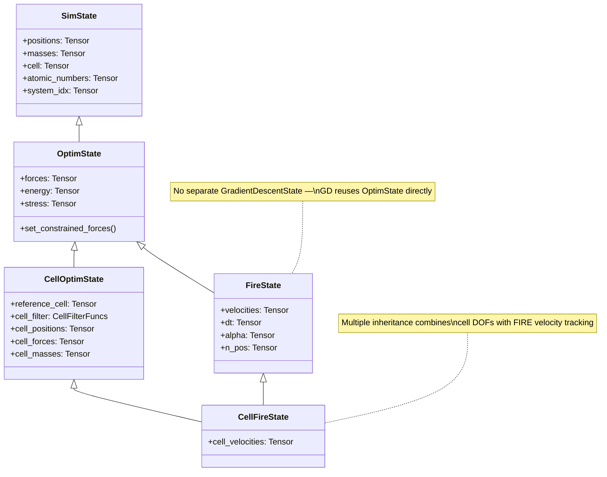
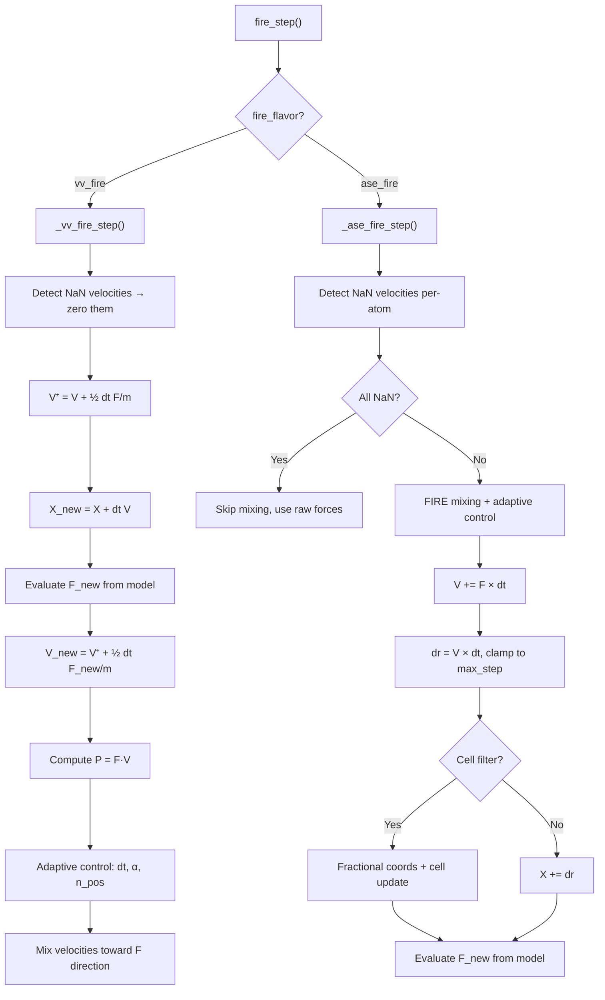

TorchSim's geometry optimization layer provides two first-order optimizers—Gradient Descent and FIRE (Fast Inertial Relaxation Engine)—that operate on batched atomic structures through a unified **init/step** functional pattern. These form the simplest tier of the optimizer hierarchy, serving as foundations for understanding the more advanced [L-BFGS and BFGS Quasi-Newton Methods](16-l-bfgs-and-bfgs-quasi-newton-methods). Both optimizers share a common state base, integrate seamlessly with [Cell Filters and Constraints](17-cell-filters-and-constraints), and are fully batched across heterogeneous systems on GPU.

Sources: [torch_sim/optimizers/__init__.py](torch_sim/optimizers/__init__.py#L1-L53), [torch_sim/optimizers/state.py](torch_sim/optimizers/state.py#L11-L52)

## Architecture Overview

The optimizer subsystem follows a layered design where all algorithms share a common base state and expose a uniform two-function interface: an initialization function that creates the state, and a step function that advances it. A registry pattern in `OPTIM_REGISTRY` maps `Optimizer` enum values to their corresponding `(init_fn, step_fn)` tuples, enabling generic dispatch through the [High-Level Runners API](19-high-level-runners-api).



The critical insight in this hierarchy is that **Gradient Descent has no dedicated state subclass**—it operates directly on `OptimState`, since it requires no additional fields beyond forces and energy. FIRE, by contrast, extends this with velocity-based dynamics parameters (`velocities`, `dt`, `alpha`, `n_pos`) that persist across steps. When cell optimization is enabled, the cell state mixins (`CellOptimState`, `CellFireState`) graft on cell degrees of freedom, reference cells, and the filter function tuple.

Sources: [torch_sim/optimizers/state.py](torch_sim/optimizers/state.py#L11-L52), [torch_sim/optimizers/state.py](torch_sim/optimizers/state.py#L152), [torch_sim/optimizers/cell_filters.py](torch_sim/optimizers/cell_filters.py#L426-L467)

## Optimizer State Hierarchy

`OptimState` serves as the universal foundation for all optimization algorithms. It extends [SimState](7-simstate-and-state-hierarchy) with three critical tensors that track the system's energetic landscape during relaxation. Forces, energy, and stress are computed once during initialization and re-evaluated after every step, while the `__post_init__` hook immediately applies any registered constraints to the initial forces.

Sources: [torch_sim/optimizers/state.py](torch_sim/optimizers/state.py#L11-L36)

### OptimState — The Base Optimization State

`OptimState` carries the essential physics data for any optimization algorithm. The `_atom_attributes` and `_system_attributes` class variables define how these tensors are broadcast, padded, and concatenated when operating on batched systems with different atom counts—mechanics covered in detail in [Batched State Operations](8-batched-state-operations).

| Attribute | Shape | Classification | Description |
|-----------|-------|---------------|-------------|
| `forces` | `[N, 3]` | Per-atom | Gradient of energy w.r.t. positions (negative forces = descent direction) |
| `energy` | `[S]` | Per-system | Total potential energy for convergence monitoring |
| `stress` | `[S, 3, 3]` | Per-system | Virial stress tensor, used when cell optimization is active |

The `set_constrained_forces` method iterates over all attached constraints and calls `constraint.adjust_forces()` before assigning, ensuring that [Constraints System](21-constraints-system) integration is enforced at every force update boundary.

Sources: [torch_sim/optimizers/state.py](torch_sim/optimizers/state.py#L20-L36)

### FireState — Velocity-Augmented State

`FireState` extends `OptimState` with four system-level or atom-level tensors that enable the FIRE algorithm's inertial dynamics. These parameters evolve adaptively during optimization based on the sign of the power (F·v).

| Attribute | Shape | Default | Description |
|-----------|-------|---------|-------------|
| `velocities` | `[N, 3]` | `NaN` | Per-atom velocities; NaN signals uninitialized (lazy init on first step) |
| `dt` | `[S]` | `dt_start` | Per-system timestep, adapted between `dt_start` and `dt_max` |
| `alpha` | `[S]` | `alpha_start` | Velocity mixing parameter; decreased on positive power steps |
| `n_pos` | `[S]` | `0` | Consecutive positive-power step counter (int32) |

The NaN-based initialization of velocities is a deliberate design choice that supports the [Automatic Batching and GPU Memory](18-automatic-batching-and-gpu-memory) system's in-flight swapping. When the `InFlightAutoBatcher` injects a fresh system mid-optimization, its velocities arrive as NaN. The step function detects these per-atom and zeroes only those systems' velocities, leaving retained systems' trajectories undisturbed. This is verified by the `test_fire_nan_velocities_dont_affect_other_systems` regression test.

Sources: [torch_sim/optimizers/fire.py](torch_sim/optimizers/fire.py#L83-L93), [torch_sim/optimizers/state.py](torch_sim/optimizers/state.py#L38-L51), [tests/test_optimizers.py](tests/test_optimizers.py#L719-L785)

## Gradient Descent Optimizer

Gradient Descent is the simplest optimizer in TorchSim—a direct force-proportional position update with no momentum, no line search, and no adaptive parameters. It serves as a baseline algorithm and is particularly useful for gentle relaxation where FIRE's inertial dynamics might overshoot, or as a reference implementation for testing the optimizer infrastructure.

Sources: [torch_sim/optimizers/gradient_descent.py](torch_sim/optimizers/gradient_descent.py#L1-L16)

### Initialization: `gradient_descent_init`

The initialization function accepts a `SimState` and a model, evaluates the initial forces and energy, and returns either an `OptimState` (position-only) or `CellOptimState` (with cell filter). The cell filter is resolved through `ts.get_cell_filter()`, which returns an `(init_fn, step_fn)` tuple from the cell filter registry.

```python
# Position-only relaxation
state = ts.gradient_descent_init(state=sim_state, model=model)

# Full cell + position relaxation
state = ts.gradient_descent_init(
    state=sim_state, model=model, cell_filter=ts.CellFilter.unit
)
```

| Parameter | Type | Default | Description |
|-----------|------|---------|-------------|
| `state` | `SimState` | *(required)* | Input atomic configuration |
| `model` | `ModelInterface` | *(required)* | Energy/force model |
| `cell_filter` | `CellFilter \| None` | `None` | `None` for positions only; `CellFilter.unit` or `CellFilter.frechet` for cell+position |
| `**filter_kwargs` | `Any` | `{}` | Forwarded to cell filter init (e.g., `hydrostatic_strain`, `constant_volume`) |

Sources: [torch_sim/optimizers/gradient_descent.py](torch_sim/optimizers/gradient_descent.py#L18-L67)

### Single Step: `gradient_descent_step`

Each step applies a straightforward update: `positions += pos_lr × forces`. The learning rate is broadcast from a per-system tensor to per-atom granularity via `system_idx` indexing. When a cell filter is active, the cell filter's step function is invoked with `cell_lr` to update the unit cell parameters.

```python
# Advance one step
state = ts.gradient_descent_step(state=state, model=model, pos_lr=0.01)

# With cell optimization
state = ts.gradient_descent_step(state=state, model=model, pos_lr=0.01, cell_lr=0.1)
```

The step sequence follows this order: (1) update atomic positions with constrained application via `set_constrained_positions`, (2) if cell-optimizing, delegate cell update to the filter's step function, (3) re-evaluate forces/energy/stress from the model, (4) update constrained forces, (5) if cell-optimizing, recompute cell forces via `compute_cell_forces`.

| Parameter | Type | Default | Description |
|-----------|------|---------|-------------|
| `pos_lr` | `float \| Tensor` | `0.01` | Position learning rate; scalar is broadcast to all systems |
| `cell_lr` | `float \| Tensor` | `0.1` | Cell learning rate; only used when `isinstance(state, CellOptimState)` |

Sources: [torch_sim/optimizers/gradient_descent.py](torch_sim/optimizers/gradient_descent.py#L70-L120)

## FIRE Optimizer

FIRE (Fast Inertial Relaxation Engine) is a damped molecular dynamics optimization algorithm that combines the stability of gradient descent with the acceleration of momentum-based methods. Originally published by Bitzek et al. (2006), it works by integrating equations of motion (either Velocity-Verlet or forward-Euler) while mixing velocities toward the force direction and adaptively controlling the timestep and mixing parameter based on the sign of the power `P = F · v`.

Sources: [torch_sim/optimizers/fire.py](torch_sim/optimizers/fire.py#L21-L22)

### Initialization: `fire_init`

Beyond the standard model evaluation, `fire_init` creates NaN-initialized velocity tensors (both atomic and cell) and per-system control parameters for the adaptive timestep and mixing. The NaN initialization pattern is the key mechanism supporting autobatcher mid-optimization state injection.

```python
# Paper-faithful Velocity-Verlet FIRE
state = ts.fire_init(sim_state, model, fire_flavor="vv_fire", dt_start=0.1)

# ASE-compatible FIRE (default)
state = ts.fire_init(sim_state, model, fire_flavor="ase_fire", dt_start=0.1)

# With Frechet cell filter
state = ts.fire_init(
    sim_state, model,
    fire_flavor="ase_fire",
    cell_filter=ts.CellFilter.frechet,
    scalar_pressure=0.0,
)
```

| Parameter | Type | Default | Description |
|-----------|------|---------|-------------|
| `dt_start` | `float \| Tensor` | `0.1` | Initial timestep per system |
| `alpha_start` | `float \| Tensor` | `0.1` | Initial velocity mixing parameter |
| `fire_flavor` | `"vv_fire" \| "ase_fire"` | `"ase_fire"` | Integration scheme (see Flavor Comparison below) |
| `cell_filter` | `CellFilter \| None` | `None` | Cell optimization filter |
| `**filter_kwargs` | `Any` | `{}` | Cell filter options (`scalar_pressure`, `hydrostatic_strain`, etc.) |

Scalar parameters are expanded to per-system tensors via `expand(n_systems).clone()`—the `.clone()` is essential because these tensors are later mutated in-place by `masked_fill` operations during adaptive control.

Sources: [torch_sim/optimizers/fire.py](torch_sim/optimizers/fire.py#L21-L111)

### Single Step: `fire_step`

The step function converts scalar parameters to device-resident tensors, selects the flavor-specific implementation, and delegates. Both flavors share the same adaptive control logic but differ in their integration mechanics.

| Parameter | Type | Default | Description |
|-----------|------|---------|-------------|
| `dt_max` | `float \| Tensor` | `1.0` | Maximum allowed timestep |
| `n_min` | `int \| Tensor` | `5` | Minimum positive-power steps before increasing `dt` |
| `f_inc` | `float \| Tensor` | `1.1` | Timestep increase factor when `P > 0` and `n_pos > n_min` |
| `f_dec` | `float \| Tensor` | `0.5` | Timestep decrease factor when `P < 0` |
| `alpha_start` | `float \| Tensor` | `0.1` | Value to reset `alpha` on negative power |
| `f_alpha` | `float \| Tensor` | `0.99` | Factor to reduce `alpha` on each positive-power step |
| `max_step` | `float \| Tensor` | `0.2` | Maximum per-atom displacement (ASE FIRE only) |
| `fire_flavor` | `"vv_fire" \| "ase_fire"` | `"ase_fire"` | Integration scheme |

Sources: [torch_sim/optimizers/fire.py](torch_sim/optimizers/fire.py#L114-L173)

### FIRE Flavor Comparison

TorchSim provides two FIRE implementations that differ in their integration scheme and behavioral nuances. Both converge to minima, but the `ase_fire` flavor is generally preferred for its stability on diverse systems.



| Characteristic | `vv_fire` (Velocity-Verlet) | `ase_fire` (ASE-style) |
|---|---|---|
| **Integration** | Symplectic Velocity-Verlet (kick-drift-kick) | Forward Euler (single acceleration) |
| **Mass dependence** | Yes — `a = F/m` | No — unit mass assumed |
| **Step clamping** | None | `max_step` limits per-atom displacement |
| **NaN handling** | All-or-nothing: zeros all systems at once | Per-atom: skips mixing only for fully-NaN systems |
| **Mixing order** | After full Verlet integration | Before Euler acceleration |
| **Cell optimization** | Cell velocities updated via Verlet half-steps | Cell positions updated as extended DOFs in dr |
| **Reference** | Original paper (Bitzek 2006) | ASE implementation |

The VV FIRE variant follows the original paper closely with a proper Velocity-Verlet integrator that provides better energy conservation properties. The ASE variant trades theoretical rigor for practical robustness—its forward-Euler integration with step clamping (`max_step`) prevents overshooting in stiff potentials, and its per-atom NaN detection is critical for correct behavior when the autobatcher swaps states mid-optimization.

Sources: [torch_sim/optimizers/fire.py](torch_sim/optimizers/fire.py#L176-L281), [torch_sim/optimizers/fire.py](torch_sim/optimizers/fire.py#L284-L473)

### Adaptive Control Logic (Shared Between Flavors)

Both flavors implement the same FIRE adaptive control mechanism, which governs how the timestep `dt` and mixing parameter `alpha` evolve. The control operates on per-system granularity—each system in a batch independently tracks its own power sign and adjusts parameters accordingly.

The power `P = F · V` determines the control flow:

- **P > 0** (system moving downhill): increment `n_pos`; if `n_pos > n_min`, increase `dt` by `f_inc` (capped at `dt_max`) and decrease `alpha` by multiplying by `f_alpha`.
- **P ≤ 0** (system moving uphill or stalled): reset `n_pos` to 0, decrease `dt` by `f_dec`, reset `alpha` to `alpha_start`, and zero the velocities (for VV FIRE) or leave them for clamping (for ASE FIRE).

Velocity mixing blends current velocities toward the force direction using the formula `V = (1 - α) × V + α × (|V|/|F|) × F`, where the scaling ensures the mixed velocity has the same magnitude as the original. Systems with negative power receive zeroed velocities, effectively restarting the inertial descent.

Sources: [torch_sim/optimizers/fire.py](torch_sim/optimizers/fire.py#L232-L279), [torch_sim/optimizers/fire.py](torch_sim/optimizers/fire.py#L330-L378)

> [!TIP]
> The `alpha` parameter in FIRE controls how aggressively velocities are rotated toward the force direction. Starting at `0.1` (90% velocity, 10% force direction), it decays geometrically by `f_alpha=0.99` on each positive-power step. This means the optimizer initially preserves inertial memory and progressively shifts toward pure gradient descent as it gains confidence in the descent direction.

## Cell Optimization Integration

Both optimizers support simultaneous optimization of atomic positions and unit cell parameters through the cell filter system. When a `cell_filter` is specified during initialization, the returned state is a cell-augmented variant (`CellOptimState` for GD, `CellFireState` for FIRE) that tracks additional cell degrees of freedom.

Sources: [torch_sim/optimizers/cell_filters.py](torch_sim/optimizers/cell_filters.py#L287-L293)

### Cell Filter Options

| Filter | State Type | Parameterization | Use Case |
|--------|-----------|------------------|----------|
| `None` | `OptimState` / `FireState` | N/A | Fixed-cell position relaxation |
| `CellFilter.unit` | `CellOptimState` / `CellFireState` | Scaled deformation gradient | General variable-cell relaxation |
| `CellFilter.frechet` | `CellOptimState` / `CellFireState` | Log-space deformation (matrix exponential) | Large deformations, better rotational invariance |

The unit cell filter parameterizes the cell as a scaled deformation gradient `H = cell_positions / cell_factor`, where `cell_factor` is a scaling constant (default 100.0 for unit, 75.0 for Frechet) that normalizes the cell and atomic DOFs to comparable magnitudes. The Frechet variant operates in log-space (`log(H)`) with matrix exponential mapping, providing smoother interpolation for large deformations and clamping at `MAX_LOG_DEFORM = 2.0` to prevent numerical instability.

Sources: [torch_sim/optimizers/cell_filters.py](torch_sim/optimizers/cell_filters.py#L23-L32), [torch_sim/optimizers/cell_filters.py](torch_sim/optimizers/cell_filters.py#L181-L285), [torch_sim/optimizers/cell_filters.py](torch_sim/optimizers/cell_filters.py#L295-L357)

### How GD and FIRE Differ in Cell Handling

For **Gradient Descent**, the cell filter's `step_fn` is invoked as a black box after the position update. The step function receives `cell_lr` and internally updates `cell_positions`, reconstructs the deformation gradient, computes the new cell matrix, and calls `set_constrained_cell` to apply constraints and rescale atomic positions.

For **FIRE**, the cell integration is tightly coupled with the atomic integration. In `ase_fire`, cell positions and atomic positions are updated as a unified displacement vector (`dr_atom` + `dr_cell`), with a shared `max_step` clamping that considers both atomic and cell displacement magnitudes. In `vv_fire`, cell velocities follow the same Velocity-Verlet half-step pattern as atomic velocities, and cell forces are computed via `compute_cell_forces` after each model evaluation.

Sources: [torch_sim/optimizers/gradient_descent.py](torch_sim/optimizers/gradient_descent.py#L103-L118), [torch_sim/optimizers/fire.py](torch_sim/optimizers/fire.py#L220-L230), [torch_sim/optimizers/fire.py](torch_sim/optimizers/fire.py#L385-L473)

## The Optimizer Registry

The `OPTIM_REGISTRY` dictionary and `Optimizer` enum provide the indirection layer that allows the `optimize()` runner and other generic code to dispatch to any optimizer without direct imports. Each entry maps to a `(init_fn, step_fn)` tuple following the same signature contract.

| `Optimizer` Key | `init_fn` | `step_fn` | State Type |
|---|---|---|---|
| `Optimizer.gradient_descent` | `gradient_descent_init` | `gradient_descent_step` | `OptimState` / `CellOptimState` |
| `Optimizer.fire` | `fire_init` | `fire_step` | `FireState` / `CellFireState` |
| `Optimizer.lbfgs` | `lbfgs_init` | `lbfgs_step` | `LBFGSState` / `CellLBFGSState` |
| `Optimizer.bfgs` | `bfgs_init` | `bfgs_step` | `BFGSState` / `CellBFGSState` |

This registry is the extension point: adding a new optimizer requires only implementing `init_fn` and `step_fn` functions, registering them in the dictionary, and adding an enum variant.

Sources: [torch_sim/optimizers/__init__.py](torch_sim/optimizers/__init__.py#L38-L52)

## Convergence Functions

TorchSim provides generator functions that produce convergence predicates compatible with the `optimize()` runner. The force convergence function accepts both `MDState` and `FireState`, checking per-atom force norms against a tolerance. The energy convergence function works with any `OptimState` subclass, checking relative energy changes.

```python
from torch_sim.runners import generate_force_convergence_fn

# Converge when max per-atom force < 0.05 eV/Å
convergence_fn = generate_force_convergence_fn(force_tol=0.05)

state = ts.optimize(
    sim_state, model,
    optimizer=ts.Optimizer.fire,
    convergence_fn=convergence_fn,
    init_kwargs={"fire_flavor": "ase_fire"},
)
```

Sources: [torch_sim/runners.py](torch_sim/runners.py#L485-L528)

## Practical Usage Patterns

### Basic Position Relaxation Loop

The most common pattern is a manual optimization loop using the init/step functions directly. This gives full control over convergence criteria and intermediate state inspection.

```python
import torch
import torch_sim as ts

# Perturb initial positions
perturbed = sim_state.positions + torch.randn_like(sim_state.positions) * 0.1
sim_state.positions = perturbed

# Initialize and run FIRE
state = ts.fire_init(sim_state, model, fire_flavor="ase_fire")
for _ in range(1000):
    state = ts.fire_step(state, model, dt_max=0.3)
    if torch.max(torch.norm(state.forces, dim=1)) < 0.01:
        break
```

### Full Cell + Position Optimization

Adding a cell filter enables variable-cell relaxation, useful for finding equilibrium lattice parameters simultaneously with atomic positions.

```python
state = ts.fire_init(
    sim_state, model,
    fire_flavor="ase_fire",
    cell_filter=ts.CellFilter.frechet,
    scalar_pressure=0.0,
)

for _ in range(500):
    state = ts.fire_step(state, model, dt_max=0.3)
    max_force = torch.max(torch.norm(state.forces, dim=1))
    pressure = torch.trace(state.stress[0]) / 3.0
    if max_force < 0.01 and abs(pressure) < 0.1:
        break
```

Sources: [tests/test_optimizers.py](tests/test_optimizers.py#L16-L52), [tests/test_optimizers.py](tests/test_optimizers.py#L101-L161), [tests/test_optimizers.py](tests/test_optimizers.py#L55-L98)

> [!TIP]
> When using FIRE with the autobatcher (`InFlightAutoBatcher`), the `ase_fire` flavor is strongly recommended over `vv_fire`. The ASE variant's per-atom NaN detection ensures that newly injected systems (with NaN velocities from `fire_init`) are handled correctly without disrupting the FIRE mixing of retained systems. The `vv_fire` variant's all-or-nothing NaN zeroing can cause subtle trajectory corruption in batched scenarios.

## Choosing Between Gradient Descent and FIRE

The choice between these two optimizers depends on the problem characteristics:

| Criterion | Gradient Descent | FIRE |
|-----------|-----------------|------|
| **Convergence speed** | Slow, linear | Fast, superlinear near minimum |
| **Stability** | Very stable; never overshoots | Can overshoot in stiff potentials (use `max_step`) |
| **Memory overhead** | Minimal (no velocity storage) | Moderate (`velocities`, `dt`, `alpha`, `n_pos`) |
| **Tuning required** | Only `pos_lr` | Multiple parameters but defaults work well |
| **Best for** | Final gentle relaxation, testing | General-purpose geometry optimization |

For production use, FIRE with the `ase_fire` flavor is the recommended default. Gradient Descent remains valuable as a debugging baseline and for cases where the adaptive dynamics of FIRE cause convergence issues, such as extremely flat potential energy surfaces or systems near structural instabilities where inertial effects can amplify numerical noise.

For larger systems or when second-order information is available, the quasi-Newton methods described in [L-BFGS and BFGS Quasi-Newton Methods](16-l-bfgs-and-bfgs-quasi-newton-methods) offer significantly faster convergence at the cost of additional memory and complexity.