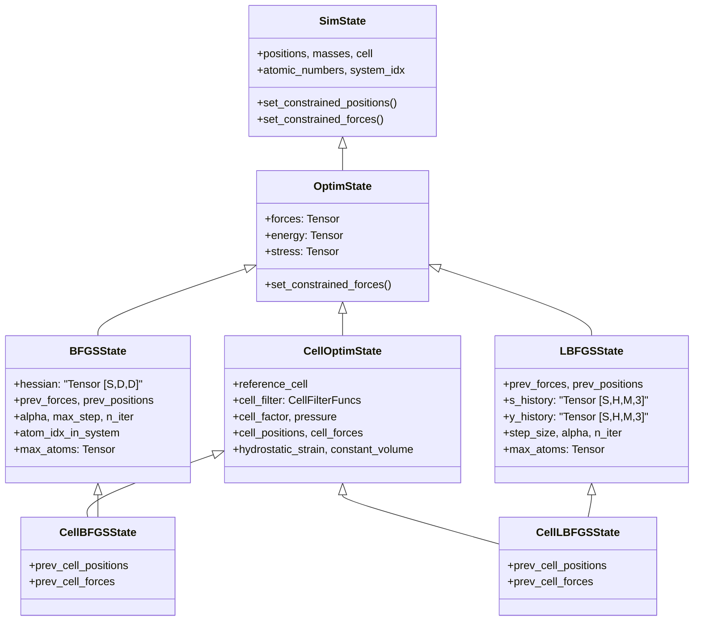
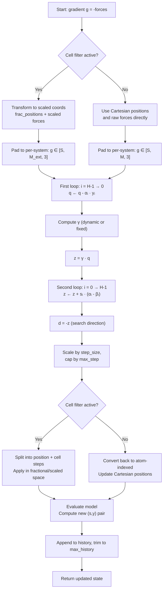

Quasi-Newton methods represent the most sophisticated class of local optimizers available in torch-sim. Both BFGS and its limited-memory variant L-BFGS build curvature information to accelerate convergence far beyond what first-order methods like gradient descent or even FIRE can achieve near the energy minimum. This page dissects the architectural design, mathematical foundations, and batched GPU implementation of these two algorithms, equipping you to make informed decisions about which to use and how to configure them for your atomic relaxation workloads.

Sources: [__init__.py](torch_sim/optimizers/__init__.py#L1-L53), [lbfgs.py](torch_sim/optimizers/lbfgs.py#L1-L12), [bfgs.py](torch_sim/optimizers/bfgs.py#L1-L15)

## Algorithmic Foundation and Design Philosophy

Both BFGS and L-BFGS belong to the quasi-Newton family: they iteratively construct an approximation to the inverse Hessian matrix — the matrix of second derivatives of the energy — to compute a Newton-like step without ever computing second derivatives explicitly. Instead, curvature information is extracted from successive gradient (force) evaluations. The critical design challenge in torch-sim is that these algorithms must operate on **batches of systems with varying atom counts**, all executing simultaneously on GPU tensors without Python-level loops over systems.

Sources: [lbfgs.py](torch_sim/optimizers/lbfgs.py#L1-L7), [bfgs.py](torch_sim/optimizers/bfgs.py#L1-L9)

### BFGS vs. L-BFGS: The Fundamental Tradeoff

The two algorithms sit on opposite ends of a precision–memory spectrum. Full BFGS maintains an explicit dense Hessian matrix of shape `[S, 3M, 3M]` per batch, where `S` is the number of systems and `M` is the maximum atom count in the batch. This yields the most accurate curvature estimate but demands O(M²) memory per system. L-BFGS instead stores a rolling window of `H` vector pairs `(s_k, y_k)` — displacement and gradient-difference histories — and reconstructs the inverse-Hessian-vector product on the fly via the classical two-loop recursion, reducing memory to O(M·H) per system at the cost of a less precise curvature model.

| Property | BFGS | L-BFGS |
|---|---|---|
| **Hessian representation** | Explicit dense matrix `[S, D, D]` | Implicit via history `[S, H, M, 3]` |
| **Memory per system** | O(M²) | O(M·H) where H = max_history |
| **Step computation** | Eigendecomposition (pseudo-inverse) | Two-loop recursion |
| **Curvature quality** | Full rank approximation | Rank-2H approximation |
| **Ideal use case** | Small systems (<200 atoms), fast convergence needed | Large systems, memory-constrained, batched workloads |
| **Default `alpha`** | 70.0 (fixed stiffness) | None (dynamic scaling) |

Sources: [lbfgs.py](torch_sim/optimizers/lbfgs.py#L1-L7), [bfgs.py](torch_sim/optimizers/bfgs.py#L1-L9), [bfgs.py](torch_sim/optimizers/bfgs.py#L36)

## Architecture and Class Hierarchy

Both optimizers share a unified architecture: an `init` function creates an optimizer-specific state from a `SimState`, and a `step` function advances that state by one iteration. The state classes extend `OptimState`, which itself extends `SimState` with forces, energy, and stress tracking. Cell-optimization variants compose these via multiple inheritance with `CellOptimState`, adding reference cell tracking, cell filter functions, and cell forces/positions.



The `_padded_system_attributes` class variable on `BFGSState` and `LBFGSState` marks which system-level tensors use padding — `hessian` for BFGS, `s_history` and `y_history` for L-BFGS. This signals to the batched state concatenation machinery that these attributes require special padding logic when combining states from different autobatching groups.

Sources: [state.py](torch_sim/optimizers/state.py#L54-L149), [cell_filters.py](torch_sim/optimizers/cell_filters.py#L426-L523)

## BFGS: Full Hessian Quasi-Newton Method

The BFGS optimizer maintains the complete Hessian approximation as a dense `[S, D, D]` tensor where `D = 3·M` for position-only optimization or `D = 3·M + 9` when a cell filter is active (the extra 9 DOFs encode the 3×3 deformation gradient). The Hessian is initialized as `α·I` — a scaled identity matrix — and updated at each step using the standard BFGS rank-2 correction, but only for systems where the maximum displacement exceeds `BFGS_EPS = 1e-7`.

Sources: [bfgs.py](torch_sim/optimizers/bfgs.py#L36), [bfgs.py](torch_sim/optimizers/bfgs.py#L87-L249)

### BFGS Hessian Update

At each step, the optimizer computes the displacement `δx = x_new - x_old` and force change `δf = f_new - f_old`. For systems with significant movement (`max|δx| ≥ BFGS_EPS`), the Hessian is updated via:

```
H_{k+1} = H_k - (δf · δfᵀ) / (δfᵀ · δx) - (H_k · δx)(H_k · δx)ᵀ / (δxᵀ · H_k · δx)
```

This is implemented using batched matrix multiplications over active systems only, avoiding wasted computation on converged or stalled systems. The per-system `update_mask` ensures that converged sub-systems in a batch don't corrupt their Hessian with numerically meaningless near-zero updates.

Sources: [bfgs.py](torch_sim/optimizers/bfgs.py#L390-L419)

### Eigendecomposition-Based Step Direction

Rather than directly inverting the Hessian, BFGS computes the step direction via eigendecomposition: `step = V · |ω|⁻¹ · Vᵀ · forces`. Taking the absolute value of eigenvalues ensures the step is always a descent direction even when the Hessian approximation develops negative eigenvalues (which happens frequently near saddle points or with poor initial curvature estimates). This pseudo-inverse approach is critical for robustness.

A key optimization for heterogeneous batches is **size-binned eigendecomposition**: systems are grouped by their actual atom count, and eigendecomposition runs separately on each group. This avoids the overhead of eigendecomposing unnecessarily large padded matrices for small systems in the batch. The loop iterates over `unique_sizes` extracted from `state.max_atoms`.

Sources: [bfgs.py](torch_sim/optimizers/bfgs.py#L421-L456)

### Step Capping

After computing the step, a per-system maximum displacement cap is enforced. The step vector is reshaped to `[S, M, 3]`, the maximum norm per system is computed (accounting for padding), and a uniform scaling factor ≤ 1.0 is applied so that no atom moves more than `max_step` Ångströms in a single iteration.

Sources: [bfgs.py](torch_sim/optimizers/bfgs.py#L458-L486)

> [!TIP]
> When using BFGS with cell filters in heterogeneous batches, the Hessian dimension is `3·global_max_atoms + 9`. Systems with fewer atoms than the maximum pay a memory penalty proportional to `(global_max - local_max)²`. For highly heterogeneous batches, L-BFGS is almost always the better choice because its per-system padded history tensors grow only linearly with atom count.

## L-BFGS: Limited-Memory Two-Loop Recursion

L-BFGS discards the explicit Hessian entirely and instead maintains a rolling buffer of the last `H` displacement-gradient pairs. The search direction is reconstructed on the fly using the classical two-loop recursion algorithm from Nocedal & Wright. This is the default recommendation for production workloads in torch-sim due to its favorable memory characteristics and competitive convergence rate.

Sources: [lbfgs.py](torch_sim/optimizers/lbfgs.py#L1-L7), [lbfgs.py](torch_sim/optimizers/lbfgs.py#L279-L324)

### Padding and Batched Two-Loop Recursion

The core challenge of implementing L-BFGS for heterogeneous batches is the two-loop recursion itself, which requires per-system inner products between history vectors and the running search direction. The implementation converts atom-indexed tensors `[N, 3]` to padded per-system format `[S, M, 3]` using `_atoms_to_padded`, then uses `_per_system_vdot` — which multiplies element-wise, masks out padded entries, and sums — to compute the needed dot products across all systems simultaneously.



Sources: [lbfgs.py](torch_sim/optimizers/lbfgs.py#L53-L111), [lbfgs.py](torch_sim/optimizers/lbfgs.py#L325-L533)

### Two-Loop Recursion Detail

The first loop traverses history from newest to oldest, accumulating corrections `αᵢ = ρᵢ · (sᵢ · q)` and updating `q ← q - αᵢ · yᵢ`. After both loops, `q` has been transformed into the steepest descent direction scaled by the approximate inverse Hessian. The intermediate scaling factor `γ` serves as the initial Hessian diagonal estimate `H₀`:

- **Standard L-BFGS** (`alpha=None`): `γ = (sᵀy)/(yᵀy)` computed from the most recent history pair — this adapts to local curvature automatically.
- **ASE compatibility mode** (`alpha=70.0`): `γ = 1/α` is fixed throughout optimization, matching `ase.optimize.LBFGS(alpha=70.0, damping=1.0)`.

The second loop traverses from oldest to newest, applying `z ← z + sᵢ · (αᵢ - βᵢ)` where `βᵢ = ρᵢ · (yᵢ · z)`. The final search direction is `d = -z`, scaled by `step_size` and capped per system.

Sources: [lbfgs.py](torch_sim/optimizers/lbfgs.py#L384-L451), [lbfgs.py](torch_sim/optimizers/lbfgs.py#L409-L427)

### History Management

New `(s, y)` pairs are appended to the history tensors on every step. Unlike some implementations, torch-sim's L-BFGS does **not** perform a curvature check before appending — this matches ASE's behavior, where invalid curvatures are handled gracefully in the two-loop recursion by zeroing out `ρ` when `|yᵀs| < curvature_eps`. When history exceeds `max_history` (default 20), the oldest entries are trimmed from the front: `s_hist[:, -max_history:]`.

Sources: [lbfgs.py](torch_sim/optimizers/lbfgs.py#L597-L625)

> [!TIP]
> The `step_size` parameter in L-BFGS serves a fundamentally different role depending on `alpha`. With `alpha=None` (standard mode), `step_size=0.1` acts as a damping factor on the quasi-Newton step. With `alpha=70.0` (ASE mode), set `step_size=1.0` and rely on `alpha` for stiffness control. Mixing these conventions produces unexpectedly small or divergent steps.

## Cell Filter Integration

Both optimizers support simultaneous optimization of atomic positions and unit cell parameters through cell filters. When a `cell_filter` is provided during initialization, the state class becomes `CellBFGSState` or `CellLBFGSState`, and the optimization operates in an **extended coordinate space** that concatenates atom positions with cell degrees of freedom.

Sources: [cell_filters.py](torch_sim/optimizers/cell_filters.py#L287-L291), [cell_filters.py](torch_sim/optimizers/cell_filters.py#L470-L523)

### Deformation Gradient Space

Both cell filter variants work in a scaled coordinate system defined by a **deformation gradient** `h` that maps reference cell vectors to current cell vectors. Forces are transformed to scaled forces via `f_scaled = f · h`, and positions are converted to fractional coordinates via `x_frac = h⁻¹ · x`. This ensures that the optimizer's curvature estimates are measured in a space where the cell metric is isotropic, dramatically improving convergence for strained or anisotropic cells.

| Filter | Deformation gradient | Cell update |
|---|---|---|
| **Unit** (`CellFilter.unit`) | `h = cell_positions / cell_factor` | Linear in cell parameters |
| **Frechet** (`CellFilter.frechet`) | `h = exp(cell_positions / cell_factor)` | Geometric (log-space), better for large strains |

The Frechet filter parameterizes the cell via matrix exponential, which naturally handles rotations and large deformations. Its log-space representation is clamped at `MAX_LOG_DEFORM = 2.0` to prevent numerical overflow in the matrix exponential.

Sources: [cell_filters.py](torch_sim/optimizers/cell_filters.py#L137-L139), [cell_filters.py](torch_sim/optimizers/cell_filters.py#L23-L59), [cell_filters.py](torch_sim/optimizers/cell_filters.py#L230-L285)

### Extended DOF Layout

For cell optimization, the history (L-BFGS) or Hessian (BFGS) is extended with 3 additional "virtual atoms" per system, representing the 3×3 cell parameter matrix. The layout is `[S, M+3, 3]` for history or `[S, 3(M+3), 3(M+3)]` for the Hessian, where the first `M` entries are atomic DOFs and the last 3 rows/columns are cell DOFs.

Sources: [lbfgs.py](torch_sim/optimizers/lbfgs.py#L249-L262), [bfgs.py](torch_sim/optimizers/bfgs.py#L146-L152)

### Cell Force Computation

Cell forces are computed from the stress tensor using `compute_cell_forces`, which applies hydrostatic strain, constant volume, and pressure constraints before converting stress to cell forces. The cell forces are then stored in `state.cell_forces` as `[S, 3, 3]` tensors, participating in the same curvature estimation machinery as atomic forces.

Sources: [cell_filters.py](torch_sim/optimizers/cell_filters.py#L353-L400), [lbfgs.py](torch_sim/optimizers/lbfgs.py#L541-L542), [bfgs.py](torch_sim/optimizers/bfgs.py#L554-L558)

## Initialization API Reference

### BFGS Initialization

`bfgs_init(state, model, *, max_step=0.2, alpha=70.0, cell_filter=None, **filter_kwargs)` creates a `BFGSState` (or `CellBFGSState` if `cell_filter` is provided). The Hessian is initialized as `α·I` with dimension `3·M` for position-only or `3·M + 9` for cell optimization.

| Parameter | Type | Default | Description |
|---|---|---|---|
| `state` | `SimState` | — | Input simulation state |
| `model` | `ModelInterface` | — | Model for energy/force computation |
| `max_step` | `float \| Tensor` | 0.2 | Maximum per-atom displacement per step (Å) |
| `alpha` | `float \| Tensor` | 70.0 | Initial Hessian stiffness (eV/ų) |
| `cell_filter` | `CellFilter \| None` | None | Cell filter for simultaneous cell optimization |
| `**filter_kwargs` | — | — | Passed to cell filter (e.g., `scalar_pressure`) |

Sources: [bfgs.py](torch_sim/optimizers/bfgs.py#L87-L249)

### L-BFGS Initialization

`lbfgs_init(state, model, *, step_size=0.1, alpha=None, cell_filter=None, **filter_kwargs)` creates an `LBFGSState` (or `CellLBFGSState`). The history tensors start empty `[S, 0, M, 3]` and grow incrementally.

| Parameter | Type | Default | Description |
|---|---|---|---|
| `step_size` | `float \| Tensor` | 0.1 | Fixed step length (damping factor) |
| `alpha` | `float \| Tensor \| None` | None | Inverse Hessian stiffness; `None` = dynamic |
| `cell_filter` | `CellFilter \| None` | None | Cell filter type |
| `**filter_kwargs` | — | — | Cell filter parameters |

Sources: [lbfgs.py](torch_sim/optimizers/lbfgs.py#L114-L276)

## Step Function API Reference

### BFGS Step

`bfgs_step(state, model)` performs one full BFGS iteration: compute displacement/force changes, update the Hessian via BFGS formula, compute step via eigendecomposition pseudo-inverse, apply step capping, update positions/cell, evaluate new forces. All parameters (max_step, alpha) are read from the state.

Sources: [bfgs.py](torch_sim/optimizers/bfgs.py#L252-L562)

### L-BFGS Step

`lbfgs_step(state, model, *, max_history=20, max_step=0.2, curvature_eps=1e-12)` performs one L-BFGS iteration: run two-loop recursion to compute search direction, apply step_size and max_step capping, update positions/cell, evaluate new forces, build new (s,y) pair, append to history and trim.

| Parameter | Type | Default | Description |
|---|---|---|---|
| `max_history` | `int` | 20 | Maximum (s,y) pairs retained |
| `max_step` | `float \| Tensor` | 0.2 | Per-system maximum displacement cap |
| `curvature_eps` | `float` | 1e-12 | Threshold for accepting curvature `⟨y,s⟩` |

Sources: [lbfgs.py](torch_sim/optimizers/lbfgs.py#L279-L628)

## Practical Configuration Guidance

The choice between BFGS and L-BFGS depends primarily on system size and batch composition. For systems with fewer than ~200 atoms where full Hessian memory is tractable, BFGS converges faster due to its richer curvature model. For larger systems or heterogeneous batches where some systems have orders of magnitude more atoms than others, L-BFGS is strongly preferred.

A common production configuration for large-scale batched relaxation uses L-BFGS with standard dynamic scaling:

```python
import torch_sim as ts

# Standard L-BFGS for position-only optimization
state = ts.lbfgs_init(sim_state, model, step_size=0.1)
for _ in range(max_steps):
    state = ts.lbfgs_step(state, model, max_history=20, max_step=0.2)

# L-BFGS with Frechet cell filter for variable-cell relaxation
state = ts.lbfgs_init(
    sim_state, model,
    step_size=0.1,
    cell_filter=ts.CellFilter.frechet,
    scalar_pressure=0.0,
)
for _ in range(max_steps):
    state = ts.lbfgs_step(state, model, max_history=20, max_step=0.2)
```

For ASE-identical behavior, use fixed alpha and unit damping:

```python
# ASE-compatible L-BFGS
state = ts.lbfgs_init(sim_state, model, step_size=1.0, alpha=70.0)
```

Sources: [__init__.py](torch_sim/optimizers/__init__.py#L47-L52), [lbfgs.py](torch_sim/optimizers/lbfgs.py#L151-L161)

## Integration with the Optimizer Registry

Both optimizers are registered in `OPTIM_REGISTRY`, enabling generic dispatch via the `Optimizer` enum. This is the mechanism used by high-level runners to instantiate optimizers from configuration:

```python
OPTIM_REGISTRY = {
    Optimizer.bfgs:  (bfgs_init, bfgs_step),
    Optimizer.lbfgs: (lbfgs_init, lbfgs_step),
}
```

The registry maps each optimizer flavor to its `(init_fn, step_fn)` tuple, allowing the runner API to treat all optimizers uniformly. For detailed usage through the high-level runners, see [High-Level Runners API](19-high-level-runners-api).

Sources: [__init__.py](torch_sim/optimizers/__init__.py#L38-L52)

## Next Steps

- **[Cell Filters and Constraints](17-cell-filters-and-constraints)** — Deep dive into Unit vs. Frechet filter mathematics, pressure coupling, and symmetry constraints
- **[FIRE and Gradient Descent Optimizers](15-fire-and-gradient-descent-optimizers)** — First-order alternatives for cases where quasi-Newton curvature estimation is unnecessary or unstable
- **[Running Batched Geometry Optimizations](5-running-batched-geometry-optimizations)** — End-to-end workflow examples combining optimizers with models and convergence criteria
- **[High-Level Runners API](19-high-level-runners-api)** — How the optimizer registry integrates with the `run_opt` and `run_md` runner functions