Geometry optimization in periodic systems requires simultaneously relaxing atomic positions and unit cell parameters. TorchSim addresses this through a **filter-based architecture** that cleanly separates cell optimization logic from the underlying optimization algorithm. This page documents the cell filter system, its integration with constraint hooks, and the state class hierarchy that enables joint position-cell relaxation across all supported optimizers.

## Architectural Overview

Cell filters in TorchSim follow a **strategy pattern** where each filter encapsulates two responsibilities: initializing cell-related state attributes, and performing per-step cell updates. Optimizers remain agnostic to cell parameterization—they delegate to whichever filter was selected at initialization time. This design mirrors ASE's `UnitCellFilter`/`ExpCellFilter` dichotomy while extending it to a fully batched, GPU-accelerated setting.

```mermaid
classDiagram
    direction TB

    class CellFilter {
        <<StrEnum>>
        unit = "unit"
        frechet = "frechet"
    }

    class CellFilterFuncs {
        <<type alias>>
        (init_fn, step_fn)
    }

    class CELL_FILTER_REGISTRY {
        unit → (unit_cell_filter_init, unit_cell_step)
        frechet → (frechet_cell_filter_init, frechet_cell_step)
    }

    class OptimState
    class CellOptimState {
        +reference_cell: Tensor
        +cell_filter: CellFilterFuncs
        +cell_factor: Tensor
        +pressure: Tensor
        +hydrostatic_strain: bool
        +constant_volume: bool
        +cell_positions: Tensor
        +cell_forces: Tensor
        +cell_masses: Tensor
    }
    class FireState
    class CellFireState {
        +cell_velocities: Tensor
    }
    class BFGSState
    class CellBFGSState {
        +prev_cell_positions: Tensor
        +prev_cell_forces: Tensor
    }
    class LBFGSState
    class CellLBFGSState {
        +prev_cell_positions: Tensor
        +prev_cell_forces: Tensor
    }

    CellOptimState --|> OptimState
    CellFireState --|> CellOptimState
    CellFireState --|> FireState
    CellBFGSState --|> CellOptimState
    CellBFGSState --|> BFGSState
    CellLBFGSState --|> CellOptimState
    CellLBFGSState --|> LBFGSState

    CELL_FILTER_REGISTRY --> CellFilterFuncs : maps enum to
    CellOptimState --> CellFilterFuncs : stores reference
    CellFilter --> CELL_FILTER_REGISTRY : lookup key
```

The `CellFilter` enum is the primary user-facing entry point. Internally, `get_cell_filter()` resolves either an enum value or a raw `(init_fn, step_fn)` tuple into a `CellFilterFuncs` pair. Each optimizer's `*_init` function checks whether `cell_filter is not None` and, if so, creates the appropriate `Cell*State` subclass instead of the position-only state. The init function then delegates to the filter's `init_fn` to populate cell-specific attributes on the state object.

Sources: [cell_filters.py](/torch_sim/optimizers/cell_filters.py#L287-L291), [cell_filters.py](/torch_sim/optimizers/cell_filters.py#L402-L423), [cell_filters.py](/torch_sim/optimizers/cell_filters.py#L426-L454)

## Filter Parameterization: Unit vs. Frechet

TorchSim provides two cell filter implementations, corresponding to ASE's `UnitCellFilter` and `ExpCellFilter` (referred to here as the Frechet cell filter). Both operate on the **deformation gradient** 𝐅, defined as the mapping from the reference cell to the current cell, but they differ in how they parameterize and update cell degrees of freedom.

The deformation gradient is computed as:

$$\mathbf{F} = (\mathbf{h}_\text{ref}^{-1} \cdot \mathbf{h}_\text{current})^\top$$

where **h** denotes the cell matrix in row-vector convention. Both filters store a `reference_cell` (the cell at initialization time) and derive updates relative to it.

Sources: [cell_filters.py](/torch_sim/optimizers/cell_filters.py#L137-L139)

### Unit Cell Filter

The unit cell filter parameterizes cell DOFs directly as the scaled deformation gradient `𝐅 · cell_factor`. This is the simpler of the two approaches:

1. **Cell positions** = `𝐅.reshape(S, 3, 3) × cell_factor` — these are the optimization variables
2. **Cell step** = `cell_lr × cell_forces` added directly to cell positions
3. **Cell update** = `cell_positions_new / cell_factor` yields a new deformation gradient, which is then composed with the reference cell via `h_ref^T · 𝐅_new^T`

The cell forces are computed by transforming the virial through the inverse deformation gradient (matching ASE's formulation):

$$\mathbf{f}_\text{cell} = \mathbf{F}^{-1} \cdot \mathbf{\sigma}^\top)^\top \;/\; \text{cell\_factor}$$

Sources: [cell_filters.py](/torch_sim/optimizers/cell_filters.py#L295-L321), [cell_filters.py](/torch_sim/optimizers/cell_filters.py#L392-L399)

### Frechet Cell Filter

The Frechet cell filter parameterizes cell DOFs in **log-space**: the cell positions are `log(𝐅) × cell_factor`, and updates happen in this logarithmic coordinate system. This has the theoretical advantage of producing symmetric updates for equivalent deformations, and avoids the path-dependent behavior of the unit filter for large deformations.

The update procedure involves:

1. **Cell step** = `cell_lr × cell_forces` added to log-space cell positions
2. **Recover deformation gradient** = `exp(cell_positions / cell_factor)` via matrix exponential
3. **Cell update** = `h_ref^T · exp(log 𝐅_new)^T`

The cell force computation requires the **Fréchet derivative** of the matrix exponential to map gradients from deformation-gradient space back to log-space. TorchSim computes this by batching the Fréchet derivative over all 9 direction matrices of the 3×3 space using `torch_sim.math.expm_frechet`, then contracting with the cell gradient [cell_filters.py](/torch_sim/optimizers/cell_filters.py#L142-L178).

A critical stability mechanism is `_clamp_deform_grad_log`, which clamps log-space deformation gradient entries to `[-2.0, +2.0]` to prevent `matrix_exp` overflow from diverging cells. This clamp is applied in both the step function and force computation, ensuring that even structurally unstable systems produce finite (if approximate) cell forces [cell_filters.py](/torch_sim/optimizers/cell_filters.py#L26-L60).

Sources: [cell_filters.py](/torch_sim/optimizers/cell_filters.py#L324-L350), [cell_filters.py](/torch_sim/optimizers/cell_filters.py#L372-L391)

### Comparison

| Property | Unit Cell Filter | Frechet Cell Filter |
|---|---|---|
| **Parameterization** | Direct deformation gradient 𝐅 | Logarithmic deformation gradient log(𝐅) |
| **Cell positions** | 𝐅 × cell_factor | log(𝐅) × cell_factor |
| **Cell update** | Linear in deformation gradient | Matrix exponential of log-space position |
| **Force computation** | Inverse transform of virial | Fréchet derivative of matrix exponential |
| **Overflow protection** | Not needed | Clamped log-space entries (±2.0) |
| **Symmetry of updates** | Path-dependent | Symmetric for equivalent deformations |
| **Computational cost** | Lower (linear algebra only) | Higher (9× Fréchet derivative per system) |
| **ASE equivalent** | `UnitCellFilter` | `ExpCellFilter` |

> [!TIP]
> When choosing between filters, the unit cell filter is preferred for small-to-moderate deformations where speed matters. The Frechet filter is more robust for large cell distortions or when cell parameters vary dramatically, as its log-space parameterization provides better geometric properties at the cost of additional computation per step.

## Shared Filter Infrastructure

Both filters share a common initialization pathway and several utility functions that handle pressure, cell mass, and strain constraints.

### Cell Factor

The **cell factor** scales the relative contribution of cell DOFs versus atomic DOFs during optimization. By default, it is set to the **atom count per system** (`torch.bincount(state.system_idx)`), which ensures that cell updates are weighted proportionally to system size. Users can override this with a scalar or per-system tensor via the `cell_factor` parameter. The tensor is reshaped to `(n_systems, 1, 1)` for broadcasting with the 3×3 cell matrices [cell_filters.py](/torch_sim/optimizers/cell_filters.py#L63-L86).

### External Pressure

The `scalar_pressure` parameter applies an isotropic external pressure by adding `P · 𝐈₃` to the stress tensor before computing the virial. The virial is then `−V · (σ + P)`, where V is the cell volume and σ is the model stress. This enables variable-cell optimization under hydrostatic pressure [cell_filters.py](/torch_sim/optimizers/cell_filters.py#L89-L94).

### Hydrostatic Strain and Constant Volume

Two boolean flags constrain the *type* of cell deformation allowed:

- **`hydrostatic_strain=True`**: Replaces the full virial with its hydrostatic (diagonal mean) component only, allowing the cell to change volume but preserving its shape. The virial becomes `diag_mean(σ) · 𝐈₃`.
- **`constant_volume=True`**: Subtracts the hydrostatic component from the virial, allowing shape changes (shear, anisotropic scaling) while preserving volume. The virial becomes `σ − diag_mean(σ) · 𝐈₃`.

These constraints are applied to the virial tensor *before* cell force computation, and they are mutually compatible (setting both would zero out all cell forces) [cell_filters.py](/torch_sim/optimizers/cell_filters.py#L116-L134).

### Cell Masses

Cell masses are computed by summing atomic masses per system using `torch.segment_reduce`, then broadcast to shape `(n_systems, 3)`. These masses are used by velocity-based optimizers (FIRE) to compute cell velocities with correct inertia scaling [cell_filters.py](/torch_sim/optimizers/cell_filters.py#L97-L101).

Sources: [cell_filters.py](/torch_sim/optimizers/cell_filters.py#L63-L134), [cell_filters.py](/torch_sim/optimizers/cell_filters.py#L181-L228)

## Constraint Integration with Cell Filters

The constraint system and cell filter system interact at two critical points: **stress modification** during force computation and **cell modification** during cell updates.

### Stress Constraint Hook

When computing cell forces, the filter first retrieves the stress from model output and applies any constraint-level stress adjustments via `constraint.adjust_stress()`. This is handled by `_get_constrained_stress()`, which clones the stress tensor and iterates over all constraints [cell_filters.py](/torch_sim/optimizers/cell_filters.py#L104-L113). The `FixSymmetry` constraint, for example, overrides `adjust_stress()` to symmetrize the stress tensor according to the crystal's point group, ensuring that cell forces respect the system's symmetry.

### Cell Constraint Hook

After computing a new cell matrix, both `unit_cell_step` and `frechet_cell_step` call `state.set_constrained_cell(new_cell)`. This method on `SimState` iterates over all constraints and calls `constraint.adjust_cell()`, allowing constraints like `FixSymmetry` to enforce symmetry on the updated cell before it is committed to the state [state.py](/torch_sim/state.py#L344-L359).

### Interaction with Atom-Level Constraints

Atom-level constraints (`FixAtoms`, `FixCom`) do not directly affect cell filters—they modify forces and positions independently. However, they interact indirectly through **degrees of freedom counting**, which affects thermodynamic property calculations (temperature, kinetic energy) in MD runs. When `FixAtoms` and `FixCom` are both applied to the same system, the DOF reduction is not additive: `FixAtoms` already removes translational DOF for the fixed subset, so `FixCom` removes only the remaining translational DOF of unfixed atoms [constraints.py](/torch_sim/constraints.py#L616-L662).

```mermaid
flowchart TD
    subgraph Cell Force Computation
        A[model_output stress] --> B["_get_constrained_stress()"]
        B --> C{constraints exist?}
        C -- Yes --> D["constraint.adjust_stress()"]
        C -- No --> E["use stress as-is"]
        D --> F["virial = −V·(σ + P)"]
        E --> F
        F --> G["_apply_constraints()"]
        G --> H["hydrostatic / volume filters"]
        H --> I["cell_forces = virial / cell_factor"]
    end

    subgraph Cell Update
        J["cell_lr × cell_forces"] --> K["new cell_positions"]
        K --> L["reconstruct new_cell from positions"]
        L --> M["state.set_constrained_cell(new_cell)"]
        M --> N{constraints exist?}
        N -- Yes --> O["constraint.adjust_cell()"]
        N -- No --> P["commit new_cell"]
        O --> P
    end
```



Sources: [cell_filters.py](/torch_sim/optimizers/cell_filters.py#L104-L113), [state.py](/torch_sim/state.py#L344-L359), [constraints.py](/torch_sim/constraints.py#L616-L662)

## Optimizer Integration Pattern

Every optimizer in TorchSim follows an identical integration pattern with cell filters. The `cell_filter` parameter is accepted by all `*_init` functions, and its presence triggers creation of the corresponding `Cell*State` variant:

| Optimizer | Position-Only State | Cell-Optimization State |
|---|---|---|
| Gradient Descent | `OptimState` | `CellOptimState` |
| FIRE | `FireState` | `CellFireState` |
| BFGS | `BFGSState` | `CellBFGSState` |
| L-BFGS | `LBFGSState` | `CellLBFGSState` |

The `CellBFGSState` and `CellLBFGSState` classes add `prev_cell_positions` and `prev_cell_forces` attributes to track cell DOF history for Hessian updates. In these quasi-Newton methods, cell DOFs are appended to the extended coordinate vector, creating a unified `(3×M + 9)` dimensional space per system where `M` is the maximum atom count [bfgs.py](/torch_sim/optimizers/bfgs.py#L87-L115), [lbfgs.py](/torch_sim/optimizers/lbfgs.py#L114-L161).

The pattern within each `*_init` function is consistent:

```python
if cell_filter is not None:
    cell_filter_funcs = init_fn, _step_fn = ts.get_cell_filter(cell_filter)
    # ... create Cell*State from base state ...
    init_fn(cell_state, model, **filter_kwargs)
    return cell_state
return PositionOnlyState.from_state(state, ...)
```

Sources: [fire.py](/torch_sim/optimizers/fire.py#L95-L111), [gradient_descent.py](/torch_sim/optimizers/gradient_descent.py#L56-L67), [cell_filters.py](/torch_sim/optimizers/cell_filters.py#L457-L523)

## State Class Hierarchy

The cell optimization state classes form a diamond inheritance hierarchy rooted at `OptimState`, which itself extends `SimState`:

```mermaid
flowchart BT
    SimState --> OptimState
    OptimState --> CellOptimState
    OptimState --> FireState
    OptimState --> BFGSState
    OptimState --> LBFGSState
    CellOptimState --> CellFireState
    CellOptimState --> CellBFGSState
    CellOptimState --> CellLBFGSState
    FireState --> CellFireState
    BFGSState --> CellBFGSState
    LBFGSState --> CellLBFGSState

    type AnyCellState == CellFireState | CellOptimState | CellBFGSState | CellLBFGSState
```

`AnyCellState` is a type alias used throughout the cell filter module to accept any cell-optimization-capable state. Each class carefully manages its `_atom_attributes`, `_system_attributes`, and `_global_attributes` class variables to ensure correct behavior during state slicing, concatenation, and device transfer. The `CellOptimState` adds cell-specific system attributes (`cell_factor`, `pressure`, `cell_positions`, `cell_forces`, `cell_masses`, `reference_cell`, `cell_filter`) and global attributes (`hydrostatic_strain`, `constant_volume`, `frechet_method`).

Sources: [cell_filters.py](/torch_sim/optimizers/cell_filters.py#L426-L454), [cell_filters.py](/torch_sim/optimizers/cell_filters.py#L526)

## Usage Examples

### Variable-Cell Optimization with FIRE

```python
import torch_sim as ts

# Initialize state from ASE Atoms with periodic boundaries
state = ts.initialize_state(atoms_list, device="cuda", dtype=torch.float32)

# Initialize FIRE with Frechet cell filter under 5 GPa pressure
opt_state = ts.optimizers.fire_init(
    state, model,
    cell_filter=ts.CellFilter.frechet,
    scalar_pressure=5.0,  # GPa
    cell_factor=None,      # defaults to atom count per system
)

# Run optimization steps
for _ in range(100):
    opt_state = ts.optimizers.fire_step(opt_state, model)
```

### Constant-Volume Cell Shape Relaxation

```python
opt_state = ts.optimizers.lbfgs_init(
    state, model,
    cell_filter=ts.CellFilter.unit,
    constant_volume=True,   # allow shape changes, preserve volume
)
```

### Hydrostatic Strain Only

```python
opt_state = ts.optimizers.bfgs_init(
    state, model,
    cell_filter=ts.CellFilter.frechet,
    hydrostatic_strain=True,  # isotropic scaling only
    scalar_pressure=0.0,
)
```

### Custom Filter via Callable Tuple

Advanced users can supply a custom `(init_fn, step_fn)` tuple instead of the enum, enabling arbitrary cell parameterization schemes. Both functions must accept the same signature as the built-in filters:

```python
def my_init(state, model, **kwargs):
    # ... initialize custom cell state ...
    pass

def my_step(state, cell_lr):
    # ... custom cell update logic ...
    pass

opt_state = ts.optimizers.fire_init(
    state, model,
    cell_filter=(my_init, my_step),
)
```

Sources: [cell_filters.py](/torch_sim/optimizers/cell_filters.py#L410-L423)

## Configuration Reference

The following parameters are accepted by both cell filter `init` functions via `**filter_kwargs`:

| Parameter | Type | Default | Description |
|---|---|---|---|
| `cell_factor` | `float \| Tensor \| None` | `None` (atom count) | Scales cell DOF contribution relative to atomic DOFs |
| `hydrostatic_strain` | `bool` | `False` | Restrict cell changes to isotropic (volume-only) deformation |
| `constant_volume` | `bool` | `False` | Restrict cell changes to shape-only (volume-preserving) deformation |
| `scalar_pressure` | `float` | `0.0` | External isotropic pressure (eV/ų) applied to the stress tensor |
| `frechet_method` | `str \| None` | `None` | Algorithm for Fréchet derivative: `"SPS"` or `"blockEnlarge"` (Frechet filter only) |

Sources: [cell_filters.py](/torch_sim/optimizers/cell_filters.py#L181-L190), [cell_filters.py](/torch_sim/optimizers/cell_filters.py#L230-L240)

## Next Steps

- **[FIRE and Gradient Descent Optimizers](15-fire-and-gradient-descent-optimizers)** — detailed behavior of the FIRE velocity-Verlet and ASE-style flavors when cell filters are active
- **[L-BFGS and BFGS Quasi-Newton Methods](16-l-bfgs-and-bfgs-quasi-newton-methods)** — how cell DOFs are integrated into the extended Hessian approximation
- **[Constraints System](21-constraints-system)** — full documentation of `FixAtoms`, `FixCom`, `FixSymmetry` and their interaction with DOF counting
- **[Architecture Overview](6-architecture-overview)** — broader context on how optimizers, models, and state classes compose