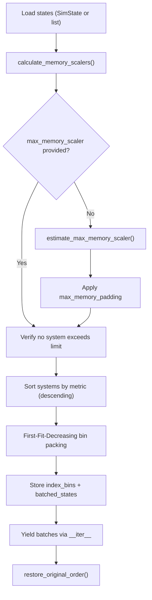
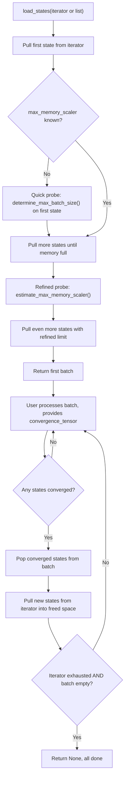
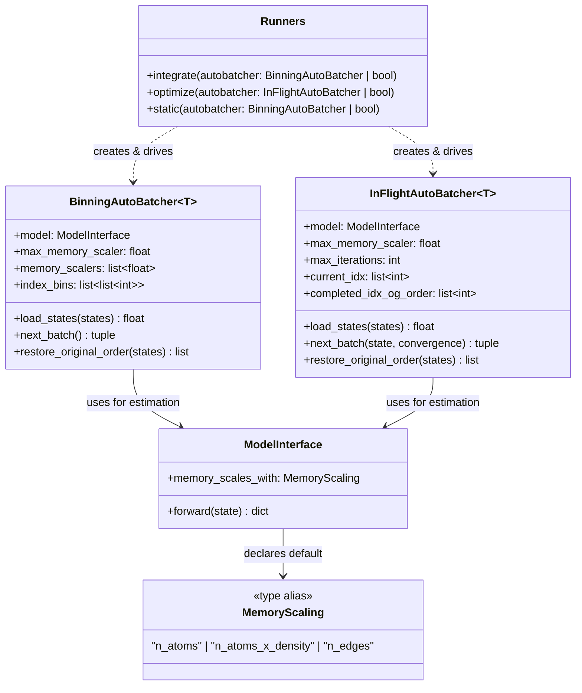

Running thousands of atomistic systems on a single GPU requires careful management of limited VRAM. TorchSim's `torch_sim.autobatching` module solves this by estimating memory requirements, determining safe batch sizes through binary-style probing, and providing two complementary strategies for dispatching work across multiple batches. This page dissects the memory estimation pipeline, the bin-packing algorithm, the two autobatcher classes, and their integration into the high-level runner API.

## The Core Problem: GPU Memory as a Scarce Resource

Every MLIP forward pass allocates GPU memory proportional to the total number of atoms (and, for models with radial neighbor cutoffs, their local density). When you need to simulate 1,000 systems × 500 atoms each, the naïve approach—concatenating all 500,000 atoms into a single batched `SimState`—will typically exceed even high-end GPU memory. The solution is to **partition** the full collection of systems into smaller batches that each fit within the GPU's memory budget, process them sequentially, then reassemble the results in original order.

TorchSim provides two strategies for this partitioning, unified by a common memory estimation subsystem that determines the *maximum aggregate memory scaling metric* a single batch may carry.

Sources: [autobatching.py](torch_sim/autobatching.py#L1-L21)

## Memory Scaling Metrics

Before any batching can occur, the system must assign each individual system a **memory scaling metric**—a scalar that correlates with the GPU memory that system will consume during a model forward pass. The function `calculate_memory_scalers()` supports three strategies, selected via the `MemoryScaling` type alias.

Sources: [autobatching.py](torch_sim/autobatching.py#L352-L456), [typing.py](torch_sim/typing.py#L50)

### Available Metrics

| Metric | Formula | Best For | Cost |
|---|---|---|---|
| `"n_atoms"` | Per-system atom count | Models with fixed neighbor counts (e.g., FairChem) | O(1) |
| `"n_atoms_x_density"` | n_atoms² / V (number density squared) | Models with radial cutoffs (e.g., MACE, MACE-MP) | O(n_systems) |
| `"n_edges"` | Actual neighbor list edge count per system | Molecular systems with heterogeneous densities | O(n_atoms) — requires neighbor list build |

The default metric is `"n_atoms_x_density"` because most deployed MLIPs use radial neighbor cutoffs, meaning memory scales with the number of pairwise interactions within the cutoff sphere. For models that internally cap the number of neighbors per atom, `"n_atoms"` is the appropriate choice since the neighbor list size is bounded by `n_atoms × max_neighbors`.

The `"n_edges"` metric is the most accurate but most expensive: it actually builds a neighbor list using `torchsim_nl` at the specified cutoff and counts edges per system. It is strongly recommended for molecular systems where density varies sharply between systems.

For the `"n_atoms_x_density"` metric, the implementation takes care to handle non-periodic systems by substituting a bounding-box volume with a 2 Å padding per non-periodic axis, and it uses a fast vectorized path when all systems are fully periodic.

Sources: [autobatching.py](torch_sim/autobatching.py#L388-L456)

### Model-Level Default

Each model implementing `ModelInterface` exposes a `memory_scales_with` property that declares its default scaling metric. The runners use this property when `autobatcher=True`, so you generally don't need to specify it manually unless you're constructing batchers directly.

Sources: [interface.py](torch_sim/models/interface.py#L125-L133), [runners.py](torch_sim/runners.py#L432)

## Estimating Maximum Batch Capacity

Once each system has a scalar metric, the autobatcher must determine the **maximum aggregate metric value** that fits in GPU memory. This is the critical constraint: all systems in a single batch must satisfy `sum(metrics) ≤ max_memory_scaler`.

### Binary-Search-Style Probing

The function `determine_max_batch_size()` uses a geometric sequence of batch sizes to efficiently probe the memory limit. Starting from `start_size=1`, it multiplies by `scale_factor=1.6` each iteration, concatenates that many copies of a reference state, and runs a model forward pass. When a `CUDA out of memory` error is caught, it backs off by two positions in the sequence to provide a safety margin.

```
Sizes tested: 1 → 2 → 3 → 5 → 8 → 13 → 20 → 33 → 53 → 84 → ...
                                            ↑ OOM here
                              safe_size = sizes[sys_idx - 2] = 13
```

The 0.6× backoff (`sys_idx - 2`) ensures the returned capacity has headroom for the overhead that accumulates during real simulation steps (optimizer state, neighbor list caching, trajectory buffers, etc.).

### Two-Point Worst-Case Estimation

`estimate_max_memory_scaler()` refines this by testing **both** the smallest-metric and largest-metric systems from the input collection. It runs `determine_max_batch_size()` independently on each, then takes the minimum of `min_batches × min_metric` and `max_batches × max_metric`. This conservative bound accounts for the nonlinear relationship between system size and per-atom memory overhead.

Sources: [autobatching.py](torch_sim/autobatching.py#L257-L335), [autobatching.py](torch_sim/autobatching.py#L458-L516)

## BinningAutoBatcher: Fixed-Partition Strategy

`BinningAutoBatcher` is the simpler of the two strategies. It partitions all input systems into a fixed set of bins at load time, then iterates through those bins sequentially. Every system in every bin is processed the same number of times, making this ideal for **molecular dynamics integration** where each system must run for a fixed number of timesteps.

Sources: [autobatching.py](torch_sim/autobatching.py#L520-L812)

### Bin-Packing Algorithm

The partitioning uses a first-fit-decreasing (FFD) bin-packing algorithm via `to_constant_volume_bins()`. Systems are sorted by their memory metric in descending order, then each system is placed into the fullest bin that still has capacity. This minimizes the total number of bins while maximizing per-bin utilization.



### Lifecycle

1. **Construction**: `BinningAutoBatcher(model, memory_scales_with=..., max_memory_scaler=...)` — set `max_memory_scaler` to a known value to skip the costly estimation step.
2. **Loading**: `load_states(states)` — computes metrics, optionally estimates `max_memory_scaler`, runs bin-packing, and stores the bins.
3. **Iteration**: Iterate directly with `for batch, indices in batcher:` or call `next_batch()` manually.
4. **Reassembly**: `restore_original_order(processed_batches)` — takes the list of processed batched states and returns a list of individual states in their original input order.

### Key Configuration Parameters

| Parameter | Type | Default | Purpose |
|---|---|---|---|
| `model` | `ModelInterface` | *required* | Used for memory estimation forward passes |
| `memory_scales_with` | `MemoryScaling` | `"n_atoms_x_density"` | Metric type for memory estimation |
| `cutoff` | `float` | `6.0` | Cutoff for `"n_edges"` metric (Å) |
| `max_memory_scaler` | `float \| None` | `None` | Pre-computed limit; estimated if `None` |
| `max_atoms_to_try` | `int` | `500_000` | Safety cap during probing |
| `memory_scaling_factor` | `float` | `1.6` | Geometric growth factor for probing |
| `max_memory_padding` | `float` | `1.0` | Multiplier applied to estimated limit |
| `oom_error_message` | `str \| list[str]` | `"CUDA out of memory"` | Strings to match for OOM detection |

> [!TIP]
> **Cache your `max_memory_scaler`**: The memory estimation step involves multiple forward passes on GPU and takes several seconds. Once you've determined the value for a given model + GPU combination, pass it explicitly to all subsequent `BinningAutoBatcher` instances to avoid repeated probing. This is safe because the metric is largely invariant across different state collections for the same model architecture.

Sources: [autobatching.py](torch_sim/autobatching.py#L562-L612)

## InFlightAutoBatcher: Dynamic Hot-Swapping Strategy

`InFlightAutoBatcher` takes a fundamentally different approach. Rather than pre-partitioning all systems upfront, it maintains a **live batch** that is dynamically reconstituted as systems converge and free up memory. This is designed for **geometry optimization** workflows where different systems converge at drastically different rates—a small molecule might relax in 20 steps while a disordered bulk system might take 2,000.

Sources: [autobatching.py](torch_sim/autobatching.py#L813-L1242)

### How Hot-Swapping Works



The core loop is driven by `next_batch(updated_state, convergence_tensor)`:

1. **Input**: The caller provides the updated state after processing and a boolean tensor indicating which systems have converged.
2. **Pop converged**: Converged systems are popped from the state (using `SimState.pop()`), stored, and their memory metrics are freed.
3. **Pull new**: The batcher pulls states from the internal iterator until the aggregate metric approaches `max_memory_scaler`. If adding the next state would exceed the limit, it is pushed back into the iterator via `itertools.chain`.
4. **Iteration limit**: If `max_iterations` is set, states that have been processed that many times are forcibly marked as converged regardless of their actual state.
5. **Terminate**: When no states remain in the batch and the iterator is exhausted, `(None, completed_states)` is returned.

Sources: [autobatching.py](torch_sim/autobatching.py#L969-L1082), [autobatching.py](torch_sim/autobatching.py#L1084-L1188)

### Iterator-Based Lazy Loading

Unlike `BinningAutoBatcher`, `InFlightAutoBatcher.load_states()` accepts not just `SimState | Sequence[SimState]` but also `Iterator[SimState]`. This means you can stream states from disk or a generator without ever materializing the full collection in memory. The batcher pulls states one at a time, computes their metric, and either adds them to the current batch or pushes them back.

> [!TIP]
> **Lazy loading with InFlightAutoBatcher**: When passing an iterator, the batcher cannot pre-compute all metrics. Instead, it computes each metric on-the-fly in `_get_next_states()`. If a single state exceeds `max_memory_scaler`, a `ValueError` is raised immediately. This fail-fast behavior prevents silent corruption of the batch composition.

Sources: [autobatching.py](torch_sim/autobatching.py#L921-L967), [autobatching.py](torch_sim/autobatching.py#L969-L1008)

### First-Batch Estimation Strategy

When `max_memory_scaler` is not provided, `InFlightAutoBatcher` uses a two-phase estimation:

1. **Phase 1 (quick probe)**: Pull one state, run `determine_max_batch_size()` to get an initial capacity estimate, then pull additional states using this preliminary limit.
2. **Phase 2 (refined probe)**: Run `estimate_max_memory_scaler()` on the states collected so far (which now represent a more diverse sample), then pull even more states with the refined limit.

This staged approach is necessary because the batcher starts with no knowledge of the input distribution—unlike `BinningAutoBatcher`, which has all states available from the start.

Sources: [autobatching.py](torch_sim/autobatching.py#L1028-L1082)

## Strategy Comparison

| Aspect | BinningAutoBatcher | InFlightAutoBatcher |
|---|---|---|
| **Primary use case** | MD integration (fixed iteration count) | Geometry optimization (variable convergence) |
| **Batch composition** | Fixed at load time | Dynamic, recomputed each swap |
| **Input type** | `SimState \| Sequence[SimState]` | `SimState \| Sequence \| Iterator` |
| **Memory estimation** | Full collection available upfront | Staged two-phase probing |
| **Iteration protocol** | `for batch, indices in batcher` | `batcher.next_batch(state, convergence)` |
| **Convergence support** | Not applicable (all states run same steps) | Required—drives hot-swapping |
| **Iterator support** | No (materializes all states) | Yes (lazy loading) |
| **max_iterations** | Not applicable | Optional hard cap per state |
| **Runner integration** | `integrate()` | `optimize()` |

## Integration with High-Level Runners

The runners in `torch_sim.runners` transparently integrate both autobatchers. You never need to construct them manually unless you're building custom workflows.

### `integrate()` ↔ `BinningAutoBatcher`

Pass `autobatcher=True` to `ts.integrate()` and it will automatically create a `BinningAutoBatcher` with `max_memory_padding=0.9` (slightly conservative). The runner iterates over bins, reinitializes trajectory reporters for each bin's system indices, runs the full integration on each batch, and finally calls `restore_original_order()` before concatenating all results.

Sources: [runners.py](torch_sim/runners.py#L71-L105), [runners.py](torch_sim/runners.py#L324-L404)

### `optimize()` ↔ `InFlightAutoBatcher`

Pass `autobatcher=True` to `ts.optimize()` and it will create an `InFlightAutoBatcher` using `model.memory_scales_with` as the metric type. The runner manages the convergence loop: after each `steps_between_swaps` optimization steps, it checks convergence with the provided `convergence_fn`, calls `next_batch()` to swap out converged states and pull in new ones, and collects all completed states.

Sources: [runners.py](torch_sim/runners.py#L407-L448)

### `static()` ↔ `BinningAutoBatcher`

The `static()` function (single-point energy/force evaluation) also accepts `autobatcher=True` for processing large collections of states through a model one batch at a time, using the same binning infrastructure.

Sources: [runners.py](torch_sim/runners.py#L734-L742)

## Measuring Raw GPU Memory

For debugging or custom workflows, `measure_model_memory_forward()` provides direct access to the low-level memory measurement: it clears the CUDA cache, resets peak memory stats, runs a single forward pass, and returns `torch.cuda.max_memory_allocated()` in gigabytes. This is the primitive that `determine_max_batch_size()` uses internally. Note that it raises `ValueError` if the model is on CPU, since memory estimation is only meaningful for GPU targets.

Sources: [autobatching.py](torch_sim/autobatching.py#L209-L255)

## Architecture Summary



## Practical Recommendations

For most users, the automatic behavior is sufficient: set `autobatcher=True` in `ts.integrate()` or `ts.optimize()` and let TorchSim handle memory management. For advanced users building custom workflows, the following guidelines apply:

- **Choose the right metric**: Use `"n_atoms"` for fixed-neighbor-count models (FairChem, SevenNet), `"n_atoms_x_density"` for radial-cutoff models (MACE, NequIP), and `"n_edges"` for heterogeneous molecular systems.
- **Cache the limit**: After the first run, extract `max_memory_scaler` from the batcher's return value and pass it to subsequent instances to skip the ~10-second estimation step.
- **Set `max_memory_padding < 1.0`** for production runs: The runners default to `0.9`, leaving 10% headroom for trajectory reporters and optimizer state that accumulates during simulation.
- **Use `InFlightAutoBatcher` with iterators** for large-scale screening: Pass a generator that yields states from disk to avoid materializing the full collection in RAM.

Sources: [runners.py](torch_sim/runners.py#L88-L93), [runners.py](torch_sim/runners.py#L430-L443)

## Further Reading

- [SimState and State Hierarchy](7-simstate-and-state-hierarchy) — the `SimState` data structure that batchers operate on, including `split()`, `pop()`, and concatenation
- [High-Level Runners API](19-high-level-runners-api) — `integrate()`, `optimize()`, and `static()` functions that integrate autobatchers transparently
- [Model Interface and Adapters](9-model-interface-and-adapters) — the `ModelInterface` base class and its `memory_scales_with` property
- [Batched State Operations](8-batched-state-operations) — how multiple systems are represented as a single `SimState` via `system_idx`