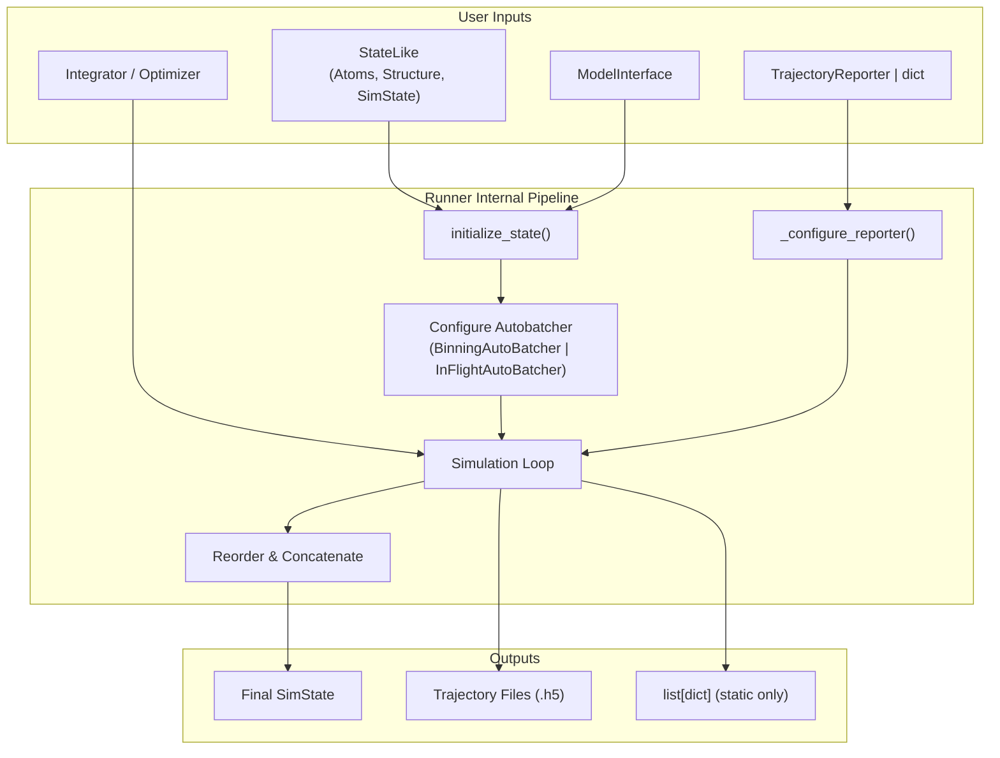

TorchSim's high-level runners form the primary user-facing interface for atomistic simulations. Rather than manually orchestrating state initialization, integrator setup, batch management, and trajectory reporting, these three functions — `integrate`, `optimize`, and `static` — encapsulate the entire simulation lifecycle into single, composable calls. They accept diverse input formats (ASE `Atoms`, PyMatGen `Structure`, or `SimState` objects), handle GPU memory management through optional autobatching, and return results that can be converted back to any supported format. This page provides a complete architectural reference for these runners, their shared infrastructure, and the convergence utilities that power optimization workflows.

Sources: [runners.py](/torch_sim/runners.py#L1-L9), [__init__.py](/torch_sim/__init__.py#L1-L80)

## Runner Architecture Overview

The three runners share a common internal pipeline: input normalization → state initialization → autobatcher configuration → simulation loop → trajectory finalization → result reordering. Each runner delegates to the low-level components documented elsewhere in this manual — integrators ([NVE and NVT Integrators](12-nve-and-nvt-integrators)), optimizers ([FIRE and Gradient Descent Optimizers](15-fire-and-gradient-descent-optimizers)), and models ([Model Interface and Adapters](9-model-interface-and-adapters)) — but manages the orchestration, batching, and reporting layers on your behalf.



All three runners live in the `torch_sim.runners` module and are re-exported at the top level of the `torch_sim` package. They share a common dependency on `torch_sim.typing.StateLike`, which is a union type accepting ASE `Atoms` objects, PyMatGen `Structure` objects, lists of either, or `SimState` objects directly. The `initialize_state()` function from the state module handles all input coercion transparently.

Sources: [typing.py](/torch_sim/typing.py#L37-L44), [runners.py](/torch_sim/runners.py#L252-L266)

## `integrate` — Molecular Dynamics Runner

The `integrate` function runs time-stepped molecular dynamics simulations. It accepts an integrator (either a named key from the `Integrator` enum or a raw `(init_func, step_func)` tuple), a temperature schedule, a timestep, and returns the final simulation state after `n_steps` of integration.

### Function Signature and Parameters

| Parameter | Type | Description |
|---|---|---|
| `system` | `StateLike` | Input system(s) — ASE Atoms, PyMatGen Structure, SimState, or list thereof |
| `model` | `ModelInterface` | Any registered model (classical or MLIP) |
| `integrator` | `Integrator \| tuple[Callable, Callable]` | Named integrator from registry or explicit `(init, step)` pair |
| `n_steps` | `int` | Number of integration steps to run |
| `temperature` | `float \| list \| Tensor` | Temperature schedule (see below) |
| `timestep` | `float` | Integration timestep in picoseconds |
| `trajectory_reporter` | `TrajectoryReporter \| dict \| None` | Reporter or dict config for trajectory output |
| `autobatcher` | `BinningAutoBatcher \| bool` | `False` = no batching; `True` = auto-estimate; pass instance for custom |
| `pbar` | `bool \| dict` | Show progress bar; dict passed as `tqdm` kwargs |
| `init_kwargs` | `dict \| None` | Extra keyword arguments for the integrator init function |
| `**integrator_kwargs` | `Any` | Extra keyword arguments forwarded to the integrator step function |

### Temperature Schedule Flexibility

The `temperature` parameter is remarkably flexible, supporting four distinct broadcast patterns through the internal `_normalize_temperature_tensor` helper. The function converts the input to a tensor and then broadcasts it to match the simulation dimensions.

Sources: [runners.py](/torch_sim/runners.py#L173-L225)

| Input Shape | Interpretation | Resulting Tensor Shape |
|---|---|---|
| Scalar (`float`) | Uniform temperature for all steps and systems | `(n_steps,)` |
| 1D of length `n_systems` | Per-system constant temperature | `(n_steps, n_systems)` |
| 1D of length `n_steps` | Time-varying temperature, same for all systems | `(n_steps,)` |
| 2D of shape `(n_steps, n_systems)` | Fully independent schedule per system per step | `(n_steps, n_systems)` |

A notable edge case: when `n_systems == n_steps`, the function cannot distinguish between per-system and per-step intent, so it defaults to per-system interpretation and emits a warning. The temperature tensor is multiplied by the `UnitSystem.metal.temperature` conversion factor internally, so users pass values in **Kelvin**.

### Simulation Loop and Batch Management

When `autobatcher` is `False`, the function wraps the initial state as a single-element list `[(state, [])]` and runs the full simulation in one pass. When `autobatcher` is `True` or a `BinningAutoBatcher` instance, the state is split into GPU-memory-fitted chunks. Each chunk runs through the full `n_steps` independently, then the `BinningAutoBatcher.restore_original_order()` method reassembles the final states into their original input ordering via `ts.concatenate_states()`.

The inner loop writes step 0 to the trajectory (if all trajectory files are empty, ensuring idempotent initial-state recording), then iterates from `initial_step` through `initial_step + n_steps`. At each step, the step function receives the current `kT` value sliced from the temperature schedule. The trajectory reporter is called after every step if configured.

Sources: [runners.py](/torch_sim/runners.py#L228-L233), [runners.py](/torch_sim/runners.py#L330-L406)

### Resuming from Existing Trajectories

The `integrate` function supports resuming from existing trajectory files. When the `TrajectoryReporter` is opened in append mode (`mode="a"`), the internal `_determine_initial_step_for_integrate` function reads the last logged step from each trajectory file. If all files share the same last step, integration resumes from `last_step + 1`. If files have inconsistent step counts, a `ValueError` is raised with guidance on using `reporter.truncate_to_step()` to align them. This mechanism enables checkpoint-resume workflows without manual step tracking.

Sources: [runners.py](/torch_sim/runners.py#L108-L141)

### Basic Usage

```python
import torch_sim as ts
from torch_sim.models import LennardJonesModel

lj_model = LennardJonesModel(sigma=2.0, epsilon=0.01)

# Run 50 steps of NVT Langevin dynamics at 2000K
final_state = ts.integrate(
    system=bulk("Cu", "fcc", a=3.6, cubic=True),
    model=lj_model,
    integrator=ts.Integrator.NVT_LANGEVIN,
    n_steps=50,
    temperature=2000.0,
    timestep=1.0,
)

# Convert back to ASE Atoms
final_atoms = final_state.to_atoms()
```

> [!TIP]
> The `integrate` function always converts the timestep and temperature using the `UnitSystem.metal` constants. Pass your timestep in **picoseconds** and temperature in **Kelvin** — the internal conversion to simulation units (eV, Å, fs) is handled automatically.

## `optimize` — Geometry Optimization Runner

The `optimize` function performs energy minimization using a configurable optimizer and convergence criterion. Unlike `integrate`, which runs a fixed number of steps, `optimize` iterates until each system either converges or hits `max_steps`. It uses the `InFlightAutoBatcher` — distinct from the `BinningAutoBatcher` used by `integrate` — which supports hot-swapping: converged systems are removed from the GPU batch mid-optimization, freeing memory for remaining systems.

Sources: [runners.py](/torch_sim/runners.py#L551-L565), [runners.py](/torch_sim/runners.py#L407-L414)

### Function Signature and Parameters

| Parameter | Type | Default | Description |
|---|---|---|---|
| `system` | `StateLike` | — | Input system(s) to optimize |
| `model` | `ModelInterface` | — | Model for energy/force evaluation |
| `optimizer` | `Optimizer \| tuple[Callable, Callable]` | — | Named optimizer or `(init, step)` pair |
| `convergence_fn` | `Callable \| None` | `None` | Per-system convergence test; defaults to energy tolerance of 1 meV |
| `max_steps` | `int` | `10,000` | Hard step limit per system |
| `steps_between_swaps` | `int` | `5` | Steps between convergence checks and batch swaps |
| `trajectory_reporter` | `TrajectoryReporter \| dict \| None` | `None` | Trajectory output configuration |
| `autobatcher` | `InFlightAutoBatcher \| bool` | `False` | `False` = single batch (no swap); `True` = auto; instance = custom |
| `pbar` | `bool \| dict` | `False` | Progress bar control |
| `init_kwargs` | `dict \| None` | `None` | Extra kwargs for optimizer init |
| `**optimizer_kwargs` | `Any` | — | Extra kwargs for optimizer step |

### Convergence Functions

The `convergence_fn` receives the current `state` and `last_energy` (energy from the previous swap interval) and returns a boolean tensor of shape `(n_systems,)`. `True` means converged. When `convergence_fn` is `None`, the runner defaults to `generate_energy_convergence_fn(energy_tol=1e-3)`, which flags a system as converged when `|energy - last_energy| < 1e-3 eV`.

Sources: [runners.py](/torch_sim/runners.py#L525-L549)

### Hot-Swapping Optimization Loop

The optimization loop diverges architecturally from `integrate`. Rather than iterating over fixed-size bins, it maintains a persistent `InFlightAutoBatcher` that tracks which systems are still active. Each iteration of the outer `while True` loop calls `autobatcher.next_batch(state, convergence_tensor)`, which returns either `(batch_state, converged_states)` or `(None, remaining_converged_states)` when all systems are done. Converged systems are collected into `all_converged_states` immediately.

Within each batch, the optimizer runs `steps_between_swaps` iterations. After each swap interval, the convergence function is evaluated. Systems that have converged or exceeded `max_steps` are marked with a boolean OR and removed on the next `next_batch()` call. When `autobatcher=False`, the function sets `max_memory_scaler = state.n_atoms + 1`, effectively creating a single-pass batch that still supports hot-swapping semantics (though all systems share the same memory pool).

Sources: [runners.py](/torch_sim/runners.py#L631-L695)

### Resuming Optimizations

Like `integrate`, `optimize` supports resuming from existing trajectory files. The `_determine_initial_step_for_optimize` function returns a per-system step tensor (unlike the scalar returned for `integrate`), since different systems may have converged at different points. The trajectory reporter is reopened for each batch's active system indices, ensuring that each system's trajectory file receives data only for its active steps.

Sources: [runners.py](/torch_sim/runners.py#L145-L171)

### Basic Usage

```python
# Relax structures with FIRE optimizer
final_state = ts.optimize(
    system=[bulk("Cu", "fcc", a=3.6), bulk("Fe", "bcc", a=2.8)],
    model=lj_model,
    optimizer=ts.Optimizer.FIRE,
    max_steps=5_000,
)

# Custom convergence: stop when max force < 0.05 eV/Å
force_conv = ts.generate_force_convergence_fn(force_tol=0.05)
final_state = ts.optimize(
    system=bulk("Cu", "fcc", a=3.6),
    model=lj_model,
    optimizer=ts.Optimizer.FIRE,
    convergence_fn=force_conv,
)
```

> [!TIP]
> The `optimize` function's default convergence (energy tolerance of 1 meV) may converge prematurely in flat energy landscapes. For production geometry optimizations, prefer the force-based convergence via `generate_force_convergence_fn(force_tol=0.025)` (25 meV/Å), which is the typical standard for DFT-level relaxation convergence.

## `static` — Single-Point Calculation Runner

The `static` function performs one-time energy, force, and stress evaluations across a batch of systems. Unlike `integrate` and `optimize`, it does **not** return a `SimState`. Instead, it returns a `list[dict[str, torch.Tensor]]` — one dictionary per system — containing the properties computed by the trajectory reporter's property calculators. This makes `static` ideal for benchmarking models against DFT reference data, computing elastic properties, or generating datasets.

Sources: [runners.py](/torch_sim/runners.py#L734-L742)

### Function Signature and Behavior

The function accepts the standard `system`, `model`, `trajectory_reporter`, `autobatcher`, and `pbar` arguments. Internally, it constructs a local `StaticState` dataclass that extends `SimState` with explicit `energy`, `forces`, and `stress` fields, then runs the model once per batch and reports the results at step 0.

When a `trajectory_reporter` dict is provided, `static` automatically enriches it with `variable_atomic_numbers=True` and `variable_masses=True` in the `state_kwargs`, since diverse input systems typically have different species and masses. The `save_forces` flag is set based on `model.compute_forces`. Properties are auto-selected based on model capabilities: `potential_energy` is always included; `forces` and `stress` are added only when the model supports them.

After processing, if a `BinningAutoBatcher` was used, the property dictionaries are reordered using the original index mapping from `batch_iterator.index_bins`, ensuring the returned list matches the input system order regardless of batch processing order.

Sources: [runners.py](/torch_sim/runners.py#L769-L854)

### Basic Usage

```python
# Compute energies for diverse systems in one call
results = ts.static(
    system=[bulk("Cu", "fcc"), bulk("Fe", "bcc"), bulk("Si", "diamond")],
    model=mace_model,
    trajectory_reporter={
        "filenames": ["cu.h5", "fe.h5", "si.h5"],
    },
)

for i, result in enumerate(results):
    print(f"System {i}: energy = {result['potential_energy'][-1].item():.4f} eV")
```

## Convergence Function Generators

TorchSim provides two factory functions for building convergence criteria compatible with the `optimize` runner. Both return callables with the signature `(state, last_energy) -> torch.Tensor[bool]`.

### `generate_force_convergence_fn`

Creates a convergence function based on the maximum atomic force per system. The optional `include_cell_forces` parameter extends the check to include the stress-derived cell forces, which is essential when optimizing with cell filters that allow lattice relaxation.

Sources: [runners.py](/torch_sim/runners.py#L485-L523)

| Parameter | Type | Default | Description |
|---|---|---|---|
| `force_tol` | `float` | `0.1` | Force tolerance in **eV/Å** (metal units) |
| `include_cell_forces` | `bool` | `False` | Whether to include cell forces in the convergence check |

The implementation uses `ts.system_wise_max_force(state)` to compute the per-system maximum atomic force magnitude, then compares against `force_tol`. When `include_cell_forces=True`, it additionally checks `cell_forces.norm(dim=2).max(dim=1)` against the same tolerance, requiring **both** atomic and cell forces to converge. If `include_cell_forces=True` but the state has no `cell_forces` attribute, a `ValueError` is raised.

### `generate_energy_convergence_fn`

Creates a convergence function based on the absolute energy change between swap intervals. This is the default used by `optimize` when no `convergence_fn` is provided.

Sources: [runners.py](/torch_sim/runners.py#L525-L549)

| Parameter | Type | Default | Description |
|---|---|---|---|
| `energy_tol` | `float` | `1e-3` | Energy tolerance in **eV** |

The returned function computes `torch.abs(state.energy - last_energy) < energy_tol`, returning a per-system boolean tensor. Because this checks the energy delta between consecutive swap intervals (controlled by `steps_between_swaps`), the effective sensitivity depends on how frequently convergence is checked.

### Custom Convergence Functions

You can write fully custom convergence functions that incorporate arbitrary state properties. The only requirement is the signature `(state: T, last_energy: torch.Tensor) -> torch.Tensor`:

```python
def my_convergence(state, last_energy):
    # Converge when energy change < 1e-4 eV AND max force < 0.05 eV/Å
    energy_ok = torch.abs(state.energy - last_energy) < 1e-4
    force_ok = ts.system_wise_max_force(state) < 0.05
    return energy_ok & force_ok

final_state = ts.optimize(
    system=bulk("Cu", "fcc", a=3.6),
    model=lj_model,
    optimizer=ts.Optimizer.FIRE,
    convergence_fn=my_convergence,
    steps_between_swaps=10,
)
```

## Trajectory Reporter Configuration

All three runners accept `trajectory_reporter` as either a pre-configured `TrajectoryReporter` instance or a plain `dict`. When a dict is passed, the internal `_configure_reporter` function handles instantiation with sensible defaults per runner type.

Sources: [runners.py](/torch_sim/runners.py#L34-L68)

### Dict Configuration

The dict is passed through `copy.deepcopy` (to prevent mutation), then forwarded to the `TrajectoryReporter` constructor. The `prop_calculators` and `state_frequency` keys are treated specially — they have runner-specific defaults:

| Runner | Default Properties | Default `state_frequency` |
|---|---|---|
| `integrate` | `kinetic_energy`, `potential_energy`, `temperature` | 100 |
| `optimize` | `potential_energy` | 100 |
| `static` | `potential_energy`, `forces` (if model supports), `stress` (if model supports) | N/A (single report at step 0) |

The available property names for the `properties` list (when using dict config) are: `potential_energy`, `forces`, `stress`, `kinetic_energy`, `temperature`, and `max_force`. Each maps to a built-in calculator function that extracts the corresponding quantity from the state.

### Quick-Filename Shortcut

The simplest way to enable trajectory logging is to pass a dict with just `filenames`:

```python
# Automatically configures default properties and state_frequency
final_state = ts.integrate(
    system=atoms,
    model=lj_model,
    integrator=ts.Integrator.NVT_LANGEVIN,
    n_steps=100,
    temperature=300.0,
    timestep=1.0,
    trajectory_reporter={"filenames": "output.h5"},
)
```

For batched simulations with per-system trajectory files, pass a list of filenames:

```python
trajectory_reporter={
    "filenames": [f"traj_{i}.h5" for i in range(len(systems))],
    "state_frequency": 10,
}
```

## Autobatching Strategies

The runners use two distinct autobatching strategies, selected automatically based on the runner type and the value of the `autobatcher` parameter.

Sources: [runners.py](/torch_sim/runners.py#L71-L105), [runners.py](/torch_sim/runners.py#L407-L458)

### `BinningAutoBatcher` — Used by `integrate` and `static`

The binning autobatcher partitions systems into fixed-size bins before the simulation starts. Each bin runs through all steps independently. The bins are sized by estimating GPU memory requirements from the model's `memory_scales_with` attribute. After all bins complete, results are reordered to match the original input sequence.

| `autobatcher` Value | Behavior |
|---|---|
| `False` | No batching; single `(state, [])` tuple |
| `True` | Auto-estimate max batch size with 90% memory padding |
| `BinningAutoBatcher(...)` | Use the provided instance (load_states is called internally) |

### `InFlightAutoBatcher` — Used by `optimize`

The in-flight autobatcher supports dynamic removal of converged systems during optimization. It tracks which systems are active and reclaims GPU memory when systems converge. The `max_iterations` parameter is set to `max_steps // steps_between_swaps`, defining how many swap intervals each system is allowed before forced convergence.

| `autobatcher` Value | Behavior |
|---|---|
| `False` | Single-pass batch with `max_memory_scaler = n_atoms + 1` (effectively no memory limit) |
| `True` | Auto-estimate memory with model's `memory_scales_with` attribute |
| `InFlightAutoBatcher(...)` | Use provided instance; `max_iterations` is overridden |

> [!TIP]
> When using autobatching with trajectory reporting, the runner automatically reopens trajectory files for the correct system indices in each batch iteration. This ensures each system's trajectory file receives data in order, even when systems are processed in different GPU batches. Always provide one filename per system when using autobatching.

## Complete Workflow Example

The following example demonstrates the full feature set: batched MD with trajectory reporting, followed by geometry optimization with custom convergence, and finally static property evaluation. It uses both ASE and PyMatGen structures interchangeably.

```python
import torch
import torch_sim as ts
from ase.build import bulk
from torch_sim.models import LennardJonesModel

# --- Setup ---
lj_model = LennardJonesModel(sigma=2.0, epsilon=0.01)
cu = bulk("Cu", "fcc", a=3.6, cubic=True)
fe = bulk("Fe", "bcc", a=2.8, cubic=True)
systems = [cu, fe]

# --- 1. Batched MD with trajectory reporting ---
md_state = ts.integrate(
    system=systems,
    model=lj_model,
    integrator=ts.Integrator.NVT_LANGEVIN,
    n_steps=100,
    temperature=300.0,
    timestep=1.0,
    trajectory_reporter={"filenames": ["md_cu.h5", "md_fe.h5"]},
    autobatcher=True,
)

# --- 2. Geometry optimization with force convergence ---
opt_state = ts.optimize(
    system=md_state,  # chain from MD output
    model=lj_model,
    optimizer=ts.Optimizer.FIRE,
    convergence_fn=ts.generate_force_convergence_fn(force_tol=0.05),
    max_steps=2_000,
    trajectory_reporter={"filenames": ["opt_cu.h5", "opt_fe.h5"]},
    autobatcher=True,
)

# --- 3. Static property evaluation ---
results = ts.static(
    system=opt_state,  # chain from optimization output
    model=lj_model,
    trajectory_reporter={"filenames": ["static_cu.h5", "static_fe.h5"]},
)
```

## Shared Internal Infrastructure

Several internal functions power the runners and are worth understanding for advanced customization.

### `_configure_batches_iterator`

Creates the batch iteration strategy for `integrate` and `static`. When `autobatcher` is `False`, returns `[(state, [])]` — a single-element list with empty system indices (indicating no reordering needed). When `True`, instantiates a `BinningAutoBatcher` with `max_memory_padding=0.9`. A pre-configured instance is loaded via `load_states()` and used directly.

Sources: [runners.py](/torch_sim/runners.py#L71-L105)

### `_configure_in_flight_autobatcher`

Creates the hot-swapping autobatcher for `optimize`. When `autobatcher` is `False`, it still returns an `InFlightAutoBatcher` instance but with `max_memory_scaler = state.n_atoms + 1`, which effectively disables memory-based binning while retaining the swap-out capability. The `max_iterations` parameter is always set to `max_steps // steps_between_swaps`.

Sources: [runners.py](/torch_sim/runners.py#L407-L457)

### `_chunked_apply`

A utility used during `optimize` initialization when the input state is not already an `OptimState`. It applies the optimizer's init function to large batches using a `BinningAutoBatcher` internally, preventing OOM during the initial force/energy evaluation. This is a one-time cost paid before the hot-swapping optimization loop begins.

Sources: [runners.py](/torch_sim/runners.py#L451-L480)

### `_write_initial_state`

Writes the step-0 state to the trajectory only when all trajectory files are empty (i.e., `last_step is None` for every trajectory). This prevents duplicate initial-state entries when resuming simulations and ensures idempotent behavior on repeated calls.

Sources: [runners.py](/torch_sim/runners.py#L228-L250)

## Next Steps

The high-level runners abstract away significant complexity, but understanding their underlying components enables more advanced workflows:

- **State System**: Learn about `SimState` and how state flows through the runners in [SimState and State Hierarchy](7-simstate-and-state-hierarchy)
- **Integrators**: Explore the specific integrators available to `integrate()` in [NVE and NVT Integrators](12-nve-and-nvt-integrators) and [NPT Integrators and Thermostats](13-npt-integrators-and-thermostats)
- **Optimizers**: Understand the optimization algorithms behind `optimize()` in [FIRE and Gradient Descent Optimizers](15-fire-and-gradient-descent-optimizers) and [L-BFGS and BFGS Quasi-Newton Methods](16-l-bfgs-and-bfgs-quasi-newton-methods)
- **Trajectory Storage**: Dive deeper into trajectory file format and analysis in [Trajectory Storage and Reporting](20-trajectory-storage-and-reporting)
- **Memory Management**: Understand the autobatching internals in [Automatic Batching and GPU Memory](18-automatic-batching-and-gpu-memory)