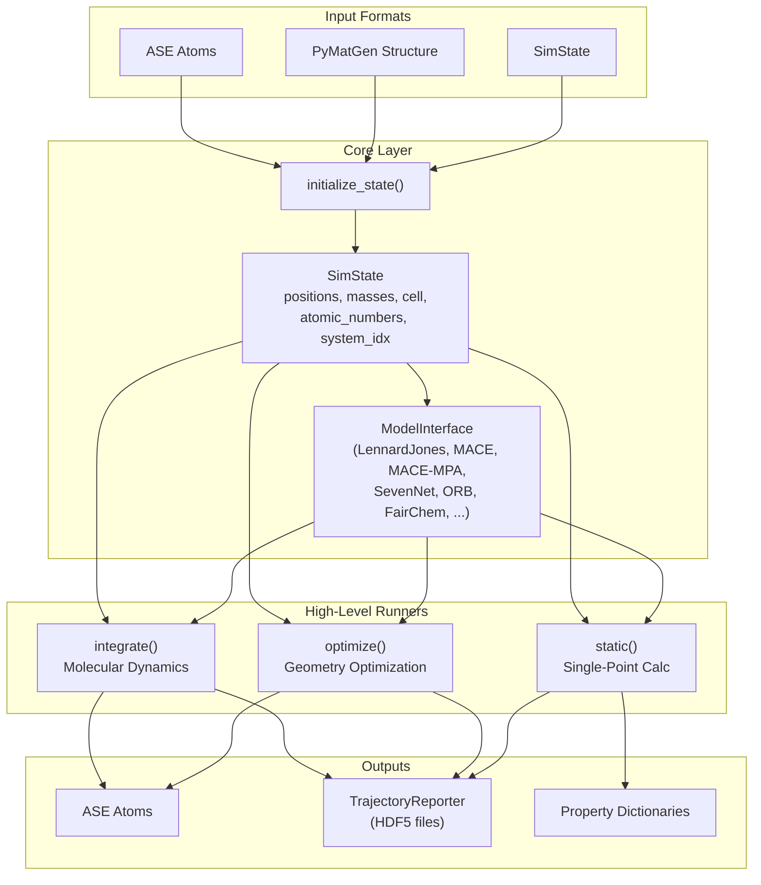

This guide walks you through your first TorchSim simulation in under five minutes. You will run a molecular dynamics simulation, perform a geometry optimization, and process multiple systems in parallel — all using TorchSim's high-level API. By the end, you will understand the three core runner functions (`integrate`, `optimize`, `static`), the `SimState` data model, and how TorchSim unifies ASE and PyMatGen inputs under a single GPU-accelerated interface.

## How TorchSim Works

TorchSim is a PyTorch-native atomistic simulation library. Unlike traditional MD packages that process one structure at a time on a CPU, TorchSim batches multiple atomic systems into unified tensors and executes them on GPU hardware. This architectural decision yields significant throughput improvements, especially for machine learning interatomic potentials (MLIPs) that are already implemented in PyTorch.

The library follows a layered design. At the bottom, `SimState` represents atomic systems as flat tensors with a `system_idx` mapping. Models implement a `ModelInterface` that accepts `SimState` and returns energy, forces, and stress. Above that, low-level integrators and optimizers expose `init_fn`/`step_fn` pairs. At the top, three high-level runner functions — `integrate`, `optimize`, and `static` — orchestrate the full simulation lifecycle including state initialization, trajectory reporting, and automatic batching.



## Your First Simulation

Install TorchSim with a classical potential model to get started immediately — no GPU or external MLIP package is required for this example.

```bash
pip install torch-sim-atomistic
```

Then run a minimal NVT molecular dynamics simulation using the built-in Lennard-Jones potential. This example creates an FCC copper structure, simulates it at 2000 K for 50 steps using a Langevin thermostat, and returns the final state.

```python
import torch
import torch_sim as ts
from ase.build import bulk
from torch_sim.models.lennard_jones import LennardJonesModel

# 1. Define the atomic potential model
lj_model = LennardJonesModel(
    sigma=2.0,        # Å, interaction distance parameter
    epsilon=0.1,      # eV, interaction strength
    device=torch.device("cpu"),
    dtype=torch.float64,
)

# 2. Create an atomic structure (ASE Atoms object)
cu_atoms = bulk("Cu", "fcc", a=5.43, cubic=True)

# 3. Run the simulation
final_state = ts.integrate(
    system=cu_atoms,                       # Input: ASE Atoms, PyMatGen Structure, or SimState
    model=lj_model,                        # Any model implementing ModelInterface
    integrator=ts.Integrator.nvt_langevin, # Thermostat ensemble
    n_steps=50,                            # Number of integration steps
    temperature=2000,                      # Target temperature in Kelvin
    timestep=0.002,                        # Integration timestep in picoseconds
)

# 4. Convert back to familiar formats
final_atoms = final_state.to_atoms()        # → list of ASE Atoms
# final_structures = final_state.to_structures()  # → list of PyMatGen Structures
```

Sources: [high_level_tutorial.py](examples/tutorials/high_level_tutorial.py#L50-L82), [runners.py](torch_sim/runners.py#L252-L270), [__init__.py](torch_sim/__init__.py#L94-L100)

### What Just Happened

The `integrate` function performed several operations automatically. It called `initialize_state()` to convert the ASE Atoms object into a `SimState` with properly shaped tensors, applied the **MetalUnits** unit system internally (Å, eV, amu, ps), resolved the integrator from the `INTEGRATOR_REGISTRY` to obtain its `init_fn` and `step_fn`, then executed the time-stepping loop. The temperature and timestep values you provided in human-readable units (Kelvin, picoseconds) were converted to the internal eV-based unit system automatically by the runner.

The `SimState` dataclass is the central data structure. It holds per-atom tensors — `positions`, `masses`, `atomic_numbers`, and `system_idx` — alongside per-system tensors like `cell`. The `system_idx` tensor maps each atom to its parent system, which is how TorchSim packs multiple structures into contiguous memory for GPU execution.

Sources: [state.py](torch_sim/state.py#L70-L124), [units.py](torch_sim/units.py#L84-L104), [runners.py](torch_sim/runners.py#L310-L330)

## Saving and Analyzing Trajectories

Passing a dictionary with a `filenames` key to `trajectory_reporter` enables automatic trajectory output. TorchSim writes HDF5 files that store both the atomic state at configurable intervals and any computed properties.

```python
final_state = ts.integrate(
    system=cu_atoms,
    model=lj_model,
    integrator=ts.Integrator.nvt_langevin,
    n_steps=50,
    temperature=2000,
    timestep=0.002,
    trajectory_reporter={"filenames": "cu_md_trajectory.h5"},
)

# Analyze saved data
with ts.TorchSimTrajectory("cu_md_trajectory.h5") as traj:
    potential_energies = traj.get_array("potential_energy")
    kinetic_energies = traj.get_array("kinetic_energy")
    final_config = traj.get_atoms(-1)  # ASE Atoms at last saved frame

print(f"Final energy: {potential_energies[-1].item():.6f} eV")
```

For finer control over what gets saved and how often, instantiate a `TrajectoryReporter` directly. You can specify per-property reporting frequencies, which is useful for quantities like kinetic energy that you may want to sample less frequently than the state itself.

Sources: [high_level_tutorial.py](examples/tutorials/high_level_tutorial.py#L94-L155), [runners.py](torch_sim/runners.py#L258-L262)

## Geometry Optimization

The `optimize` function relaxes atomic structures using algorithms like FIRE or L-BFGS. It accepts a `convergence_fn` that returns a boolean tensor indicating which systems have converged. If you omit this argument, TorchSim applies a default energy convergence criterion of 1 meV between successive steps.

```python
final_state = ts.optimize(
    system=cu_atoms,
    model=lj_model,
    optimizer=ts.Optimizer.fire,
    init_kwargs={"cell_filter": ts.CellFilter.unit},  # Allow unit cell relaxation
)

# With custom convergence criteria
force_convergence = ts.generate_force_convergence_fn(force_tol=1e-3)
final_state = ts.optimize(
    system=cu_atoms,
    model=lj_model,
    optimizer=ts.Optimizer.fire,
    convergence_fn=force_convergence,
    init_kwargs={"cell_filter": ts.CellFilter.unit},
)
```

Sources: [high_level_tutorial.py](examples/tutorials/high_level_tutorial.py#L352-L412), [runners.py](torch_sim/runners.py#L485-L547), [runners.py](torch_sim/runners.py#L551-L570)

## Batched and Automatic Batching

The defining capability of TorchSim is batched execution. Pass a list of systems and the library simulates all of them in a single GPU kernel launch. When your list exceeds available GPU memory, enable autobatching with `autobatcher=True` and TorchSim automatically partitions the workload.

```python
from ase.build import bulk

# Create multiple distinct systems
fe_atoms = bulk("Fe", "fcc", a=5.26, cubic=True)
cu_atoms = bulk("Cu", "fcc", a=5.43, cubic=True)
si_atoms = bulk("Si", "diamond", a=5.43, cubic=True)

systems = [fe_atoms, cu_atoms, si_atoms]

# Simulate all three in parallel
final_state = ts.integrate(
    system=systems,
    model=lj_model,
    integrator=ts.Integrator.nvt_langevin,
    n_steps=50,
    temperature=1500,
    timestep=0.002,
    autobatcher=True,  # Auto-partition if memory is exceeded
)

# Results come back in original order
final_atoms_list = final_state.to_atoms()
print(f"Simulated {len(final_atoms_list)} systems in parallel")
```

The same batching pattern applies to `optimize` and `static`. Each function handles the internal complexity of state splitting, batch iteration, and result reordering transparently.

Sources: [high_level_tutorial.py](examples/tutorials/high_level_tutorial.py#L228-L335), [runners.py](torch_sim/runners.py#L346-L370)

## High-Level API Summary

TorchSim exposes three runner functions that cover the vast majority of atomistic simulation workflows. Each accepts diverse input formats, supports optional trajectory reporting, and handles automatic batching.

| Function | Purpose | Key Parameters | Returns |
|---|---|---|---|
| `integrate()` | Molecular dynamics | `integrator`, `n_steps`, `temperature`, `timestep` | Final `SimState` |
| `optimize()` | Geometry optimization | `optimizer`, `convergence_fn`, `max_steps` | Final `SimState` |
| `static()` | Single-point calculations | None (no evolution) | `list[dict]` of properties |

All three runners accept `system` as an **ASE Atoms** object, a **PyMatGen Structure**, a raw `SimState`, or a **list of any of these**. The `trajectory_reporter` parameter accepts either a `TrajectoryReporter` instance or a dictionary with at least a `"filenames"` key. The `autobatcher` parameter accepts `True` (auto-configure), `False` (no batching), or a custom `BinningAutoBatcher`/`InFlightAutoBatcher` instance for fine-grained control.

> [!TIP]
> All models in TorchSim use the **MetalUnits** system internally (Å for distance, eV for energy, amu for mass, ps for time). The runner functions accept human-readable values — temperature in Kelvin, timestep in picoseconds — and convert them automatically. When using the low-level API directly, you must apply `MetalUnits.temperature` and `MetalUnits.time` conversions manually.

Sources: [runners.py](torch_sim/runners.py#L252-L270), [runners.py](torch_sim/runners.py#L551-L570), [runners.py](torch_sim/runners.py#L734-L760), [units.py](torch_sim/units.py#L84-L104)

## Supported Models

TorchSim ships with both classical pair potentials for quick prototyping and wrappers for state-of-the-art machine learning interatomic potentials. All models implement the `ModelInterface` abstract class, ensuring a uniform calling convention across the entire ecosystem.

| Category | Model | Status |
|---|---|---|
| **Classical** | `LennardJonesModel` | Built-in, no dependencies |
| **Classical** | `MorseModel` | Built-in, no dependencies |
| **Classical** | `SoftSphereModel` | Built-in, no dependencies |
| **MLIP** | `MaceModel` (MACE, MACE-MPA) | Requires `mace-torch` |
| **MLIP** | `SevenNetModel` | Requires `sevenn` |
| **MLIP** | `ORBModel` | Requires `orb-models` |
| **MLIP** | `MatterSimModel` | Requires `matsciml` |
| **MLIP** | `FairChemModel` | Requires `fairchem-core` |
| **MLIP** | `NequipModel` | Requires `nequip` |
| **MLIP** | `MetatomicModel` (MatPES, CHGNet, etc.) | Requires `metatensor` |

> [!TIP]
> Start with `LennardJonesModel` for development and testing — it runs on CPU instantly with zero external dependencies. Switch to an MLIP model for production accuracy. The model interface is identical, so swapping models requires changing only the constructor call.

Sources: [models/interface.py](torch_sim/models/interface.py#L38-L137), [models/lennard_jones.py](torch_sim/models/lennard_jones.py#L74-L107), [models/__init__.py](torch_sim/models/__init__.py#L1-L2)

## Where to Go Next

You now have enough to run production simulations with TorchSim. The following pages in this documentation expand on each concept introduced here:

- **[Installation and Model Setup](3-installation-and-model-setup)** — Detailed installation instructions for each MLIP model, CUDA configuration, and environment troubleshooting
- **[Running Batched MD Simulations](4-running-batched-md-simulations)** — Deep dive into `integrate()` with temperature schedules, multiple integrators, and resumable trajectories
- **[Running Batched Geometry Optimizations](5-running-batched-geometry-optimizations)** — Full exploration of `optimize()` with cell filters, custom convergence, and the in-flight autobatching strategy
- **[Overview](1-overview)** — Architectural overview of the entire TorchSim package for a broader perspective before diving deeper