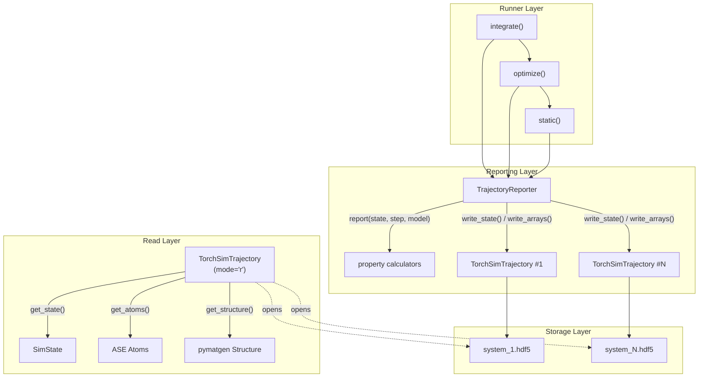

TorchSim provides a two-layer trajectory system for persisting simulation data: a low-level `TorchSimTrajectory` class that directly reads and writes HDF5 files, and a high-level `TrajectoryReporter` that automates periodic state capture, custom property calculation, and multi-batch splitting. Together, they replace the need for fragile file I/O glue code while maintaining full interoperability with ASE and pymatgen for downstream analysis and visualization.

## Architecture Overview

The trajectory module is built around two complementary classes with distinct responsibilities. `TorchSimTrajectory` owns the HDF5 file handle and handles serialization, validation, and decompression. `TrajectoryReporter` orchestrates simulation-aware workflows: it decides *when* to write, *what* to compute, and *where* each system's data lands. The high-level runner functions — `integrate`, `optimize`, and `static` — accept a `TrajectoryReporter` (or a simple dict that gets converted into one) and call its `report()` method inside their main loops.



The flow is intentionally unidirectional during simulation: runners call `report()`, which dispatches to per-system `TorchSimTrajectory` instances. After the simulation completes, a fresh `TorchSimTrajectory` opened in read mode provides retrieval methods. This separation means the reporting machinery never interferes with the reader, and multiple readers can safely open the same file concurrently.

Sources: [trajectory.py](torch_sim/trajectory.py#L1-L28), [runners.py](torch_sim/runners.py#L34-L70)

## HDF5 File Structure

Every `.hdf5` file produced by TorchSim follows a consistent internal layout that mirrors the logical separation between metadata, frame data, and step indexing. Understanding this structure is useful for debugging and for writing external tools that consume TorchSim trajectories without the Python API.

```
/
├── header/                  # Fixed file metadata
│   └── _v_attrs
│       ├── program = "TorchSim"
│       └── title  = "TorchSim Trajectory"
├── metadata/                # User-supplied key-value pairs
│   └── _v_attrs
│       └── (arbitrary string keys)
├── data/                    # Frame-by-frame arrays (EArrays)
│   ├── positions            # shape: (n_frames, n_atoms, 3)
│   ├── cell                 # shape: (n_frames, 3, 3) or (1, 3, 3)
│   ├── atomic_numbers       # shape: (n_frames, n_atoms) or (1, n_atoms)
│   ├── masses               # shape: (n_frames, n_atoms) or (1, n_atoms)
│   ├── pbc                  # shape: (3,) — stored as global array
│   └── (custom arrays…)     # shape: (n_frames, …)
└── steps/                   # Step-number index per array
    ├── positions            # shape: (n_frames,)
    ├── cell                 # shape: (n_frames,)
    └── (custom arrays…)
```

Static properties like `atomic_numbers`, `masses`, and `pbc` are written once (single-frame EArray) unless explicitly flagged as variable. The `steps/` group stores a parallel EArray for every data array, recording which simulation step each frame corresponds to. This design allows arrays to be saved at different frequencies — `positions` might be recorded every 100 steps while a custom property is recorded every 10 steps — without any alignment constraints between them.

The underlying format uses PyTables `EArray` (extendable array) nodes with optional zlib compression (shuffle + complevel=1 by default). When `compress_data=True`, all arrays benefit from transparent compression without any change to the API.

Sources: [trajectory.py](torch_sim/trajectory.py#L556-L590), [trajectory.py](torch_sim/trajectory.py#L680-L710)

## TorchSimTrajectory: Low-Level Interface

`TorchSimTrajectory` is the foundational class that wraps an HDF5 file handle and provides methods for writing arrays, writing full `SimState` objects, and reading data back in multiple formats. It is designed to be simple, explicit, and free of simulation logic.

### Initialization and File Modes

The constructor accepts a filename, a mode (`"w"`, `"a"`, or `"r"`), and several options that control data fidelity and compression.

| Parameter | Default | Description |
|---|---|---|
| `mode` | `"r"` | `"w"` overwrites, `"a"` appends (with consistency checks), `"r"` read-only |
| `compress_data` | `True` | Enable zlib compression with shuffle and complevel=1 |
| `coerce_to_float32` | `True` | Automatically downcast float64 → float32 |
| `coerce_to_int32` | `False` | Automatically downcast int64 → int32 |
| `metadata` | `None` | Dictionary of string key-value pairs stored in the file header |

When opening in append mode, the constructor automatically detects inconsistent step counts across arrays (which can occur if a previous write was interrupted) and truncates all arrays to the shortest one with a warning. This self-healing behavior prevents corrupted reads without requiring manual intervention.

> [!TIP]
> The `coerce_to_float32` option defaults to `True` because many MLIP models operate in float32 internally. Disabling it preserves full float64 fidelity but roughly doubles file sizes. Choose based on whether you need post-simulation precision beyond what your model provides.

Sources: [trajectory.py](torch_sim/trajectory.py#L491-L555), [trajectory.py](torch_sim/trajectory.py#L591-L613)

### Writing Arbitrary Arrays

The `write_arrays()` method is the primitive operation on which all other write methods are built. It accepts a mapping of array names to numpy arrays or torch tensors and corresponding step numbers.

```python
import numpy as np
from torch_sim.trajectory import TorchSimTrajectory

# Single frame write — step is an integer
with TorchSimTrajectory("output.hdf5", mode="w") as traj:
    positions = np.random.randn(64, 3)
    traj.write_arrays({"positions": positions}, steps=0)

# Multi-frame write — steps is a list
with TorchSimTrajectory("output.hdf5", mode="a") as traj:
    frames = np.random.randn(50, 64, 3)
    traj.write_arrays({"positions": frames}, steps=list(range(100, 6000, 100)))
```

Internally, single-frame writes pad the first dimension with size 1 so that the stored shape is always `(n_frames, ...)`. Every array is validated against the registry on write: shapes must match from the second dimension onward, dtypes must be compatible, and step numbers must be strictly monotonically increasing. This prevents silent data corruption from mismatched configurations.

Sources: [trajectory.py](torch_sim/trajectory.py#L615-L665), [trajectory.py](torch_sim/trajectory.py#L710-L757)

### Writing SimState Objects

The `write_state()` method extracts arrays from a `SimState` (or list of `SimState` objects representing a trajectory) and writes them via `write_arrays()`. It handles the distinction between variable and static properties automatically.

| Flag | Effect |
|---|---|
| `save_velocities` | Extract and write `state.velocities` (requires `MDState`) |
| `save_forces` | Extract and write `state.forces` (requires `MDState`) |
| `variable_cell` | Write cell every frame (`True`) or once (`False`, default `True`) |
| `variable_masses` | Write masses every frame or once (default `False`) |
| `variable_atomic_numbers` | Write atomic numbers every frame or once (default `False`) |

Static arrays (cell, masses, atomic_numbers) are written at step 0 only on their first encounter. On subsequent calls, they are silently skipped unless the corresponding `variable_*` flag is `True`. The `pbc` array is always written once via `write_global_array()`, which stores it as a non-frame-indexed entry.

Sources: [trajectory.py](torch_sim/trajectory.py#L882-L988)

### Reading Trajectory Data

Three retrieval methods convert stored frames into different representations, each suited to a different downstream workflow.

| Method | Returns | Use Case |
|---|---|---|
| `get_array(name, start, stop, step)` | `np.ndarray` | Raw numerical data for custom analysis |
| `get_state(frame, device, dtype)` | `SimState` | Resuming simulations or TorchSim pipelines |
| `get_atoms(frame)` | `ase.Atoms` | ASE ecosystem (visualization, analysis) |
| `get_structure(frame)` | `pymatgen.Structure` | Pymatgen ecosystem (phase analysis, input generation) |

The `frame` parameter uses Python-style indexing: `-1` returns the last frame, `0` the first. `get_state()` reconstructs a full `SimState` with positions, cell, masses, atomic_numbers, and pbc, placing tensors on the specified device and dtype. The `get_atoms()` and `get_structure()` methods delegate to the `io` module's conversion utilities, handling lattice matrix transpositions and coordinate convention differences transparently.

```python
# Read trajectory and convert to different formats
with TorchSimTrajectory("output.hdf5", mode="r") as traj:
    print(traj)                    # Summary of arrays, shapes, dtypes
    print(len(traj))               # Number of position frames
    print(traj.last_step)          # Last recorded step number

    state = traj.get_state(frame=-1)              # SimState (last frame)
    atoms = traj.get_atoms(frame=0)               # ASE Atoms (first frame)
    struct = traj.get_structure(frame=-1)         # pymatgen Structure

    # Bulk read all positions
    all_positions = traj.get_array("positions")   # shape: (n_frames, n_atoms, 3)
    all_steps = traj.get_steps("positions")       # corresponding step numbers
```

Sources: [trajectory.py](torch_sim/trajectory.py#L797-L870), [trajectory.py](torch_sim/trajectory.py#L989-L1170)

## TrajectoryReporter: High-Level Interface

`TrajectoryReporter` wraps one or more `TorchSimTrajectory` instances and adds simulation-aware logic: periodic state saving, property calculator dispatch, and automatic per-batch file splitting. It is the class that the `integrate`, `optimize`, and `static` runner functions interact with directly.

### Initialization and Configuration

The constructor accepts filenames (one per batch system, or a single path for single-system runs), a state saving frequency, and optional property calculators and metadata.

```python
from torch_sim.trajectory import TrajectoryReporter

reporter = TrajectoryReporter(
    filenames=["system_0.hdf5", "system_1.hdf5"],
    state_frequency=100,
    prop_calculators={
        10: {"temperature": lambda s: s.calc_temperature()},
        50: {"energy": lambda s, m: s.energy},
    },
    state_kwargs={"save_velocities": True, "variable_cell": False},
    metadata={"description": "NVT simulation of Si bulk", "model": "MACE-MP-0"},
)
```

The `state_kwargs` dict is passed through to `TorchSimTrajectory.write_state()`, giving direct control over which optional arrays are persisted. The `trajectory_kwargs` dict (not shown above) passes through to the underlying `TorchSimTrajectory` constructor, allowing control over compression, type coercion, and file mode.

When `filenames` is `None`, the reporter operates in a **headless mode**: no files are written, but `report()` still evaluates all property calculators and returns the computed properties. This is useful for benchmarking or debugging without disk I/O.

Sources: [trajectory.py](torch_sim/trajectory.py#L104-L163)

### Property Calculators

Property calculators are the mechanism for recording arbitrary derived quantities alongside the simulation state. They are organized as a nested dictionary mapping *frequencies* to *property name / function* pairs.

```python
def compute_rdf(state: ts.SimState) -> torch.Tensor:
    """Compute a scalar RDF metric — state-only signature."""
    ...

def compute_forces(state: ts.SimState, model: ModelInterface) -> torch.Tensor:
    """Compute max force — requires model for energy/force evaluation."""
    ...

prop_calculators = {
    10: {"rdf_metric": compute_rdf},
    50: {"max_force": compute_forces},
}
```

Each calculator function must accept a `SimState` as its first argument. If it also accepts a `ModelInterface` as a second argument, the reporter passes the model from the simulation. Functions with only a single parameter are automatically wrapped via `functools.partial` to accept and ignore the optional model argument — this transformation happens in `_add_model_arg_to_prop_calculators()` and is invisible to the user.

The return value must be a torch tensor. If the tensor is scalar (zero-dimensional), it is unsqueezed to 1D before writing. The reporter determines whether the result is per-atom or per-system by comparing its first dimension against `n_atoms` and `n_systems`, enabling correct behavior for batched simulations without any annotation from the user.

Sources: [trajectory.py](torch_sim/trajectory.py#L246-L270), [trajectory.py](torch_sim/trajectory.py#L345-L397)

### The report() Method and Multi-Batch Dispatch

The `report(state, step, model)` method is the central operation called by the simulation loop. For each invocation, it:

1. Checks whether `step % state_frequency == 0` and, if so, writes the full state.
2. Iterates over all frequency keys in `prop_calculators`, checking whether `step % frequency == 0`.
3. Splits batched states via `state.split()` and routes each sub-state to the corresponding trajectory file.

When the number of trajectory files matches `state.n_systems`, each system gets its own HDF5 file. The step argument can be either a single integer (broadcast to all systems) or a per-system list, enabling correct behavior when systems have different step counts (e.g., after convergence divergence).

> [!TIP]
> If you pass `step=0` to `report()`, the method writes the state and evaluates *all* property calculators regardless of their configured frequency. This is how the runners ensure the initial configuration is always recorded.

Sources: [trajectory.py](torch_sim/trajectory.py#L267-L343), [trajectory.py](torch_sim/trajectory.py#L345-L397)

## Integration with Runner Functions

The `integrate`, `optimize`, and `static` functions in `runners.py` all accept a `trajectory_reporter` parameter that can be either a pre-configured `TrajectoryReporter` instance or a plain dictionary. When a dict is provided, `_configure_reporter()` converts it into a `TrajectoryReporter` with sensible defaults.

### Automatic Reporter Configuration

When a dict is passed to `integrate()`, the helper `_configure_reporter()` registers three standard properties at the default frequency of 10 steps:

| Property | Calculator | Available In |
|---|---|---|
| `kinetic_energy` | `calc_kinetic_energy(state.velocities, state.masses)` | `integrate` (MD states have velocities) |
| `potential_energy` | `state.energy` | All runners |
| `temperature` | `state.calc_temperature()` | `integrate` (MD states have velocities) |

The full set of recognized property names includes `forces`, `stress`, and `max_force`, but only the three above are registered by default for MD simulations. The state saving frequency defaults to 100 steps. Both values can be overridden by including `state_frequency` and `prop_frequency` keys in the dict.

```python
# Equivalent ways to configure a reporter for integrate()
import torch_sim as ts

result = ts.integrate(
    system, model,
    integrator="nvt",
    n_steps=5000,
    temperature=300,
    timestep=1.0,
    trajectory_reporter={
        "filenames": "md_output.hdf5",
        "state_frequency": 50,
        "prop_frequency": 5,
        "properties": ["kinetic_energy", "potential_energy", "temperature"],
    },
)
```

Sources: [runners.py](torch_sim/runners.py#L34-L70), [runners.py](torch_sim/runners.py#L252-L260)

### Initial State Recording and Resume

Before the main simulation loop begins, runners call `_write_initial_state()`, which writes step 0 *only if all trajectory files are empty*. This prevents duplicate step-0 frames when resuming an interrupted simulation.

For resume support, the runner inspects `trajectory_reporter.mode`. If the mode is `"a"` (append), `_determine_initial_step_for_integrate()` reads `last_steps` from all trajectory files, verifies they are consistent, and sets the loop's starting step to `min(last_steps) + 1`. For `optimize()`, the initial step is tracked per-system as a tensor, since different systems may converge at different times.

If the trajectory files have uneven step counts (e.g., due to a crash), the runner raises a `ValueError` with instructions to call `reporter.truncate_to_step(min(reporter.last_steps))` to normalize them before resuming.

Sources: [runners.py](torch_sim/runners.py#L108-L171), [runners.py](torch_sim/runners.py#L228-L250)

## Appending, Truncation, and Lifecycle Management

### Appending to Existing Trajectories

To continue a simulation and append to existing files, open the reporter in append mode. The `TrajectoryReporter` constructor defaults to `"w"` mode, so you must explicitly set `"a"` via `trajectory_kwargs`:

```python
reporter = TrajectoryReporter(
    "existing.hdf5",
    state_frequency=100,
    trajectory_kwargs={"mode": "a"},
)
```

On opening in append mode, the underlying `TorchSimTrajectory` checks for step consistency across all arrays. If any array has more frames than the `positions` array, it truncates automatically with a warning. This ensures that all arrays in the file share the same temporal extent.

### Truncation

Both `TorchSimTrajectory` and `TrajectoryReporter` expose a `truncate_to_step(step)` method that removes all frames recorded after the specified step. This is an irreversible operation useful for rolling back corrupted data or normalizing uneven trajectories before resuming.

The reporter-level `truncate_to_step()` validates that the target step is positive and does not exceed the minimum last step across all trajectory files. It handles closed files gracefully by reopening them temporarily in append mode.

Sources: [trajectory.py](torch_sim/trajectory.py#L220-L244), [trajectory.py](torch_sim/trajectory.py#L1220-L1262)

### Context Manager and Resource Cleanup

Both classes implement the context manager protocol (`__enter__` / `__exit__`), ensuring that HDF5 file handles are released even if an exception occurs. The reporter also provides `finish()` (which closes all trajectory files) and `close()` (an alias for `finish()`). The `flush()` method on `TorchSimTrajectory` forces buffered data to disk, which can be useful for long-running simulations where you want to inspect intermediate results.

```python
# Recommended: always use context managers
with TrajectoryReporter("output.hdf5", state_frequency=100) as reporter:
    for step in range(1000):
        state = step_fn(state)
        reporter.report(state, step, model)
# File is automatically closed here
```

Sources: [trajectory.py](torch_sim/trajectory.py#L399-L464), [trajectory.py](torch_sim/trajectory.py#L1145-L1176)

## Interoperability with External Formats

TorchSim trajectories can be converted to ASE's native `.traj` format via the `write_ase_trajectory()` method, enabling seamless handoff to ASE's extensive analysis and visualization ecosystem. On the read side, `get_atoms()` returns an `ase.Atoms` object directly from any stored frame, and `get_structure()` returns a `pymatgen.Structure`. These conversion paths use the same `io` module utilities that [Interoperability with ASE and Pymatgen](28-interoperability-with-ase-and-pymatgen) describes in full detail.

```python
with TorchSimTrajectory("output.hdf5", mode="r") as traj:
    # Convert entire trajectory to ASE format
    ase_reader = traj.write_ase_trajectory("output.traj")

    # Or read individual frames into pymatgen/ASE objects
    structure = traj.get_structure(frame=-1)
    atoms = traj.get_atoms(frame=0)
```

The `write_ase_trajectory()` method returns an ASE `TrajectoryReader`, which can be used immediately with tools like `ase.visualize.plot` or `ase.io.write`. If ASE is not installed, `get_atoms()` raises a clear `ImportError` rather than failing silently.

Sources: [trajectory.py](torch_sim/trajectory.py#L1187-L1218), [trajectory.py](torch_sim/trajectory.py#L1073-L1100)

## Quick Reference

| Task | Class | Method / Pattern |
|---|---|---|
| Write raw arrays to HDF5 | `TorchSimTrajectory` | `write_arrays({"name": array}, step)` |
| Write a full SimState | `TorchSimTrajectory` | `write_state(state, step, save_velocities=True)` |
| Read raw arrays | `TorchSimTrajectory` | `get_array("positions", start=0, stop=10)` |
| Read as SimState | `TorchSimTrajectory` | `get_state(frame=-1, device="cpu")` |
| Read as ASE Atoms | `TorchSimTrajectory` | `get_atoms(frame=0)` |
| Read as pymatgen Structure | `TorchSimTrajectory` | `get_structure(frame=-1)` |
| Periodic state saving + properties | `TrajectoryReporter` | Pass to `integrate()` / `optimize()` |
| Custom property at frequency N | `TrajectoryReporter` | `prop_calculators={N: {"name": fn}}` |
| Multi-batch file splitting | `TrajectoryReporter` | `filenames=["sys0.h5", "sys1.h5", ...]` |
| Resume from existing trajectory | Runner + Reporter | `trajectory_kwargs={"mode": "a"}` |
| Truncate to a specific step | Both | `truncate_to_step(step)` |
| Convert to ASE .traj format | `TorchSimTrajectory` | `write_ase_trajectory("out.traj")` |