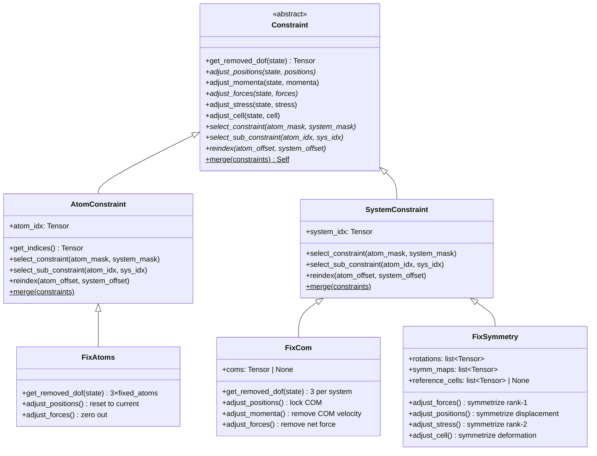
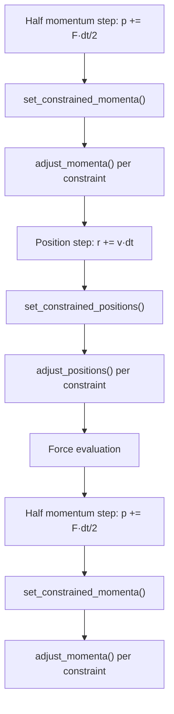

The constraints system controls how degrees of freedom are removed from atomistic simulations, governing which atoms can move, how forces are modified, and how the center of mass behaves. Inspired by ASE's constraint architecture but redesigned for PyTorch's batched execution model, it ensures that every integrator, optimizer, and quantity calculation respects the same invariant: constrained degrees of freedom never contribute to dynamics or thermodynamic observables.

## Architecture Overview

The constraint hierarchy follows a three-level abstract class pattern. At the top, the `Constraint` ABC defines six adjustment hooks that simulation routines call at well-defined points in each step. Below that, `AtomConstraint` and `SystemConstraint` provide index-management logic for constraints that target specific atoms versus specific systems. At the bottom, three concrete implementations — `FixAtoms`, `FixCom`, and `FixSymmetry` — address the most common constraint scenarios.



The abstract `Constraint` base class defines the complete lifecycle interface. The `adjust_*` methods are called by the simulation engine at precise points, while `select_constraint`, `select_sub_constraint`, `reindex`, and `merge` manage how constraints propagate through batched state operations like slicing, splitting, and concatenation.

Sources: [constraints.py](torch_sim/constraints.py#L28-L153)

## Constraint Interface

Every constraint must implement five abstract methods from the base class. The default implementations of `adjust_momenta`, `adjust_stress`, and `adjust_cell` are no-ops or delegate to `adjust_forces`, allowing subclasses to override only what they need.

### Adjustment Hooks

Adjustment hooks are called in-place by simulation routines, modifying tensors without returning new ones. The order in which hooks fire during a single velocity Verlet step is: `adjust_forces` → `adjust_momenta` → `adjust_positions` → `adjust_forces` (again) → `adjust_momenta` (again). For geometry optimization, only `adjust_positions`, `adjust_forces`, `adjust_stress`, and `adjust_cell` are relevant.

| Hook | When Called | Default Behavior |
|------|-------------|-----------------|
| `adjust_forces(state, forces)` | After every force evaluation | *Abstract* — must override |
| `adjust_momenta(state, momenta)` | After momentum updates | Delegates to `adjust_forces` |
| `adjust_positions(state, positions)` | After position updates | *Abstract* — must override |
| `adjust_stress(state, stress)` | After stress computation | No-op |
| `adjust_cell(state, cell)` | After cell updates | No-op |

The key design decision is that `adjust_momenta` defaults to calling `adjust_forces`. This works correctly for `FixAtoms` (zeroing both forces and momenta at the same indices) but `FixCom` overrides `adjust_momenta` with a mass-weighted center-of-mass velocity removal that differs from its force adjustment.

Sources: [constraints.py](torch_sim/constraints.py#L47-L107)

### Index Management for Batched States

The remaining four abstract methods handle constraint survival across state operations. When a batched state is sliced, each constraint must be asked whether it still applies and have its indices remapped accordingly.

| Method | Purpose | Called By |
|--------|---------|-----------|
| `select_constraint(atom_mask, system_mask)` | Filter constraint to keep only masked atoms/systems | `_slice_state` |
| `select_sub_constraint(atom_idx, sys_idx)` | Extract constraint for a single system | `_split_state` |
| `reindex(atom_offset, system_offset)` | Shift indices to global coordinates | `concatenate_states` |
| `merge(constraints)` | Combine reindexed constraints of same type | `concatenate_states` |

The reindex-then-merge protocol is the mechanism that allows independent simulation states, each with their own constraints, to be concatenated into a single batch. First, each constraint's atom or system indices are shifted by cumulative offsets via `reindex`. Then, constraints of the same type are merged by concatenating their index arrays. The top-level `merge_constraints` function orchestrates this two-phase process.

Sources: [constraints.py](torch_sim/constraints.py#L108-L153), [constraints.py](torch_sim/constraints.py#L375-L413)

## FixAtoms: Pinning Atoms in Place

`FixAtoms` is the simplest constraint: it prevents specified atoms from moving by zeroing their forces and resetting their positions after every update. Each fixed atom removes exactly 3 translational degrees of freedom.

```python
# Fix atoms by index
constraint = FixAtoms(atom_idx=[0, 1, 2])

# Fix atoms by boolean mask
mask = torch.tensor([True, True, True, False, False])
constraint = FixAtoms(atom_mask=mask)
```

The `get_removed_dof` method uses `torch.bincount` on `system_idx` to count how many fixed atoms belong to each system in a batch, returning a per-system tensor of shape `(n_systems,)`. In `adjust_positions`, the proposed positions at the fixed indices are overwritten with the current positions from the state. In `adjust_forces`, the force tensor is zeroed at the fixed indices. Both operations are in-place and require no mass information.

`FixAtoms` validates against duplicate indices at construction time and checks that all indices fall within the state's atom count during validation. The constraint's `adjust_momenta` is inherited from `Constraint`, which delegates to `adjust_forces` — this correctly zeros momenta at the same atom indices.

Sources: [constraints.py](torch_sim/constraints.py#L416-L492)

## FixCom: Fixing the Center of Mass

`FixCom` prevents the center of mass of each targeted system from drifting by removing translational degrees of freedom. Unlike `FixAtoms`, it affects all atoms within a system, redistributing corrections proportionally to mass.

### Position Adjustment

On first call, `adjust_positions` captures the current center of mass into the `coms` attribute using a mass-weighted `scatter_add`. On subsequent calls, it computes the COM of the proposed new positions and shifts every atom so that the COM matches the stored reference. This ensures the COM never moves, even as individual atoms are displaced by forces or thermostat kicks.

### Momentum and Force Adjustment

The `adjust_momenta` method computes the system's total momentum, converts it to a COM velocity, and subtracts the mass-weighted COM velocity from every atom's momentum. This is more nuanced than simply calling `adjust_forces` on the momenta tensor — it requires per-system mass aggregation.

The `adjust_forces` method removes the net force to prevent COM acceleration, following the formulation from Eq. (3) and (7) in [https://doi.org/10.1021/jp9722824](https://doi.org/10.1021/jp9722824). The correction is mass-weighted using `Σ(m²)` in the denominator, ensuring that lighter atoms receive larger force corrections than heavier ones. This is critical for mixed-element systems where naive uniform correction would introduce unphysical forces on heavy atoms.

Sources: [constraints.py](torch_sim/constraints.py#L494-L614)

## FixSymmetry: Preserving Crystal Symmetry

`FixSymmetry` is the most sophisticated constraint. It preserves the spacegroup symmetry of a crystal during geometry optimization by symmetrizing forces, positions, stress, and cell deformation according to the crystal's symmetry operations. This is essential for optimizing unit cells where symmetry-breaking displacements would lead to physically incorrect relaxed structures.

### Construction

`FixSymmetry` can be constructed either directly from symmetry operations or, more commonly, via the `from_state` class method which uses the `moyopy` library for automatic symmetry detection:

```python
# Automatic construction from state (mutates state to ideal symmetry)
constraint = FixSymmetry.from_state(
    state, symprec=0.01,
    adjust_positions=True, adjust_cell=True,
)
```

Each system in a batch can have different symmetry operations. The constructor accepts per-system rotation tensors `(n_ops, 3, 3)` and atom mapping tensors `(n_ops, n_atoms)`. The `from_state` method optionally refines the state's positions and cell to ideal symmetry before extracting these operations.

> [!TIP]
> When `refine_symmetry_state=True` (the default), `from_state` mutates the input state in-place to have ideal symmetric positions and cell. If you need to preserve the original state, clone it before calling `from_state`, or set `refine_symmetry_state=False`.

### Symmetrization Behavior

`FixSymmetry` has two independent toggle flags that control what gets symmetrized:

| Parameter | Controls | Default |
|-----------|----------|---------|
| `adjust_positions` | Position displacement symmetrization | `True` |
| `adjust_cell` | Cell deformation gradient symmetrization | `True` |

**Forces** are always symmetrized (via `_symmetrize_rank1`), regardless of the flags. **Stress** is also always symmetrized (via `_symmetrize_rank2`). The flags only gate position displacement and cell deformation symmetrization.

The cell adjustment is the most complex operation. It computes the deformation gradient `F = inv(current_cell) @ proposed_cell`, symmetrizes `F - I` as a rank-2 tensor, then reconstructs the proposed cell. Two safety guards prevent numerical instability: a per-step deformation clamp (max delta 0.25) that prevents ill-conditioned symmetrization, and a cumulative strain check against the reference cell that clamps the total deformation to `max_cumulative_strain` (default 0.5) to prevent phase transitions that would break the symmetry constraint.

Sources: [constraints.py](torch_sim/constraints.py#L725-L968), [symmetrize.py](torch_sim/symmetrize.py#L206-L235)

## Degrees of Freedom Accounting

Constraint-aware degree of freedom counting is central to correct thermodynamic calculations. The system starts with `3 × n_atoms_per_system` degrees of freedom per system, and each constraint subtracts its contribution via `get_removed_dof`.

### Counting Mechanism

The `count_degrees_of_freedom` helper function validates constraints, then sums all removed DOF and subtracts from the unconstrained total. The result is clamped to a minimum of zero (to handle over-constrained edge cases gracefully):

```python
dof = count_degrees_of_freedom(state, constraints)
# Returns tensor of shape (n_systems,) with per-system DOF
```

The `SimState.get_number_of_degrees_of_freedom()` method delegates to the same internal computation but is stricter — it raises `ValueError` if any system has zero or negative DOF, because simulation routines like temperature calculation require physically valid DOF.

### Impact on Temperature

Temperature calculation in `MDState.calc_kT()` calls `get_number_of_degrees_of_freedom()` to get the correct DOF per system, then divides the total kinetic energy by that DOF count. This means that fixing atoms or constraining the COM directly increases the measured temperature at a given kinetic energy — a physically correct behavior, since the same kinetic energy is distributed over fewer degrees of freedom.

The `calc_kT` function in [quantities.py](torch_sim/quantities.py#L16-L66) accepts an optional `dof_per_system` parameter, which the MD state populates from its constraints. Without constraints, DOF equals `3 × n_atoms_per_system`; with constraints, it is reduced accordingly.

| Scenario | DOF per System | Temperature Effect |
|----------|---------------|-------------------|
| Unconstrained (N atoms) | 3N | Baseline |
| FixAtoms with K fixed atoms | 3(N - K) | Higher T at same KE |
| FixCom | 3N - 3 | Slightly higher T |
| FixAtoms(K) + FixCom | 3(N - K) - 3 | Highest T at same KE |

Sources: [constraints.py](torch_sim/constraints.py#L616-L647), [state.py](torch_sim/state.py#L415-L431), [quantities.py](torch_sim/quantities.py#L16-L66)

## Integration with Simulation Routines

Constraints are not called manually by users — they are invoked automatically by the simulation engine through constrained setter methods on the state objects.

### Velocity Verlet Integration

The velocity Verlet step in [md.py](torch_sim/integrators/md.py#L201-L236) calls `momentum_step` and `position_step`, both of which use constrained setters. `momentum_step` computes `new_momenta = momenta + forces * dt` and passes it through `state.set_constrained_momenta()`, which calls each constraint's `adjust_momenta`. Similarly, `position_step` computes `new_positions = positions + velocities * dt` and passes it through `state.set_constrained_positions()`, which calls each constraint's `adjust_positions`.



### Geometry Optimization

Optimizers follow the same pattern. `gradient_descent_step` calls `state.set_constrained_positions()` after computing the position update, and `state.set_constrained_forces()` after receiving new forces from the model. FIRE, BFGS, and LBFGS optimizers all route through these same constrained setter methods, ensuring uniform constraint enforcement across all optimization algorithms.

For cell optimization with `CellOptimState`, the `set_constrained_cell` method additionally calls `adjust_cell` on each constraint, allowing `FixSymmetry` to symmetrize cell deformation gradients during variable-cell relaxation.

Sources: [md.py](torch_sim/integrators/md.py#L159-L198), [gradient_descent.py](torch_sim/optimizers/gradient_descent.py#L70-L121)

## Constraint Validation

The `validate_constraints` function runs automatically when constraints are attached to a `SimState` (via the `constraints` property setter) or when `count_degrees_of_freedom` is called with explicit constraints. It performs three checks:

1. **Bounds checking**: Verifies that atom indices do not exceed `state.n_atoms` and system indices do not exceed `state.n_systems`. Raises `ValueError` on violation.
2. **Overlap detection**: If multiple `AtomConstraint` instances target the same atom indices, a `UserWarning` is emitted. This does not raise an error because some overlap scenarios are intentional (e.g., combining `FixAtoms` on different subsets).
3. **COM conflict warning**: If `FixCom` is combined with any `AtomConstraint`, a `UserWarning` notes that the COM constraint applies to all atoms including fixed ones, which may produce unexpected behavior.

Sources: [constraints.py](torch_sim/constraints.py#L650-L723), [state.py](torch_sim/state.py#L370-L388)

## Constraint Propagation in Batched Operations

When batched states are manipulated — sliced, split, popped, or concatenated — constraints must be updated to remain consistent with the new state geometry. This propagation happens automatically through the state manipulation functions in [state.py](torch_sim/state.py).

### Slicing and Splitting

`_slice_state` calls each constraint's `select_constraint` with boolean masks indicating which atoms and systems to keep. The constraint returns a new instance with remapped indices, or `None` if it no longer applies. `_split_state` uses `select_sub_constraint` to extract per-system constraints.

### Concatenation

`concatenate_states` calls `merge_constraints`, which operates in two phases. First, each constraint is `reindex`-ed by the cumulative atom/system offsets of all preceding states. Then, constraints of the same type are `merge`-d by concatenating their reindexed index arrays. This ensures that a `FixAtoms` constraint targeting atom 3 in the second state becomes a constraint targeting atom `(N₁ + 3)` in the concatenated state, where `N₁` is the number of atoms in the first state.

```python
# Two states, each with their own constraints
state1.constraints = [FixAtoms(atom_idx=[0, 1])]
state2.constraints = [FixCom([0])]

# After concatenation
merged = concatenate_states([state1, state2])
# merged.constraints has both FixAtoms (reindexed) and FixCom
```

> [!TIP]
> When defining constraints for states that will be concatenated, always use **local** (per-state) indices. The `reindex` method handles the conversion to global indices automatically during concatenation.

Sources: [constraints.py](torch_sim/constraints.py#L375-L413), [constraints.py](torch_sim/constraints.py#L224-L273)

## Quick Reference

| Constraint | Scope | DOF Removed | Key Adjustments |
|-----------|-------|-------------|-----------------|
| `FixAtoms(atom_idx=...)` | Atom-level | 3 per fixed atom | Zero forces, reset positions |
| `FixCom(system_idx=...)` | System-level | 3 per system | Remove net force, lock COM, remove COM velocity |
| `FixSymmetry.from_state(...)` | System-level | 0 (directional) | Symmetrize forces, positions, stress, cell |

| Construction Pattern | Use Case |
|---------------------|----------|
| `FixAtoms(atom_idx=[0, 1])` | Fix specific atoms by index |
| `FixAtoms(atom_mask=mask)` | Fix atoms by boolean mask |
| `FixCom([0])` | Fix COM of system 0 |
| `FixCom([0, 2])` | Fix COM of systems 0 and 2 |
| `FixSymmetry.from_state(state)` | Auto-detect and preserve symmetry |

For details on how constraints interact with specific integrators and optimizers, see [NVE and NVT Integrators](12-nve-and-nvt-integrators), [NPT Integrators and Thermostats](13-npt-integrators-and-thermostats), [FIRE and Gradient Descent Optimizers](15-fire-and-gradient-descent-optimizers), and [Cell Filters and Constraints](17-cell-filters-and-constraints). For the underlying state manipulation that propagates constraints through batched operations, see [SimState and State Hierarchy](7-simstate-and-state-hierarchy).