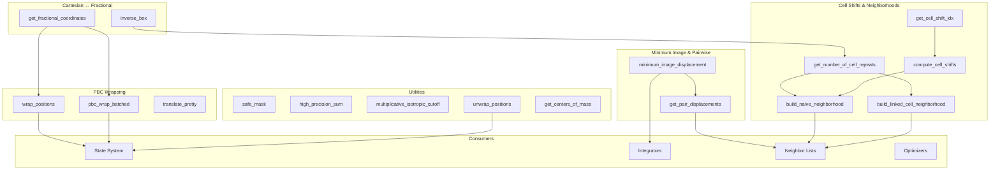

Molecular simulations live in a space defined by two coordinate systems—Cartesian positions that describe where atoms *are*, and fractional coordinates that describe where atoms sit *relative to the unit cell*. The `torch_sim.transforms` module is the bridge between these worlds, providing every operation needed to convert, wrap, unwrap, and shift atomic positions across periodic boundary conditions. These functions are the invisible scaffolding beneath every integrator, optimizer, and neighbor list in TorchSim: when a molecule crosses a cell boundary during MD, when a neighbor list needs to enumerate periodic images, or when a trajectory must be unwrapped for diffusion analysis—transforms are invoked.

Sources: [transforms.py](torch_sim/transforms.py#L1-L6)

## Architectural Overview

The transforms module organizes its ~25 functions into five logical tiers, each building on the one below it. The diagram below illustrates these tiers and their interconnections with the rest of the TorchSim system.

The two foundational operations—converting between Cartesian and fractional coordinates and computing cell inverses—feed every higher-level function. PBC wrapping consumes fractional coordinates directly. Minimum image displacement wraps pairwise differences. Cell shift calculations drive both the naive and linked-cell neighborhood builders that feed the [Neighbor List Implementations](23-neighbor-list-implementations).

## Cartesian ↔ Fractional Coordinates

The unit cell matrix in TorchSim stores lattice vectors as **rows** of a (3, 3) matrix. Converting between coordinate systems requires solving a linear system: fractional coordinates **s** satisfy **r** = Aᵀ**s**, where A is the cell matrix and **r** is the Cartesian position. This means **s** = (Aᵀ)⁻¹ **r**, which is computed via `torch.linalg.solve`.

The function `get_fractional_coordinates` handles two cases. For a 2D cell matrix (single system), it directly solves `cell.mT @ frac = pos` using `torch.linalg.solve` with proper transpose handling. For a batched 3D cell tensor with exactly one system, it squeezes the batch dimension first. Multi-system batched cells raise `NotImplementedError` because the function lacks system indices to partition atoms across systems—in that case, `pbc_wrap_batched` should be used instead.

Sources: [transforms.py](torch_sim/transforms.py#L16-L65)

The companion function `inverse_box` provides a polymorphic inversion operation that adapts to the dimensionality of its input. Scalars receive a reciprocal, vectors receive element-wise reciprocals, and 2D matrices receive a proper matrix inverse via `torch.linalg.inv`. Any tensor with more than 2 dimensions raises a `ValueError`. This function is used internally for computing reciprocal cell vectors needed by repeat and shift calculations.

Sources: [transforms.py](torch_sim/transforms.py#L67-L112)

## Periodic Boundary Condition Wrapping

### Single-System Wrapping

`wrap_positions` is the PyTorch-native equivalent of ASE's `wrap_positions`. It maps atoms back into the primary unit cell by converting positions to fractional space, applying a modulo operation, and converting back to Cartesian. The `center` parameter controls the origin of the wrapping region (defaulting to the cell center at (0.5, 0.5, 0.5)), while `pretty_translation` minimizes the spread of fractional coordinates along periodic dimensions.

The PBC tensor controls wrapping per-dimension: non-periodic axes leave positions untouched. The wrapping logic applies `torch.where` with a boolean mask, ensuring that only periodic dimensions undergo the modulo operation. When `pretty_translation` is enabled, `translate_pretty` is called first to find the translation that minimizes the maximum gap between consecutive sorted fractional positions along each periodic axis.

Sources: [transforms.py](torch_sim/transforms.py#L319-L380), [transforms.py](torch_sim/transforms.py#L273-L317)

### Batched Wrapping

`pbc_wrap_batched` handles the more general case of wrapping atoms across multiple systems in a single vectorized operation. It accepts flattened positions across all systems, a per-system cell tensor, and a `system_idx` tensor that maps each atom to its system. The algorithm proceeds in four steps: (1) compute the inverse of each system's cell matrix, (2) gather the correct inverse cell per atom via `B[system_idx]`, (3) convert to fractional coordinates via batched matrix-vector multiplication, (4) apply modulo on periodic dimensions, and (5) transform back to Cartesian via the per-atom cell matrix.

This function validates that positions and cells are floating-point, that their dimensionalities match, and that the number of unique system indices equals the number of cell matrices. It handles the `pbc` parameter as either a boolean (applied uniformly) or a per-dimension tensor.

Sources: [transforms.py](torch_sim/transforms.py#L114-L179)

> [!TIP]
> `wrap_positions` is designed for single-system use and accepts a (3, 3) cell. For batched simulations where atoms from multiple systems are concatenated into a flat tensor, use `pbc_wrap_batched` instead—it takes `system_idx` to correctly partition atoms to their respective cells. Mixing these two up is the most common source of shape mismatch errors in TorchSim workflows.

### Pretty Translation

`translate_pretty` implements ASE's pretty translation algorithm entirely in PyTorch. For each periodic dimension, it sorts the fractional coordinates, computes the wrapped differences between consecutive atoms, finds the largest gap, and shifts all coordinates so that gap wraps around the cell boundary. This produces a visually compact arrangement where atoms are clustered together rather than spanning the full cell width—useful for visualization and for certain analysis tasks.

Sources: [transforms.py](torch_sim/transforms.py#L273-L317)

## Minimum Image Convention and Pairwise Displacements

### Minimum Image Displacement

`minimum_image_displacement` applies the minimum image convention (MIC) to displacement vectors. Given a displacement vector **dr** and a cell, it converts the displacement to fractional space, rounds each periodic component to the nearest integer, subtracts that rounding, and converts back. The result is the shortest displacement consistent with the periodic images. When the cell is `None` or all PBC flags are `False`, it returns the displacement unchanged.

The function handles both flat displacement tensors (N, 3) and pairwise displacement matrices (N, N, 3) via `torch.einsum` broadcasting. The PBC parameter accepts a boolean (applied uniformly to all dimensions) or a per-dimension tensor.

Sources: [transforms.py](torch_sim/transforms.py#L181-L212)

### Pair Displacements

`get_pair_displacements` computes displacement vectors and distances between atom pairs with full PBC support. It operates in two modes depending on whether explicit `pairs` are provided. Without pairs, it constructs a full (N, N, 3) displacement matrix with the minimum image convention applied, computes distances, and masks self-interactions with infinity. With explicit (i, j) pairs, it computes displacements directly, optionally applying either the minimum image convention or explicit cell shifts.

When explicit `shifts` are provided alongside a cell, the function applies `cell @ shiftsᵀ` to add periodic image offsets to the base displacement—this is how neighbor lists communicate which periodic image a neighbor belongs to.

Sources: [transforms.py](torch_sim/transforms.py#L214-L271)

## Cell Shift Calculations

Computing which periodic images need to be considered for a given cutoff is the foundation of neighbor list construction. The transforms module provides a layered approach.

### Number of Cell Repeats

`get_number_of_cell_repeats` determines how many cell replicas are needed in each dimension to capture all interactions within a cutoff radius. It computes the reciprocal cell vectors, takes their norms (which represent face-to-face distances), and rounds up `cutoff / face_distance` to get the integer repeat count. Non-periodic dimensions are forced to zero. The function accepts batched cell and PBC tensors, returning a (n_systems, 3) tensor of repeat counts.

Sources: [transforms.py](torch_sim/transforms.py#L403-L436)

### Cell Shift Indices

`get_cell_shift_idx` generates the Cartesian product of integer shift vectors from the repeat counts. For each dimension, it creates an `arange(-n, n+1)` and sorts by absolute value so that the zero shift (no periodic image) comes first. The result is a (n_shifts, 3) tensor covering all combinations such as (-1,-1,-1), (-1,-1,0), ..., (0,0,0), ..., (1,1,1).

Sources: [transforms.py](torch_sim/transforms.py#L438-L466)

### Computing Real-Space Cell Shifts

`compute_cell_shifts` converts integer shift indices into real-space displacement vectors by contracting with the cell matrix via `torch.einsum("jn,jnm->jm", shifts_idx, cell)`. It takes a `system_mapping` tensor to gather the correct cell per system from a batched cell tensor. The result is a (n_systems, 3) tensor of Cartesian offsets.

Sources: [transforms.py](torch_sim/transforms.py#L508-L535)

### Lattice Shift Superset

`_calculate_n2_lattice_shifts` computes a superset of shift vectors that covers *all* systems in a batch. It takes the maximum repeat count across all systems for each dimension, then generates the full Cartesian product of integer shifts. This ensures a single shift set covers everything, at the cost of some redundancy for systems with smaller cells.

Sources: [transforms.py](torch_sim/transforms.py#L537-L567)

## Neighborhood Building

The transforms module provides two approaches to constructing neighbor lists directly from positions and cells.

### Naive O(N²) Neighborhood

`build_naive_neighborhood` builds a fully vectorized pairwise neighbor list using pad-and-broadcast operations. All systems are padded to the same atom count using `pad_sequence`, then a 4D distance tensor (n_systems, n_shifts, n_max, n_max) is computed. The criterion mask applies the cutoff, filters out self-interactions, removes shifts along non-periodic axes, and masks out padded atoms. The output includes global atom indices (accounting for per-system offsets), system assignments, and integer shift vectors.

This approach is straightforward but memory-intensive due to the O(N²) pairwise distance computation—best suited for systems with similar atom counts where padding overhead is minimal.

Sources: [transforms.py](torch_sim/transforms.py#L569-L691)

### Linked-Cell Neighborhood

`build_linked_cell_neighborhood` applies the linked cell algorithm, which decomposes space into bins of size ≥ cutoff and only checks pairs within neighboring bins. It iterates over systems (using `strides_of` to index into the flat positions array), calling `linked_cell` for each system. The linked cell implementation assigns atoms to bins, checks 27 neighboring bins per atom, and applies PBC-aware bin arithmetic. The per-system results are concatenated into global indices.

This approach scales closer to O(N) for sparse systems and is the preferred method for production simulations.

Sources: [transforms.py](torch_sim/transforms.py#L970-L1046), [transforms.py](torch_sim/transforms.py#L807-L968)

> [!TIP]
> Both neighborhood builders return the same triplet format: `(mapping, system_mapping, shifts_idx)`. This standardized output allows the [Neighbor List Implementations](23-neighbor-list-implementations) module to swap between implementations transparently. If you are implementing a custom model, always consume neighbor list output through this interface rather than building your own pair logic.

## Position Unwrapping

`unwrap_positions` reverses the effect of PBC wrapping, reconstructing continuous trajectories from wrapped positions. It handles both constant and time-dependent cells across multiple systems in a single vectorized pass. For constant cells (3D input), it computes the inverse box once and uses `torch.einsum` to convert all frames to fractional coordinates. For time-dependent cells (4D input), it inverts the cell per frame. The fractional displacements between consecutive frames have their integer components subtracted (unwrapping), are converted back to Cartesian displacements, and then cumulatively summed to reconstruct the continuous trajectory.

Sources: [transforms.py](torch_sim/transforms.py#L1180-L1241)

## Utility Functions

### Safe Masked Operations

`safe_mask` applies an arbitrary function only to elements selected by a boolean mask, replacing masked-out positions with a configurable placeholder. This prevents numerical errors (e.g., `log(0)`) when computing quantities over subsets of atoms. The implementation uses `torch.where` to create a zeroed copy, applies the function, then merges results with the placeholder.

Sources: [transforms.py](torch_sim/transforms.py#L1148-L1178)

### High-Precision Summation

`high_precision_sum` mitigates floating-point accumulation error by casting to 64-bit precision before summation. It automatically selects the appropriate high-precision dtype: `float64` for real tensors, `complex128` for complex tensors, and `int64` for integer tensors. The result is cast back to the original dtype to maintain API consistency. This is critical when summing energies or forces across large batched systems where 32-bit precision can lose significant digits.

Sources: [transforms.py](torch_sim/transforms.py#L1108-L1146)

### Smooth Isotropic Cutoff

`multiplicative_isotropic_cutoff` wraps any isotropic function f(r) with a C¹-continuous switching function that smoothly transitions from 1 to 0 between `r_onset` and `r_cutoff`. The switching function follows the HOOMD-blue form: S(r) = (rc² − r²)² × (rc² + 2r² − 3ro²) / (rc² − ro²)³. This ensures both the function value and its first derivative are continuous at both boundaries, which is essential for stable energy minimization and molecular dynamics where force discontinuities cause numerical instability.

Sources: [transforms.py](torch_sim/transforms.py#L1048-L1106)

### Centers of Mass

`get_centers_of_mass` computes per-system centers of mass using `scatter_add_` for fully vectorized batched computation. It accumulates mass-weighted positions and total masses per system, then divides to get the final centers. This is used internally by the [Constraints System](21-constraints-system) and trajectory reporting.

Sources: [transforms.py](torch_sim/transforms.py#L1244-L1271)

## Function Reference Summary

The table below catalogs every public function in the transforms module with its signature, purpose, and typical consumer.

| Function | Key Parameters | Returns | Primary Consumer |
|---|---|---|---|
| `get_fractional_coordinates` | `(positions, cell)` | Fractional coords `[..., 3]` | `wrap_positions`, analysis |
| `inverse_box` | `(box)` | Inverted tensor (scalar/vector/matrix) | Internal cell math |
| `pbc_wrap_batched` | `(positions, cell, system_idx, pbc)` | Wrapped positions `[N, 3]` | State system |
| `minimum_image_displacement` | `(*, dr, cell, pbc)` | Minimum-image dr | `get_pair_displacements`, models |
| `get_pair_displacements` | `(*, positions, cell, pbc, pairs, shifts)` | `(dr, distances)` | Models, analysis |
| `translate_pretty` | `(fractional, pbc)` | Shifted fractional coords | `wrap_positions` |
| `wrap_positions` | `(positions, cell, *, pbc, center, pretty_translation)` | Wrapped positions `[N, 3]` | State system, I/O |
| `get_number_of_cell_repeats` | `(cutoff, cell, pbc)` | Repeats `[n_systems, 3]` | Neighborhood builders |
| `get_cell_shift_idx` | `(num_repeats, dtype)` | Shift indices `[n_shifts, 3]` | `build_linked_cell_neighborhood` |
| `compute_cell_shifts` | `(cell, shifts_idx, system_mapping)` | Cartesian shifts `[n_systems, 3]` | Neighbor list consumers |
| `build_naive_neighborhood` | `(positions, cell, pbc, cutoff, n_atoms, self_interaction)` | `(mapping, system_mapping, shifts)` | Fallback neighbor list |
| `build_linked_cell_neighborhood` | `(positions, cell, pbc, cutoff, n_atoms, self_interaction)` | `(mapping, system_mapping, shifts)` | Default neighbor list |
| `unwrap_positions` | `(positions, cells, system_idx)` | Unwrapped positions `[T, N, 3]` | Trajectory analysis |
| `safe_mask` | `(mask, fn, operand, placeholder)` | Masked result tensor | Models, quantities |
| `high_precision_sum` | `(x, dim, keepdim)` | Sum in original dtype | Energy/force aggregation |
| `multiplicative_isotropic_cutoff` | `(fn, r_onset, r_cutoff)` | Wrapped callable | Classical potentials |
| `get_centers_of_mass` | `(positions, masses, system_idx, n_systems)` | COMs `[n_systems, 3]` | Constraints, reporting |

## Integration with the Broader System

The transforms module is not a standalone utility—it is deeply embedded in TorchSim's computational pipeline. The [SimState and State Hierarchy](7-simstate-and-state-hierarchy) stores positions and cells; when the state needs to be wrapped (e.g., after initialization or cell deformation), it calls `wrap_positions` or `pbc_wrap_batched`. The [NVE and NVT Integrators](12-nve-and-nvt-integrators) rely on `minimum_image_displacement` indirectly through the model interface when computing forces. The [Neighbor List Implementations](23-neighbor-list-implementations) consume `build_linked_cell_neighborhood` and `build_naive_neighborhood` as their core pair-finding algorithm. The [Linked Cell Algorithm](24-linked-cell-algorithm) page details the binning internals that `linked_cell` uses under the hood.

For understanding how these transforms are used in practice, proceed to the [Neighbor List Implementations](23-neighbor-list-implementations) documentation, which shows how cell shift calculations feed directly into pair enumeration. For context on how wrapped and unwrapped positions are managed during simulation, see [SimState and State Hierarchy](7-simstate-and-state-hierarchy).