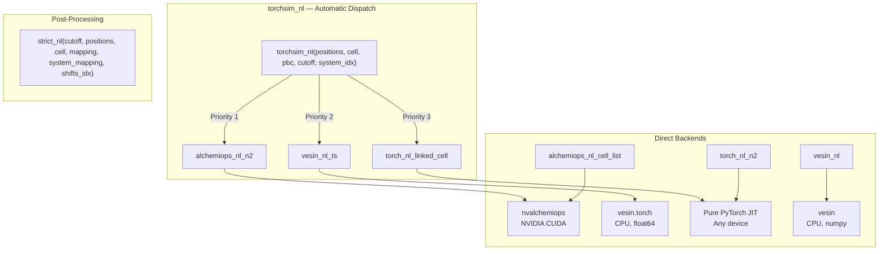
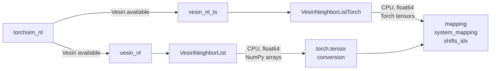

Neighbor list computation is the computational backbone of any atomic simulation — every force evaluation, every energy calculation, every MLIP forward pass begins by determining which atom pairs fall within a cutoff radius. TorchSim provides a layered neighbor list architecture with **six distinct implementations** unified behind a single automatic-selection API, enabling you to go from a zero-dependency pure-PyTorch fallback all the way up to NVIDIA CUDA-accelerated kernels without changing a single line of application code.

This page maps out the full implementation landscape: the unified dispatch surface, each backend's algorithm and constraints, the shared data contract, and the strict post-filtering mechanism that guarantees exact cutoff compliance.

Sources: [__init__.py](torch_sim/neighbors/__init__.py#L1-L146)

## The Unified Neighbor List API

All six neighbor list functions share an identical signature. This contract is not accidental — it is the enabling constraint for automatic backend swapping and the foundation of `torchsim_nl`, the top-level dispatch function that every model in TorchSim ultimately calls.



### Common Signature

Every implementation — whether from Alchemiops, Vesin, or pure PyTorch — accepts and returns the same tensor shapes:

| Parameter | Shape | Dtype | Description |
|-----------|-------|-------|-------------|
| `positions` | `[n_atoms, 3]` | float32/64 | Wrapped atomic positions |
| `cell` | `[3, 3]` or `[n_systems, 3, 3]` | float32/64 | Row-vector convention unit cells |
| `pbc` | `[3]` or `[n_systems, 3]` | bool | Periodic boundary conditions per axis |
| `cutoff` | scalar tensor | float32/64 | Maximum neighbor distance |
| `system_idx` | `[n_atoms]` | long | System assignment for each atom |
| `self_interaction` | — | bool | Include (i,i) pairs |

The return tuple is always `(mapping, system_mapping, shifts_idx)` where `mapping` is `[2, n_neighbors]`, `system_mapping` is `[n_neighbors]`, and `shifts_idx` is `[n_neighbors, 3]`.

Sources: [__init__.py](torch_sim/neighbors/__init__.py#L98-L145)

### Automatic Backend Selection

The `torchsim_nl` function is the recommended entry point. It selects the best available backend at import time through a simple priority chain encoded in [`__init__.py`](torch_sim/neighbors/__init__.py#L87-L95):

```
alchemiops_nl_n2  →  vesin_nl_ts  →  torch_nl_linked_cell
```

The same priority determines the `default_batched_nl` module-level variable, which other TorchSim internals reference when they need a neighbor list without calling `torchsim_nl` directly. When optional backends are unavailable, graceful import guards fall back to stubs that raise `ImportError` with installation instructions, or the priority chain simply skips them.

Sources: [__init__.py](torch_sim/neighbors/__init__.py#L58-L95)

### Input Normalization

The `_normalize_inputs` helper (and its JIT-compiled variant `_normalize_inputs_jit`) provides the flexible cell/pbc shape handling that all backends depend on. It accepts three possible input ranks and normalizes them to the canonical batched form `[n_systems, 3, 3]` for cells and `[n_systems, 3]` for PBC flags. A `[3, 3]` cell is broadcast-expanded across all systems; a flattened `[n_systems*3, 3]` cell is reshaped. This normalization is invoked at the top of every implementation before delegating to the backend-specific logic.

Sources: [__init__.py](torch_sim/neighbors/__init__.py#L24-L55), [torch_nl.py](torch_sim/neighbors/torch_nl.py#L24-L47)

## Pure PyTorch Implementations

The pure PyTorch backends in [`torch_nl.py`](torch_sim/neighbors/torch_nl.py) are always available — they carry zero external dependencies and work on any device (CPU, CUDA, ROCm). They serve as both the default fallback and the reference implementations against which all other backends are validated.

### Naive N² Search: `torch_nl_n2`

The `torch_nl_n2` function computes neighbor lists by evaluating all possible atom pairs within a system. It delegates to `transforms.build_naive_neighborhood`, which constructs candidate pairs using an O(N²) sweep across all periodic images within the cutoff, then applies the `strict_nl` post-filter to enforce exact distance compliance. This approach is simple and reliable but scales quadratically with system size.

The implementation first normalizes inputs via the JIT-compatible `_normalize_inputs_jit`, counts atoms per system with `torch.bincount`, builds the candidate neighborhood, and finally applies the strict cutoff filter.

Sources: [torch_nl.py](torch_sim/neighbors/torch_nl.py#L119-L189)

### Linked Cell Algorithm: `torch_nl_linked_cell`

The `torch_nl_linked_cell` function replaces the brute-force pair enumeration with a spatial binning approach. It delegates to `transforms.build_linked_cell_neighborhood` (detailed in [Linked Cell Algorithm](24-linked-cell-algorithm)), which partitions space into a grid of bins sized to the cutoff radius and only checks atom pairs in neighboring bins. This reduces complexity from O(N²) to O(N) for sparse systems, making it the **recommended pure-PyTorch default** and the final fallback in the `torchsim_nl` dispatch chain.

Despite the algorithmic difference, the high-level flow mirrors `torch_nl_n2` exactly: normalize inputs, compute atom counts, build the candidate neighborhood, then apply `strict_nl`.

Sources: [torch_nl.py](torch_sim/neighbors/torch_nl.py#L192-L262)

> [!TIP]
> Both `torch_nl_n2` and `torch_nl_linked_cell` produce an over-approximate candidate set that is then refined by `strict_nl`. This two-phase design (generate candidates → filter by exact distance) is a deliberate architectural pattern: the candidate generation can be vectorized and JIT-compiled efficiently, while the strict filter operates on a (typically much smaller) set of pairs where precise floating-point distances matter.

## Vesin Backend

The Vesin backend in [`vesin.py`](torch_sim/neighbors/vesin.py) wraps the [Vesin](https://github.com/Luthaf/vesin) neighbor list library, providing high-performance neighbor search with support for complex triclinic cells. Two variants are exposed, differing in their TorchScript compatibility and internal data flow.

### Architecture Overview



### `vesin_nl_ts`: TorchScript-Compatible Variant

This function uses `VesinNeighborListTorch` from `vesin.torch`, which accepts and returns PyTorch tensors directly. It processes each system sequentially in a Python loop: for each system identified by `system_idx`, it extracts the relevant positions and cell, converts them to CPU float64 (Vesin's internal requirement), calls `neighbor_list_fn.compute` with `quantities="ijS"` to retrieve index pairs and shift vectors, then adjusts local indices to global indices using an offset counter.

The per-system loop means Vesin is not fully vectorized across batches — each system incurs a CPU round-trip. For large batches of small systems, the pure PyTorch linked-cell implementation may outperform it. Vesin excels with individual large systems and highly skewed (non-orthorhombic) cells.

### `vesin_nl`: Standard NumPy Variant

The `vesin_nl` function follows the same loop structure but uses the standard `VesinNeighborList` class, which returns NumPy arrays. It detaches gradients and explicitly converts results back to PyTorch tensors. This variant is not TorchScript-compatible due to the NumPy interop, but it is functionally equivalent to `vesin_nl_ts`.

### Self-Interaction Handling

Neither Vesin variant includes self-interactions by default. When `self_interaction=True`, the function post-appends diagonal pairs `(i, i)` with zero shifts and the appropriate `system_idx` values. This post-hoc approach is consistent across all external backends.

Sources: [vesin.py](torch_sim/neighbors/vesin.py#L22-L277)

## Alchemiops Backend (NVIDIA CUDA)

The Alchemiops backend in [`alchemiops.py`](torch_sim/neighbors/alchemiops.py) wraps the [nvalchemiops](https://github.com/NVIDIA/nvalchemiops) library, providing GPU-accelerated neighbor list computation specifically for NVIDIA CUDA devices. It offers the highest throughput for large-scale batched simulations on NVIDIA hardware and is assigned the **highest priority** in the dispatch chain.

### Two Algorithms: Naive and Cell List

| Function | Algorithm | Complexity | Best For |
|----------|-----------|------------|----------|
| `alchemiops_nl_n2` | Batched naive N² | O(N²) | Dense systems, small cutoffs |
| `alchemiops_nl_cell_list` | CUDA cell list | O(N) | Sparse systems, large cutoffs |

Both functions call into nvalchemiops kernels with the same argument pattern: `positions`, `cutoff`, `batch_idx` (int32-converted `system_idx`), `cell`, and `pbc` (bool-converted). The backend returns a variable-length result tuple — either 2 elements (mapping, neighbor_ptr) or 3 elements (mapping, neighbor_ptr, shifts_idx). The wrapper normalizes this to the standard three-tensor output, converting `mapping` to `torch.long` and `shifts_idx` to the cell's dtype for downstream einsum compatibility.

### Non-Periodic Edge Case Handling

The `alchemiops_nl_cell_list` function contains a critical workaround for systems that are both non-periodic and have zero-valued cells (common in molecular simulations). The nvalchemiops warp kernels would trigger division-by-zero on such inputs, so the function detects these cases using the predicate `is_non_periodic & is_zero_cell` and substitutes an identity matrix cell to avoid the error. This substitution does not affect neighbor distances because PBC is disabled, but it prevents kernel crashes.

### Device Constraint

Unlike the pure PyTorch backends, the Alchemiops implementations are **NVIDIA CUDA-only**. The `ALCHEMIOPS_AVAILABLE` flag is set at import time based on whether `nvalchemiops` can be imported. When unavailable, stub functions raise `ImportError` with installation instructions. Tests conditionally skip Alchemiops benchmarks unless `torch.cuda.is_available()` is true.

Sources: [alchemiops.py](torch_sim/neighbors/alchemiops.py#L1-L207)

## The `strict_nl` Post-Filter

The `strict_nl` function in [`torch_nl.py`](torch_sim/neighbors/torch_nl.py#L50-L116) is the shared post-processing step that guarantees exact distance compliance across all pure-PyTorch neighbor lists. It computes pairwise squared distances using `compute_cell_shifts` from the transforms module, then applies a boolean mask `d² < cutoff²` to filter the candidate set.

The distance computation follows a two-path strategy: when `compute_cell_shifts` returns `None` (indicating no periodic shifts are needed), it computes direct differences; otherwise it subtracts the cell shifts before computing squared norms. This avoids unnecessary computation for non-periodic systems. The use of squared distances throughout avoids the computational cost of square root operations while preserving the comparison semantics.

This function is called explicitly by both `torch_nl_n2` and `torch_nl_linked_cell`, but it is **not** used by Vesin or Alchemiops — those backends enforce their own exact cutoffs internally.

> [!TIP]
> `strict_nl` can also be called independently to re-filter any neighbor list with a different cutoff. This is useful in multi-cutoff scenarios where a model needs neighbor lists at several radii (e.g., a short-range repulsive pair plus a longer-range MLIP cutoff) without recomputing the full neighborhood search.

Sources: [torch_nl.py](torch_sim/neighbors/torch_nl.py#L50-L116)

## Implementation Comparison

| Feature | torch_nl_n2 | torch_nl_linked_cell | vesin_nl / vesin_nl_ts | alchemiops_nl_n2 | alchemiops_nl_cell_list |
|---------|-------------|----------------------|------------------------|------------------|------------------------|
| **Dependency** | None (PyTorch) | None (PyTorch) | `vesin` | `nvalchemiops` | `nvalchemiops` |
| **Algorithm** | Naive O(N²) | Linked cell O(N) | Vesin (cell-based) | Batched O(N²) CUDA | Cell list O(N) CUDA |
| **Device** | Any | Any | CPU (internal), any (I/O) | NVIDIA CUDA only | NVIDIA CUDA only |
| **Internal precision** | Input dtype | Input dtype | float64 | Input dtype | Input dtype |
| **TorchScript** | ✅ (`_normalize_inputs_jit`) | ✅ | `vesin_nl_ts` only | ❌ | ❌ |
| **Batched natively** | ✅ (vectorized) | ✅ (vectorized) | ❌ (Python loop) | ✅ (CUDA kernel) | ✅ (CUDA kernel) |
| **Self-interaction** | Configurable via `build_*` | Configurable via `build_*` | Post-appended | Post-appended | Post-appended |
| **Strict filtering** | Via `strict_nl` | Via `strict_nl` | Internal | Internal | Internal |

## Validation and Testing

All six implementations are validated against ASE reference neighbor lists in a comprehensive parametrized test suite at [`tests/test_neighbors.py`](tests/test_neighbors.py#L128-L168). The test fixture combines molecular systems (CH₃CH₂NH₂, H₂O, etc.) and periodic crystals (diamond Si, fcc Cu, hcp Ti, rhombohedral Bi, and a triclinic CaCrP₂O₇ structure) into a single batched input — including **mixed periodic/non-periodic systems** — to exercise every dimension of the API. Each implementation is tested across four cutoff values (1, 3, 5, 7 Å) and both self-interaction modes, comparing sorted distance lists against ASE `neighbor_list` output.

Additional test coverage includes:
- **PBC edge cases**: periodic vs. non-periodic systems with and without self-interaction, separately parametrized.
- **Fallback integrity**: monkeypatching `ALCHEMIOPS_AVAILABLE` and `VESIN_AVAILABLE` to `False` verifies that `torchsim_nl` degrades gracefully to `torch_nl_linked_cell` and produces identical results.
- **GPU smoke test**: verifies `torchsim_nl` executes without error on CUDA devices.
- **Performance bounds**: `test_neighbor_lists_time_and_memory` enforces that every implementation completes a 100-atom system within 0.8s (CPU) or 0.01s (CUDA) and uses less than 500 MB of memory.
- **Empty neighbor lists**: systems with no neighbors within the cutoff return correctly shaped zero tensors.

Sources: [test_neighbors.py](tests/test_neighbors.py#L128-L168), [test_neighbors.py](tests/test_neighbors.py#L217-L252), [test_neighbors.py](tests/test_neighbors.py#L312-L425), [test_neighbors.py](tests/test_neighbors.py#L479-L551)

## Choosing the Right Backend

For most users, calling `torchsim_nl` directly is the correct choice — it handles all availability detection and priority resolution automatically. However, if you need to select a specific backend, the decision depends on your deployment constraints:

- **Maximum compatibility**: Use `torch_nl_linked_cell`. It requires nothing beyond PyTorch, works on any device, and uses the efficient O(N) linked-cell algorithm.
- **Large individual systems on CPU**: Use `vesin_nl` or `vesin_nl_ts`. Vesin handles complex triclinic cells efficiently and is well-optimized for single large structures.
- **Large batches on NVIDIA GPU**: Ensure `nvalchemiops` is installed and let `torchsim_nl` select `alchemiops_nl_n2` automatically. The CUDA-native batch processing avoids CPU round-trips entirely.
- **TorchScript export**: Use `torch_nl_linked_cell` or `vesin_nl_ts`. The pure PyTorch implementations are fully JIT-compatible, and `vesin_nl_ts` uses `VesinNeighborListTorch` for the same reason.

For the algorithmic details of the linked-cell approach specifically — how spatial bins are constructed, how atom counts are scattered, and how neighbor pairs are gathered — see the [Linked Cell Algorithm](24-linked-cell-algorithm) page.