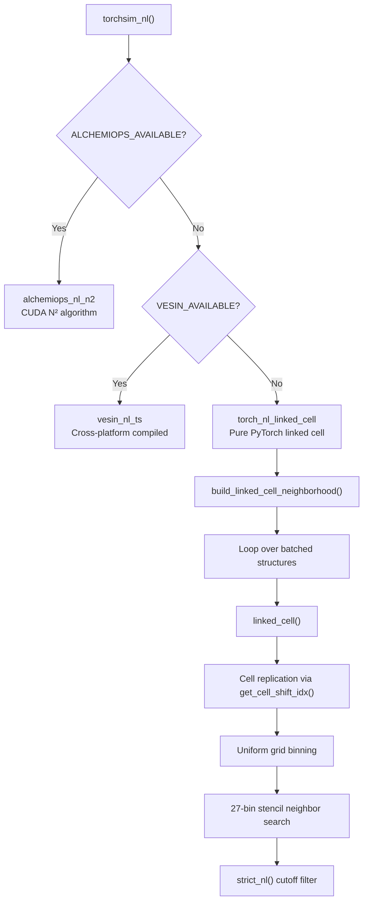
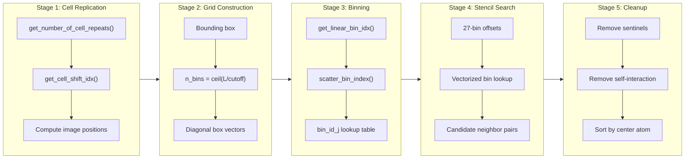

The linked cell algorithm is the primary spatial decomposition strategy in torch-sim's pure-PyTorch neighbor list stack, reducing the asymptotic cost of neighbor detection from O(N²) to O(N) for uniformly distributed systems. This page provides a complete architectural walkthrough of the implementation, from grid construction through batched dispatch, and explains how it integrates with torch-sim's broader neighbor list hierarchy described in [Neighbor List Implementations](23-neighbor-list-implementations).

## Algorithmic Foundation and Position in the Dispatch Hierarchy

The linked cell algorithm exploits a simple geometric observation: if the simulation domain is partitioned into a uniform grid of cubic cells whose side length equals the interaction cutoff, then any pair of atoms within the cutoff must reside in the same cell or in one of the 26 directly adjacent cells. This reduces the exhaustive all-pairs search to a local stencil operation over at most 27 cells per atom, yielding linear-time complexity for homogeneous density distributions.

Within torch-sim's neighbor list architecture, the linked cell implementation occupies a specific niche. The module-level dispatch in [`__init__.py`](torch_sim/neighbors/__init__.py#L86-L95) follows a strict priority chain: **alchemiops** (NVIDIA CUDA-optimized) → **vesin** (cross-platform compiled) → **torch_nl_linked_cell** (pure PyTorch fallback). The linked cell method serves as the guaranteed-available backend when neither optional dependency is installed, and it is also the algorithmic basis that Alchemiops's `batch_cell_list` reimplements in CUDA.

The public entry point [`torch_nl_linked_cell`](torch_sim/neighbors/torch_nl.py#L192-L263) accepts the standard batched neighbor list signature—positions, cell, PBC flags, cutoff, and system indices—and delegates internally. Understanding this function's two-phase structure (cell-based candidate generation followed by strict distance filtering) is essential for grasping the algorithm's correctness guarantees.

## Two-Phase Architecture: Candidate Generation Then Strict Filtering

The linked cell neighbor list is not a single monolithic computation. It follows a deliberate two-phase pipeline that separates spatial locality from geometric precision.

**Phase 1 — Cell-based candidate generation** produces a superset of all atom pairs that *might* be within the cutoff. This phase uses only the bin grid and periodic cell shifts, operating entirely with integer bin indices. It is conservative: some returned pairs will exceed the cutoff, but no valid pair within the cutoff is missed.

**Phase 2 — Strict cutoff filtering** applies [`strict_nl`](torch_sim/neighbors/torch_nl.py#L50-L116), which computes the actual Euclidean distances (via squared distances to avoid sqrt overhead) and removes any pair exceeding the cutoff. This is where the periodic cell shifts are materialized into Cartesian displacement vectors using [`compute_cell_shifts`](torch_sim/transforms.py#L508-L536), and the final `(mapping, system_mapping, shifts_idx)` triple is produced.

This separation exists because the grid-based stencil can only approximate the cutoff boundary. A cell side length exactly equal to the cutoff means two atoms in diagonally adjacent cells could be up to √3 × cutoff apart, making the strict filter indispensable. The trade-off is intentional: the O(N) candidate generation dominates for large systems, while the O(N_neighbors) filtering is cheap since the candidate set is already small.

## Core Algorithm: The `linked_cell` Function

The single-system implementation in [`linked_cell`](torch_sim/transforms.py#L807-L967) is the computational heart of the algorithm. It processes one structure at a time, producing a `(neigh_atom, neigh_shift_idx)` tuple. The function decomposes into six sequential stages.

### Stage 1: Periodic Cell Replication

The algorithm first determines how many unit cell replicas are needed in each lattice direction using [`get_number_of_cell_repeats`](torch_sim/transforms.py#L403-L435). This function computes the reciprocal cell vectors via `torch.linalg.inv`, takes their norms to obtain interplanar spacings, and applies `ceil(cutoff / d_spacing)` to find the minimum integer repetitions. Non-periodic dimensions are zeroed out via `torch.where(pbc, ...)`.

The cell shift indices are then generated by [`get_cell_shift_idx`](torch_sim/transforms.py#L438-L465), which constructs the Cartesian product of `[-n_rep, ..., n_rep]` ranges across all three dimensions, sorted by absolute value. These shifts are expanded via `repeat_interleave` to pair every atom index with every cell image, producing an `images` tensor of shape `(n_atom × n_cell_image, 3)` containing the Cartesian positions of all replicas.

### Stage 2: Bounding Box and Grid Construction

With all replica positions computed, the algorithm constructs an axis-aligned bounding box encompassing every image. A small epsilon offset (`1e-5`) shifts the box origin slightly inward, and the box dimensions are padded (`+ 1e-3`) to ensure no atom lies exactly on a bin boundary. The number of bins per dimension is `ceil(box_length / cutoff)`, yielding cubic bins of side length exactly equal to the cutoff. The box vectors are a diagonal matrix `diag(n_bins × cutoff)`, transforming the problem into a rectangular grid amenable to linear algebra binning.

### Stage 3: Atom Binning into the Uniform Grid

Every atom (original plus all replicas) is assigned to a bin via [`get_linear_bin_idx`](torch_sim/transforms.py#L741-L764). This function solves `cell.T @ fractional = positions` to convert Cartesian coordinates to fractional, multiplies by `n_bins`, floors to get integer 3D bin indices, then flattens them to a linear index using [`ravel_3d`](torch_sim/transforms.py#L693-L712) with row-major ordering: `idx = z + nz × (y + ny × x)`.

The linear bin assignments are then restructured into a 2D lookup table by [`scatter_bin_index`](torch_sim/transforms.py#L767-L804). This function sorts atoms by bin index, computes a flat `(n_bins × max_atoms_per_bin)` array, and uses `scatter_` to place atom IDs into their respective bin slots. Empty slots are filled with the sentinel value `n_images` (the total number of atom images), which enables efficient removal in a later masking step. The resulting `bin_id_j` tensor has shape `(n_bins, max_atoms_per_bin)` and provides O(1) access to all atoms within any bin.

### Stage 4: 27-Bin Stencil Neighbor Search

For each bin that contains at least one original atom, the algorithm generates all 27 neighboring bin indices (including the bin itself) using `torch.cartesian_prod([0,1,-1], [0,1,-1], [0,1,-1])`. Out-of-bounds bin indices are masked out by checking against the grid dimensions with `torch.logical_and(neigh_bins_s < n_bins_s, neigh_bins_s >= 0)`.

The critical vectorized lookup then occurs: `bin_id_ij[neigh_i_bins_l] = bin_id_j[neigh_j_bins_l]`. This single operation populates, for every original-atom bin, a flat array of all candidate neighbor atom IDs from the 27 surrounding bins. The result is then reshaped to `(n_bins, max_atoms_per_bin × 27)` and indexed by `bin_index_i` (the bin assignment of each original atom) to produce the final `neigh_atom[1]` candidate neighbor list.

### Stage 5: Self-Interaction Removal and Sorting

Empty sentinel entries (`neigh_atom[1] == n_images`) are stripped first. If `self_interaction` is `False`, pairs where the atom index equals the neighbor index within the same cell image are removed via `neigh_atom[0] != neigh_atom[1]`. The remaining pairs are sorted by center atom index for cache-friendly downstream access patterns.

### Stage 6: Shift Index Extraction

Since neighbor atom indices span the full range `[0, n_atom × n_cell_image)`, the algorithm extracts the cell shift for each neighbor by indexing into the precomputed `shifts_idx` tensor, then reduces the neighbor index modulo `n_atom` to map back to the original atom positions: `neigh_atom[1] = torch.remainder(neigh_atom[1], n_atom)`. This produces the `(neigh_atom, neigh_shift_idx)` pair that [`build_linked_cell_neighborhood`](torch_sim/transforms.py#L970-L1045) uses to assemble the final batched output.

## Batched Orchestration: `build_linked_cell_neighborhood`

While the core `linked_cell` operates on a single structure, real torch-sim workloads involve batches of heterogeneous systems. The [`build_linked_cell_neighborhood`](torch_sim/transforms.py#L970-L1045) function bridges this gap by iterating over batched structures with explicit strides.

The function computes cumulative strides via [`strides_of`](torch_sim/transforms.py#L382-L400), which maps each structure's local atom indices to global positions in the flattened positions tensor. For each structure in the loop, it extracts the position slice, cell matrix, and cell repeats, invokes `linked_cell`, then adjusts the returned atom indices by adding the stride offset and tags each neighbor pair with the structure index. A `TODO` comment on line 1023 acknowledges that this loop is a serialization bottleneck: *vectorizing this for loop remains an open optimization target*.

The per-system cell repeats are computed once upfront via `get_number_of_cell_repeats`, which returns a tensor of shape `(n_systems, 3)` allowing each structure to have a different replication count based on its cell geometry and PBC flags.

## Comparison with the Naive O(N²) Approach

Torch-sim provides a second pure-PyTorch implementation, [`torch_nl_n2`](torch_sim/neighbors/torch_nl.py#L119-L189), which uses [`build_naive_neighborhood`](torch_sim/transforms.py#L569-L690). The naive method pads all structures to a common maximum atom count, constructs all pairwise displacements across all cell shifts as a `(n_systems, n_shifts, n_max, n_max, 3)` tensor, and applies distance and validity masks. The table below contrasts the two approaches across dimensions relevant to performance engineering.

| Dimension | Linked Cell (`torch_nl_linked_cell`) | Naive O(N²) (`torch_nl_n2`) |
|---|---|---|
| **Time complexity** | O(N) for uniform density; degrades with clustering | O(N²) always |
| **Memory profile** | Bins table: O(N × max_atoms_per_bin); stencil lookup: O(N × 27 × max_atoms_per_bin) | Full distance tensor: O(N²) per structure, padded |
| **Batching strategy** | Per-structure loop with stride offsets | Fully vectorized via `pad_sequence` |
| **Padding sensitivity** | None (each structure processed independently) | High—memory scales with `n_max²`, penalizing heterogeneous batches |
| **JIT compatibility** | Partial (core helpers are `@torch.jit.script`, but loop prevents full compilation) | Partial (same constraints) |
| **GPU utilization** | Moderate (loop serialization, but vectorized within each structure) | Higher for small systems (fully batched), lower for large systems (memory bound) |

The linked cell method's per-structure loop is a deliberate trade-off: it avoids the quadratic memory explosion of the naive approach for large systems, accepting serialization as the cost. For batches of small molecules (< 50 atoms), the naive method's full vectorization can actually be faster despite its asymptotic disadvantage.

> [!TIP]
> The dispatch system in `__init__.py` always selects the best available implementation. If you have `nvalchemiops` installed, `alchemiops_nl_n2` (an N² CUDA kernel) is preferred over `torch_nl_linked_cell` even for large systems, because the GPU's massive parallelism and optimized memory access patterns often outperform the CPU-linked cell's loop structure. The linked cell's primary role is as the **guaranteed pure-PyTorch fallback** for CPU-only or non-NVIDIA environments.

## Data Flow Through the Return Contract

Every neighbor list implementation in torch-sim returns the same triple: `(mapping, system_mapping, shifts_idx)`. The linked cell path populates these as follows.

`mapping` is a `[2, n_neighbors]` long tensor where `mapping[0]` contains center atom indices and `mapping[1]` contains neighbor atom indices. These are **global** indices into the flattened positions tensor (after stride adjustment in the batched wrapper). The `strict_nl` filter may further reduce this set by applying the precise cutoff.

`system_mapping` is a `[n_neighbors]` long tensor mapping each neighbor pair to its source structure index. In the batched wrapper, this is `struct_idx * ones(n_pairs)` concatenated across structures.

`shifts_idx` is a `[n_neighbors, 3]` tensor (dtype matches the cell dtype) containing integer lattice shifts `[a, b, c]` for each neighbor pair. Downstream consumers like `compute_cell_shifts` use `torch.einsum('ij,nj->ni', shifts_idx, cell)` indexed by `system_mapping` to materialize the Cartesian displacement vectors needed for distance and force computations.

## Helper Functions: Indexing and Binning Primitives

The linked cell algorithm depends on four supporting functions that form a reusable toolkit for uniform grid operations in [`transforms.py`](torch_sim/transforms.py).

[`ravel_3d`](torch_sim/transforms.py#L693-L712) and [`unravel_3d`](torch_sim/transforms.py#L715-L738) implement row-major 3D ↔ 1D index conversion. The ravel formula `z + nz × (y + ny × x)` treats the x-dimension as the outermost (slowest-varying) index, matching standard C/NumPy memory layout. The unravel uses integer division and remainder to invert this mapping.

[`get_linear_bin_idx`](torch_sim/transforms.py#L741-L764) converts Cartesian positions to bin assignments by solving the linear system `cell.T @ frac = pos` via `torch.linalg.solve`, scaling by `n_bins`, and flooring. This assumes the cell is axis-aligned (diagonal box vectors), which is guaranteed by the bounding box construction in `linked_cell`.

[`scatter_bin_index`](torch_sim/transforms.py#L767-L804) builds the atom-to-bin lookup table using a sort-and-scatter pattern: atoms are sorted by bin index, a flat `(n_bins × max_per_bin)` tensor is allocated and filled with the sentinel value, and `scatter_` places atom IDs into their positions. This pattern avoids the irregular memory access of a naive hash-table approach and is well-suited to GPU execution.

## Alchemiops CUDA Cell List: The High-Performance Variant

For NVIDIA GPU environments, the [`alchemiops_nl_cell_list`](torch_sim/neighbors/alchemiops.py#L103-L186) function provides a CUDA-optimized cell list implementation that mirrors the algorithmic structure of the PyTorch version. It calls `_batch_cell_list` from `nvalchemiops.neighborlist` with the same `(positions, cutoff, batch_idx, cell, pbc)` interface, then parses the returned `(neighbor_list, neighbor_ptr[, shifts])` tuple into torch-sim's standard `(mapping, system_mapping, shifts_idx)` contract.

The Alchemiops wrapper adds two important handling details not present in the pure-PyTorch version. First, it detects non-periodic systems with zero cells and substitutes an identity matrix to prevent division-by-zero errors in the CUDA warp kernels ([line 130–139](torch_sim/neighbors/alchemiops.py#L130-L139)). Second, it converts `shifts_idx` to the cell's floating-point dtype immediately, since downstream `einsum` operations require consistent dtypes ([line 166](torch_sim/neighbors/alchemiops.py#L166)).

> [!TIP]
> The `alchemiops_nl_cell_list` is currently available as a standalone function but is **not** wired into the `torchsim_nl` dispatch chain. Only `alchemiops_nl_n2` is used as the default Alchemiops backend. If your workload involves large periodic systems on NVIDIA GPUs, you can call `alchemiops_nl_cell_list` directly for potentially better performance than the N² variant at scale.

## Testing and Validation Strategy

The test suite in [`test_neighbors.py`](tests/test_neighbors.py#L128-L152) validates the linked cell implementation through cross-comparison with all other neighbor list backends. The parameterized `test_neighbor_list_implementations` fixture runs every combination of cutoff (1, 3, 5, 7 Å), self-interaction mode, and NL implementation against ASE reference values for both periodic (triclinic CaCrP₂O₇) and molecular test sets.

The linked cell is tested alongside every other implementation in the same test matrix, ensuring behavioral equivalence. Additional edge-case tests cover non-periodic systems, single-atom structures, and the strict fallback path when both Alchemiops and Vesin are unavailable ([line 383](tests/test_neighbors.py#L383-L425)). The `test_neighbor_lists_time_and_memory` benchmark ([line 479](tests/test_neighbors.py#L479-L551)) provides performance regression detection across all implementations.
