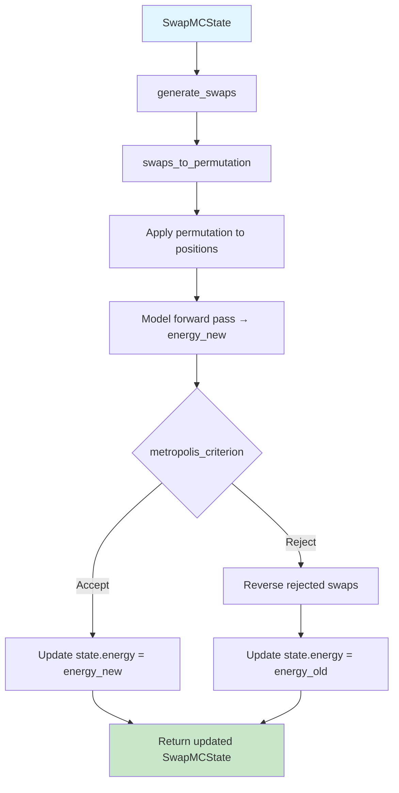
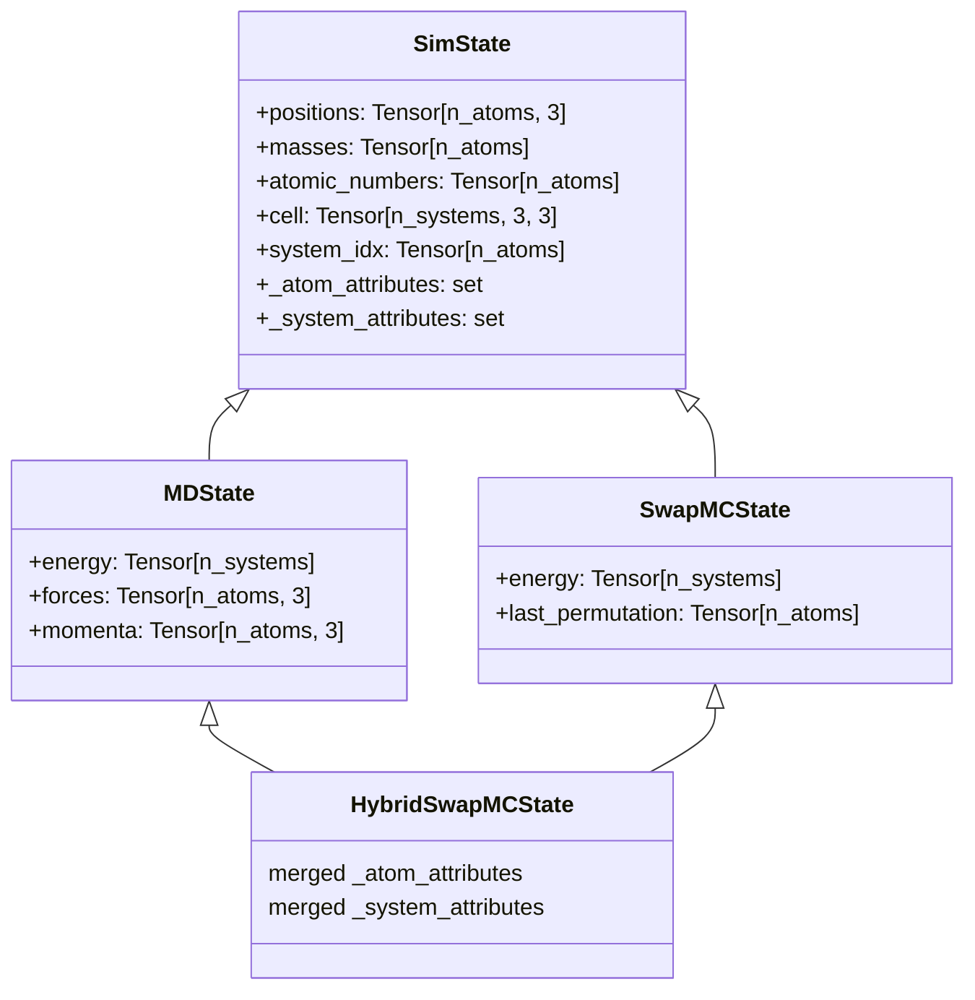

TorchSim provides a modular Monte Carlo (MC) framework for performing atom swap simulations, enabling compositional sampling in alloy and disordered material systems. This page covers the swap MC implementation, its integration with the broader TorchSim ecosystem, and how to compose hybrid simulation methods that combine Monte Carlo with molecular dynamics.

## Algorithm Overview

Swap Monte Carlo explores configurational space by exchanging atomic species at fixed lattice sites, driven by the Metropolis acceptance criterion. Unlike molecular dynamics — which moves atoms through continuous space — swap MC operates in discrete composition space, making it particularly effective for sampling phase diagrams and exploring order-disorder transitions in multicomponent systems. TorchSim's implementation is fully batched, runs on GPU via PyTorch, and composes cleanly with the existing state and model infrastructure.

The core algorithm follows a three-phase loop: propose a swap between two atoms of different species within the same system, evaluate the energy change through the MLIP model, and accept or reject using the Metropolis criterion. Rejected moves are reversed in-place so that the state always reflects the correct configuration after each step.



## SwapMCState and the State Hierarchy

`SwapMCState` extends the base [SimState](7-simstate-and-state-hierarchy) with two additional fields that are essential for Monte Carlo bookkeeping: the system energy (a per-system tensor used in the acceptance criterion) and a permutation record tracking the last applied swap for analysis and potential reversal.

Sources: [monte_carlo.py](torch_sim/monte_carlo.py#L36-L67)

| Attribute | Scope | Shape | Description |
|---|---|---|---|
| `energy` | per-system | `[n_systems]` | Total potential energy of each system, computed by the model |
| `last_permutation` | per-atom | `[n_atoms]` | Identity permutation by default; records the net effect of accepted swaps |

The `_atom_attributes` and `_system_attributes` class variables are extended from `SimState` to include `last_permutation` and `energy` respectively, which ensures that batching, splitting, slicing, and concatenation operations all handle these fields correctly. When `last_permutation` is not provided at construction, `__post_init__` initializes it to `torch.arange(n_atoms)` — an identity permutation representing no net change.

Sources: [monte_carlo.py](torch_sim/monte_carlo.py#L57-L67), [state.py](torch_sim/state.py#L155-L162)

## Core Functions

The Monte Carlo module exposes five public functions, organized into three logical layers: swap proposal, acceptance evaluation, and simulation lifecycle management.

### Swap Generation

`generate_swaps` proposes one atom-pair swap per system in the batch. It uses a two-stage sampling strategy: first, a uniform random atom is selected within each system; then, a second atom of a *different* atomic number is sampled from the remaining candidates within the same system. This is implemented by constructing per-system weight tensors where atoms matching the first selected atom's species are masked out, then applying `torch.multinomial` for sampling. The function handles ragged batches — systems with different atom counts — by computing cumulative system boundaries and iterating only to adjust same-type masks.

Sources: [monte_carlo.py](torch_sim/monte_carlo.py#L70-L128)

`swaps_to_permutation` converts a tensor of swap pairs `[n_swaps, 2]` into a single permutation vector of shape `[n_atoms]` by sequentially applying each swap to an identity permutation. This permutation can then be used to reorder any per-atom tensor (positions, masses, atomic numbers) consistently.

Sources: [monte_carlo.py](torch_sim/monte_carlo.py#L131-L154)

### Metropolis Criterion

`metropolis_criterion` implements the standard Metropolis-Hastings acceptance rule: a move is accepted with probability `min(1, exp(-ΔE / kT))`. The function operates on batched energy tensors and returns a boolean mask of shape `[batch_size]`. When `kT` is very large relative to `ΔE`, the acceptance probability approaches 1 (high-temperature limit). When `kT` approaches zero, only energy-lowering moves are accepted. A `torch.Generator` can be passed for reproducible randomness across runs.

Sources: [monte_carlo.py](torch_sim/monte_carlo.py#L157-L194)

| Scenario | `ΔE` | `kT` | Expected Behavior |
|---|---|---|---|
| Energy decreases | negative | any | Always accept |
| Energy increases, small | positive | large | Accept probabilistically |
| Energy increases, large | positive | small | Almost always reject |
| No energy change | zero | any | Always accept |

### Simulation Lifecycle

`swap_mc_init` takes a `SimState` and a model, runs a single forward pass to compute the initial energy, and returns a fully constructed `SwapMCState`. This is the entry point for setting up a swap MC simulation and follows the same init/step pattern used by all TorchSim integrators.

Sources: [monte_carlo.py](torch_sim/monte_carlo.py#L197-L235)

`swap_mc_step` executes a single Monte Carlo sweep. Internally, it calls `generate_swaps`, converts swaps to a permutation, applies the permutation to positions, evaluates the new energy, runs the Metropolis criterion, and then reverses any rejected swaps. A safety check verifies that the permutation does not cross system boundaries (atoms are only swapped within the same system). The function accepts either a `seed` (deprecated, creates a temporary generator) or a persistent `rng` generator; the latter is strongly recommended for reproducibility across multiple steps.

Sources: [monte_carlo.py](torch_sim/monte_carlo.py#L238-L296)

> [!TIP]
> **Prefer a persistent `torch.Generator` over per-step seeds.** Creating a new generator from a seed each step resets the RNG state, making the sequence deterministic but not portable across different step counts. Pass a single `torch.Generator` instance initialized once with `manual_seed()` to `swap_mc_step` for both reproducibility and efficient state management.

## Using Swap MC with the High-Level Runner

Because `swap_mc_init` and `swap_mc_step` follow the same `(init_func, step_func)` interface expected by [TorchSim's `integrate` runner](19-high-level-runners-api), swap Monte Carlo can be used as a drop-in integrator. The temperature parameter is interpreted as `kT` in energy units, consistent with the runner's internal unit conversion.

```python
import torch_sim as ts
from torch_sim.units import MetalUnits

mc_state = ts.integrate(
    system=initial_structures,
    model=mace_model,
    integrator=(ts.swap_mc_init, ts.swap_mc_step),
    n_steps=1000,
    temperature=1000,  # Kelvin → internally converted to eV via MetalUnits
    timestep=0,        # Not used by MC but required by runner signature
)
```

When using trajectory reporting with swap MC, the `TorchSimTrajectory.write_state` method **must** be called with `variable_masses=True`. This is because atom swaps exchange positions along with their associated masses (since different species have different masses), and the trajectory writer needs to know that the mass array changes between frames to store it correctly.

Sources: [monte_carlo.py](torch_sim/monte_carlo.py#L8-L10), [trajectory.py](torch_sim/trajectory.py#L882-L893)

> [!TIP]
> **Trajectory reporting caveat:** The `variable_masses=True` flag is critical. Without it, the trajectory writer assumes masses are static and will silently store only the initial mass configuration, corrupting any analysis that depends on correctly tracked species identities across swap MC frames.

## Hybrid MD-Monte Carlo Simulations

One of the most powerful capabilities unlocked by TorchSim's modular state architecture is the ability to create hybrid simulation methods. The hybrid approach alternates between NVT Langevin dynamics for local structural relaxation and swap Monte Carlo for configurational exploration, enabling efficient sampling of both positional and compositional degrees of freedom.

The hybrid tutorial demonstrates this by defining a custom `HybridSwapMCState` that uses multiple inheritance from both `SwapMCState` and `MDState`, merging the atom-level and system-level attribute registries so that all fields are correctly handled by batching and concatenation operations.

Sources: [hybrid_swap_tutorial.py](examples/tutorials/hybrid_swap_tutorial.py#L92-L112)



The following pattern shows how to construct and run a hybrid simulation:

```python
from dataclasses import dataclass
import torch
import torch_sim as ts
from torch_sim.integrators.md import MDState
from torch_sim.monte_carlo import SwapMCState
from torch_sim.units import MetalUnits

@dataclass(kw_only=True)
class HybridSwapMCState(SwapMCState, MDState):
    _atom_attributes = SwapMCState._atom_attributes | MDState._atom_attributes
    _system_attributes = SwapMCState._system_attributes | MDState._system_attributes

    def __post_init__(self):
        super().__post_init__()

kT = 1000 * MetalUnits.temperature
md_state = ts.nvt_langevin_init(state=state, model=mace_model, kT=kT)
hybrid_state = HybridSwapMCState(**md_state.attributes)

rng = torch.Generator(device=mace_model.device)
rng.manual_seed(42)

for step in range(n_steps):
    if step % 10 == 0:
        hybrid_state = ts.swap_mc_step(
            state=hybrid_state, model=mace_model, kT=kT, rng=rng
        )
    else:
        hybrid_state = ts.nvt_langevin_step(
            state=hybrid_state, model=mace_model, dt=0.002, kT=kT
        )
```

Sources: [hybrid_swap_tutorial.py](examples/tutorials/hybrid_swap_tutorial.py#L92-L169)

## Batched and Ragged System Support

The swap MC implementation fully supports TorchSim's batched execution model. Multiple independent systems are simulated simultaneously on GPU, with each system receiving its own swap proposal and independent Metropolis acceptance decision. The energy tensor has shape `[n_systems]`, and `metropolis_criterion` evaluates each system independently.

Crucially, the implementation also handles **ragged batches** — systems with different atom counts concatenated into a single flat tensor. `generate_swaps` computes per-system boundaries via `system_lengths.cumsum()` and uses these offsets to (1) mask invalid indices in weight tensors and (2) convert local atom indices to global flat indices. The test suite explicitly validates this with 2-atom and 5-atom systems batched together, running multiple iterations to stress-test boundary correctness.

Sources: [monte_carlo.py](torch_sim/monte_carlo.py#L88-L128), [test_monte_carlo.py](tests/test_monte_carlo.py#L229-L267)

## Conservation and Invariants

Two key invariants are maintained throughout swap MC simulations, both verified by the test suite:

**System integrity:** Swaps are constrained to occur only between atoms belonging to the same system. A validation check in `swap_mc_step` raises `ValueError` if a proposed permutation would map any atom to a different `system_idx`. Additionally, `generate_swaps` enforces this at the proposal level by computing per-system weight masks.

**Species conservation:** The count of each atomic number within every system is preserved across all accepted and rejected moves. Since swaps exchange positions (not atomic numbers), the `atomic_numbers` tensor is never modified — only the `positions` tensor is permuted. This means the composition of every system remains constant throughout the simulation, as verified statistically in the integration tests.

Sources: [monte_carlo.py](torch_sim/monte_carlo.py#L279-L280), [test_monte_carlo.py](tests/test_monte_carlo.py#L182-L191)

## API Reference Summary

| Function | Signature | Purpose |
|---|---|---|
| `generate_swaps` | `(state, rng=None) → Tensor[n_systems, 2]` | Propose one swap pair per system |
| `swaps_to_permutation` | `(swaps, n_atoms) → Tensor[n_atoms]` | Convert swap pairs to permutation vector |
| `metropolis_criterion` | `(energy_new, energy_old, kT, rng=None) → Tensor[bool]` | Evaluate Metropolis acceptance |
| `swap_mc_init` | `(state, model) → SwapMCState` | Initialize MC state with computed energy |
| `swap_mc_step` | `(state, model, *, kT, seed=None, rng=None) → SwapMCState` | Execute one MC sweep |

Sources: [monte_carlo.py](torch_sim/monte_carlo.py#L70-L296)

## Next Steps

- **[NVE and NVT Integrators](12-nve-and-nvt-integrators)** — Understand the MD integrators that pair with swap MC in hybrid workflows
- **[SimState and State Hierarchy](7-simstate-and-state-hierarchy)** — Deep dive into the state system that underpins `SwapMCState`
- **[High-Level Runners API](19-high-level-runners-api)** — Learn how the `integrate` runner orchestrates init/step function pairs
- **[Trajectory Storage and Reporting](20-trajectory-storage-and-reporting)** — Full details on trajectory I/O, including the `variable_masses` requirement
- **[Supported MLIP Models](10-supported-mlip-models)** — Compatible energy models for swap MC energy evaluation