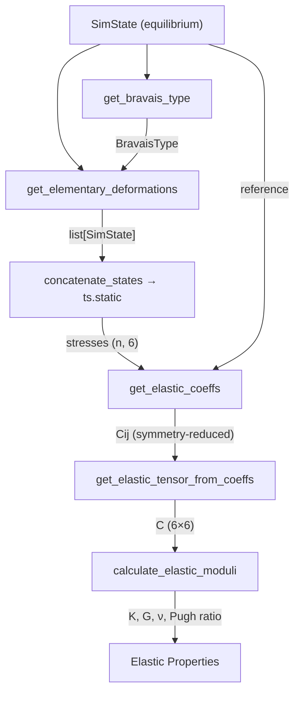
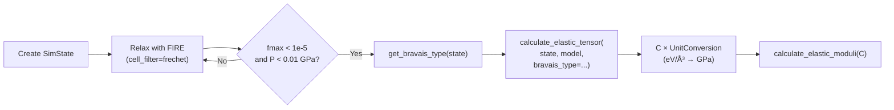

The `torch_sim.elastic` module implements a fully differentiable, GPU-accelerated pipeline for computing the second-order elastic tensor of crystals from interatomic potentials. Built on the stress–strain fitting methodology pioneered by Birch (1947) and formalized by Mouhat & Coudert (2014), the module generates symmetry-adapted deformations, evaluates stresses via any `ModelInterface`, and recovers the full 6×6 elastic stiffness tensor through least-squares regression. The entire computation chain runs as PyTorch operations on the target device, making it compatible with autograd and automatic batching strategies.

Sources: [elastic.py](/torch_sim/elastic.py#L1-L34)

## Theoretical Foundation

The elastic tensor **C** relates stress to strain through Hooke's law for anisotropic media: σᵢ = Σⱼ Cᵢⱼ εⱼ, where both σ and ε are expressed in Voigt notation as 6-component vectors mapping the symmetric 3×3 tensors. The tensor **C** is 6×6 and, by major and minor symmetries, has at most 21 independent components for a triclinic crystal. Higher crystal symmetries reduce this count—cubic systems require only 3 independent constants (C₁₁, C₁₂, C₄₄), while the full hierarchy spans all seven Bravais lattice types.

The computation follows the **Birch–Murnaghan finite-strain** approach: apply small finite deformations to the equilibrium cell, compute the resulting stress for each deformed configuration, and fit the linear stress–strain relationship. A pressure correction is applied post-hoc since the Birch coefficients Bᵢⱼ relate to the elastic constants as Cᵢⱼ = Bᵢⱼ − P·δ, where δ encodes symmetry-dependent pressure coupling.

Sources: [elastic.py](/torch_sim/elastic.py#L6-L19)

## Architecture Overview

The elastic tensor calculation decomposes into four sequential stages, each encapsulated in a dedicated function. The high-level orchestrator `calculate_elastic_tensor` chains these stages, while each stage is independently callable for custom workflows or testing.



The pipeline is fully device-aware—every intermediate tensor inherits the device and dtype of the input `SimState`, ensuring seamless GPU execution without explicit data transfers.

Sources: [elastic.py](/torch_sim/elastic.py#L1113-L1184), [elastic.py](/torch_sim/elastic.py#L896-L1016), [elastic.py](/torch_sim/elastic.py#L1017-L1112)

## Bravais Lattice Detection

The `get_bravais_type` function performs a heuristic classification of the crystal system by comparing lattice parameters (a, b, c) and interaxial angles (α, β, γ) against symmetry criteria with configurable tolerances. It operates directly on the row-vector cell matrix, extracting lengths via `torch.linalg.norm` and angles via `torch.arccos` of dot products between cell vectors.

The detection follows a priority cascade from highest symmetry to lowest, returning the first matching system:

| Priority | Crystal System | Lattice Constraints | Angle Constraints | Independent Constants |
|----------|---------------|--------------------|-------------------|-----------------------|
| 1 | Cubic | a = b = c | α = β = γ = 90° | 3 |
| 2 | Hexagonal | a = b ≠ c | α = β = 90°, γ = 120° | 5 |
| 3 | Tetragonal | a = b ≠ c | α = β = γ = 90° | 7 |
| 4 | Orthorhombic | a ≠ b ≠ c | α = β = γ = 90° | 9 |
| 5 | Monoclinic | a ≠ b ≠ c | α = γ = 90°, β ≠ 90° | 13 |
| 6 | Trigonal | a = b = c | α = β = γ ≠ 90° | 7 |
| 7 | Triclinic | a ≠ b ≠ c | α ≠ β ≠ γ ≠ 90° | 21 |

The default tolerances are `length_tol=1e-3` (Ångströms) and `angle_tol=0.1` (degrees). The hexagonal check precedes trigonal because the 120° γ-angle is the more specific discriminator for hexagonal systems where a = b.

> [!TIP]
> The detection algorithm does **not** use spglib—it relies solely on geometric heuristics. For structures very far from their idealized geometry (e.g., heavily distorted or DFT-relaxed cells with numerical noise), the tolerance values may need adjustment, or the `bravais_type` should be specified explicitly to `calculate_elastic_tensor` to bypass automatic detection.

Sources: [elastic.py](/torch_sim/elastic.py#L55-L145), [typing.py](/torch_sim/typing.py#L17-L47)

## Symmetry-Adapted Deformation Generation

The `DeformationRule` dataclass encapsulates the two ingredients that make symmetry-aware elastic calculations efficient: (1) which strain axes are non-equivalent under the crystal's point group symmetry, and (2) how to construct the stress–strain equation matrix from a given strain vector.

```python
@dataclass
class DeformationRule:
    axes: list[int]           # Non-equivalent strain axes (Voigt notation)
    symmetry_handler: Callable # Builds equation matrix from 6-component strain
```

The `get_elementary_deformations` function uses these rules to generate deformed `SimState` copies. For each non-equivalent axis, it applies `n_deform` uniformly spaced strains symmetrically around zero, with separate magnitude controls for normal (axes 0–2) and shear (axes 3–5) deformations. Normal strains default to ±0.01 and shear strains to ±0.06, reflecting the typical practice of using larger shear amplitudes to improve numerical stability.

The deformation itself is implemented by `get_cart_deformed_cell`, which constructs a Lagrangian deformation matrix **L** = **I** + Δ·**êᵢêⱼ** (where **êᵢ**, **êⱼ** depend on the axis), applies it to the cell as **M'** = **ML**, and transforms atomic positions through the fractional coordinate route: **s** = **x**·**M⁻¹**, then **x'** = **s**·**M'**.

| Crystal System | Deformed Axes | Deformations per Axis | Total Deformations (n_deform=5) |
|---------------|---------------|----------------------|-------------------------------|
| Cubic | [0, 3] | 4 | 8 |
| Hexagonal | [0, 2, 3, 5] | 4 | 16 |
| Tetragonal | [0, 2, 3, 5] | 4 | 16 |
| Orthorhombic | [0, 1, 2, 3, 4, 5] | 4 | 24 |
| Trigonal | [0, 1, 2, 3, 4, 5] | 4 | 24 |
| Monoclinic | [0, 1, 2, 3, 4, 5] | 4 | 24 |
| Triclinic | [0, 1, 2, 3, 4, 5] | 4 | 24 |

The cubic case is the most economical—only 8 deformations are needed to determine 3 independent constants, yielding a highly overdetermined system.

Sources: [elastic.py](/torch_sim/elastic.py#L36-L53), [elastic.py](/torch_sim/elastic.py#L629-L685), [elastic.py](/torch_sim/elastic.py#L686-L771)

## Strain Tensor Computation

The `get_strain` function computes the Lagrangian strain tensor in Voigt notation by evaluating ε = (**u** + **u**ᵀ)/2, where the displacement gradient **u** = **M₀⁻¹**Δ**M** is derived from the reference cell **M₀** and the cell difference Δ**M** = **M** − **M₀**. This formulation is exact for the finite deformations used in the pipeline—it is not a small-strain linearization.

The symmetric strain tensor is then serialized to a 6-component vector following the standard Voigt mapping: [εxx, εyy, εzz, εyz, εxz, εxy]. The off-diagonal shear components correctly reflect the symmetric part only; for example, a pure xy-shear deformation of size δ produces εxy = δ/2 (not δ), as confirmed by the test suite.

Sources: [elastic.py](/torch_sim/elastic.py#L773-L836), [tests/test_elastic.py](/tests/test_elastic.py#L73-L110)

## Symmetry Handler Functions

Each of the seven crystal systems has a dedicated handler that constructs a (6, n) equation matrix mapping the 6-component strain vector to the stress components. These matrices encode Hooke's law for that specific symmetry, with columns corresponding to the independent elastic constants.

The pattern is consistent across all handlers: each takes a `(6,)` strain tensor and returns a matrix where row *i* encodes the equation σᵢ = Σⱼ Mᵢⱼ·cⱼ, with cⱼ being the independent elastic constants. The shear rows always contain the factor of 2 (e.g., σyz = 2·C₄₄·εyz) consistent with the Voigt engineering convention for the elastic tensor.

| Function | Output Shape | Independent Constants |
|----------|-------------|----------------------|
| `regular_symmetry` | (6, 3) | C₁₁, C₁₂, C₄₄ |
| `hexagonal_symmetry` | (6, 5) | C₁₁, C₃₃, C₁₂, C₁₃, C₄₄ |
| `trigonal_symmetry` | (6, 7) | C₁₁, C₁₂, C₁₃, C₁₄, C₁₅, C₃₃, C₄₄ |
| `tetragonal_symmetry` | (6, 7) | C₁₁, C₁₂, C₁₃, C₁₆, C₃₃, C₄₄, C₆₆ |
| `orthorhombic_symmetry` | (6, 9) | C₁₁, C₂₂, C₃₃, C₁₂, C₁₃, C₂₃, C₄₄, C₅₅, C₆₆ |
| `monoclinic_symmetry` | (6, 13) | C₁₁–C₆₆ (13 independent) |
| `triclinic_symmetry` | (6, 21) | All 21 upper-triangular components |

Sources: [elastic.py](/torch_sim/elastic.py#L147-L627)

## Elastic Coefficient Recovery via Least Squares

The `get_elastic_coeffs` function assembles the overdetermined linear system **Ax** = **b**, where each deformation contributes 6 equations (one per stress component). The matrix **A** is built by stacking the per-deformation symmetry handler outputs, and **b** is the pressure-corrected stress vector. The system is solved via `torch.linalg.lstsq`, returning the Birch coefficients Bᵢⱼ along with residuals, rank, and singular values for diagnostics.

A critical post-processing step subtracts symmetry-dependent pressure corrections from the Birch coefficients: Cᵢⱼ = Bᵢⱼ − P·δᵢⱼ. For cubic symmetry, this gives C₁₁ = B₁₁ − P, C₁₂ = B₁₂ + P, C₄₄ = B₄₄ − P. The pressure is computed from the reference state as P = −tr(**σ**)/3.

The returned tuple provides both the corrected elastic constants and the raw least-squares diagnostics, enabling convergence analysis—large residuals may indicate insufficient deformations, excessive strain magnitudes, or structures far from equilibrium.

Sources: [elastic.py](/torch_sim/elastic.py#L896-L1016)

## Elastic Tensor Reconstruction

The `get_elastic_tensor_from_coeffs` function maps the symmetry-reduced coefficient vector back to the full 6×6 stiffness tensor. Each Bravais type has a dedicated branch that fills the upper-triangular (and by symmetry, the lower-triangular) entries according to the established elastic symmetry rules.

Notably, for hexagonal and trigonal systems, C₆₆ is not an independent constant—it is derived as (C₁₁ − C₁₂)/2 and placed directly on the diagonal. The function validates that the input vector length matches the expected number of independent constants for the given symmetry, raising a `ValueError` on mismatch.

Sources: [elastic.py](/torch_sim/elastic.py#L1017-L1112)

## Elastic Moduli: Voigt–Reuss–Hill Averaging

The `calculate_elastic_moduli` function derives four scalar elastic properties from the full 6×6 tensor using the Voigt–Reuss–Hill (VRH) averaging scheme, which provides a practical estimate for polycrystalline aggregates:

| Modulus | Voigt Bound | Reuss Bound | VRH Average |
|---------|------------|-------------|-------------|
| Bulk K | (C₁₁+C₂₂+C₃₃+2(C₁₂+C₂₃+C₃₁))/9 | 1/(S₁₁+S₂₂+S₃₃+2(S₁₂+S₂₃+S₃₁)) | (K_V + K_R)/2 |
| Shear G | (ΣCᵢᵢ−ΣCᵢⱼ+3ΣC₄₄)/15 | 15/(4ΣSᵢᵢ−4ΣSᵢⱼ+3ΣS₄₄) | (G_V + G_R)/2 |

From these, Poisson's ratio ν = (3K − 2G)/(6K + 2G) and Pugh's ratio K/G are computed as dimensionless indicators of ductility (K/G > 1.75 suggests ductile behavior). The compliance tensor **S** = **C**⁻¹ is computed via `torch.linalg.inv`.

Sources: [elastic.py](/torch_sim/elastic.py#L1185-L1238)

## High-Level API: `calculate_elastic_tensor`

The primary entry point orchestrates the full pipeline in a single call. It accepts an `OptimState` (ensuring the structure carries pre-computed stress), a `ModelInterface`, and configuration parameters:

```python
def calculate_elastic_tensor(
    state: OptimState,
    model: ModelInterface,
    *,
    bravais_type: BravaisType = BravaisType.triclinic,
    max_strain_normal: float = 0.01,
    max_strain_shear: float = 0.06,
    n_deform: int = 5,
    autobatcher: BinningAutoBatcher | bool = False,
    pbar: bool | dict[str, Any] = False,
) -> torch.Tensor
```

The function validates that the model computes stress (`model.compute_stress must be True`), concatenates all deformations into a single batched `SimState`, evaluates stresses via `ts.static`, converts each 3×3 stress to Voigt notation, and runs the coefficient fitting and tensor reconstruction. The optional `autobatcher` argument enables memory-constrained execution by splitting the deformation batch into sub-batches—useful when the number of deformations is large (e.g., triclinic systems with high `n_deform`).

Sources: [elastic.py](/torch_sim/elastic.py#L1113-L1184)

## Voigt Notation Conversion Utilities

Two utility functions handle conversion between the full 3×3 stress tensor and its 6-component Voigt representation. `voigt_6_to_full_3x3_stress` reconstructs the symmetric 3×3 matrix from a Voigt vector, while `full_3x3_to_voigt_6_stress` symmetrizes the input via (σ + σᵀ)/2 before extraction. Both preserve arbitrary batch dimensions, making them safe to use with batched simulation states.

Sources: [elastic.py](/torch_sim/elastic.py#L837-L895)

## Practical Usage Pattern

The standard workflow requires three preparatory steps before elastic tensor computation: (1) create a relaxed structure at zero pressure, (2) detect or specify the Bravais type, and (3) call the high-level API. The test suite demonstrates this pattern comprehensively with MACE models across six crystal systems.



The relaxation step is critical—the elastic tensor is defined at the equilibrium geometry. Unrelaxed structures produce meaningless results because the internal stress biases the stress–strain fit. The test suite uses the Frechet cell filter during FIRE relaxation to simultaneously optimize positions and cell shape to near-zero pressure convergence.

> [!TIP]
> Always convert the raw elastic tensor from internal units (eV/ų) to GPa using `UnitConversion.eV_per_Ang3_to_GPa` before computing moduli or comparing against literature values. The conversion factor is approximately 160.2176634 GPa per eV/ų.

Sources: [tests/test_elastic.py](/tests/test_elastic.py#L282-L354), [tests/test_elastic.py](/tests/test_elastic.py#L355-L412)

## Advanced Topics

### Symmetry Exploitation vs. Triclinic Fallback

A key design decision in this module is that specifying a higher-symmetry Bravais type **reduces the number of deformations** (and thus model evaluations) but does **not** change the recovered tensor—both approaches should yield the same 6×6 tensor within numerical tolerance. The triclinic fallback (default) deforms all six axes independently and recovers all 21 coefficients, while a cubic specification deforms only axes 0 and 3 and recovers 3 coefficients that are then expanded. The test suite verifies this equivalence for all supported crystal systems, though the absolute tolerance varies from 0.2 GPa (cubic) to 0.5 GPa (lower-symmetry systems) reflecting the increasing sensitivity of the overdetermined system to numerical noise.

### Automatic Batching for Memory-Constrained Environments

When running with large supercells or memory-intensive models, the `autobatcher` parameter enables sub-batch processing of deformations. Passing `True` activates `BinningAutoBatcher` with default settings, which dynamically determines batch sizes based on available GPU memory. This is transparent to the caller—the stresses are reassembled into a single tensor before fitting.

### Relationship to Cell Filters and Geometry Optimization

The elastic tensor calculation is closely related to the cell optimization infrastructure described in [Cell Filters and Constraints](17-cell-filters-and-constraints). Both modules manipulate the cell tensor and compute stresses, but serve different purposes: cell filters parameterize cell updates for **optimization** (minimizing energy under pressure), while the elastic module applies **finite perturbations** to measure the second-order response. The Frechet cell filter is recommended during pre-relaxation because it provides well-conditioned cell updates that converge to truly stress-free structures—prerequisite for meaningful elastic constants.
