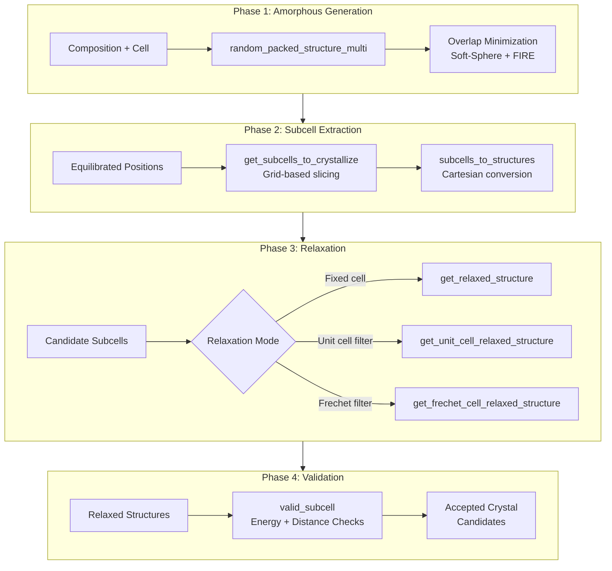

The amorphous-to-crystalline (A2C) workflow is a stochastic crystal structure prediction pipeline that transforms disordered atomic configurations into candidate crystalline phases. Rather than relying on known prototype structures, it exploits the inherent short-range order present in amorphous or liquid-like systems by systematically slicing them into subcells, relaxing each independently, and validating the resulting structures against physical and energetic criteria. The entire pipeline is implemented in [`torch_sim.workflows.a2c`](/torch_sim/workflows/a2c.py) and orchestrated through composable functions that operate on TorchSim's core `SimState` and `FireState` abstractions.

## Architectural Pipeline

The A2C workflow decomposes into four sequential phases, each exposed as an independent function. This modularity allows advanced users to substitute individual stages—for example, replacing the FIRE relaxation with L-BFGS—while preserving the overall pipeline semantics.



Each phase maps directly to one or more public functions in the module. The pipeline is deliberately stateless between phases: data flows through standard PyTorch tensors and pymatgen `Composition` objects, making it straightforward to inject checkpointing, parallelism, or custom logic at any boundary.

Sources: [a2c.py](/torch_sim/workflows/a2c.py#L1-L8)

## Phase 1: Amorphous Structure Generation

Generating a physically plausible amorphous starting structure requires two sub-problems to be solved: placing atoms at random positions within a simulation cell, and then minimizing interatomic overlaps. The module provides two generation functions—`random_packed_structure` for single-diameter systems and `random_packed_structure_multi` for multi-species systems with pairwise diameter control.

### Atomic Diameter Estimation

Before atoms can be placed, the workflow needs a notion of "too close." The module provides two helpers that derive atomic diameters from pymatgen's element database. `get_diameter` returns a single scalar for single-species compositions—using metallic radius for metals, atomic or ionic radius for non-metals. For multi-element systems, it returns the minimum pairwise ionic radius sum across all element pairs. `get_diameter_matrix` extends this to a full symmetric matrix of shape `[n_elements, n_elements]`, where off-diagonal entries represent the sum of the two elements' appropriate radii, enabling species-specific overlap control. For a compound like Fe₂O₃, the matrix captures Fe–Fe, Fe–O, and O–O separations independently.
Sources: [a2c.py](/torch_sim/workflows/a2c.py#L73-L139), [a2c.py](/torch_sim/workflows/a2c.py#L140-L209)

### Random Packing with Overlap Minimization

Both `random_packed_structure` and `random_packed_structure_multi` follow the same core algorithm. First, atoms are placed at uniformly random fractional coordinates within the cell. Then, if a diameter (or diameter matrix) is specified, the system undergoes iterative FIRE optimization against a [`SoftSphereModel`](/torch_sim/models/soft_sphere.py#L175) (or [`SoftSphereMultiModel`](/torch_sim/models/soft_sphere.py#L248)) repulsive potential. The soft-sphere potential `V(r) = ε/α · (1 - r/σ)^α` for `r < σ` generates repulsive forces that push overlapping atoms apart, while the FIRE optimizer (described in [FIRE and Gradient Descent Optimizers](15-fire-and-gradient-descent-optimizers)) provides efficient energy minimization. Convergence is declared early when the minimum interatomic distance exceeds 95% of the target diameter, making the procedure adaptive rather than wastefully running for a fixed iteration count.

The multi-species variant assigns a `species_idx` tensor mapping each atom to its element type, which is passed as `atomic_numbers` to the `SoftSphereMultiModel`. This allows the model to apply different `σ` values to different atom pairs via the `sigma_matrix`, producing physically realistic overlap resolution for heteroatomic systems.
Sources: [a2c.py](/torch_sim/workflows/a2c.py#L210-L315), [a2c.py](/torch_sim/workflows/a2c.py#L316-L433)

| Parameter | Function | Description |
|---|---|---|
| `composition` | Both | pymatgen `Composition` with integer atom counts (e.g., `Fe80B20`) |
| `cell` | Both | `3×3` tensor defining the triclinic simulation box (Å) |
| `diameter` / `diameter_matrix` | Single / Multi | Minimum allowed interatomic distance(s) (Å) |
| `auto_diameter` | Both | Auto-compute diameter(s) from pymatgen radii |
| `max_iter` | Both | Max FIRE steps for overlap minimization (default: 100) |
| `seed` | Both | Random seed for reproducibility (default: 42) |

> [!TIP]
> The `auto_diameter=True` flag delegates diameter computation to `get_diameter` or `get_diameter_matrix`, which source radii from pymatgen's element database. For exotic compositions or non-standard oxidation states, manually specifying the diameter or diameter matrix gives you precise control over the overlap tolerance.

## Phase 2: Subcell Extraction

Once a disordered structure is equilibrated, the workflow systematically extracts candidate crystalline subcells by slicing the parent structure along an orthorhombic grid in fractional coordinates. This is the core algorithmic insight of the A2C method: short-range order in an amorphous matrix often already encodes fragments of stable crystal structures, and a sufficiently dense grid will capture them.

### Grid-Based Slicing

`get_subcells_to_crystallize` generates all possible axis-aligned subcells by constructing a grid with spacing `d_frac` in fractional coordinates. For each pair of lower and upper grid bounds (where `upper > lower` in all three dimensions), it identifies atoms whose fractional positions fall within the resulting rectangular prism. Subcells are filtered by atom count (`n_min` to `n_max`) and optionally by composition. The composition filter can operate either from an explicit list of formulas (e.g., `["CuO", "Cu2O"]`) or by specifying a `max_coeff` and `elements` list to generate all stoichiometries up to a given complexity. The default `d_frac=0.05` yields a 20×20×20 grid, producing a very large candidate set for large parent cells—hence the `n_max=48` limit to keep individual relaxations tractable.

The function returns a list of tuples, each containing the atom indices, lower bounds, and upper bounds of a candidate subcell. These raw candidates are then converted to proper crystallographic structures by `subcells_to_structures`, which shifts fractional positions to the origin, scales them to the `[0, 1]` range, and computes the new cell tensor by scaling the parent cell by the subcell's fractional extent.
Sources: [a2c.py](/torch_sim/workflows/a2c.py#L505-L615), [a2c.py](/torch_sim/workflows/a2c.py#L617-L658)

| Parameter | Default | Effect |
|---|---|---|
| `d_frac` | 0.05 | Grid spacing in fractional coords; smaller = more candidates |
| `n_min` | 1 | Minimum atoms per subcell |
| `n_max` | 48 | Maximum atoms per subcell (controls relaxation cost) |
| `restrict_to_compositions` | None | Explicit formula whitelist (e.g., `["AB2"]`) |
| `max_coeff` | None | Auto-generate formulas up to this coefficient |
| `elements` | None | Required when `max_coeff` is set |

> [!TIP]
> The composition restriction parameters are critical for practical use. Without them, the grid-based extraction produces an enormous number of candidates with irrelevant stoichiometries. Always pair `max_coeff` with a chemically motivated `elements` list, or provide an explicit `restrict_to_compositions` set based on known phase diagrams.

## Phase 3: Structure Relaxation

Each candidate subcell must be relaxed to its local energy minimum before it can be evaluated as a potential crystal structure. The module provides three relaxation functions that differ in how they treat the unit cell degrees of freedom. All three use the FIRE algorithm internally and accept any `ModelInterface`—meaning MLIP models like MACE, MACE-MP, SevenNet, or classical potentials can be plugged in without modification.

### Relaxation Modes

`get_relaxed_structure` performs position-only relaxation at fixed cell parameters. This is the fastest option and appropriate when the subcell extraction already produces reasonable cell dimensions. It initializes FIRE via `ts.fire_init(state, model)` without a `cell_filter` parameter, then iterates for up to `max_iter` steps, logging energy at each step. Final pressure is computed from the virial stress tensor using [`get_pressure`](/torch_sim/quantities.py).

`get_unit_cell_relaxed_structure` enables full cell relaxation using the **unit cell filter** (`ts.CellFilter.unit`). This filter directly parameterizes the cell matrix elements as degrees of freedom and applies stress-based forces to them, allowing the lattice vectors to change shape and size freely. It tracks both energy and stress at each step, making it suitable for monitoring convergence of both atomic and cell forces simultaneously.

`get_frechet_cell_relaxed_structure` uses the **Frechet cell filter** (`ts.CellFilter.frechet`), which parameterizes cell deformations through a logarithmic deformation gradient in the Lie algebra of GL(3). This approach naturally handles large deformations and preserves positive-definiteness of the cell matrix. Both cell relaxation functions accept optional `hydrostatic_strain`, `constant_volume`, and `scalar_pressure` parameters passed through to the cell filter initialization, enabling equilibration at specific thermodynamic conditions.

All three functions return a tuple of `(FireState, logger_dict, final_energy_list, final_pressure_list)`, where the logger contains per-step energy (and stress for cell-relaxed modes) trajectories useful for convergence analysis.
Sources: [a2c.py](/torch_sim/workflows/a2c.py#L685-L756), [a2c.py](/torch_sim/workflows/a2c.py#L757-L828), [a2c.py](/torch_sim/workflows/a2c.py#L830-L893)

| Function | Cell DOFs | Cell Filter | Stress Tracking |
|---|---|---|---|
| `get_relaxed_structure` | Fixed | None | Post-hoc only |
| `get_unit_cell_relaxed_structure` | Free | `CellFilter.unit` | Per-step |
| `get_frechet_cell_relaxed_structure` | Free | `CellFilter.frechet` | Per-step |

## Phase 4: Structure Validation

After relaxation, each candidate must pass `valid_subcell`—a multi-criteria gate that rejects unphysical structures before they enter downstream analysis. The function applies four independent checks using both energetic and geometric criteria.

The **formation energy check** rejects structures with `final_energy < e_form_lower_limit` (default −5.0 eV/atom), catching cases where the MLIP extrapolates into unphysical energy wells. The **energy decrease check** verifies that `final_energy ≥ initial_energy + e_tol`, ensuring the optimization actually reduced the energy (rather than diverging or stagnating). The **upper energy check** requires `final_energy ≤ fe_upper_limit + e_tol`, filtering out structures that remain at high energy after relaxation. Finally, the **atomic fusion check** uses `min_distance` with periodic boundary conditions to ensure no two atoms are closer than `fusion_distance` (default 1.5 Å), detecting catastrophic structural collapse. A structure must pass all four checks to be accepted.
Sources: [a2c.py](/torch_sim/workflows/a2c.py#L435-L504)

| Criterion | Parameter | Default | Rejects If |
|---|---|---|---|
| Formation energy floor | `e_form_lower_limit` | −5.0 eV/atom | Energy too negative (unphysical) |
| Energy decrease | `e_tol` | 0.001 eV | Optimization didn't lower energy |
| Final energy ceiling | `fe_upper_limit` | 0.0 eV/atom | Energy still too high |
| Atomic fusion | `fusion_distance` | 1.5 Å | Any atom pair closer than threshold |

## Temperature Scheduling

`get_target_temperature` implements a simple three-stage thermal profile: equilibration at `T_high`, linear cooling to `T_low`, and hold at `T_low`. This is designed for melt-quench workflows where an amorphous structure is first equilibrated at high temperature, then slowly cooled to allow crystalline nuclei to form. The step-based interface makes it straightforward to call inside any simulation loop—whether NVT, NPT, or custom integrators. During the cooling phase, temperature decreases linearly: `T = T_low + (T_high − T_low) × (1 − (step − equi_steps) / cool_steps)`. After cooling completes, the temperature remains at `T_low` indefinitely.
Sources: [a2c.py](/torch_sim/workflows/a2c.py#L661-L683)

| Stage | Step Range | Temperature |
|---|---|---|
| Equilibration | `0 ≤ step < equi_steps` | `T_high` |
| Cooling | `equi_steps ≤ step < equi_steps + cool_steps` | Linear `T_high` → `T_low` |
| Hold | `step ≥ equi_steps + cool_steps` | `T_low` |

## Minimum Distance Calculation

`min_distance` is a primitive utility that computes the smallest non-zero interatomic distance in a periodic system. It leverages [`transforms.get_pair_displacements`](/torch_sim/transforms.py) to obtain all pairwise displacement vectors (respecting periodic boundary conditions), extracts the scalar distances, masks out self-interactions below `distance_tolerance`, and returns the minimum of the remaining values. This function is used both in the overlap minimization convergence check during structure generation and in the atomic fusion detection during validation. The default `distance_tolerance=0.0001 Å` is set well below any physically meaningful bond length, ensuring that only true self-interactions are excluded.
Sources: [a2c.py](/torch_sim/workflows/a2c.py#L26-L71)

## Composing the Full Workflow

The following example demonstrates how to assemble the complete A2C pipeline for a binary Fe₂O₃ system. Each phase is a function call with explicit inputs and outputs, making the workflow easy to introspect and debug.

```python
import torch
from pymatgen.core import Composition
import torch_sim as ts
from torch_sim.workflows.a2c import (
    random_packed_structure_multi,
    get_subcells_to_crystallize,
    subcells_to_structures,
    get_frechet_cell_relaxed_structure,
    valid_subcell,
    get_target_temperature,
)

# Phase 1: Generate amorphous structure
composition = Composition("Fe40O60")
cell = torch.eye(3, dtype=torch.float32) * 12.0  # 12 Å cubic cell
state = random_packed_structure_multi(
    composition, cell, auto_diameter=True, seed=42, device="cpu"
)

# Phase 2: Extract subcell candidates
frac_pos = ts.transforms.get_fractional_coordinates(state.positions, cell)
species = ["Fe"] * 40 + ["O"] * 60
candidates = get_subcells_to_crystallize(
    frac_pos, species, d_frac=0.1, n_min=4, n_max=24,
    restrict_to_compositions=["Fe2O3"], max_coeff=3,
    elements=["Fe", "O"]
)
subcells = subcells_to_structures(candidates, frac_pos, cell, species)

# Phase 3 & 4: Relax and validate each subcell
accepted = []
model = your_mlip_model  # Any ModelInterface
for frac, subcell, sp in subcells:
    sub_state = ts.SimState(
        positions=torch.matmul(frac, subcell),
        cell=subcell,
        atomic_numbers=torch.tensor([...]),  # map species to Z
        masses=torch.tensor([...]),
        pbc=True,
    )
    relaxed, logger, e_final, p_final = get_frechet_cell_relaxed_structure(
        sub_state, model, max_iter=200
    )
    if valid_subcell(relaxed.positions, relaxed.cell, 0.0, e_final[0]):
        accepted.append(relaxed)
```

## Navigating Further

- [FIRE and Gradient Descent Optimizers](15-fire-and-gradient-descent-optimizers) — deep dive into the FIRE algorithm used throughout this workflow
- [L-BFGS and BFGS Quasi-Newton Methods](16-l-bfgs-and-bfgs-quasi-newton-methods) — alternative relaxation strategies for subcell optimization
- [Cell Filters and Constraints](17-cell-filters-and-constraints) — detailed explanation of unit vs. Frechet cell filter behavior
- [Classical Potential Models](11-classical-potential-models) — soft-sphere potential internals used during overlap minimization
- [SimState and State Hierarchy](7-simstate-and-state-hierarchy) — the core state object that all workflow functions consume and produce