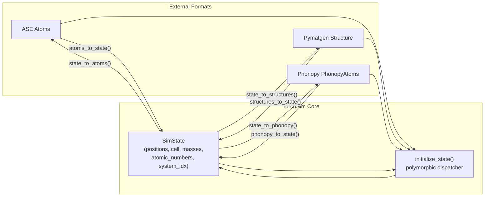
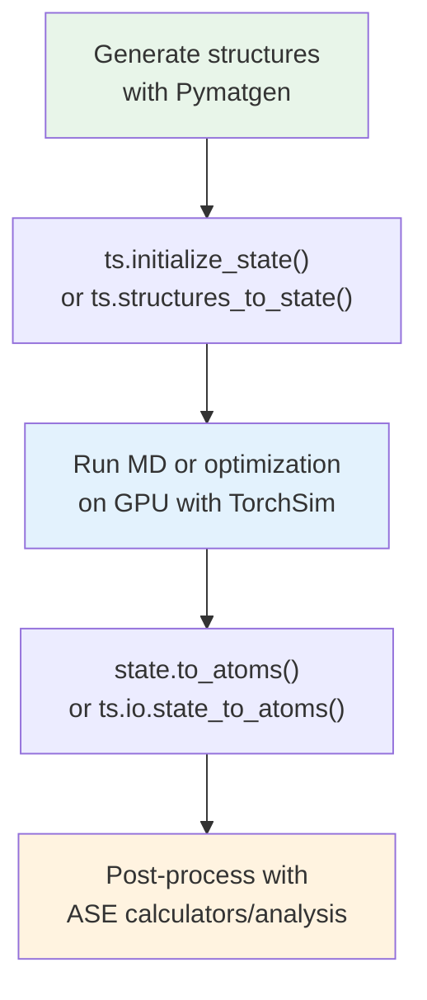

TorchSim is designed not as an isolated simulation engine, but as a bridge that slots into the existing Python materials science ecosystem. Its core `SimState` object can be converted to and from the three dominant atomistic representations—**ASE `Atoms`**, **Pymatgen `Structure`**, and **Phonopy `PhonopyAtoms`**—enabling you to prepare structures with Pymatgen, simulate them in TorchSim on GPU, and post-process or export the results with any of these libraries. This page documents the conversion architecture, the critical cell convention difference, batched conversion patterns, and the edge cases you will encounter in practice.

## The Conversion Architecture

All interop logic lives in a single module, [`torch_sim/io.py`](torch_sim/io.py), which provides six conversion functions organized as three symmetric pairs. Each pair maps between `SimState` and one external format. These functions are the only place in the codebase where ASE, Pymatgen, or Phonopy types appear directly in function signatures—everything else in TorchSim operates exclusively on `SimState`.



The polymorphic entry point [`initialize_state()`](torch_sim/state.py#L1199-L1267) inspects the runtime type of its argument and dispatches to the correct converter automatically. It accepts a single object or a list of objects of any supported type, making it the preferred API for most workflows.

Sources: [torch_sim/io.py](torch_sim/io.py#L1-L13), [torch_sim/state.py](torch_sim/state.py#L1199-L1234)

## Conversion Function Reference

Each conversion pair follows an identical structural pattern: the *to-state* functions accept either a single object or a list, concatenate per-atom properties (positions, masses, atomic numbers) along the atom dimension, stack per-system properties (cell) along the batch dimension, and generate a `system_idx` tensor via `torch.repeat_interleave`. The *from-state* functions reverse this process by iterating over unique system indices and splitting the concatenated tensors.

| From External → SimState | SimState → To External | External Package |
|---|---|---|
| `atoms_to_state()` | `state_to_atoms()` | ASE |
| `structures_to_state()` | `state_to_structures()` | Pymatgen |
| `phonopy_to_state()` | `state_to_phonopy()` | Phonopy |

All *to-state* functions share the same signature pattern: they accept the external object (or list), a `device`, and a `dtype`, returning a `SimState`. All *from-state* functions accept a `SimState` and return a `list` of the external objects—one per system in the batch.

Sources: [torch_sim/io.py](torch_sim/io.py#L243-L317), [torch_sim/io.py](torch_sim/io.py#L325-L398), [torch_sim/io.py](torch_sim/io.py#L406-L486)

## The Cell Convention Transposition

The single most important detail in TorchSim's interop layer is the **cell matrix transposition**. ASE and Pymatgen store the unit cell as a **row-vector matrix** where each row is a lattice vector: `[[ax, ay, az], [bx, by, bz], [cx, cy, cz]]`. TorchSim uses a **column-vector convention** where each column is a lattice vector: `[[ax, bx, cx], [ay, by, cy], [az, bz, cz]]`. The two representations are transposes of each other.

This transposition happens silently inside every conversion function. When converting *to* `SimState`, the cell is transposed (`.T`) during construction ([`atoms_to_state` line 288](torch_sim/io.py#L287-L289), [`structures_to_state` line 361](torch_sim/io.py#L360-L362)). When converting *from* `SimState`, the cell is transposed back ([`state_to_atoms` line 82](torch_sim/io.py#L82), [`state_to_structures` line 152](torch_sim/io.py#L152)). The `SimState` class itself exposes both conventions through the `column_vector_cell` and `row_vector_cell` properties for direct access when needed ([`state.py` lines 306–331](torch_sim/state.py#L306-L331)).

> [!TIP]
> If you bypass the `io` module and construct a `SimState` manually from ASE or Pymatgen data, you **must** transpose the cell yourself. Forgetting this transposition will produce incorrect neighbor lists and forces without any obvious error message—the simulation will simply give wrong results.

Sources: [torch_sim/state.py](torch_sim/state.py#L88-L92), [torch_sim/io.py](torch_sim/io.py#L287-L289), [torch_sim/io.py](torch_sim/io.py#L82)

## Working with ASE Atoms

ASE `Atoms` is the most feature-rich conversion partner. The *to-state* path reads `positions`, `cell`, `atomic_numbers`, `masses`, and `pbc` directly from the `Atoms` object. It also extracts `charge` and `spin` from `atoms.info` (defaulting to 0.0 if absent), which is critical for molecular MLIP models like FairChem that require per-system charge states ([`atoms_to_state` lines 301–306](torch_sim/io.py#L301-L306)).

On the reverse path, [`state_to_atoms()`](torch_sim/io.py#L35-L102) reconstructs `Atoms` objects by converting atomic numbers to chemical symbols via `ase.data.chemical_symbols`, transposing the cell back to ASE's row-vector convention, and writing `charge` and `spin` back into `atoms.info` as integers for FairChem compatibility ([lines 94–98](torch_sim/io.py#L94-L98)). All tensors are detached and moved to CPU before conversion to NumPy arrays.

```python
import torch
import torch_sim as ts

# Single Atoms → SimState
from ase.build import bulk
si_atoms = bulk("Si", "diamond", a=5.43)
state = ts.io.atoms_to_state(si_atoms, device="cuda", dtype=torch.float64)

# SimState → list of Atoms
atoms_list = ts.io.state_to_atoms(state)
assert len(atoms_list) == 1

# Batched: list of Atoms → single batched SimState
batch = [si_atoms, si_atoms]
batched_state = ts.io.atoms_to_state(batch, device="cuda", dtype=torch.float64)
assert batched_state.n_systems == 2
assert batched_state.n_atoms == 16
```

Sources: [torch_sim/io.py](torch_sim/io.py#L35-L102), [torch_sim/io.py](torch_sim/io.py#L243-L317)

## Working with Pymatgen Structures

Pymatgen `Structure` objects are converted through [`structures_to_state()`](torch_sim/io.py#L325-L398) and [`state_to_structures()`](torch_sim/io.py#L110-L173). The conversion extracts per-site data—`cart_coords`, `specie.atomic_mass`, and `specie.number`—and uses the `lattice.matrix` for the cell. Pymatgen's `pbc` attribute is read per-structure and validated for consistency across a batch ([line 384](torch_sim/io.py#L383-L385)).

The reverse path creates `pymatgen.core.Structure` objects using Cartesian coordinates (`coords_are_cartesian=True`) and constructs a `Lattice` from the transposed cell matrix. The `pbc` tuple is passed directly to the `Lattice` constructor ([lines 165–166](torch_sim/io.py#L165-L166)).

```python
from pymatgen.core import Structure, Lattice

# Create a structure
lattice = Lattice.cubic(5.43)
structure = Structure(lattice, ["Si", "Si"], [[0, 0, 0], [0.25, 0.25, 0.25]])

# Convert to SimState
state = ts.io.structures_to_state(structure, device="cuda", dtype=torch.float64)

# Convert back
structures = ts.io.state_to_structures(state)
```

Sources: [torch_sim/io.py](torch_sim/io.py#L110-L173), [torch_sim/io.py](torch_sim/io.py#L325-L398)

## Working with Phonopy Atoms

Phonopy interop follows the same pattern but has one notable simplification: `PhonopyAtoms` objects **do not carry a `pbc` attribute** for supercells. The conversion function therefore **assumes `pbc=True`** for all systems ([`phonopy_to_state` line 483](torch_sim/io.py#L483-L486)). This is consistent with Phonopy's own internal assumption for crystal phonon calculations. The [`state_to_phonopy()`](torch_sim/io.py#L186-L235) function similarly ignores the `SimState`'s `pbc` attribute when constructing `PhonopyAtoms`, since Phonopy always assumes periodic boundaries ([line 228–229](torch_sim/io.py#L228-L229)).

Sources: [torch_sim/io.py](torch_sim/io.py#L406-L486), [torch_sim/io.py](torch_sim/io.py#L186-L235)

## Batched Conversions and System Indexing

A defining feature of TorchSim's IO layer is that **batching is handled automatically and transparently**. When you pass a list of structures to any `*_to_state` function, the resulting `SimState` concatenates all atoms from all systems into flat `(n_total_atoms, 3)` tensors while maintaining a `system_idx` mapping tensor. This is the same layout TorchSim uses internally for all GPU-accelerated computations.

The `system_idx` tensor is constructed using `torch.repeat_interleave` in every to-state converter. For example, with two systems of 8 atoms each, `system_idx` becomes `[0,0,0,0,0,0,0,0,1,1,1,1,1,1,1,1]`. On the reverse conversion, `np.unique(system_indices)` splits the batch back into individual objects ([`state_to_atoms` line 78](torch_sim/io.py#L78)).

```python
# Heterogeneous batching: different structures, different sizes
struct_a = Structure(Lattice.cubic(3.0), ["Al"], [[0, 0, 0]])
struct_b = Structure(Lattice.cubic(4.0), ["Cu", "Cu"], [[0, 0, 0], [0.5, 0.5, 0.5]])
struct_c = Structure(Lattice.cubic(5.0), ["Au"] * 4, [(i/4,)*3 for i in range(4)])

# Single call produces one batched SimState
state = ts.structures_to_state([struct_a, struct_b, struct_c], device="cuda")
assert state.n_systems == 3
assert state.n_atoms == 7  # 1 + 2 + 4

# Individual systems are extractable via slicing
first_system = state[0]
assert first_system.n_atoms == 1
```

> [!TIP]
> All systems in a single batched `SimState` must share the same periodic boundary conditions. The `atoms_to_state` and `structures_to_state` functions validate this and raise a `ValueError` if the PBC flags are inconsistent across the input list ([`atoms_to_state` line 298](torch_sim/io.py#L297-L299)). This is a deliberate design choice to keep the `pbc` tensor shape minimal at `(3,)` rather than `(n_systems, 3)`.

Sources: [torch_sim/io.py](torch_sim/io.py#L291-L295), [torch_sim/io.py](torch_sim/io.py#L78), [torch_sim/io.py](torch_sim/io.py#L297-L299)

## The `initialize_state()` Polymorphic Dispatcher

For most user-facing code, you should use [`ts.initialize_state()`](torch_sim/state.py#L1199-L1267) rather than calling the individual conversion functions directly. This function inspects the type of its argument at runtime and dispatches to the appropriate converter:

```python
# All of these work identically:
state1 = ts.initialize_state(si_atoms, device="cuda", dtype=torch.float64)        # ASE
state2 = ts.initialize_state(si_structure, device="cuda", dtype=torch.float64)    # Pymatgen
state3 = ts.initialize_state(si_phonopy, device="cuda", dtype=torch.float64)      # Phonopy
state4 = ts.initialize_state(existing_state, device="cuda", dtype=torch.float64)  # SimState (cloned)
state5 = ts.initialize_state([s1, s2, s3], device="cuda", dtype=torch.float64)   # List of any type
```

The dispatcher tries converters in order—Pymatgen, ASE, then Phonopy—using `importlib.import_module` with silent `ImportError` handling, so it gracefully skips packages that are not installed ([lines 1230–1248](torch_sim/state.py#L1230-L1248)). If the input is already a `SimState`, it returns a clone moved to the specified device and dtype ([line 1224](torch_sim/state.py#L1223-L1224)). A list of `SimState` objects is concatenated via [`ts.concatenate_states()`](torch_sim/state.py#L1054) ([line 1228](torch_sim/state.py#L1226-L1228)).

Sources: [torch_sim/state.py](torch_sim/state.py#L1199-L1267)

## Unit System Consistency

TorchSim uses the **Metal unit system** throughout: distances in Å, energies in eV, masses in amu, forces in eV/Å, and stress in bar. These are defined in [`torch_sim/units.py`](torch_sim/units.py#L84-L103) and align exactly with ASE's default units and Pymatgen's standard representation. Because all three libraries share the same unit conventions, **no unit conversion is performed during IO operations**—the numeric values pass through unchanged. The only transformation applied is the cell transposition described above.

Sources: [torch_sim/units.py](torch_sim/units.py#L84-L103)

## Edge Cases and Gotchas

**Mass round-trip fidelity**: While positions, cells, and atomic numbers round-trip exactly (verified by parametrized tests across 8 different material systems), masses do not always round-trip precisely for Pymatgen and Phonopy conversions. Both libraries use their own isotope-averaged mass tables rather than the values stored in `SimState`. The test suite explicitly documents this: `# TODO: masses round trip for pmg and phonopy masses is not exact` ([test_io.py line 258](tests/test_io.py#L257-L261)). ASE's `Atoms` round-trips masses exactly because `atoms_to_state` reads masses directly from `at.get_masses()` and `state_to_atoms` reconstructs `Atoms` without modifying masses.

**Charge and spin are ASE-only metadata**: The `charge` and `spin` fields on `SimState` are populated only when converting from ASE `Atoms` (read from `atoms.info`) and preserved only when converting back to ASE. Pymatgen `Structure` and Phonopy `PhonopyAtoms` conversions do not transfer these fields—`charge` and `spin` default to zero tensors in the resulting `SimState`.

**Non-periodic systems**: Phonopy conversions always assume periodic boundaries. For non-periodic molecular systems, use ASE or Pymatgen as your input format. The round-trip test suite currently excludes non-PBC systems like benzene (`# TODO: round trip benzene/non-pbc systems`, [test_io.py line 217](tests/test_io.py#L217)).

**Graceful dependency handling**: All six conversion functions use lazy imports inside `try/except` blocks. If ASE, Pymatgen, or Phonopy is not installed, the function raises a clear `ImportError` with a descriptive message rather than failing at module load time ([e.g., line 55–56](torch_sim/io.py#L52-L56)). This means you can use TorchSim with only a subset of these packages installed.

Sources: [tests/test_io.py](tests/test_io.py#L205-L261), [torch_sim/io.py](torch_sim/io.py#L52-L56), [torch_sim/io.py](torch_sim/io.py#L301-L306)

## SimState Convenience Methods

The `SimState` class exposes three convenience methods that delegate directly to the `io` module, providing a more object-oriented conversion API:

| Method | Delegates To | Returns |
|---|---|---|
| `state.to_atoms()` | `ts.io.state_to_atoms(self)` | `list[Atoms]` |
| `state.to_structures()` | `ts.io.state_to_structures(self)` | `list[Structure]` |
| `state.to_phonopy()` | `ts.io.state_to_phonopy(self)` | `list[PhonopyAtoms]` |

These are defined at [`state.py` lines 494–516](torch_sim/state.py#L494-L516). Note that the *to-state* direction has no corresponding method on external objects—you must use either `ts.io.atoms_to_state()` or `ts.initialize_state()`.

Sources: [torch_sim/state.py](torch_sim/state.py#L494-L516)

## Typical Interop Workflow

The following flowchart illustrates a common workflow where structures originate in Pymatgen, get simulated in TorchSim, and results are exported back to ASE for downstream analysis:



For a complete example of this pattern in action, see the [High-Level Runners API](19-high-level-runners-api) documentation, which demonstrates how `initialize_state()` is used as the universal entry point in production simulation pipelines.

## Next Steps

- **[SimState and State Hierarchy](7-simstate-and-state-hierarchy)**: Understand the `SimState` dataclass internals that underpin all conversions
- **[Model Interface and Adapters](9-model-interface-and-adapters)**: Learn how models consume the `SimState` produced by these converters
- **[High-Level Runners API](19-high-level-runners-api)**: See `initialize_state()` used in end-to-end simulation workflows