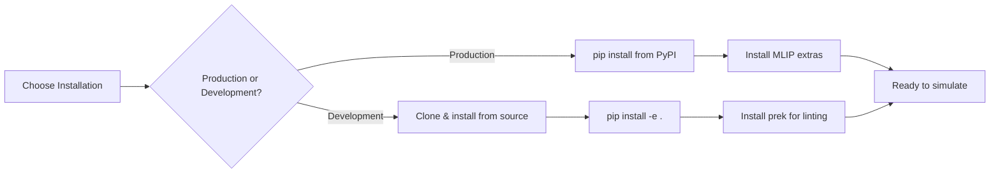
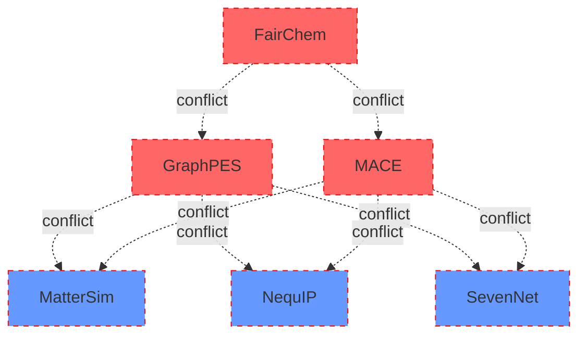

This page walks you through installing TorchSim and configuring your first model — whether it is a production-grade machine learning interatomic potential (MLIP) or a lightweight classical potential for prototyping. By the end, you will have a working simulation pipeline ready to run batched molecular dynamics or geometry optimizations.

## Prerequisites

TorchSim requires **Python 3.12 or later** and **PyTorch 2.0+**. Because TorchSim compiles no native extensions itself, the main prerequisite is simply having a compatible PyTorch installation that matches your CUDA version when running on GPU. You can verify your environment with:

```bash
python -c "import torch; print(torch.__version__, torch.cuda.is_available())"
```

The project targets three Python versions — 3.12, 3.13, and 3.14 — as declared in its classifier metadata.

Sources: [pyproject.toml](pyproject.toml#L18-L28)

## Installation Methods

TorchSim offers two primary installation paths. Choose the one that matches your workflow.



### Installing from PyPI

The recommended approach for most users is a single pip command. The base package includes the simulation engine, classical potentials (Lennard-Jones, Morse, soft sphere, particle life), and the pair potential framework — everything you need to start simulating immediately without any MLIP dependency:

```bash
pip install torch-sim-atomistic
```

Sources: [README.md](README.md#L108-L112), [pyproject.toml](pyproject.toml#L29-L37)

### Installing from Source

If you want the latest unreleased features or plan to contribute, install in editable mode from a cloned repository:

```bash
git clone https://github.com/TorchSim/torch-sim
cd torch-sim
pip install -e .
```

The build backend is `uv_build`, so you need `uv` (version 0.7.12+) available if building from an sdist. For contributor workflows, installing the `prek` pre-commit hooks ensures that every commit passes ruff linting and ty type checking:

```bash
prek install
```

Sources: [docs/dev/dev_install.md](docs/dev/dev_install.md#L15-L21), [pyproject.toml](pyproject.toml#L79-L85)

### Verifying the Installation

After installation, confirm that TorchSim loads correctly and can access the GPU:

```py
import torch_sim as ts
print(f"TorchSim {ts.__version__} loaded successfully")
```

## Installing MLIP Model Extras

MLIP models are distributed as **optional extras** to keep the base installation lightweight. Each model has its own dependency group, so you install only what you need. All extras follow the same pattern:

```bash
pip install torch-sim-atomistic[<model_name>]
```

The following table lists every supported MLIP model, its pip extra, the upstream package it pulls in, and a minimal initialization snippet.

| Model | Extra | Upstream Package | Install Command |
|-------|-------|-----------------|-----------------|
| **MACE** | `mace` | `mace-torch>=0.3.15` | `pip install torch-sim-atomistic[mace]` |
| **FairChem** | `fairchem` | `fairchem-core>=2.7` | `pip install torch-sim-atomistic[fairchem]` |
| **SevenNet** | `sevennet` | `sevenn[torchsim]>=0.12.1` | `pip install torch-sim-atomistic[sevennet]` |
| **MatterSim** | `mattersim` | `mattersim>=0.1.2` | `pip install torch-sim-atomistic[mattersim]` |
| **Metatomic** | `metatomic` | `metatomic-torch>=0.1.3` | `pip install torch-sim-atomistic[metatomic]` |
| **ORB** | `orb` | `orb-models>=0.6.0` | `pip install torch-sim-atomistic[orb]` |
| **GraphPES** | `graphpes` | `graph-pes>=0.1`, `mace-torch>=0.3.12` | `pip install torch-sim-atomistic[graphpes]` |
| **NequIP** | `nequip` | `nequip>=0.17.0` | `pip install torch-sim-atomistic[nequip]` |

Beyond MLIPs, two additional extras provide interoperability and symmetry analysis:

| Extra | Purpose | Dependencies |
|-------|---------|-------------|
| `io` | ASE, Pymatgen, Phonopy integration | `ase>=3.26`, `phonopy>=2.37.0`, `pymatgen>=2025.6.14` |
| `symmetry` | Crystal symmetry operations | `moyopy>=0.7.8` |

Sources: [pyproject.toml](pyproject.toml#L39-L74)

> [!TIP]
> **Multiple extras at once:** You can combine extras in a single install: `pip install torch-sim-atomistic[mace,io,symmetry]`. However, see the next section carefully — some MLIP extras are mutually exclusive due to incompatible `e3nn` versions.

### Understanding Extra Conflicts

Several MLIP extras depend on different versions of the `e3nn` library, making them **mutually exclusive**. The project explicitly declares these conflicts in its configuration so that package managers like `uv` will warn or error if you attempt an impossible combination:



The conflict groups partition the MLIP landscape into two clusters that cannot coexist in the same environment:

| Cluster | Compatible Extras |
|---------|------------------|
| **Cluster A** (fairchem side) | `fairchem` alone (no other MLIPs) |
| **Cluster B** (mace/graphpes side) | Any subset of `{mace, graphpes, mattersim, sevennet, nequip}` — but `graphpes` also conflicts with `mattersim`, `nequip`, and `sevennet` |
| **Independent** | `metatomic`, `orb` — no conflicts with any other extra |

The practical takeaway: **pick one MLIP per virtual environment**, or use `metatomic`/`orb` which have no conflicts. If you need to switch between conflicting models, use separate conda environments or virtualenvs.

Sources: [pyproject.toml](pyproject.toml#L142-L186)

## Setting Up Your First Model

All models in TorchSim implement the `ModelInterface` abstract base class, which inherits from `torch.nn.Module`. Every model's `forward()` method accepts a `SimState` and returns a dictionary containing at minimum `"energy"` (shape `[n_systems]`) and `"forces"` (shape `[n_atoms, 3]`), with optional `"stress"` (shape `[n_systems, 3, 3]`). This uniform interface means you can swap any model into the same simulation pipeline without code changes.


### Classical Potentials (No Extra Install Required)

Classical potentials ship with the base package and require zero additional dependencies. They are ideal for testing, prototyping, and educational use.

**Lennard-Jones** models pairwise van der Waals interactions with the standard 12-6 form:

```py
import torch
import torch_sim as ts

# No extra install needed — ships with base package
model = ts.models.LennardJonesModel(
    sigma=3.405,    # Å (argon-like)
    epsilon=0.0104,  # eV
    device=torch.device("cuda" if torch.cuda.is_available() else "cpu"),
)
```

**Morse** potentials add an exponential decay term useful for modeling bond stretching:

```py
model = ts.models.MorseModel(
    sigma=2.55,     # equilibrium distance (Å)
    epsilon=0.436,  # well depth (eV)
    alpha=1.359,    # width parameter
)
```

**Soft Sphere** potentials provide a purely repulsive interaction, useful for granular and hard-sphere simulations:

```py
model = ts.models.SoftSphereModel(
    sigma=1.0,
    epsilon=1.0,
    alpha=2.0,      # steepness of repulsion
)
```

For **multi-component systems** with species-dependent parameters, use `SoftSphereMultiModel` which accepts full interaction matrices:

```py
model = ts.models.SoftSphereMultiModel(
    atomic_numbers=torch.tensor([18, 36]),  # Ar, Kr
    sigma_matrix=torch.tensor([[1.0, 0.8], [0.8, 0.6]]),
    epsilon_matrix=torch.tensor([[1.0, 0.5], [0.5, 2.0]]),
)
```

For fully **custom pair potentials**, the `PairPotentialModel` framework accepts any Python function matching the signature `pair_fn(distances, atomic_numbers_i, atomic_numbers_j) -> pair_energies` and automatically computes forces via autograd:

```py
import functools

def bmhtf_pair(dr, zi, zj, A, B, C, D, sigma):
    """Born-Meyer-Huggins-Tosi-Fumi ionic potential."""
    exp_term = A * torch.exp(B * (sigma - dr))
    r6_term = C / dr.pow(6)
    r8_term = D / dr.pow(8)
    return torch.where(dr > 0, exp_term - r6_term - r8_term, torch.zeros_like(dr))

fn = functools.partial(bmhtf_pair, A=20.35, B=3.15, C=674.48, D=837.08, sigma=2.755)
model = ts.models.PairPotentialModel(pair_fn=fn, cutoff=10.0)
```

Sources: [torch_sim/models/lennard_jones.py](torch_sim/models/lennard_jones.py#L74-L107), [torch_sim/models/morse.py](torch_sim/models/morse.py#L78-L112), [torch_sim/models/soft_sphere.py](torch_sim/models/soft_sphere.py#L175-L209), [torch_sim/models/pair_potential.py](torch_sim/models/pair_potential.py#L283-L321)

### MLIP Models

Each MLIP wrapper follows a similar pattern: install the extra, load the upstream model, and wrap it in the TorchSim adapter. Below are setup examples for the most commonly used models.

**MACE** — high-accuracy equivariant architecture supporting both checkpoint files and in-memory `torch.nn.Module` objects. It supports optional CuEq acceleration for faster inference:

```py
pip install torch-sim-atomistic[mace]
```

```py
from mace.calculators.foundations_models import mace_mp
from torch_sim.models.mace import MaceModel

# Load a pretrained MACE foundation model
mace = mace_mp(model="small", return_raw_model=True)
model = MaceModel(
    model=mace,
    device=torch.device("cuda"),
    dtype=torch.float64,
    compute_stress=True,    # needed for NPT simulations
    enable_cueq=False,      # set True for CuEq acceleration
)
```

**FairChem** — supports pretrained model names and local checkpoint paths, using an optimized batch predictor API:

```py
pip install torch-sim-atomistic[fairchem]
```

```py
from torch_sim.models.fairchem import FairChemModel

model = FairChemModel(
    model="EquiformerV2-31M-S2EF-OC20-All-MD",  # pretrained name
    device=torch.device("cuda"),
    compute_stress=True,
)
```

**SevenNet** and **ORB** follow a re-export pattern — the actual `ModelInterface` implementation lives in the upstream package, and TorchSim re-exports it with backward-compatible naming:

```py
pip install torch-sim-atomistic[sevennet]
```

```py
from torch_sim.models import SevenNetModel

model = SevenNetModel(device=torch.device("cuda"))
```

```py
pip install torch-sim-atomistic[orb]
```

```py
from torch_sim.models import OrbModel

model = OrbModel(device=torch.device("cuda"))
```

**Metatomic** — supports the pre-defined `pet-mad` model by name, or custom `.ckpt`/`.pt` checkpoint files. It validates that the model supports the requested device:

```py
pip install torch-sim-atomistic[metatomic]
```

```py
from torch_sim.models.metatomic import MetatomicModel

model = MetatomicModel(
    model="pet-mad",   # downloads from HuggingFace automatically
    device=torch.device("cuda"),
    compute_stress=True,
)
```

**MatterSim** — requires an already-loaded MatterSim `Potential` object to be passed in:

```py
pip install torch-sim-atomistic[mattersim]
```

```py
from mattersim.forcefield import MatterSimCalculator
from torch_sim.models.mattersim import MatterSimModel

# Load via MatterSim's own API first
calculator = MatterSimCalculator()
model = MatterSimModel(
    model=calculator.potential,
    device=torch.device("cuda"),
)
```

Sources: [torch_sim/models/mace.py](torch_sim/models/mace.py#L103-L168), [torch_sim/models/fairchem.py](torch_sim/models/fairchem.py#L71-L152), [torch_sim/models/sevennet.py](torch_sim/models/sevennet.py#L15-L17), [torch_sim/models/orb.py](torch_sim/models/orb.py#L15-L27), [torch_sim/models/metatomic.py](torch_sim/models/metatomic.py#L62-L141), [torch_sim/models/mattersim.py](torch_sim/models/mattersim.py#L55-L114)

### Model Interface Contract

Regardless of which model you choose, every TorchSim model implements `ModelInterface` and exposes four key properties:

| Property | Type | Purpose |
|----------|------|---------|
| `device` | `torch.device` | Where computation runs (CPU or CUDA) |
| `dtype` | `torch.dtype` | Tensor precision (typically `float32` or `float64`) |
| `compute_stress` | `bool` | Whether stress tensor is returned in `forward()` output |
| `compute_forces` | `bool` | Whether atomic forces are computed |

The `forward()` method returns a dictionary with this structure:

```py
output = model(sim_state)
# output = {
#     "energy": tensor of shape [n_systems],
#     "forces": tensor of shape [n_atoms, 3],
#     "stress": tensor of shape [n_systems, 3, 3],  # only if compute_stress=True
# }
```

> [!TIP]
> **Stress computation matters.** If you plan to run NPT simulations (constant pressure) or cell optimizations, make sure `compute_stress=True` is set during model initialization. For NVE/NVT dynamics with fixed cells, you can disable it for a small performance gain.

Sources: [torch_sim/models/interface.py](torch_sim/models/interface.py#L38-L169)

## Quick Validation Pipeline

After installing and setting up a model, verify the entire pipeline end-to-end with this minimal script:

```py
import torch
import torch_sim as ts
from ase.build import bulk

# 1. Choose your model (swap this single line for any model above)
model = ts.models.LennardJonesModel(sigma=3.405, epsilon=0.0104)

# 2. Build initial atomic structure
atoms = bulk("Cu", "fcc", a=3.58, cubic=True).repeat((2, 2, 2))

# 3. Convert to SimState
state = ts.initialize_state(atoms, model=model)

# 4. Run a short NVT simulation
final_state = ts.integrate(
    system=state,
    model=model,
    n_steps=20,
    timestep=0.002,
    temperature=300,
    integrator=ts.Integrator.nvt_langevin,
)

print(f"Final energy: {final_state.energy}")
```

## Optional Extras for a Complete Workflow

For production simulations, you will likely want file I/O and symmetry analysis in addition to your MLIP:

```bash
pip install torch-sim-atomistic[mace,io,symmetry]
```

The `io` extra unlocks ASE `Atoms` ↔ `SimState` conversion, Pymatgen structure support, and Phonopy integration. The `symmetry` extra provides crystallographic symmetry operations for symmetric cell handling. Together with an MLIP extra, this gives you a full-featured simulation environment.

## Where to Go Next

Now that TorchSim is installed and you have a model ready, the natural next steps are:

- **[Running Batched MD Simulations](4-running-batched-md-simulations)** — learn how to run multiple independent simulations simultaneously on GPU, leveraging TorchSim's automatic batching for massive throughput gains.
- **[Running Batched Geometry Optimizations](5-running-batched-geometry-optimizations)** — relax atomic positions and unit cells using FIRE, L-BFGS, or gradient descent optimizers across dozens of structures at once.
- **[Supported MLIP Models](10-supported-mlip-models)** — deep dive into each MLIP wrapper's configuration options, performance characteristics, and known limitations.
- **[Classical Potential Models](11-classical-potential-models)** — explore the built-in pair potentials and learn how to create your own custom potential functions using the `PairPotentialModel` framework.