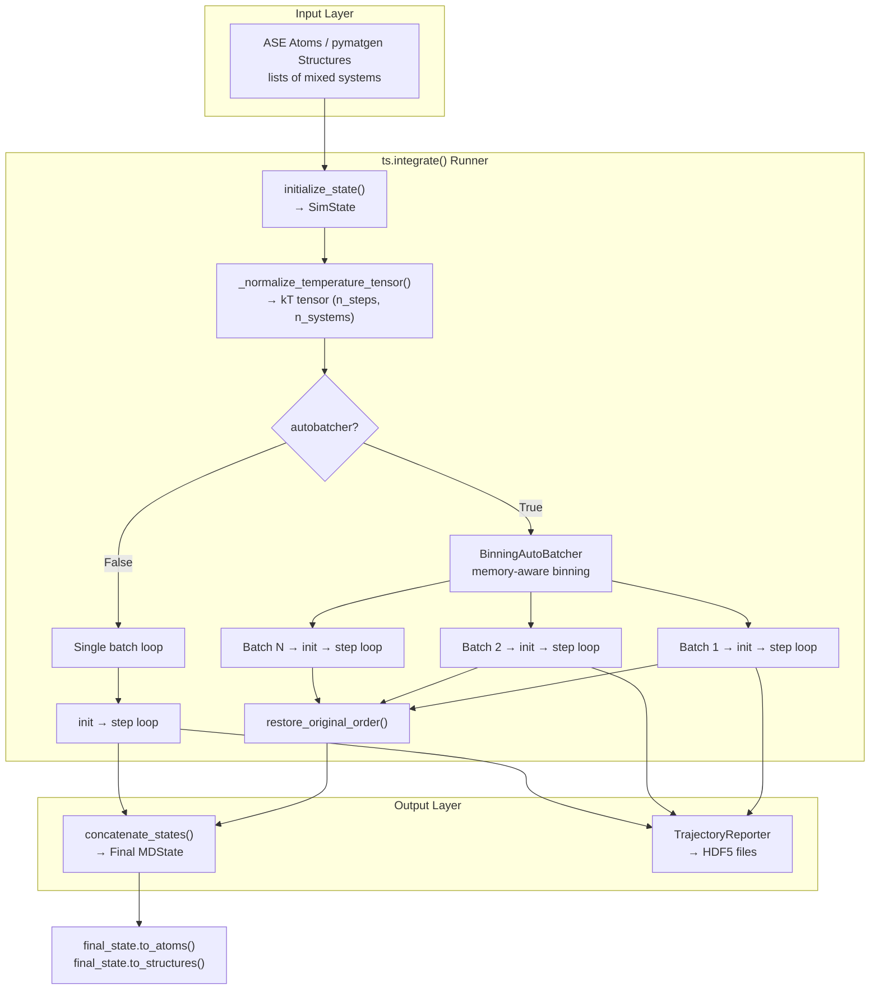

TorchSim enables you to simulate dozens to thousands of molecular systems simultaneously on a single GPU, turning what would be hours of serial computation into minutes of parallel execution. This page walks through both the high-level `integrate()` runner API and the lower-level init/step pattern, covering ensemble selection, temperature scheduling, trajectory reporting, and automatic memory management for batched workloads that exceed GPU capacity.

## Architecture Overview

The batched MD pipeline in TorchSim follows a layered architecture where the high-level runner orchestrates state initialization, integrator selection, batch iteration, and trajectory reporting. At its core, every MD simulation passes through the same two-phase lifecycle: **initialization** (converting raw atomic structures into an `MDState` with momenta, forces, and energy) followed by **time-stepping** (repeatedly advancing the state by one timestep). When autobatching is enabled, this lifecycle is applied to memory-sized sub-batches, and the results are reassembled into a single unified state at the end.



Sources: [runners.py](torch_sim/runners.py#L252-L405), [integrators/__init__.py](torch_sim/integrators/__init__.py#L1-L175)

## The `integrate()` Function

The `integrate()` function is the primary entry point for running batched molecular dynamics. It accepts atomic systems in any format that TorchSim understands (ASE `Atoms`, pymatgen `Structure`, or already-initialized `SimState`), a model implementing the `ModelInterface`, and configuration for the integrator ensemble, temperature schedule, and timestep.

```python
import torch_sim as ts

final_state = ts.integrate(
    system=ase_atoms_or_list,
    model=my_model,
    integrator=ts.Integrator.nvt_langevin,
    n_steps=10_000,
    temperature=1000.0,          # Kelvin
    timestep=0.002,               # picoseconds
)
```

The `system` argument accepts a single atomic structure or a list of structures. When a list is provided, TorchSim concatenates them into a single batched `SimState` with a `system_idx` tensor mapping each atom to its parent system. All systems in a batch are advanced through the same number of timesteps using the same model, but each can have its own temperature schedule (see the temperature section below). The function returns a single `MDState` containing the final positions, momenta, forces, and energy for every system in the batch.

Sources: [runners.py](torch_sim/runners.py#L252-L405), [state.py](torch_sim/state.py#L1054-L1197)

## Available Integrators

TorchSim provides eight integrators spanning three thermodynamic ensembles, all registered in the `Integrator` enum and `INTEGRATOR_REGISTRY`. Each integrator is implemented as a pair of functions: an `_init` function that creates the appropriate `MDState` subclass (initializing momenta, forces, and any ensemble-specific state variables), and a `_step` function that advances the state by one timestep.

| Integrator Key | Ensemble | Thermostat / Barostat | State Class | Key Keyword Args |
|---|---|---|---|---|
| `nve` | Microcanonical | None (energy conserved) | `MDState` | — |
| `nvt_langevin` | Canonical | Langevin (BAOAB splitting) | `MDState` | `gamma` (friction) |
| `nvt_vrescale` | Canonical | Velocity rescaling (Bussi) | `NVTVRescaleState` | `tau` (coupling time) |
| `nvt_nose_hoover` | Canonical | Nosé-Hoover chain | `NVTNoseHooverState` | `tau`, `chain_length`, `chain_steps` |
| `npt_langevin` | Isobaric-isothermal | Langevin barostat | `NPTLangevinState` | `gamma`, `external_pressure`, `alpha` |
| `npt_nose_hoover` | Isobaric-isothermal | Nosé-Hoover barostat | `NPTNoseHooverState` | `external_pressure`, `t_tau`, `b_tau` |
| `npt_isotropic_crescale` | Isobaric-isothermal | C-Rescale (isotropic) | `NPTCRescaleState` | `external_pressure`, `tau_p` |
| `npt_anisotropic_crescale` | Isobaric-isothermal | C-Rescale (anisotropic) | `NPTCRescaleState` | `external_pressure`, `tau_p` |

NPT integrators require the model to have `compute_stress=True`, since they need the stress tensor to compute pressure forces on the cell. All NVT and NPT integrators accept the `init_kwargs` parameter in `integrate()` for passing ensemble-specific initialization arguments such as `tau` or `chain_length`, while ensemble-specific stepping arguments like `external_pressure` or `gamma` are passed via `**integrator_kwargs`.

> [!TIP]
> When choosing an integrator, prefer `nvt_langevin` or `npt_langevin` for production runs: Langevin dynamics are stochastic and robustly sample the canonical distribution without fine-tuning thermostat parameters. Use Nosé-Hoover variants when you need deterministic, time-reversible trajectories (e.g., for computing transport properties). The `nve` integrator is useful for energy conservation tests and microcanonical benchmarking.

Sources: [integrators/__init__.py](torch_sim/integrators/__init__.py#L97-L175), [nvt.py](torch_sim/integrators/nvt.py#L24-L629), [npt.py](torch_sim/integrators/npt.py#L26-L635)

## Temperature Scheduling

The `temperature` parameter in `integrate()` is remarkably flexible. Rather than accepting only a scalar, it supports four scheduling patterns that control how temperature varies over time and across systems:

| Pattern | Input Shape | Interpretation |
|---|---|---|
| Constant | `float` or `tensor(1)` | Same temperature for all steps and all systems |
| Per-system | `tensor(n_systems)` | Each system has its own temperature, held constant over all steps |
| Per-step | `tensor(n_steps)` | Temperature changes at each step, applied uniformly to all systems |
| Per-step per-system | `tensor(n_steps, n_systems)` | Full schedule: each system has its own temperature at each step |

Internally, `_normalize_temperature_tensor()` converts any of these inputs into a tensor of shape `(n_steps,)` or `(n_steps, n_systems)` and scales it by the metal unit system's temperature factor (eV/K). When a per-system temperature array has the same length as `n_steps`, TorchSim emits a warning since the intent is ambiguous, defaulting to per-system interpretation.

This scheduling system enables powerful workflows: simulated annealing (linearly decreasing temperature array), replica exchange (different temperatures per system within the same batch), and temperature-jump experiments — all without modifying the integrator itself.

```python
# Linear cooling from 2000K to 300K over 5000 steps
temps = torch.linspace(2000, 300, 5000)
final_state = ts.integrate(
    system=atoms, model=model,
    integrator=ts.Integrator.nvt_langevin,
    n_steps=5000, temperature=temps, timestep=0.002,
)
```

Sources: [runners.py](torch_sim/runners.py#L173-L227)

## Trajectory Reporting

TorchSim provides a built-in `TrajectoryReporter` that writes simulation data to HDF5 files during integration. The simplest way to enable it is to pass a dictionary with filenames:

```python
final_state = ts.integrate(
    system=atoms, model=model,
    integrator=ts.Integrator.nvt_langevin,
    n_steps=5000, temperature=1000, timestep=0.002,
    trajectory_reporter={"filenames": "trajectory.h5"},
)
```

When autobatching is enabled, each system in the batch gets its own trajectory file, and the reporter automatically reopens the correct files for each sub-batch. For finer control, instantiate the `TrajectoryReporter` directly to configure the state saving frequency, property calculators (custom per-step quantities like kinetic energy, temperature, or pressure), and trajectory compression settings.

After the simulation, read trajectory data with `TorchSimTrajectory`:

```python
with ts.TorchSimTrajectory("trajectory.h5") as traj:
    energies = traj.get_array("potential_energy")
    final_atoms = traj.get_atoms(-1)
```

Sources: [trajectory.py](torch_sim/trajectory.py#L69-L464), [runners.py](torch_sim/runners.py#L34-L68)

## Automatic Batching for Large Workloads

When simulating many systems whose combined atom count exceeds GPU memory, set `autobatcher=True` to let TorchSim automatically partition the batch into memory-safe sub-batches. The `integrate()` function uses the `BinningAutoBatcher` strategy, which groups systems using a bin-packing algorithm that minimizes the total number of batches while keeping each batch within the GPU's memory budget.

```python
final_state = ts.integrate(
    system=many_atoms,  # e.g., 100 systems
    model=mace_model,
    integrator=ts.Integrator.nvt_langevin,
    n_steps=5000, temperature=1000, timestep=0.002,
    autobatcher=True,  # automatically manage GPU memory
)
```

The autobatcher first calls `estimate_max_memory_scaler()` to determine the largest memory metric the model can handle on the current GPU, then packs systems into bins such that the sum of memory metrics in each bin stays below this threshold. Memory scaling is estimated based on the `memory_scales_with` property of the model — most MLIPs with radial cutoffs use `"n_atoms_x_density"`, while models with fixed neighbor counts use `"n_atoms"`. Each sub-batch runs the full init → step loop independently, and the final states are reassembled via `restore_original_order()` and `concatenate_states()` to produce a single output state.

> [!TIP]
> The `max_memory_scaler` is typically fixed for a given model and GPU. After the first run determines it via auto-detection, you can cache this value and pass a pre-configured `BinningAutoBatcher(model, max_memory_scaler=cached_value)` to avoid the slow calibration step on subsequent runs. This is particularly valuable in production pipelines that run repeatedly with the same hardware and model.

Sources: [runners.py](torch_sim/runners.py#L71-L107), [autobatching.py](torch_sim/autobatching.py#L520-L768), [interface.py](torch_sim/models/interface.py#L125-L133)

## Low-Level Init/Step Pattern

For advanced workflows that need direct control over the integration loop — such as custom logging, conditional logic between steps, or coupling with external processes — you can bypass `integrate()` and use the init/step functions directly. Each integrator follows the same two-function contract: `_init` transforms a `SimState` into the appropriate `MDState` subclass, and `_step` advances it by one timestep.

```python
# Low-level NVT Langevin with custom per-step logic
import torch
from torch_sim.units import MetalUnits as U

kT = torch.tensor(1000 * U.temperature)
dt = torch.tensor(0.002 * U.time)

state = ts.initialize_state(ase_atoms, model.device, model.dtype)
state = ts.nvt_langevin_init(state, model, kT=kT)

for step in range(10_000):
    state = ts.nvt_langevin_step(state, model, dt=dt, kT=kT, gamma=1.0 / U.time)

    if step % 500 == 0:
        temp = state.calc_temperature()
        print(f"Step {step}: T = {temp.item():.1f} K")
```

The low-level pattern also supports batched states directly. When you pass a batched `SimState` to `nvt_langevin_init`, all systems are initialized with momenta drawn from a Maxwell-Boltzmann distribution at the specified temperature, and `nvt_langevin_step` advances every system simultaneously within a single GPU kernel launch.

Sources: [nvt.py](torch_sim/integrators/nvt.py#L86-L195), [nve.py](torch_sim/integrators/nve.py#L17-L105), [md.py](torch_sim/integrators/md.py#L20-L100)

## Mixed-System Batching

One of TorchSim's most powerful features is the ability to batch **different** systems — different elements, different structures, different sizes — into a single simulation. The `system_idx` tensor in `SimState` tracks which atoms belong to which system, and all integrators use this index for per-system temperature control, degree-of-freedom calculations, and property reporting.

```python
from ase.build import bulk, molecule

si_bulk = bulk("Si", "diamond", a=5.43).repeat((2, 2, 2))
cu_bulk = bulk("Cu", "fcc", a=3.61).repeat((3, 3, 3))
h2o = molecule("H2O")

# All three systems simulated simultaneously at different temperatures
final_state = ts.integrate(
    system=[si_bulk, cu_bulk, h2o],
    model=mace_model,
    integrator=ts.Integrator.nvt_langevin,
    n_steps=5000,
    temperature=[1500.0, 300.0, 300.0],  # per-system temperatures
    timestep=0.002,
)
```

Each system in the batch maintains independent state: separate cells, separate momenta, separate energies. The MLIP model receives the concatenated batch and returns forces for all atoms in a single forward pass, which is where the GPU efficiency comes from — the model's fixed overhead (kernel launches, memory allocations) is amortized across all systems in the batch.

Sources: [state.py](torch_sim/state.py#L70-L135), [runners.py](torch_sim/runners.py#L335-L350)

## Putting It All Together

The following example combines all the concepts covered on this page — batched multi-system simulation with autobatching, trajectory reporting, and temperature scheduling:

```python
import torch
import torch_sim as ts
from ase.build import bulk

device = torch.device("cuda" if torch.cuda.is_available() else "cpu")

# Set up a MACE model
from mace.calculators.foundations_models import mace_mp
from torch_sim.models.mace import MaceModel

mace = mace_mp(model="small", return_raw_model=True)
model = MaceModel(model=mace, device=device)

# Create diverse systems to batch together
systems = [
    bulk("Si", "diamond", a=5.43).repeat((2, 2, 2)),
    bulk("Cu", "fcc", a=3.61).repeat((3, 3, 3)),
    bulk("Al", "fcc", a=4.05).repeat((2, 2, 2)),
] * 10  # 30 systems total

# Run with automatic batching and trajectory reporting
final_state = ts.integrate(
    system=systems,
    model=model,
    integrator=ts.Integrator.nvt_langevin,
    n_steps=5000,
    temperature=[800.0, 300.0, 300.0],  # per-system (broadcast over steps)
    timestep=0.002,
    trajectory_reporter={"filenames": [f"traj_{i}.h5" for i in range(30)]},
    autobatcher=True,
)
```

## Next Steps

- **[NVE and NVT Integrators](12-nve-and-nvt-integrators)** — Deep dive into the Verlet, Langevin, velocity rescaling, and Nosé-Hoover thermostat algorithms and their implementation details.
- **[NPT Integrators and Thermostats](13-npt-integrators-and-thermostats)** — Understanding barostat coupling, cell dynamics, and the NPT state classes.
- **[Automatic Batching and GPU Memory](18-automatic-batching-and-gpu-memory)** — Full exploration of `BinningAutoBatcher`, `InFlightAutoBatcher`, memory scaling strategies, and performance tuning.
- **[Trajectory Storage and Reporting](20-trajectory-storage-and-reporting)** — Advanced trajectory reporter configuration, custom property calculators, and HDF5 data analysis patterns.
- **[High-Level Runners API](19-high-level-runners-api)** — Broader coverage of `integrate()`, `optimize()`, and `static()` with their shared infrastructure.