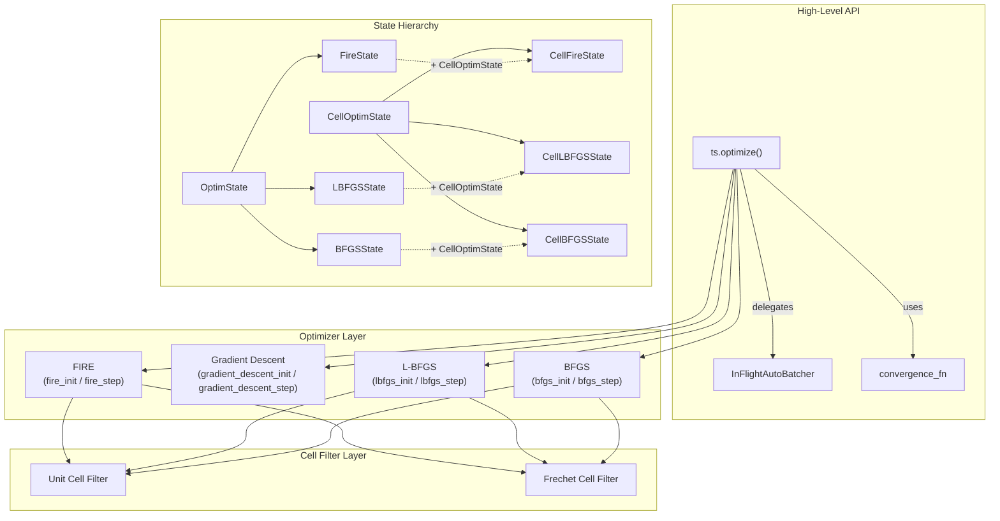
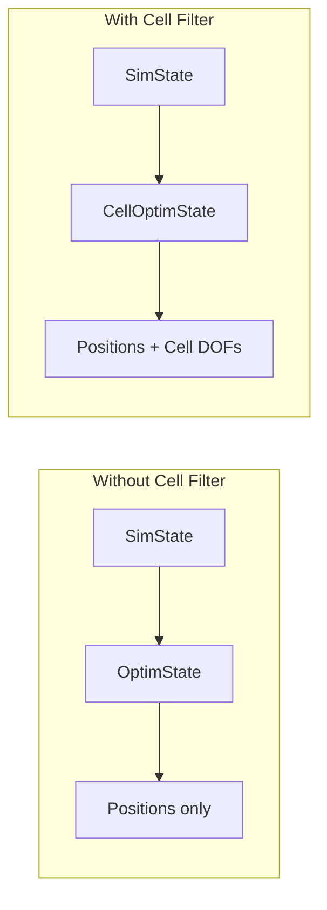
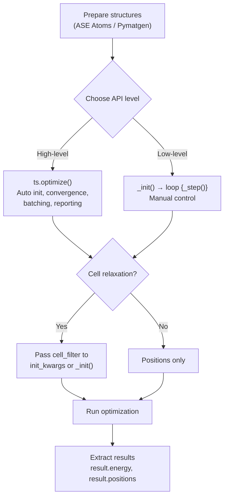

This page covers how to perform geometry optimizations — relaxing atomic positions and optionally unit cells — across batches of molecular systems simultaneously on GPU. TorchSim's optimization framework follows a filter-based architecture where optimization algorithms operate independently from cell parameterization, and both layers support fully batched execution. Whether you need to relax a handful of defect structures or thousands of DFT-generated candidates, the same API scales from single systems to large batches with automatic GPU memory management.

## Optimization Architecture Overview

TorchSim's geometry optimization system is built around three pillars: a **state hierarchy** that tracks per-system optimization state, an **init/step protocol** that separates initialization from iteration, and a **cell filter abstraction** that decouples cell optimization from position optimization. These layers compose so that any optimizer can run with or without cell relaxation, on any batch size, with or without automatic memory batching.



The `Optimizer` enum and `OPTIM_REGISTRY` dictionary in [optimizers/__init__.py](torch_sim/optimizers/__init__.py#L38-L53) provide a string-keyed lookup mapping each optimizer name to its `(init_fn, step_fn)` tuple. The high-level `optimize()` runner accepts either an `Optimizer` enum value or a raw `(init_fn, step_fn)` tuple, giving you flexibility to use built-in or custom optimizers interchangeably.

Sources: [optimizers/__init__.py](torch_sim/optimizers/__init__.py#L38-L53), [optimizers/state.py](torch_sim/optimizers/state.py#L11-L25)

## Available Optimizers

TorchSim ships four optimization algorithms, each with different convergence characteristics and computational costs. All four operate on batched states identically — you never need to loop over systems manually.

| Optimizer | Enum Key | State Class | Best For | Complexity |
|-----------|----------|-------------|----------|------------|
| Gradient Descent | `Optimizer.gradient_descent` | `OptimState` | Debugging, simple test cases | O(N) per step |
| FIRE | `Optimizer.fire` | `FireState` | General-purpose relaxation | O(N) per step |
| L-BFGS | `Optimizer.lbfgs` | `LBFGSState` | Large systems, quasi-Newton convergence | O(N × history) per step |
| BFGS | `Optimizer.bfgs` | `BFGSState` | Small-to-moderate systems, best convergence | O(N²) memory |

**FIRE** (Fast Inertial Relaxation Engine) is the default workhorse. It combines molecular dynamics-like velocity updates with adaptive damping, making it robust for a wide range of initial conditions. It comes in two flavors: `"ase_fire"` (ASE-compatible, default) and `"vv_fire"` (velocity-Verlet based). FIRE is implemented in [fire.py](torch_sim/optimizers/fire.py#L22-L127).

**L-BFGS** approximates the inverse Hessian using a limited history of displacement-gradient pairs (default 20 steps), achieving superlinear convergence near minima while keeping memory linear in system size. It uses a fixed step size with the classical two-loop recursion for inverse-Hessian-vector products. See [lbfgs.py](torch_sim/optimizers/lbfgs.py#L114-L287).

**BFGS** maintains the full Hessian matrix (padded to `3*max_atoms × 3*max_atoms` per batch), giving the best convergence rate at O(N²) memory cost. This makes it ideal for systems with fewer than ~200 atoms. See [bfgs.py](torch_sim/optimizers/bfgs.py#L87-L256).

**Gradient Descent** applies a fixed learning rate to force directions. It is the simplest optimizer, useful for testing and as a baseline. See [gradient_descent.py](torch_sim/optimizers/gradient_descent.py#L18-L77).

> [!TIP]
> When optimizing systems with widely different atom counts in the same batch, L-BFGS and BFGS pad internal history/Hessian tensors to `max_atoms`. This is handled transparently by the state system — you don't need to sort or partition your systems by size. However, very heterogeneous batches (e.g., 10 atoms + 1000 atoms) waste GPU memory on padding. Consider grouping similarly-sized systems together for efficiency.

Sources: [optimizers/__init__.py](torch_sim/optimizers/__init__.py#L38-L53), [fire.py](torch_sim/optimizers/fire.py#L22-L127), [lbfgs.py](torch_sim/optimizers/lbfgs.py#L114-L287), [bfgs.py](torch_sim/optimizers/bfgs.py#L87-L256)

## Quick Start: The High-Level `optimize()` Runner

The simplest way to run batched geometry optimization is through the `ts.optimize()` function. It handles optimizer initialization, convergence checking, automatic batching via the `InFlightAutoBatcher`, trajectory reporting, and progress tracking — all in a single call.

```python
import torch_sim as ts

# Prepare systems (list of ASE Atoms objects)
atoms_list = [si_structure, cu_structure, fe_structure]

# Use a model
result = ts.optimize(
    atoms_list,
    model=mace_model,
    optimizer=ts.Optimizer.fire,
    convergence_fn=ts.generate_force_convergence_fn(force_tol=0.05),
    max_steps=10_000,
    steps_between_swaps=5,
)
```

The `optimize()` function accepts `StateLike` inputs — ASE `Atoms`, Pymatgen `Structure`, or a `SimState` directly. When you pass non-`OptimState` objects, it automatically initializes the optimizer state via a chunked application that respects GPU memory limits. The function then enters a loop where it repeatedly: (1) requests the next batch from the `InFlightAutoBatcher`, (2) runs `steps_between_swaps` optimizer steps, (3) evaluates convergence, and (4) feeds the convergence tensor back to the batcher so converged states are swapped out and new ones are loaded in.

Sources: [runners.py](torch_sim/runners.py#L551-L730)

### Convergence Functions

The `optimize()` runner requires a convergence function that returns a boolean tensor of shape `(n_systems,)` — `True` where converged, `False` otherwise. TorchSim provides two built-in generators:

| Function | Criterion | Signature |
|----------|-----------|-----------|
| `generate_force_convergence_fn(force_tol)` | Max per-atom force < tolerance | Optional `include_cell_forces=True` for cell optimizations |
| `generate_energy_convergence_fn(energy_tol)` | \|ΔE\| < tolerance between steps | Compares current energy to previous step |

If you pass no `convergence_fn`, the optimizer defaults to energy convergence with `energy_tol=1e-3`. For production relaxations, force-based convergence is generally preferred because it directly measures the quality of the optimized geometry rather than indirect energy differences.

Sources: [runners.py](torch_sim/runners.py#L485-L547)

### Key Parameters of `optimize()`

| Parameter | Type | Default | Description |
|-----------|------|---------|-------------|
| `optimizer` | `Optimizer` or `tuple` | required | Built-in optimizer enum or custom `(init_fn, step_fn)` |
| `convergence_fn` | `Callable` | energy at 1e-3 | Returns `(n_systems,)` boolean tensor |
| `max_steps` | `int` | 10,000 | Hard cap on total optimization steps |
| `steps_between_swaps` | `int` | 5 | Steps before checking convergence and swapping |
| `autobatcher` | `InFlightAutoBatcher` or `bool` | `False` | `True` enables auto memory estimation; pass instance for custom config |
| `trajectory_reporter` | `TrajectoryReporter` or `dict` | `None` | Enable trajectory logging |
| `init_kwargs` | `dict` | `None` | Extra kwargs forwarded to optimizer `init` function |
| `**optimizer_kwargs` | — | — | Extra kwargs forwarded to optimizer `step` function |

Sources: [runners.py](torch_sim/runners.py#L551-L564)

## Low-Level API: Init and Step Pattern

For finer control over the optimization loop — custom convergence logic, mixed optimizer strategies, or integration into larger workflows — use the init/step pattern directly. Every optimizer exposes an `_init` function that creates the appropriate state, and a `_step` function that advances it by one iteration.

```python
# 1. Convert your structures to a batched SimState
state = ts.io.atoms_to_state(atoms_list, device=device, dtype=torch.float32)

# 2. Initialize the optimizer (computes initial forces/energy)
state = ts.fire_init(state=state, model=mace_model, dt_start=0.005)

# 3. Run optimization steps manually
for step in range(500):
    state = ts.fire_step(state=state, model=mace_model, dt_max=0.01)
    max_force = ts.system_wise_max_force(state)
    if (max_force < 0.05).all():
        print(f"Converged at step {step}")
        break
```

Each `_init` function calls the model to compute initial forces and energy, then packages everything into the appropriate state dataclass. The `_step` function takes the current state and model, performs one optimization iteration, and returns the updated state. All tensors in the state are batched — `forces` has shape `(total_atoms, 3)`, `energy` has shape `(n_systems,)`, and so on.

Sources: [optimizers/__init__.py](torch_sim/optimizers/__init__.py#L1-L10), [examples/scripts/2_structural_optimization.py](examples/scripts/2_structural_optimization.py#L113-L120)

### Optimizer-Specific Initialization Parameters

Each optimizer's `_init` function accepts configuration parameters that control its behavior:

**FIRE** ([fire_init](torch_sim/optimizers/fire.py#L22-L113)):
| Parameter | Default | Description |
|-----------|---------|-------------|
| `dt_start` | 0.1 | Initial timestep |
| `alpha_start` | 0.1 | Initial mixing parameter |
| `fire_flavor` | `"ase_fire"` | `"ase_fire"` (ASE-compatible) or `"vv_fire"` (velocity-Verlet) |
| `cell_filter` | `None` | Cell filter for simultaneous cell optimization |

**L-BFGS** ([lbfgs_init](torch_sim/optimizers/lbfgs.py#L114-L278)):
| Parameter | Default | Description |
|-----------|---------|-------------|
| `step_size` | 0.1 | Fixed step size for displacement |
| `alpha` | auto | Initial inverse Hessian scale (stiffness) |
| `cell_filter` | `None` | Cell filter for simultaneous cell optimization |

**BFGS** ([bfgs_init](torch_sim/optimizers/bfgs.py#L87-L251)):
| Parameter | Default | Description |
|-----------|---------|-------------|
| `max_step` | 0.2 | Maximum displacement per atom per step |
| `alpha` | 70.0 | Initial Hessian scale (stiffness) |
| `cell_filter` | `None` | Cell filter for simultaneous cell optimization |

Sources: [fire.py](torch_sim/optimizers/fire.py#L22-L113), [lbfgs.py](torch_sim/optimizers/lbfgs.py#L114-L278), [bfgs.py](torch_sim/optimizers/bfgs.py#L87-L251)

## Cell Optimization with Filters

Many materials science workflows require simultaneous relaxation of atomic positions **and** unit cell parameters. TorchSim handles this through **cell filters** — composable wrappers that extend any optimizer to include cell degrees of freedom. The filter handles computing cell forces from the stress tensor, applying strain constraints, and updating the cell matrix, while the underlying optimizer treats everything as a unified optimization problem.



The `CellFilter` enum in [cell_filters.py](torch_sim/optimizers/cell_filters.py#L287-L293) provides two options:

| Filter | Description | Best For |
|--------|-------------|----------|
| `CellFilter.unit` | Transforms cell via logarithmic deformation gradient; directly controls strain. | General cell relaxation, isotropic or anisotropic |
| `CellFilter.frechet` | Uses the Frechet derivative of cell energy for cell forces; compatible with ASE's `FrechetCellFilter`. | Matching ASE behavior, non-orthogonal cells |

Cell filters are passed to any optimizer's `_init` function:

```python
# FIRE with Frechet cell filter
state = ts.fire_init(
    state=state, model=model,
    cell_filter=ts.CellFilter.frechet,
    scalar_pressure=0.0,  # GPa
)

for step in range(500):
    state = ts.fire_step(state=state, model=model)
```

When a cell filter is active, the optimizer's internal state is automatically upgraded to the corresponding `Cell*State` variant (`CellFireState`, `CellBFGSState`, `CellLBFGSState`). These composite states inherit both the cell filter attributes (`reference_cell`, `cell_forces`, `cell_factor`, `hydrostatic_strain`, `constant_volume`) and the optimizer-specific attributes (velocities for FIRE, Hessian for BFGS, history for L-BFGS).

For gradient descent with cell optimization, separate learning rates control positions and cell:

```python
state = ts.gradient_descent_init(
    state=state, model=model,
    cell_filter=ts.CellFilter.unit,
)
for step in range(500):
    state = ts.gradient_descent_step(
        state=state, model=model,
        pos_lr=0.01, cell_lr=0.1,
    )
```

> [!TIP]
> When using cell filters with quasi-Newton methods (BFGS/L-BFGS), forces and positions are internally transformed into the filter's scaled coordinate space. The `prev_forces` and `prev_positions` stored in the state are in this transformed space, matching ASE's `UnitCellFilter`/`FrechetCellFilter` behavior for result reproducibility. Set `include_cell_forces=True` in `generate_force_convergence_fn()` to ensure both atomic and cell forces converge.

Sources: [cell_filters.py](torch_sim/optimizers/cell_filters.py#L287-L527), [gradient_descent.py](torch_sim/optimizers/gradient_descent.py#L70-L77)

## Complete Example: Batched FIRE with Cell Relaxation

This example demonstrates a realistic batched optimization workflow — relaxing three different crystal structures (Si, Cu, Fe) simultaneously with both position and cell degrees of freedom, using the high-level `optimize()` runner with automatic memory management.

```python
import torch
import torch_sim as ts
from ase.build import bulk
import numpy as np

device = torch.device("cuda" if torch.cuda.is_available() else "cpu")

# --- 1. Create perturbed structures ---
rng = np.random.default_rng(seed=0)
si = bulk("Si", "diamond", a=5.21, cubic=True).repeat((2, 2, 2))
si.positions += 0.2 * rng.standard_normal(si.positions.shape)

cu = bulk("Cu", "fcc", a=3.85).repeat((2, 2, 2))
cu.positions += 0.2 * rng.standard_normal(cu.positions.shape)

fe = bulk("Fe", "bcc", a=2.95).repeat((2, 2, 2))
fe.positions += 0.2 * rng.standard_normal(fe.positions.shape)

atoms_list = [si, cu, fe]

# --- 2. Run batched optimization ---
result = ts.optimize(
    atoms_list,
    model=mace_model,
    optimizer=ts.Optimizer.fire,
    convergence_fn=ts.generate_force_convergence_fn(force_tol=0.05),
    max_steps=10_000,
    steps_between_swaps=5,
    autobatcher=True,           # auto GPU memory management
    init_kwargs={"cell_filter": ts.CellFilter.frechet},
    trajectory_reporter={"file_prefix": "opt_", "properties": ["potential_energy"]},
)

print(f"Energies: {result.energy.tolist()}")
print(f"Max forces: {ts.system_wise_max_force(result).tolist()}")
```

When `autobatcher=True`, the `optimize()` function automatically estimates the maximum memory your GPU can handle, then uses an `InFlightAutoBatcher` to swap converged states out and new states in. This means you can pass thousands of structures and the system will process them in memory-safe chunks without any manual configuration.

## Putting It All Together: Workflow Summary



Sources: [runners.py](torch_sim/runners.py#L551-L730), [optimizers/__init__.py](torch_sim/optimizers/__init__.py#L1-L53)

## Next Steps

- **[FIRE and Gradient Descent Optimizers](15-fire-and-gradient-descent-optimizers)** — Deep dive into the algorithm details, parameter tuning, and convergence behavior of the most commonly used optimizers.
- **[L-BFGS and BFGS Quasi-Newton Methods](16-l-bfgs-and-bfgs-quasi-newton-methods)** — Understand the Hessian approximation strategies, padding behavior for heterogeneous batches, and when to prefer quasi-Newton over FIRE.
- **[Cell Filters and Constraints](17-cell-filters-and-constraints)** — Full exploration of cell filter internals, strain parameterization, pressure coupling, and the `hydrostatic_strain`/`constant_volume` options.
- **[Automatic Batching and GPU Memory](18-automatic-batching-and-gpu-memory)** — How `BinningAutoBatcher` and `InFlightAutoBatcher` work under the hood, memory estimation, and custom batch size configuration.
- **[High-Level Runners API](19-high-level-runners-api)** — Complete reference for `integrate()`, `optimize()`, and `static()` runners including trajectory reporting and reproducible restarts.