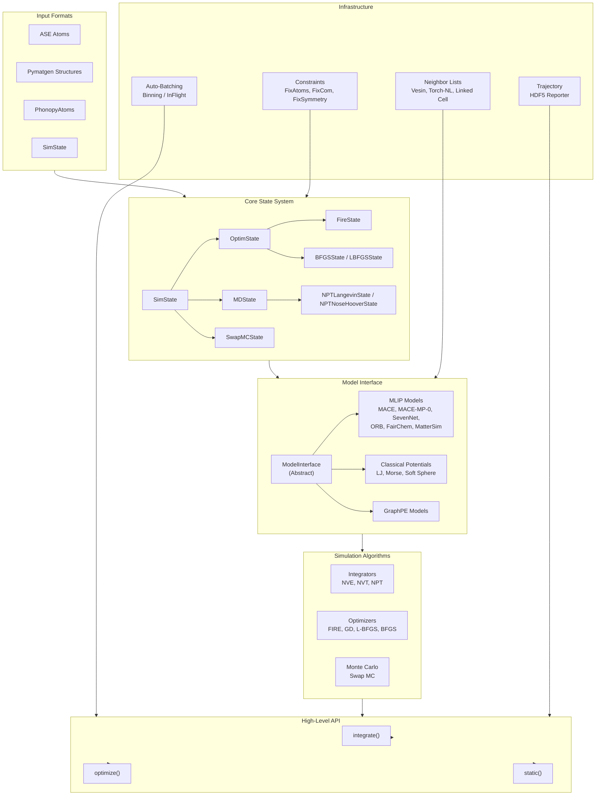
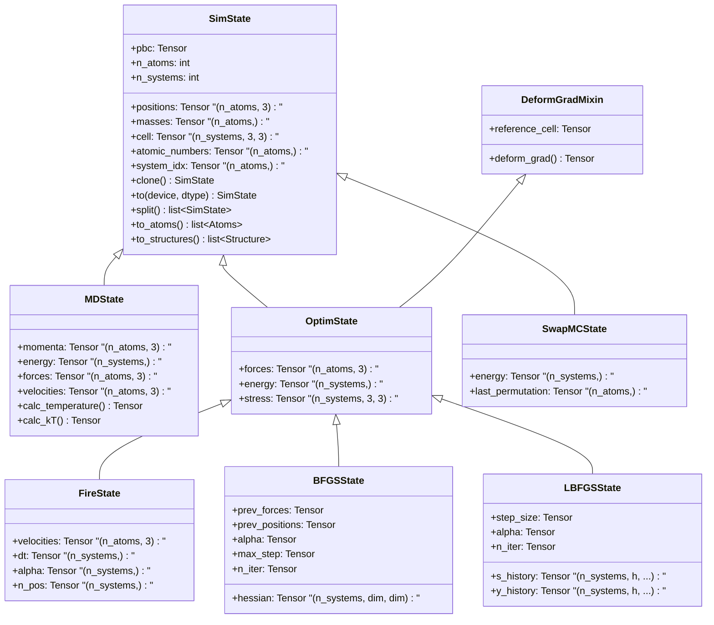

TorchSim is a PyTorch-native framework for atomistic simulation that unifies machine-learned interatomic potentials (MLIPs), molecular dynamics, geometry optimization, and Monte Carlo sampling under a single differentiable computation graph. Its architecture is organized around a **central state hierarchy** that flows through **pluggable model interfaces** into **modular simulation algorithms**, with **automatic batching** and **high-level runners** orchestrating the entire pipeline. This page maps out that architecture end-to-end, giving you the mental model needed to navigate the codebase and extend it for your own research.

## High-Level Architecture

The framework follows a layered architecture where each layer exposes both low-level primitives (for fine-grained control) and high-level runners (for rapid experimentation). Data flows downward from user-provided atomic structures through state initialization, model evaluation, and simulation algorithms, with optional batching and trajectory reporting wrapping the entire loop.

Sources: [torch_sim/__init__.py](/torch_sim/__init__.py#L104-L212), [torch_sim/runners.py](/torch_sim/runners.py#L252-L265)

## Package Structure

The `torch_sim/` package is divided into clearly delineated submodules, each responsible for a single concern. Understanding this layout is the first step toward navigating and contributing to the codebase effectively.

```mermaid
flowchart LR
    subgraph torch_sim["torch_sim/"]
        direction TB
        state_py["state.py<br/>SimState hierarchy"]
        models_dir["models/<br/>ModelInterface + adapters"]
        integrators_dir["integrators/<br/>MD integrators"]
        optimizers_dir["optimizers/<br/>Geometry optimizers"]
        runners_py["runners.py<br/>integrate, optimize, static"]
        autobatching_py["autobatching.py<br/>GPU memory management"]
        neighbors_dir["neighbors/<br/>Vesin, Torch-NL"]
        transforms_py["transforms.py<br/>PBC & coordinate math"]
        constraints_py["constraints.py<br/>FixAtoms, FixCom, FixSymmetry"]
        trajectory_py["trajectory.py<br/>HDF5 I/O"]
        io_py["io.py<br/>ASE / Pymatgen / Phonopy bridges"]
        units_py["units.py<br/>Metal, Real unit systems"]
        elastic_py["elastic.py<br/>Elastic tensor calculation"]
        monte_carlo_py["monte_carlo.py<br/>Swap MC sampling"]
        properties_dir["properties/<br/>Correlation calculators"]
        workflows_dir["workflows/<br/>A2C crystallization"]
    end
```

| Module | Responsibility | Key Exports |
|--------|---------------|-------------|
| `state.py` | Core state dataclasses and manipulation | `SimState`, `concatenate_states`, `initialize_state` |
| `models/interface.py` | Abstract model contract | `ModelInterface` |
| `models/` | Concrete model adapters (13+ models) | `LennardJones`, `MaceModel`, `SevenNetModel`, etc. |
| `integrators/` | MD time-stepping algorithms | `nve_step`, `nvt_langevin_step`, `npt_nose_hoover_step`, etc. |
| `optimizers/` | Structure relaxation algorithms | `fire_step`, `lbfgs_step`, `bfgs_step`, `gradient_descent_step` |
| `runners.py` | High-level simulation loops | `integrate()`, `optimize()`, `static()` |
| `autobatching.py` | GPU memory-aware batch splitting | `BinningAutoBatcher`, `InFlightAutoBatcher` |
| `neighbors/` | Pair neighbor list construction | `torchsim_nl()` (auto-selecting best backend) |
| `transforms.py` | PBC wrapping, fractional coords, distances | `pbc_wrap_batched()`, `get_fractional_coordinates()` |
| `constraints.py` | Degrees-of-freedom restrictions | `FixAtoms`, `FixCom`, `FixSymmetry` |
| `trajectory.py` | HDF5-based trajectory storage | `TrajectoryReporter`, `TorchSimTrajectory` |
| `io.py` | Cross-library format conversion | `atoms_to_state()`, `state_to_atoms()`, etc. |
| `units.py` | Physical unit systems and conversions | `MetalUnits`, `RealUnits` |
| `elastic.py` | Elastic tensor from strain-stress | `calculate_elastic_tensor()` |
| `monte_carlo.py` | Monte Carlo swap moves | `swap_mc_init()`, `swap_mc_step()` |
| `properties/` | On-the-fly property calculators | `VelocityAutoCorrelation`, `HeatFluxAutoCorrelation` |
| `workflows/` | Multi-step simulation workflows | A2C amorphous-to-crystalline pipeline |

Sources: [torch_sim/__init__.py](/torch_sim/__init__.py#L104-L212), [torch_sim/typing.py](/torch_sim/typing.py)

## The State System: Central Data Backbone

Every simulation in TorchSim revolves around the **state hierarchy** — a set of composable, `@dataclass`-based PyTorch tensor containers that carry all atomic and system-level data through the simulation pipeline. The base `SimState` holds the universal attributes (positions, masses, cell, PBC, atomic numbers, system index), while derived states extend it with domain-specific fields for dynamics, optimization, or Monte Carlo.

The state system uses a **three-tier attribute classification** enforced at the metaclass level via `__init_subclass__`:

- **Per-atom attributes** (`_atom_attributes`): Tensors shaped `(n_atoms, ...)` — e.g. `positions`, `masses`, `forces`, `momenta`
- **Per-system attributes** (`_system_attributes`): Tensors shaped `(n_systems, ...)` — e.g. `cell`, `energy`, `stress`, `temperature`
- **Global attributes** (`_global_attributes`): Scalars or single tensors shared across all systems — e.g. `pbc`, `_rng`

This classification is critical because it drives **batch splitting, concatenation, slicing, and device transfer** — operations that must treat each attribute scope differently. The `system_idx` tensor maps each atom to its parent system, enabling ragged batching where different systems can have different atom counts within a single flat tensor.

A key design decision enforced by `__init_subclass__` is that **no tensor attribute in a derived state may be typed as `Tensor | None`**. This is because `torch.concatenate` cannot operate between a tensor and `None` — states that are conditionally absent must instead use dummy tensor values. The `from_state()` classmethod enables **cross-casting** between state types (e.g., `MDState` → `OptimState`), copying only the attributes valid for the target class and filling in any additional required fields.

Sources: [torch_sim/state.py](/torch_sim/state.py#L70-L601), [torch_sim/state.py](/torch_sim/state.py#L459-L492), [torch_sim/state.py](/torch_sim/state.py#L592-L684)

## Model Interface and the Adapter Pattern

All force and energy models in TorchSim implement the `ModelInterface` abstract base class, which inherits from `torch.nn.Module` and defines a single contract method: `forward(state: SimState, **kwargs) -> dict[str, torch.Tensor]`. The output dictionary must contain at minimum `"energy"` (per-system) and `"forces"` (per-atom), with optional `"stress"` (per-system, required for NPT integrators).

This adapter pattern decouples simulation algorithms from model implementations. The runner functions and integrators never know whether they are calling a universal MLIP like MACE or a simple Lennard-Jones potential — they only see the `ModelInterface` contract.

| Model Category | Examples | Key Characteristic |
|---------------|----------|-------------------|
| Universal MLIPs | `MaceModel`, `SevenNetModel`, `MatterSimModel`, `OrbModel` | Graph neural network architectures, GPU-accelerated |
| FairChem Models | `FairchemModel`, `FairchemLegacyModel` | FAIR-Chemistry foundation models |
| Classical Potentials | `LennardJones`, `MorsePotential`, `SoftSphere`, `PairPotential` | Analytical pair potentials, fast and differentiable |
| Metatomic | `MetatomicModel` | Interface to Metatomic-based compiled models |
| GraphPE Models | GraphPE framework adapters | Models using graph positional encodings |

The `memory_scales_with` property on each model informs the auto-batcher about memory scaling behavior — either `"n_atoms_x_density"` (radial cutoff models) or `"n_atoms"` (fixed-neighbor models). This distinction is essential for accurate GPU memory estimation when batching heterogeneous systems.

Sources: [torch_sim/models/interface.py](/torch_sim/models/interface.py#L38-L137), [torch_sim/models/__init__.py](/torch_sim/models/__init__.py)

## Simulation Algorithms: Integrators and Optimizers

TorchSim provides two families of simulation algorithms, each following an **init/step pattern** that produces a state derivative on the first call and advances it on subsequent calls. This pattern allows the high-level runners to call the same function object repeatedly inside a loop.

**Integrators** (molecular dynamics) are registered in `INTEGRATOR_REGISTRY` and support eight ensemble variants. Each integrator step function takes a state and model, evaluates forces via the model, and returns an updated state with new positions, momenta, and (where applicable) cell parameters.

| Ensemble | Integrator | Thermostat / Barostat |
|----------|-----------|----------------------|
| NVE | `nve_step` | None (microcanonical) |
| NVT | `nvt_vrescale_step` | Bussi velocity rescaling |
| NVT | `nvt_langevin_step` | BAOAB Langevin |
| NVT | `nvt_nose_hoover_step` | Nosé-Hoover chain |
| NPT | `npt_langevin_step` | Langevin barostat |
| NPT | `npt_nose_hoover_step` | Nosé-Hoover barostat |
| NPT | `npt_isotropic_crescale_step` | Stochastic cell rescaling (isotropic) |
| NPT | `npt_anisotropic_crescale_step` | Stochastic cell rescaling (anisotropic) |

**Optimizers** (geometry relaxation) are registered in `OPTIM_REGISTRY` and include gradient-based and quasi-Newton methods. The `cell_filter` subsystem (Exp, Strain, Frechet filters) handles variable-cell optimization by parameterizing cell degrees of freedom separately from atomic positions, analogous to ASE's filter design.

| Optimizer | Type | Notes |
|-----------|------|-------|
| `gradient_descent` | First-order | Simplest, for baseline comparison |
| `fire` | Velocity-Verlet / ASE | Two flavors: `vv_fire` and `ase_fire` |
| `lbfgs` | Quasi-Newton | Limited-memory, no line search, two-loop recursion |
| `bfgs` | Quasi-Newton | Full Hessian approximation, padded for ragged batches |

Sources: [torch_sim/integrators/__init__.py](/torch_sim/integrators/__init__.py#L97-L162), [torch_sim/optimizers/__init__.py](/torch_sim/optimizers/__init__.py#L38-L47), [torch_sim/optimizers/state.py](/torch_sim/optimizers/state.py#L11-L97)

## Automatic Batching and GPU Memory Management

A distinguishing feature of TorchSim is its **automatic batching infrastructure**, which solves a fundamental challenge in MLIP-driven simulation: systems of varying sizes must be batched on GPU, but memory consumption scales non-linearly with system size. The auto-batching module provides two complementary strategies.

`BinningAutoBatcher` pre-sorts systems into **fixed memory bins** before the simulation begins. It estimates memory consumption per system using a configurable scaling metric (atom count or atom count × density), then packs systems into groups that fit within the GPU memory budget. This is the default strategy for `integrate()`.

`InFlightAutoBatcher` takes a **streaming approach** — it pulls systems from an iterator, adds them to the current batch until the memory budget would be exceeded, runs the optimization step, then replaces completed systems with new ones from the stream. This is the default strategy for `optimize()`, where systems may converge at different rates.

Both batchers expose the same iterator protocol (`__iter__` / `__next__`) and handle the bookkeeping of mapping batch-local indices back to the original system ordering via `restore_original_order()`.

> [!TIP]
> The `memory_scales_with` property on each model is critical for correct batching behavior. Radial-cutoff MLIPs (MACE, SevenNet, etc.) should report `"n_atoms_x_density"` because their memory scales with the number of neighbor pairs, not just atom count. Fixed-neighbor models report `"n_atoms"`. Misconfiguring this will lead to either wasted GPU memory or OOM crashes.

Sources: [torch_sim/autobatching.py](/torch_sim/autobatching.py#L520-L810), [torch_sim/autobatching.py](/torch_sim/autobatching.py#L813-L1191)

## High-Level Runners API

The `runners.py` module provides the primary user-facing entry points that compose all the subsystems into ready-to-use simulation loops. Each runner accepts a `StateLike` input (ASE Atoms, Pymatgen Structure, PhonopyAtoms, or SimState), a model, and an integrator/optimizer specification.

| Runner | Purpose | Key Parameters |
|--------|---------|---------------|
| `integrate()` | Run MD simulation for N steps | `integrator`, `n_steps`, `temperature`, `timestep` |
| `optimize()` | Relax structures to convergence | `optimizer`, `convergence_fn`, `max_steps` |
| `static()` | Single-point energy/force evaluation | No time-stepping parameters |

Internally, the runners handle state initialization (converting `StateLike` → `SimState`), model validation, auto-batcher setup, trajectory reporter configuration, progress bar integration, and reproducible restart support. They return the final derived state type (`MDState` for `integrate()`, `OptimState` subtype for `optimize()`), which can be sliced, split, or converted back to external formats.

Sources: [torch_sim/runners.py](/torch_sim/runners.py#L252-L265), [torch_sim/runners.py](/torch_sim/runners.py#L551-L564), [torch_sim/runners.py](/torch_sim/runners.py#L734-L742)

## Supporting Infrastructure

Several cross-cutting modules provide foundational capabilities used throughout the framework.

**Neighbor Lists** — The `neighbors/` package auto-selects the best available backend (priority: alchemiops > vesin > torch_nl linked cell > naive) and provides a unified `torchsim_nl()` API accepting positions, cell, PBC, cutoff, and system index. Multiple implementations ensure broad hardware and dependency compatibility.

**Transforms** — The `transforms.py` module is the mathematical workhorse for periodic boundary conditions: PBC wrapping, fractional ↔ Cartesian coordinate conversion, minimum image displacement, cell shift computation, and both naive and linked-cell neighbor list construction algorithms.

**Constraints** — The constraint system (`constraints.py`) mirrors ASE's design but is fully tensor-native and batched. The `Constraint` ABC defines hooks for `adjust_positions`, `adjust_forces`, `adjust_momenta`, `adjust_stress`, and `adjust_cell`. Concrete implementations include `FixAtoms` (freezes selected atoms), `FixCom` (removes center-of-mass motion), and `FixSymmetry` (symmetrizes forces/cells according to crystal symmetry). Constraints integrate with the state system through `set_constrained_positions()`, `set_constrained_forces()`, and `set_constrained_momenta()`.

**Trajectory Storage** — The `TrajectoryReporter` writes per-system HDF5 trajectory files with configurable state and property recording frequencies. It supports custom property calculators (like `VelocityAutoCorrelation`) that are evaluated on-the-fly during simulation. The `TorchSimTrajectory` class provides read/write access, ASE export, and restart support via `truncate_to_step()`.

**Interoperability** — The `io.py` module provides bidirectional conversion between `SimState` and ASE Atoms, Pymatgen Structures, and PhonopyAtoms objects. The `initialize_state()` function accepts any `StateLike` input, handling column-vector ↔ row-vector cell convention differences between TorchSim and ASE.

Sources: [torch_sim/neighbors/__init__.py](/torch_sim/neighbors/__init__.py), [torch_sim/transforms.py](/torch_sim/transforms.py), [torch_sim/constraints.py](/torch_sim/constraints.py#L28-L153), [torch_sim/trajectory.py](/torch_sim/trajectory.py#L69-L464), [torch_sim/io.py](/torch_sim/io.py#L35-L410)

## Unit Systems

TorchSim defines physical unit systems in `units.py` following LAMMPS conventions, with CODATA 2014 recommended values as the authoritative constant source. Two unit systems are provided: **Metal** (Å, eV, amu, ps) and **Real** (Å, kcal/mol, amu, fs). All integrator time steps, temperatures, and pressures must be expressed in the chosen unit system — no internal unit conversion is performed during simulation. The `MetalUnits` enum is used by default throughout the framework.

Sources: [torch_sim/units.py](/torch_sim/units.py#L13-L141)

## Workflow Composition

For complex multi-step protocols, TorchSim provides the `workflows/` package. The A2C (amorphous-to-crystalline) workflow demonstrates the compositional power of the framework: it chains random structure generation, subcell extraction, unit-cell relaxation, Frechet cell relaxation, and temperature-annealed crystallization into a single end-to-end pipeline. Each step uses the same `SimState` / `ModelInterface` / optimizer primitives, illustrating how the architecture supports building higher-order workflows from the same low-level building blocks.

Sources: [torch_sim/workflows/a2c.py](/torch_sim/workflows/a2c.py#L210-L836)

## Navigating Forward

This architecture overview provides the structural map of TorchSim. The natural next step is to understand the state system in depth — it is the data structure every other component depends on.

- **[SimState and State Hierarchy](7-simstate-and-state-hierarchy)** — Deep dive into state construction, attribute scoping, and batch manipulation operations
- **[Model Interface and Adapters](9-model-interface-and-adapters)** — How to implement custom models or extend existing adapters
- **[High-Level Runners API](19-high-level-runners-api)** — Full usage patterns for `integrate()`, `optimize()`, and `static()`
- **[NVE and NVT Integrators](12-nve-and-nvt-integrators)** — Detailed algorithm walkthrough of the velocity Verlet scheme and thermostat implementations