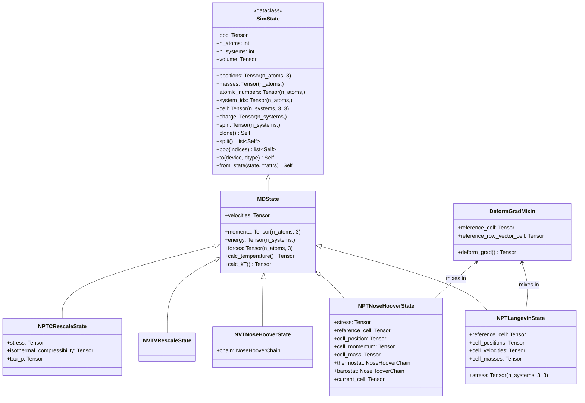

`SimState` is the foundational data structure in TorchSim — a GPU-accelerated, batched representation of atomistic systems that every integrator, optimizer, and workflow builds upon. This page covers the class architecture, attribute scoping rules, the inheritance hierarchy, and the lifecycle operations that make state manipulation composable and type-safe.

## Core Architecture

At its heart, `SimState` is a `@dataclass(kw_only=True)` that stores positions, masses, cell vectors, periodic boundary conditions, atomic numbers, and a system index mapping. Multiple atomistic systems are packed into a single state object by concatenating their per-atom tensors along dimension zero, then using a `system_idx` tensor to track which atoms belong to which system. This "flattened batch" design eliminates Python loops entirely — all operations across systems are dispatched as single tensor operations on the GPU.

Sources: [state.py](torch_sim/state.py#L70-L161)

## Attribute Scoping System

Every attribute on a `SimState` (or any subclass) must be explicitly classified into exactly one of three scopes. This classification drives all batched operations — slicing, splitting, popping, and concatenation all behave differently depending on whether an attribute is per-atom, per-system, or global. The `__init_subclass__` hook enforces this at class definition time, raising `TypeError` if any attribute is unscoped or if an attribute appears in multiple scopes.

Sources: [state.py](torch_sim/state.py#L155-L162), [state.py](torch_sim/state.py#L592-L684)

| Scope | Class Variable | Shape Convention | Example | Naming Convention |
|-------|---------------|------------------|---------|-------------------|
| Per-atom | `_atom_attributes` | `(n_atoms, ...)` | `positions`, `masses`, `momenta` | Plural |
| Per-system | `_system_attributes` | `(n_systems, ...)` | `cell`, `energy`, `stress` | Singular |
| Global | `_global_attributes` | Any fixed shape | `pbc`, `_rng`, chain thermostats | Singular |

When you slice `state[[0, 2]]`, per-atom attributes are filtered by `system_idx`, per-system attributes are indexed directly, and global attributes are copied unchanged. This is implemented by the `_filter_attrs_by_index` helper and used by `_slice_state`, `_split_state`, and `_pop_states`.

Sources: [state.py](torch_sim/state.py#L834-L892), [state.py](torch_sim/state.py#L1012-L1052)

A critical constraint enforced by `__init_subclass__` is that **no tensor attribute may have type `Tensor | None`**. This is because `torch.cat` cannot concatenate a tensor with `None`. The three exceptions are `system_idx`, `charge`, and `spin`, which are coerced from `None` to proper tensors during `__post_init__`.

Sources: [state.py](torch_sim/state.py#L603-L629)

> [!TIP]
> When defining a custom state subclass, you must declare every new tensor attribute in one of `_atom_attributes`, `_system_attributes`, or `_global_attributes`. The metaclass hook will reject unscoped attributes at import time, not at runtime — this catches errors early and documents intent clearly.

## The Batching Model: `system_idx`

The `system_idx` tensor maps each atom to its parent system. It has shape `(n_atoms,)` and contains unique consecutive integers starting from 0. For a batch of three systems with 2, 3, and 4 atoms respectively, `system_idx` would be `[0, 0, 1, 1, 1, 2, 2, 2, 2]`. This flat packing means that all per-atom tensors share the same leading dimension, and all per-atom operations can be expressed as single tensor calls.

The `system_idx` is auto-generated when omitted — assigning `None` triggers `__setattr__` to create `torch.zeros(n_atoms)` (i.e., a single system). When explicitly provided, the setter validates that indices are unique and consecutive.

Sources: [state.py](torch_sim/state.py#L174-L190), [state.py](torch_sim/state.py#L192-L233)

## The Full State Hierarchy

The state hierarchy splits into two main branches: **simulation states** (for molecular dynamics) and **optimizer states** (for geometry optimization). Both branch from `SimState` and each leaf class adds the attributes required by its specific algorithm.

### Molecular Dynamics Branch

`MDState` extends `SimState` with `momenta`, `energy`, and `forces`. It also provides computed properties like `velocities` (momenta divided by masses) and temperature calculation via `calc_kT()`. Every MD integrator in TorchSim accepts an `MDState` as input and returns a new `MDState` after each step.

Sources: [md.py](torch_sim/integrators/md.py#L20-L99)

| State Class | Module | Key Additions |
|------------|--------|---------------|
| `MDState` | `integrators.md` | `momenta`, `forces`, `energy`, `velocities` |
| `NPTLangevinState` | `integrators.npt` | `stress`, `reference_cell`, `cell_positions/velocities/masses` |
| `NPTNoseHooverState` | `integrators.npt` | `stress`, `reference_cell`, `cell_position/momentum/mass`, thermostat + barostat chains |
| `NPTCRescaleState` | `integrators.npt` | `stress`, `isothermal_compressibility`, `tau_p` |
| `NVTNoseHooverState` | `integrators.nvt` | `chain` (NoseHooverChain) |
| `NVTVRescaleState` | `integrators.nvt` | (inherits MDState, overrides DOF) |

Note that NPT integrators use the `DeformGradMixin` (either explicitly or through `reference_cell`) to track the deformation gradient from the original cell to the current cell — this is essential for computing cell forces correctly.

Sources: [npt.py](torch_sim/integrators/npt.py#L34-L92), [npt.py](torch_sim/integrators/npt.py#L750-L829), [nvt.py](torch_sim/integrators/nvt.py#L198-L245)

### Optimizer Branch

`OptimState` extends `SimState` with `forces`, `energy`, and `stress`. Further subclasses add algorithm-specific history and hyperparameter tensors.

Sources: [state.py](torch_sim/optimizers/state.py#L11-L35)

| State Class | Module | Key Additions |
|------------|--------|---------------|
| `OptimState` | `optimizers.state` | `forces`, `energy`, `stress` |
| `FireState` | `optimizers.state` | `velocities`, `dt`, `alpha`, `n_pos` |
| `BFGSState` | `optimizers.state` | `hessian`, `prev_forces`, `prev_positions`, `alpha`, `max_step`, `n_iter` |
| `LBFGSState` | `optimizers.state` | `s_history`, `y_history`, `step_size`, `prev_forces`, `prev_positions` |
| `CellOptimState` | `optimizers.cell_filters` | `reference_cell`, `cell_filter`, `cell_positions/forces/masses` |
| `CellFireState` | `optimizers.cell_filters` | `cell_velocities` (CellOptimState + FireState) |
| `CellBFGSState` | `optimizers.cell_filters` | `prev_cell_positions/forces` (CellOptimState + BFGSState) |
| `CellLBFGSState` | `optimizers.cell_filters` | `prev_cell_positions/forces` (CellOptimState + LBFGSState) |

The cell optimization states use multiple inheritance to compose `CellOptimState` with a specific optimizer state. The `_system_attributes` and `_global_attributes` are explicitly combined via set union in each class body to maintain the scoping invariant.

Sources: [cell_filters.py](torch_sim/optimizers/cell_filters.py#L426-L523)

> [!TIP]
> Both `BFGSState` and `LBFGSState` declare a `_padded_system_attributes` class variable listing attributes like `hessian`, `s_history`, and `y_history` that require zero-padding when concatenating systems of different sizes. This is handled by `concatenate_states` which checks for this class variable and applies appropriate padding logic.

## State Initialization and Conversion

TorchSim provides `initialize_state()` as the primary entry point for creating states from external formats. It accepts a `StateLike` type — which unions ASE `Atoms`, pymatgen `Structure`, Phonopy `PhonopyAtoms`, existing `SimState` objects, or homogeneous lists of any of these — and returns a unified `SimState`. Passing a list of systems automatically batches them into a single state with appropriate `system_idx` assignment.

Sources: [state.py](torch_sim/state.py#L1199-L1267), [typing.py](torch_sim/typing.py#L37-L44)

Conversion back to external formats is available through dedicated methods:

| Method | Returns | Target Library |
|--------|---------|----------------|
| `state.to_atoms()` | `list[Atoms]` | ASE |
| `state.to_structures()` | `list[Structure]` | pymatgen |
| `state.to_phonopy()` | `list[PhonopyAtoms]` | Phonopy |

Each method internally delegates to the corresponding converter in `torch_sim.io`, splitting the batched state into per-system objects.

Sources: [state.py](torch_sim/state.py#L494-L516)

## Cross-Casting with `from_state`

The `from_state()` class method is the mechanism by which TorchSim "upgrades" a base `SimState` into an `MDState`, `OptimState`, or any other subclass. It copies all attributes from the source state that the target class recognizes (via scope sets), then overlays any additional keyword arguments. This enables a clean separation: users work with `SimState` for setup, and integrator `*_init` functions handle the casting.

For example, `nve_init()` takes a `SimState`, runs the model to get energy and forces, samples initial momenta, then calls `MDState.from_state(state, momenta=..., energy=..., forces=...)`. The reverse direction (downcasting) and cross-casting (e.g., `MDState` → `OptimState`) are equally supported because `from_state` only copies attributes that exist in the target class's scope.

Sources: [state.py](torch_sim/state.py#L459-L492), [nve.py](torch_sim/integrators/nve.py#L60-L65)

## State Manipulation Operations

`SimState` provides a rich set of operations for manipulating batched states, all of which propagate correctly to subclasses.

| Operation | Method | Mutates Original? | Returns |
|-----------|--------|-------------------|---------|
| Slice | `state[[0, 2]]` or `state[:2]` | No | Single state with selected systems |
| Clone | `state.clone()` | No | Deep copy (tensors + RNG state) |
| Split | `state.split()` | No | `list` of single-system states |
| Pop | `state.pop([0, 2])` | **Yes** | `list` of popped single-system states |
| Move | `state.to(device, dtype)` | No | State on new device/dtype |
| Concatenate | `concatenate_states([s1, s2])` | No | Single merged state |

The `clone()` method uses a custom `_clone_attr` static method that correctly handles `torch.Generator` objects by copying their internal state, not just the reference. This ensures that cloned states have independent random streams while preserving reproducibility.

Sources: [state.py](torch_sim/state.py#L433-L572), [state.py](torch_sim/state.py#L1054-L1197)

## Cell Convention: Column Vectors

TorchSim uses the **column vector convention** for unit cells, where `cell` has shape `(n_systems, 3, 3)` with rows representing the x, y, z components of each lattice vector: `[[a1, b1, c1], [a2, b2, c2], [a3, b3, c3]]`. This differs from ASE's row vector convention where rows represent full lattice vectors. The `row_vector_cell` and `column_vector_cell` properties provide conversion in both directions via transpose, and the `set_cell()` method accepts column-vector cells by default.

Sources: [state.py](torch_sim/state.py#L306-L331), [state.py](torch_sim/state.py#L390-L413)

## Constraints and Degrees of Freedom

States support an optional list of `Constraint` objects that modify how positions, momenta, forces, and cells are updated. Constraints are validated at assignment time and factored into the degree-of-freedom calculation via `get_number_of_degrees_of_freedom()`. Several NPT integrators further subtract 3 degrees of freedom for center-of-mass motion in their overrides of this method.

Sources: [state.py](torch_sim/state.py#L361-L431), [npt.py](torch_sim/integrators/npt.py#L860-L863)

## Summary

`SimState` and its hierarchy form the backbone of TorchSim's functional, immutable-by-convention architecture. Each integrator step returns a **new** state object rather than mutating in place, which makes simulation loops trivially composable with PyTorch's autograd and JIT. The attribute scoping system, enforced at class definition time, ensures that every batched operation — slice, split, pop, concatenate — handles all attributes correctly regardless of how deep the inheritance chain goes.

For details on how batched state operations work under the hood, see [Batched State Operations](8-batched-state-operations). To learn how states are consumed by integrators, see [NVE and NVT Integrators](12-nve-and-nvt-integrators). For optimizer-specific states, see [FIRE and Gradient Descent Optimizers](15-fire-and-gradient-descent-optimizers).