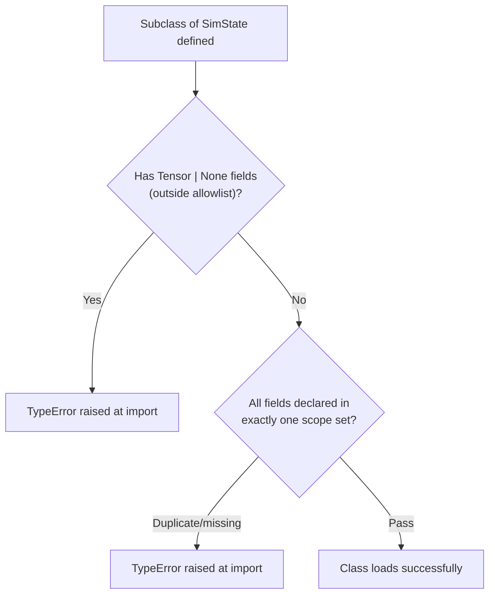
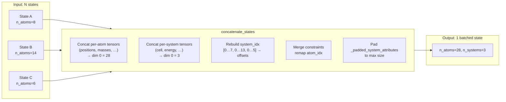

TorchSim's state system manipulates **multiple independent atomistic systems as a single flattened tensor batch**. Rather than iterating over systems in a Python loop, every property is stored in contiguous tensors indexed by `system_idx`, enabling GPU-parallel evaluation of forces, energies, and integrator steps across heterogeneous ensembles. This page dissects the five core batched operations—**concatenation, splitting, slicing, popping, and device transfer**—and the attribute-scoping machinery that makes them type-safe across the entire state hierarchy.

## The Three-Tier Attribute Model

Every state class in TorchSim classifies its tensor fields into exactly three scopes, declared via `ClassVar` sets. This classification drives how each batched operation treats every attribute during restructuring.

| Scope | Indexing axis | Example attributes | Reshape rule |
|---|---|---|---|
| **Per-atom** | `(n_atoms, …)` | `positions`, `masses`, `atomic_numbers`, `system_idx`, `momenta`, `forces` | Split/concatenate along dim 0 by atom count |
| **Per-system** | `(n_systems, …)` | `cell`, `energy`, `stress`, `charge`, `spin` | Split/concatenate along dim 0 by system count |
| **Global** | scalar or broadcast | `pbc`, `_rng`, thermostat/barostat objects | Copied from the first state, never split |

The base `SimState` declares the canonical partition: `positions`, `masses`, `atomic_numbers`, `system_idx` are per-atom; `cell`, `charge`, `spin` are per-system; `pbc` and `_rng` are global [state.py#L155-L162](torch_sim/state.py#L155-L162). Every subclass extends these sets via set union rather than overriding them, which ensures parent attributes are never accidentally dropped:

```python
# MDState adds momenta/forces to per-atom, energy to per-system
_atom_attributes = SimState._atom_attributes | {"momenta", "forces"}
_system_attributes = SimState._system_attributes | {"energy"}
```

Sources: [state.py#L155-L162](torch_sim/state.py#L155-L162), [md.py#L55-L60](torch_sim/integrators/md.py#L55-L60), [state.py](torch_sim/optimizers/state.py#L24-L25)

## Attribute Scope Enforcement at Class Definition

The `SimState.__init_subclass__` metaclass hook runs two static checks on every new subclass at import time. First, `_assert_no_tensor_attributes_can_be_none` prevents any field typed as `torch.Tensor | None` (with a small allowlist for `system_idx`, `charge`, `spin` that are coerced in `__post_init__`). This invariant exists because `torch.cat` cannot concatenate a tensor against `None` [state.py#L603-L629](torch_sim/state.py#L603-L629). Second, `_assert_all_attributes_have_defined_scope` ensures every public field name appears in exactly one of the three scope sets, catching both orphan attributes and accidental duplicates [state.py#L632-L684](torch_sim/state.py#L632-L684).



Sources: [state.py#L592-L684](torch_sim/state.py#L592-L684)

## Concatenation: Merging States into a Unified Batch

`concatenate_states` is the primary entry point for building multi-system batches. It accepts a sequence of states (all must share the same concrete class), concatenates per-atom tensors along dim 0, per-system tensors along dim 0, and copies global attributes from the first element. The `system_idx` vector is rebuilt with an incremental offset so atoms from state *k* receive indices starting at *k* [state.py#L1054-L1197](torch_sim/state.py#L1054-L1197).

The function also handles **padded system attributes**—tensors whose trailing dimensions vary across systems. `BFGSState` declares `_padded_system_attributes = {"hessian"}` because the Hessian has shape `(n_atoms × 3, n_atoms × 3)`, which differs when systems contain different atom counts. `LBFGSState` pads `s_history` and `y_history`, which carry 4-D tensors `(n_systems, history_len, max_atoms, 3)` [state.py](torch_sim/optimizers/state.py#L97-L98). During concatenation, the framework detects the tensor rank and pads to the maximum size along the variable dimension before `torch.cat` [state.py#L1160-L1197](torch_sim/state.py#L1160-L1197).

Constraints are merged through `merge_constraints`, which re-maps `atom_idx` references and adjusts system-level masks to account for the concatenated atom and system offsets [state.py#L1190-L1193](torch_sim/state.py#L1190-L1193).



Sources: [state.py#L1054-L1197](torch_sim/state.py#L1054-L1197), [state.py#L97-L98](torch_sim/optimizers/state.py#L97-L98)

## Index Normalization

Before any index-based operation runs, `_normalize_system_indices` converts the caller's index specification into a canonical `torch.Tensor` of `int64` values. It accepts four input types and resolves Python-style negative indexing for each [state.py#L732-L770](torch_sim/state.py#L732-L770):

| Input type | Handling | Example |
|---|---|---|
| `int` | Wraps negative values via `n_systems + idx`, returns 1-element tensor | `state[-1]` → last system |
| `list[int]` | Maps each element, preserves caller order | `state[[2, 0, 1]]` → permuted batch |
| `slice` | Expanded via `torch.arange(n_systems)[slice]` | `state[1:3]` → systems 1, 2 |
| `torch.Tensor` | Element-wise `torch.where` for negative values | `state[tensor([0, -1])]` → first and last |

> [!TIP]
> Tuple indexing is explicitly **not supported** and raises `TypeError`. This is intentional—tuples are ambiguous with single-element indexing in Python and would create hard-to-debug silent errors when users write `(idx,)` instead of `[idx]`.

Sources: [state.py#L732-L770](torch_sim/state.py#L732-L770)

## Slicing: Extracting Subsystems by Index

The `__getitem__` method on `SimState` delegates to `_slice_state` after normalization. Slicing is **order-preserving**: passing `[2, 0, 1]` produces a new state where original system 2 becomes system 0, original 0 becomes 1, and so on [state.py#L574-L590](torch_sim/state.py#L574-L590). Internally, `_slice_state` builds atom indices by computing cumulative atom counts per system, then calls `_filter_attrs_by_index` to extract the relevant rows from every attribute tensor [state.py#L1012-L1052](torch_sim/state.py#L1012-L1052).

The `_filter_attrs_by_index` function is the shared workhorse for both slice and pop operations. It performs three passes [state.py#L834-L892](torch_sim/state.py#L834-L892):

1. **Global scope**: copied verbatim.
2. **Per-atom scope**: indexed by the computed `atom_indices` tensor. The `system_idx` vector receives special treatment—it is **remapped** through an inverse lookup table so that the old system numbers map to consecutive new system numbers preserving the caller's ordering.
3. **Per-system scope**: indexed by `system_indices` (tensor elements) or copied (non-tensor values).
4. **Constraints**: a boolean atom mask and system mask are constructed; each constraint's `select_constraint` method determines whether it survives the filter, and `atom_idx` references are remapped to the new atom numbering [state.py#L855-L871](torch_sim/state.py#L855-L871).

```python
# Extract the last system and the first system (order preserved)
reordered = state[[2, 0]]
assert reordered.n_systems == 2
assert reordered[0] == original[2]
assert reordered[1] == original[0]
```

Sources: [state.py#L574-L590](torch_sim/state.py#L574-L590), [state.py#L834-L892](torch_sim/state.py#L834-L892), [state.py#L1012-L1052](torch_sim/state.py#L1012-L1052)

## Popping: In-Place Removal of Subsystems

The `pop` method removes one or more systems from the calling state and returns them as a list of individual states. Unlike `__getitem__`, this operation is **mutating**—the original state's attributes are replaced in-place with the "keep" subset [state.py#L529-L556](torch_sim/state.py#L529-L556). The internal `_pop_states` function derives keep/pop masks via `torch.isin` on `system_idx`, builds separate attribute dictionaries for the retained and extracted portions, then splits the extracted portion into individual states [state.py#L966-L1010](torch_sim/state.py#L966-L1010).

```python
batched = ts.concatenate_states([si, ar, fe])
popped = batched.pop([0, 2])  # removes Si and Fe
assert len(popped) == 2
assert batched.n_systems == 1  # only Ar remains, mutated in-place
```

Sources: [state.py#L529-L556](torch_sim/state.py#L529-L556), [state.py#L966-L1010](torch_sim/state.py#L966-L1010)

## Splitting: Full Decomposition into Individual States

The `split` method decomposes a batched state into a list of single-system states. It uses `torch.split` with per-system atom counts for per-atom attributes and splits per-system tensors with a chunk size of 1 [state.py#L894-L965](torch_sim/state.py#L894-L965). For each subsystem, `system_idx` is reset to an all-zeros tensor, and constraints are filtered via `select_sub_constraint` which extracts only the atoms belonging to that system [state.py#L957-L965](torch_sim/state.py#L957-L965).

```python
individual_states = batched.split()
assert len(individual_states) == batched.n_systems
assert all(s.n_systems == 1 for s in individual_states)
```

Sources: [state.py#L518-L527](torch_sim/state.py#L518-L527), [state.py#L894-L965](torch_sim/state.py#L894-L965)

## Device and Dtype Transfer

The `to` method returns a new state with all tensor attributes migrated to the target device and dtype. Per-atom, per-system, and global tensors are all transferred. `atomic_numbers` is forced to `torch.int` regardless of the requested dtype to preserve semantic correctness [state.py#L558-L572](torch_sim/state.py#L558-L572). The `torch.Generator` stored in `_rng` is also moved to the target device via `coerce_prng` [state.py#L772-L806](torch_sim/state.py#L772-L806). Critically, `to` produces a **new state object**—the original is never modified, making it safe to use within autograd graphs [test_state.py#L724-L753](tests/test_state.py#L724-L753).

Sources: [state.py#L558-L572](torch_sim/state.py#L558-L572), [state.py#L772-L806](torch_sim/state.py#L772-L806)

## Cross-Class State Casting

`from_state` enables upcasting, downcasting, and cross-casting between state classes. It copies attributes that the target class recognizes (matching against its scope sets), clones each via `_clone_attr` (which preserves `torch.Generator` state), and overlays any additional keyword arguments [state.py#L460-L492](torch_sim/state.py#L460-L492). This is the canonical way to promote a `SimState` to `MDState` or `OptimState` when initializing integrators or optimizers:

```python
md_state = MDState.from_state(
    sim_state,
    energy=model_output["energy"],
    forces=model_output["forces"],
    momenta=torch.zeros_like(sim_state.positions),
)
```

Sources: [state.py#L460-L492](torch_sim/state.py#L460-L492)

## Operations Across the State Hierarchy

All five batched operations are generic over the state type via `TypeVar[T: SimState]`, meaning they work identically on `MDState`, `OptimState`, `NPTLangevinState`, `NPTNoseHooverState`, `BFGSState`, `LBFGSState`, and any custom subclasses. The attribute scoping machinery dynamically inspects the target class's scope sets, so subclass-specific attributes are handled automatically. The following table summarizes how each state class extends the base scopes:

| State class | Added per-atom | Added per-system | Added global |
|---|---|---|---|
| `MDState` | `momenta`, `forces` | `energy` | — |
| `NPTLangevinState` | *(inherits MD)* | `stress`, `cell_positions`, `cell_velocities`, `cell_masses`, `reference_cell`, `alpha`, `cell_alpha`, `b_tau` | — |
| `NPTNoseHooverState` | *(inherits MD)* | `stress`, `reference_cell`, `cell_position`, `cell_momentum`, `cell_mass` | `thermostat`, `barostat`, `thermostat_fns`, `barostat_fns` |
| `OptimState` | `forces` | `energy`, `stress` | — |
| `BFGSState` | `prev_forces`, `prev_positions`, `atom_idx_in_system` | `hessian` *(padded)*, `alpha`, `max_step`, `n_iter`, `max_atoms` | — |
| `LBFGSState` | `prev_forces`, `prev_positions` | `step_size`, `alpha`, `n_iter`, `max_atoms`, `s_history` *(padded)*, `y_history` *(padded)* | — |

> [!TIP]
> When concatenating states with different atom counts that carry padded attributes (BFGS/L-BFGS), the padding logic operates on tensor **rank**: 3-D tensors pad the last two dimensions (Hessian), while 4-D tensors pad dimensions 1 and 2 (history buffers). This rank-based dispatch avoids fragile attribute-name checking and generalizes to future padded attributes.

Sources: [md.py#L55-L60](torch_sim/integrators/md.py#L55-L60), [npt.py#L82-L91](torch_sim/integrators/npt.py#L82-L91), [npt.py#L817-L829](torch_sim/integrators/npt.py#L817-L829), [state.py#L24-L25](torch_sim/optimizers/state.py#L24-L25), [state.py#L85-L98](torch_sim/optimizers/state.py#L85-L98), [state.py#L136-L149](torch_sim/optimizers/state.py#L136-L149)

## API Reference Summary

| Operation | Method | Mutating? | Returns | Key internal |
|---|---|---|---|---|
| Concatenate | `ts.concatenate_states(states)` | No | Single batched state | Padded attribute handling |
| Slice | `state[indices]` / `state.__getitem__` | No | New state (subset) | `_slice_state`, order-preserving |
| Pop | `state.pop(indices)` | **Yes** (in-place) | `list[Self]` (extracted) | `_pop_states`, `torch.isin` |
| Split | `state.split()` | No | `list[Self]` (one per system) | `_split_state`, `torch.split` |
| Device transfer | `state.to(device, dtype)` | No | New state on target | `_state_to_device` |
| Cross-cast | `TargetState.from_state(src, **kwargs)` | No | New target-class state | Scope-aware attribute copy |

For the conceptual foundation of `SimState` and the `system_idx` batching mechanism, see [SimState and State Hierarchy](7-simstate-and-state-hierarchy). To understand how batched states flow through simulation loops, continue to [NVE and NVT Integrators](12-nve-and-nvt-integrators) or [FIRE and Gradient Descent Optimizers](15-fire-and-gradient-descent-optimizers). The memory implications of large batches are covered in [Automatic Batching and GPU Memory](18-automatic-batching-and-gpu-memory).