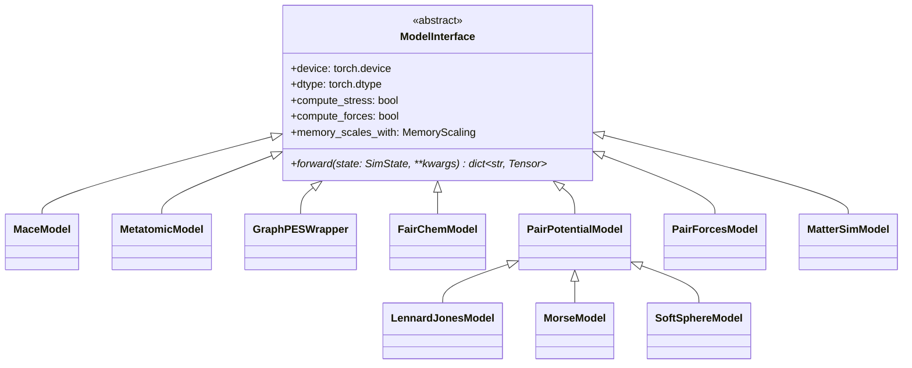
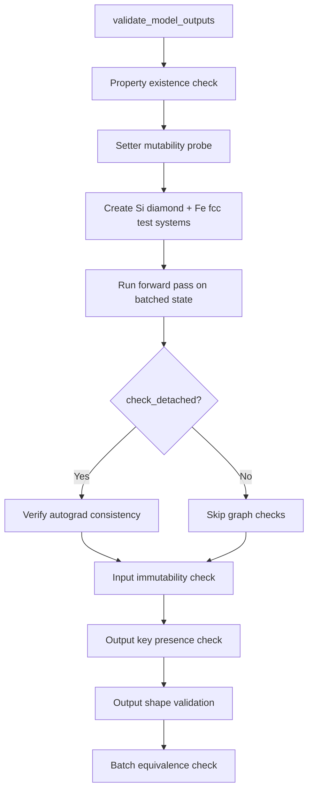

TorchSim's model system is built around a single abstract contract — the `ModelInterface` — that every model, whether a billion-parameter MLIP or a two-parameter Lennard-Jones potential, must satisfy. This page dissects that contract, explains the adapter layer that bridges external models into TorchSim, and demonstrates how to write your own model that plugs directly into the simulation engine.

## The ModelInterface Contract

At the heart of `torch_sim/models/interface.py` lives `ModelInterface`, an abstract class that simultaneously inherits from `torch.nn.Module` and `ABC` ([interface.py#L38](torch_sim/models/interface.py#L38-L38)). This dual inheritance is intentional: it guarantees that every model is a proper PyTorch module (enabling parameter management, `to()` calls, and device/dtype tracking) while enforcing a compile-time contract through abstract methods. The interface defines exactly what the simulation engine — integrators, optimizers, runners — can expect from any model instance.

### Required Properties

Every `ModelInterface` implementation must expose four managed properties, each backed by a private underscore attribute ([interface.py#L72-L75](torch_sim/models/interface.py#L72-L75)):

| Property | Type | Purpose | Post-init Settable |
|---|---|---|---|
| `device` | `torch.device` | Where all model tensors reside | Only if setter is overridden |
| `dtype` | `torch.dtype` | Floating-point precision for computations | Only if setter is overridden |
| `compute_stress` | `bool` | Whether `forward()` includes stress in output | Only if setter is overridden |
| `compute_forces` | `bool` | Whether `forward()` includes forces in output | Only if setter is overridden |

A critical design choice: all property setters default to raising `NotImplementedError` ([interface.py#L83-L87](torch_sim/models/interface.py#L83-L87)). This means you cannot change a model's device, dtype, or computation flags after construction *unless the adapter explicitly opts in*. This prevents silent misconfiguration — a model moved to CUDA mid-simulation without proper tensor migration would produce incorrect results. Adapters that support post-init modification (like certain pair potentials) override these setters explicitly.

The fifth property, `memory_scales_with`, is special. It returns a `MemoryScaling` value — either `"n_atoms_x_density"` or `"n_atoms"` ([interface.py#L126-L133](torch_sim/models/interface.py#L126-L133)). This hint drives the [Automatic Batching](18-automatic-batching-and-gpu-memory) system's decision about how to split large batches across GPU memory. Models with radial cutoffs (most MLIPs) scale with atom count times number density because their neighbor lists grow with system volume. Models that always use a fixed number of neighbors (like some GraphPES models with small cutoffs) can declare `"n_atoms"` for more efficient batching.

### The `forward()` Method: The Universal Contract

The single abstract method, `forward()`, accepts a `SimState` and returns a `dict[str, torch.Tensor]` ([interface.py#L135-L168](torch_sim/models/interface.py#L135-L168)). The input `SimState` carries all atomic information — positions, cell vectors, system indices, atomic numbers, and PBC flags. The output dictionary must contain at minimum:

| Key | Shape | Required Condition |
|---|---|---|
| `"energy"` | `[n_systems]` | Always |
| `"forces"` | `[n_atoms, 3]` | When `compute_forces=True` |
| `"stress"` | `[n_systems, 3, 3]` | When `compute_stress=True` |

The `n_atoms` dimension is the *total* number of atoms across all batched systems, while `n_systems` is the batch dimension. This flattened atom layout is central to TorchSim's performance — it eliminates Python-level loops over systems and enables fully vectorized GPU kernels.

> [!TIP]
> Models must not mutate the input `SimState` during `forward()`. The validator explicitly clones positions, cell, system_idx, and atomic_numbers before calling forward, then verifies they remain unchanged ([interface.py#L283-L291](torch_sim/models/interface.py#L283-L291)). Violating this invariant causes silent data corruption in integrators that cache state.

### Output Detachment and the Computation Graph

TorchSim draws a sharp distinction between *differentiable* and *non-differentiable* model outputs. The `_check_output_detached()` utility enforces this contract ([interface.py#L171-L201](torch_sim/models/interface.py#L171-L201)): when a model's `retain_graph` attribute is `False` (the default), all output tensors must be detached from the autograd graph. When `retain_graph=True`, all output tensors must carry gradients. This binary choice prevents a common failure mode where some tensors retain a graph (leaking GPU memory) while others don't (breaking backpropagation consistency).

The `retain_graph` flag exists for advanced use cases like differentiable simulation, where you need to backpropagate through the energy landscape to optimize model parameters during a simulation trajectory. Most production simulations leave this `False`.

## Model Validation

TorchSim provides `validate_model_outputs()` — a comprehensive test harness that verifies a model conforms to the interface contract ([interface.py#L204-L351](torch_sim/models/interface.py#L204-L351)). It performs six categories of checks:

The validator creates two canonical test structures — silicon diamond (8 atoms) and iron fcc (12 atoms, 3×1×1 supercell) — and runs them both as a batch and individually ([interface.py#L262-L271](torch_sim/models/interface.py#L262-L271)). It then verifies that the batched result equals the concatenation of individual results to within `1e-3` tolerance ([interface.py#L311-L342](torch_sim/models/interface.py#L311-L342)). This catches subtle batching bugs where system indices are incorrectly mapped.

> [!TIP]
> When adding a new model to TorchSim, always run `validate_model_outputs()` with `check_detached=True` during development. The default `False` exists only to avoid breaking existing external code, but it skips the autograd graph checks that catch the most common memory leak patterns.

## The Adapter Layer: Bridging External Models

External MLIP packages each have their own data structures, neighbor list formats, and calling conventions. The adapter layer — each model file in `torch_sim/models/` — translates between TorchSim's `SimState` and the external model's expectations. Despite the diversity of source packages, adapters fall into three distinct architectural patterns based on how they handle batching and neighbor lists.

### Pattern 1: Graph-Based Adapters (Batched Internal)

Models like MACE and GraphPES natively support batched computation on graph-structured data. The adapter builds a single graph containing all systems, calls the model once, and splits the output. MaceModel exemplifies this pattern ([mace.py#L232-L350](torch_sim/models/mace.py#L232-L350)):

1. **State extraction**: Pull positions, cell, atomic numbers, system indices from `SimState`
2. **Preprocessing**: Wrap positions into the unit cell via `pbc_wrap_batched`, build neighbor lists with the linked-cell algorithm
3. **Graph assembly**: Construct the MACE data dict with `ptr` (system boundary pointers), `node_attrs` (one-hot encoded atomic types), `edge_index`, shifts, and cell
4. **Single forward call**: Pass the assembled graph to the underlying MACE model
5. **Output extraction**: Detach energy, forces, and stress tensors

GraphPESWrapper follows the same pattern but adds an intermediate `AtomicGraph` conversion step ([graphpes_framework.py#L56-L97](torch_sim/models/graphpes_framework.py#L56-L97)). It also has a subtle cutoff handling detail: the neighbor list cutoff is bumped by `1e-5` to avoid edge effects where pairs exactly at the cutoff boundary might be inconsistently included or excluded across steps ([graphpes_framework.py#L70-L76](torch_sim/models/graphpes_framework.py#L70-L76)).

### Pattern 2: System-Loop Adapters

Metatomic models cannot accept batched input — each structure must be processed as a separate `System` object. The adapter loops over systems, computes gradients separately, and concatenates results ([metatomic.py#L149-L289](torch_sim/models/metatomic.py#L149-L289)). This has two noteworthy implications:

- **Neighbor lists move to CPU and back**: Metatomic's neighbor computation currently requires CPU execution via vesin, so the adapter transfers data to CPU, computes neighbors, then moves back to the model's device ([metatomic.py#L224-L230](torch_sim/models/metatomic.py#L224-L230))
- **Forces via external autograd**: Unlike most MLIPs that compute forces internally, metatomic requires the caller to run `torch.autograd.grad` on the energy with respect to positions ([metatomic.py#L252-L256](torch_sim/models/metatomic.py#L252-L256)). The adapter creates a strain tensor for stress computation and applies it to both positions and cell before calling the model

### Pattern 3: Autograd-Based Force Computation (Pair Potentials)

The `PairPotentialModel` takes a fundamentally different approach: it accepts a callable `pair_fn(distances, atomic_numbers_i, atomic_numbers_j) → pair_energies` and computes forces analytically via PyTorch autograd ([pair_potential.py#L283-L470](torch_sim/models/pair_potential.py#L283-L470)). The workflow is:

1. Build neighbor list and compute pairwise displacement vectors
2. Evaluate `pair_fn` on all pairs (with distances requiring gradients)
3. Accumulate pair energies into per-system totals
4. Call `torch.autograd.grad` on total pair energy w.r.t. distances to get `dV/dr`
5. Construct force vectors as `(-dV/dr / |r|) × r_vec` and accumulate per-atom

A `reduce_to_half_list` flag controls whether the neighbor list is reduced to unique i<j pairs ([pair_potential.py#L318-L319](torch_sim/models/pair_potential.py#L318-L319)). When `True`, Newton's third law is applied explicitly (accumulate forces symmetrically on both atoms). When `False`, each pair appears twice (i→j and j→i) and forces are accumulated only on the source atom to avoid double-counting ([pair_potential.py#L436-L446](torch_sim/models/pair_potential.py#L436-L446)). The `PairForcesModel` variant handles the case where the interaction cannot be expressed as an energy gradient — it accepts a `force_fn` directly instead of a `pair_fn` ([pair_potential.py#L473-L542](torch_sim/models/pair_potential.py#L473-L542)).

## Adapter Comparison Matrix

The following table summarizes the key architectural differences across adapter implementations, which affect performance characteristics and feature availability:

| Adapter | Batching Strategy | Force Computation | Stress Method | Neighbor List | `memory_scales_with` |
|---|---|---|---|---|---|
| **MaceModel** | Single graph batch | Internal (MACE) | Internal | torchsim_nl | `n_atoms_x_density` |
| **MetatomicModel** | Per-system loop | External autograd | Strain tensor + autograd | vesin (CPU round-trip) | `n_atoms_x_density` |
| **GraphPESWrapper** | Single graph batch | Internal (graph-pes) | Internal | torchsim_nl | `n_atoms` or `n_atoms_x_density` |
| **FairChemModel** | ASE → AtomicData batch | Internal (predictor) | Internal | Built-in | `n_atoms` |
| **PairPotentialModel** | Single tensor batch | Autograd on distances | Virial formula | torchsim_nl | `n_atoms_x_density` |
| **PairForcesModel** | Single tensor batch | Direct `force_fn` | Virial formula | torchsim_nl | `n_atoms_x_density` |
| **MatterSimModel** | Internal | Internal (MatterSim) | Internal | Built-in | — |

Note that GraphPESWrapper dynamically sets `memory_scales_with` based on the underlying model's cutoff value — if the cutoff is less than 0.5 (indicating a fixed-neighbor-count model), it uses `"n_atoms"` ([graphpes_framework.py#L168-L169](torch_sim/models/graphpes_framework.py#L168-L169)).

## Output Conventions and Edge Cases

Across all adapters, several output conventions are consistently enforced. Energy is always per-system (not per-atom), forces are always per-atom with shape `[n_atoms, 3]`, and stress is always a Voigt-notation 3×3 tensor per system. When `compute_forces=False` or `compute_stress=False`, the corresponding keys are simply absent from the output dictionary — the simulation engine checks for key presence, not value truthiness.

The `PairPotentialModel` additionally supports optional `per_atom_energies` and `per_atom_stresses` outputs (keys `"energies"` and `"stresses"`), which distribute system-level quantities to individual atoms for analysis ([pair_potential.py#L417-L465](torch_sim/models/pair_potential.py#L417-L465)). These are not part of the core interface contract but are exposed through the pair potential's extended API.

When a model cannot compute a requested property (e.g., stress for a model that doesn't support it), the `validate_model_outputs` function gracefully handles this by probing the setter — if setting `compute_stress = True` raises `NotImplementedError`, stress validation is skipped entirely ([interface.py#L248-L253](torch_sim/models/interface.py#L248-L253)).

## Writing a Custom Model Adapter

To integrate a new model into TorchSim, you need to implement the `ModelInterface` contract. The minimal implementation requires setting the four core properties and providing a `forward()` method that accepts `SimState` and returns the required output dictionary. The full process for contributing a model to the repository is documented in [Adding New Models](../dev/add_model), but the core implementation pattern is:

```mermaid
flowchart LR
    A["Define class inheriting\nModelInterface"] --> B["Set _device, _dtype,\n_compute_forces, _compute_stress"]
    B --> C["Implement forward(state)"]
    C --> D["Extract positions, cell,\natomic_numbers from SimState"]
    D --> E["Transform to external\nmodel's input format"]
    E --> F["Call external model"]
    F --> G["Extract energy, forces,\nstress from output"]
    G --> H["Detach tensors\n(return dict)"]
    H --> I["Run validate_model_outputs()\nto verify compliance"]
```

The developer guide specifies that new models should be placed in `torch_sim/models/`, tested with both `validate_model_outputs` and a calculator consistency test, and imported into `torch_sim.models.__init__.py` with a try/except clause to handle optional dependencies gracefully ([add_model.md#L12-L23](docs/dev/add_model.md#L12-L23)). This ensures that users who haven't installed a particular MLIP package can still import TorchSim without errors.

The recommended validation sequence during development is: first run `validate_model_outputs()` with default arguments to catch shape and key errors, then run it with `check_detached=True` to verify autograd graph hygiene, and finally run the calculator consistency test to ensure results match the external model's own ASE calculator interface.

---

For the next step in understanding the model system, see [Supported MLIP Models](10-supported-mlip-models) for detailed per-model configuration and initialization patterns. To understand how models interact with the simulation state they consume, revisit [SimState and State Hierarchy](7-simstate-and-state-hierarchy). For the batching implications of `memory_scales_with`, proceed to [Automatic Batching and GPU Memory](18-automatic-batching-and-gpu-memory).