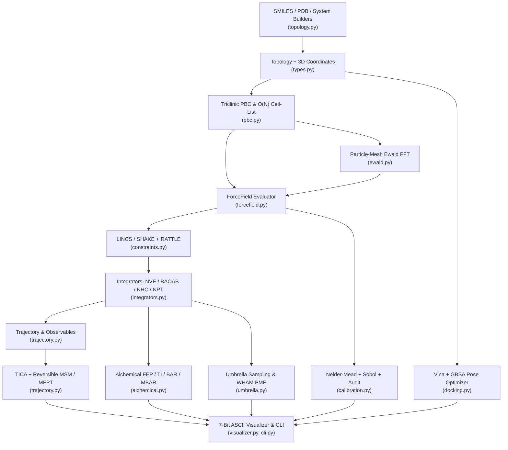
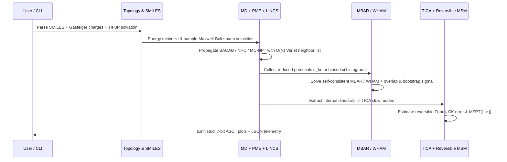

# ChemiVerlet

[](https://github.com/ZengLLQ/chemi-verlet/actions/workflows/ci.yml)
[](https://www.python.org/downloads/)
[](LICENSE)
[](#scientific-architecture)

Atomistic molecular dynamics engine with particle-mesh Ewald electrostatics, LINCS bond constraints, alchemical BAR/MBAR free-energy perturbation, WHAM umbrella sampling, and Markov state trajectory kinetics.

---

## Executive Overview

**ChemiVerlet** is a modular, pure-Python/NumPy/SciPy computational chemistry and statistical mechanics simulation suite engineered without heavy native extensions or fragile platform binaries. It unifies structure-based cheminformatics, atomistic molecular mechanics, spectral electrostatics, symplectic and stochastic ensemble integrators, alchemical and umbrella free-energy estimators, and kinetic trajectory analysis inside a single coherent codebase:

- **Cheminformatics & Topology Construction (`chemi_verlet.topology`)**: Pure-Python SMILES parser supporting aromaticity, bracketed formal charges, branches, and ring closures; BFS/GF(2) Smallest Set of Smallest Rings (SSSR) perception; iterative Gasteiger-Marsili partial charge equalization; automated GAFF/UFF-inspired force-field typing; `.pdb` and `.gro` coordinate I/O; and explicit 3-site TIP3P solvated ligand and host-guest complex builders.
- **Periodic Geometry & $O(N)$ Cell-Linked Neighbor Lists (`chemi_verlet.pbc`)**: Arbitrary triclinic and orthorhombic minimum-image conventions with Verlet skin-buffered 3D fractional cell lists and 1-2/1-3 exclusion plus 1-4 scaling awareness.
- **Analytical Force Field (`chemi_verlet.forcefield`)**: Harmonic bonds and angles, proper periodic and Ryckaert-Bellemans dihedrals (exact Blondel-Karplus torque projections), harmonic impropers, $C^2$-switched and shifted Lennard-Jones 12-6 with isotropic dispersion tail corrections, Beutler soft-core alchemical $\lambda$-coupling with exact $\partial U / \partial \lambda$, Onsager Reaction-Field electrostatics, and harmonic center-of-mass restraints.
- **Spectral Particle-Mesh Ewald (`chemi_verlet.ewald`)**: Smooth Cardinal B-spline charge spreading, Euler exponential spline modulus correction (with Nyquist zero-mode singularity guarding), 3D FFT reciprocal potential and force interpolation, analytical reciprocal virial tensor, and an $O(N \cdot N_k)$ Exact Ewald reference solver.
- **Holonomic Constraints & Ensembles (`chemi_verlet.constraints`, `chemi_verlet.integrators`)**: SHAKE/RATTLE and Neumann-series LINCS with rotational lengthening correction; Velocity-Verlet (NVE), Langevin BAOAB splitting (NVT), Martyna-Klein-Tuckerman Nosé-Hoover Chains (NVT, $M=3$), and Monte-Carlo / Berendsen barostats (NPT).
- **Free Energy & Drug Discovery (`chemi_verlet.alchemical`, `chemi_verlet.umbrella`, `chemi_verlet.docking`)**: Zwanzig FEP, Thermodynamic Integration (TI), Bennett Acceptance Ratio (BAR), Shirts-Chodera Multistate BAR (MBAR) with SVD asymptotic covariance and overlap diagnostics, log-space self-consistent WHAM with block-bootstrap uncertainty, Jarzynski steered-MD work estimator, and Vina-empirical + Still Generalized Born/SASA simulated-annealing docking.
- **Trajectory Kinetics, Calibration & Visualization (`chemi_verlet.trajectory`, `chemi_verlet.calibration`, `chemi_verlet.visualizer`)**: Kabsch SVD RMSD, RMSF, periodic RDF $g(r)$, hydrogen-bond geometry, TICA, reversible MLE Markov State Models with Chapman-Kolmogorov and MFPT validation, bounded Nelder-Mead parameter calibration, Saltelli-Jansen Sobol global sensitivity analysis, and strict 7-bit ASCII terminal plotting.

---

## Scientific Architecture



### Thermodynamic & Kinetic Workflow Pipeline



---

## Mathematical Formulations & Physical Invariants

### 1. Periodic Boundary Conditions & Minimum-Image Geometry

A general triclinic simulation cell is represented by lattice column vectors $\mathbf{H} = [\mathbf{a}, \mathbf{b}, \mathbf{c}] \in \mathbb{R}^{3\times 3}$ with cell volume $V = \det(\mathbf{H}) > 0$. Fractional coordinates $\mathbf{s}_i = \mathbf{H}^{-1} \mathbf{r}_i$ are wrapped into $[0, 1)^3$, and exact minimum-image pair displacements are computed via:

$$\Delta \mathbf{r}_{ij}^{\text{MIC}} = \mathbf{H} \left[ \mathbf{H}^{-1}(\mathbf{r}_j - \mathbf{r}_i) - \operatorname{round}\!\left(\mathbf{H}^{-1}(\mathbf{r}_j - \mathbf{r}_i)\right) \right]$$

### 2. Bonded & Nonbonded Potential Energy Surface

The total molecular mechanics potential decomposes as:

$$U(\mathbf{r}; \lambda) = U_{\text{bond}} + U_{\text{angle}} + U_{\text{dihedral}} + U_{\text{RB}} + U_{\text{improper}} + U_{\text{LJ,sc}}(\lambda_{\text{vdW}}) + U_{\text{tail}} + U_{\text{elec}}(\lambda_{\text{elec}}) + U_{\text{restraint}}$$

- **Harmonic Bonds & Angles**:
  $$U_{\text{bond}} = \sum_{b} \frac{1}{2} k_b (r_{ij} - r_0)^2, \qquad U_{\text{angle}} = \sum_{a} \frac{1}{2} k_\theta (\theta_{ijk} - \theta_0)^2$$
- **Proper Periodic & Ryckaert-Bellemans Dihedrals** (with exact Blondel-Karplus analytical torque projections):
  $$U_{\text{dihedral}} = \sum_{d} k_\phi \left[1 + \cos(n\phi - \delta)\right], \qquad U_{\text{RB}} = \sum_{d} \sum_{m=0}^{5} C_m \cos^m(\phi - \pi)$$
- **Beutler Soft-Core Lennard-Jones 12-6**:
  For alchemical-environment pairs coupled by $\lambda_v \in [0, 1]$ with softness $\alpha_{\text{sc}} = 0.5$:
  $$U_{\text{sc}}(r; \lambda_v) = 4 \epsilon_{ij} \lambda_v^p \left[ \left(\alpha_{\text{sc}}(1 - \lambda_v)^q + \left(\frac{r}{\sigma_{ij}}\right)^6\right)^{-2} - \left(\alpha_{\text{sc}}(1 - \lambda_v)^q + \left(\frac{r}{\sigma_{ij}}\right)^6\right)^{-1} \right]$$
  yielding exact analytical $\frac{\partial U_{\text{sc}}}{\partial \lambda_v}$ for Thermodynamic Integration alongside $C^2$ cubic force-switching on $[r_{\text{switch}}, r_c]$ and isotropic analytical dispersion tail correction:
  $$U_{\text{tail}} = -\frac{2\pi}{3 V r_c^3} \sum_{i < j} 4 \epsilon_{ij} \sigma_{ij}^6$$

### 3. Smooth Particle-Mesh Ewald (PME) Electrostatics

Splitting the $1/r$ Coulomb kernel via $\operatorname{erfc}(\alpha r) + \operatorname{erf}(\alpha r)$ yields four exact terms (with $f_e = \frac{1}{4\pi\varepsilon_0} = 138.935458\text{ kJ}\cdot\text{nm}/(\text{mol}\cdot e^2)$):

$$U_{\text{PME}} = \frac{f_e}{2} \sum_{i \ne j}' q_i q_j \frac{\operatorname{erfc}(\alpha r_{ij})}{r_{ij}} - f_e \sum_{(i,j)\in\mathcal{E}} q_i q_j \frac{\operatorname{erf}(\alpha r_{ij})}{r_{ij}} + \frac{1}{2}\sum_{\mathbf{m}} Q(\mathbf{m}) \Phi(\mathbf{m}) - f_e \frac{\alpha}{\sqrt{\pi}}\sum_i q_i^2 - f_e \frac{\pi}{2 V \alpha^2} \left(\sum_i q_i\right)^2$$

Charges are interpolated onto a $(K_1, K_2, K_3)$ mesh using order-$p$ Cardinal B-splines $M_p(u_\alpha - m_\alpha)$, transformed via 3D FFT, multiplied by the Euler spline modulus influence function $G(\mathbf{k}) = \frac{f_e K_1 K_2 K_3}{\pi V} \frac{\exp(-\pi^2 |\mathbf{m}'|^2 / \alpha^2)}{|\mathbf{m}'|^2} \prod_{\alpha=1}^3 |b_\alpha(m_\alpha)|^2$ (safely zeroing odd-order Nyquist modes), and differentiated analytically on the B-spline support to obtain $\mathbf{F}_i^{\text{rec}}$ and the reciprocal virial tensor $\Xi_{\alpha\beta}^{\text{rec}}$.

### 4. Holonomic Constraints (LINCS & SHAKE/RATTLE)

For bond constraints $g_k(\mathbf{r}) = |\mathbf{r}_{j_k} - \mathbf{r}_{i_k}| - d_k = 0$, LINCS constructs the normalized constraint direction matrix $\mathbf{B}$, inverse-mass coupling matrix $\mathbf{A} = -\mathbf{S}(\mathbf{B}\mathbf{M}^{-1}\mathbf{B}^T - \mathbf{S}^{-2})\mathbf{S}$, solves $(\mathbf{I} - \mathbf{A})^{-1}$ via truncated Neumann series $\sum_{n=0}^{N_{\text{order}}} \mathbf{A}^n$, and applies iterative rotational lengthening correction $d_{\text{corr}} = \sqrt{2 d_k^2 - |\mathbf{r}_{j_k} - \mathbf{r}_{i_k}|^2}$.

### 5. Symplectic, Langevin BAOAB & Nosé-Hoover Chain Integrators

- **Langevin BAOAB**: Symmetric operator splitting $\mathcal{L} = \mathcal{L}_B(\Delta t/2)\,\mathcal{L}_A(\Delta t/2)\,\mathcal{L}_O(\Delta t)\,\mathcal{L}_A(\Delta t/2)\,\mathcal{L}_B(\Delta t/2)$ with exact Ornstein-Uhlenbeck velocity thermalization $c_1 = e^{-\gamma \Delta t}$, $c_2 = \sqrt{k_B T (1 - c_1^2)/m_i}$.
- **Nosé-Hoover Chain ($M=3$)**: Martyna-Klein-Tuckerman symmetric Liouville factorization with 3-step Yoshida-Suzuki sub-stepping conserving the extended Hamiltonian:
  $$H_{\text{NHC}} = K + U + \sum_{k=1}^{M} \frac{Q_k v_{\xi_k}^2}{2} + g k_B T \xi_1 + k_B T \sum_{k=2}^{M} \xi_k$$
- **NPT Pressure**: Instantaneous virial pressure $P = \frac{\operatorname{Tr}(\mathbf{K}_2 + \boldsymbol{\Xi})}{3 V}$ coupled to Metropolis Monte-Carlo volume moves with acceptance weight $\Delta W = \Delta U + P_{\text{ext}} \Delta V - N k_B T \ln(V_{\text{new}}/V_{\text{old}})$.

### 6. Alchemical MBAR & WHAM Free-Energy Estimators

- **Multistate Bennett Acceptance Ratio (MBAR)**: Given $K$ states with $N_k$ samples and reduced potentials $u_{kn} = \beta U_k(\mathbf{x}_n)$, dimensionless free energies $\{f_k\}$ satisfy the self-consistent nonlinear system:
  $$f_k = -\ln \sum_{n=1}^{N} \frac{\exp(-u_{kn})}{\sum_{j=1}^{K} N_j \exp(f_j - u_{jn})}, \qquad \boldsymbol{\Theta} = \left( (\mathbf{W}^T \mathbf{W})^+ - \operatorname{diag}(\mathbf{N}) \right)^+$$
  producing asymptotic uncertainty $\sigma(\Delta f_{ij}) = \sqrt{\Theta_{ii} + \Theta_{jj} - 2\Theta_{ij}}$, row-stochastic overlap matrix $\mathbf{O}$, and Kish effective sample sizes $\text{ESS}_k = (\sum_n W_{nk}^2)^{-1}$.
- **Weighted Histogram Analysis Method (WHAM)**: Self-consistent log-space iteration for unbiased bin probabilities $P_b$ and window offsets $F_w$:
  $$P_b = \frac{\sum_{w} M_{w,b}}{\sum_{w} N_w \exp\!\left(f_w - \beta U_{\text{bias}}^{(w)}(\xi_b)\right)}, \qquad W(\xi_b) = -k_B T \ln P_b$$

### 7. Reversible Markov State Models & TICA

Time-Lagged Independent Component Analysis solves the generalized eigenvalue problem $\mathbf{C}(\tau)\mathbf{v} = \lambda \mathbf{C}(0)\mathbf{v}$. Microstate transition counts $C_{ij}(\tau)$ are symmetrized via fixed-point MLE satisfying detailed balance $\pi_i T_{ij} = \pi_j T_{ji}$, yielding implied timescales $t_k(\tau) = -\tau / \ln |\mu_k|$, Chapman-Kolmogorov validation residual $\|\mathbf{T}(\tau)^2 - \mathbf{T}(2\tau)\|_F$, and exact Mean First-Passage Times (MFPT) from $(\mathbf{I} - \mathbf{T}_{-t})\mathbf{m}_t = \tau \mathbf{1}$.

---

## Subsystem & Module Map

| Module | Responsibilities | Key Classes & Functions |
| :--- | :--- | :--- |
| `chemi_verlet.types` | Physical constants, unit conversions, box geometry, topology & state dataclasses | `SimulationBox`, `Topology`, `AtomSpec`, `MDState`, `EnergyBreakdown`, `FreeEnergyEstimate`, `PMFProfile`, `MarkovModelResult` |
| `chemi_verlet.pbc` | Triclinic/orthorhombic wrapping, MIC vectors, $O(N)$ cell-linked Verlet lists | `wrap_positions`, `minimum_image_displacement`, `CellListNeighborFinder`, `compute_pair_list_direct` |
| `chemi_verlet.topology` | SMILES parser, GF(2) SSSR rings, Gasteiger charges, PDB/GRO I/O, system builders | `parse_smiles`, `smiles_to_topology`, `build_alkane_chain`, `build_solvated_ligand_box`, `build_host_guest_complex` |
| `chemi_verlet.ewald` | Cardinal B-spline PME spectral electrostatics + Exact $O(N N_k)$ Ewald reference | `ParticleMeshEwald`, `optimal_ewald_alpha`, `bspline_values_and_derivatives`, `exact_ewald_energy_forces` |
| `chemi_verlet.forcefield` | Bonded, RB, improper, switched/soft-core LJ, tail, Reaction-Field & restraints | `ForceField`, `ForceFieldConfig`, `HarmonicCOMRestraint`, `finite_difference_forces` |
| `chemi_verlet.constraints` | Holonomic distance & velocity constraints | `LincsSolver`, `ShakeSolver`, `constraint_rms_deviation` |
| `chemi_verlet.integrators` | Energy minimization, MB velocities, NVE, BAOAB, NHC, MC/Berendsen NPT | `VelocityVerletIntegrator`, `LangevinBAOABIntegrator`, `NoseHooverChainIntegrator`, `MonteCarloBarostat`, `run_simulation` |
| `chemi_verlet.docking` | Vina empirical + Still GBSA scoring and quaternion simulated annealing | `score_protein_ligand_pose`, `compute_gbsa_desolvation`, `optimize_binding_pose` |
| `chemi_verlet.alchemical` | FEP, TI, BAR, MBAR solvers, overlap/ESS diagnostics, thermodynamic cycles | `zwanzig_fep`, `solve_bar_pair`, `solve_mbar`, `run_alchemical_fep`, `compute_relative_binding_ddg` |
| `chemi_verlet.umbrella` | Self-consistent WHAM PMF, block bootstrap, Jarzynski work estimator | `solve_wham`, `run_umbrella_sampling`, `jarzynski_free_energy`, `compute_com_distance` |
| `chemi_verlet.trajectory` | Kabsch RMSD, RMSF, RDF $g(r)$, H-bonds, TICA, reversible MSM, MFPT | `kabsch_rmsd`, `compute_rdf`, `detect_hydrogen_bonds`, `compute_tica`, `build_markov_state_model`, `compute_mfpt_matrix` |
| `chemi_verlet.calibration` | Bounded Nelder-Mead fitting, Saltelli Sobol indices, conservation audit | `bounded_nelder_mead`, `sobol_sensitivity_indices`, `calibrate_lj_parameters`, `run_conservation_audit` |
| `chemi_verlet.visualizer` | Strict 7-bit ASCII plots, overlap heatmaps, and summary tables | `render_energy_profile`, `render_rdf_plot`, `render_mbar_summary`, `render_pmf_profile`, `render_msm_summary` |
| `chemi_verlet.cli` | Console entry point with 7 operational subcommands and `--json` export | `main`, `build_parser` |

---

## Installation & Quickstart

```bash
git clone https://github.com/ZengLLQ/chemi-verlet.git
cd chemi-verlet
pip install -e .[dev]
```

### CLI Reference

| Subcommand | Purpose | Example |
| :--- | :--- | :--- |
| `simulate` | Run NVE/NVT/NPT MD on a solvated SMILES solute with PME & LINCS | `chemi-verlet simulate --smiles "CCO" --waters 12 --ensemble nvt --thermostat nhc --steps 100` |
| `alchemical` | Run multi-$\lambda$ alchemical decoupling with FEP/TI/BAR/MBAR | `chemi-verlet alchemical --smiles "CO" --windows 6 --steps-per-window 100` |
| `umbrella` | Run umbrella pulling along host-guest COM distance & WHAM PMF | `chemi-verlet umbrella --smiles "c1ccccc1O" --windows 6 --steps-per-window 100` |
| `dock` | Score & optimize a SMILES ligand inside the receptor pocket | `chemi-verlet dock --smiles "CC(=O)Oc1ccccc1C(=O)O" --iterations 250` |
| `msm` | Sample pentane conformations & fit TICA + reversible MSM | `chemi-verlet msm --n-trajectories 4 --steps 150 --states 4` |
| `calibrate` | Run Nelder-Mead LJ fitting, Sobol sensitivity & conservation audit | `chemi-verlet calibrate --max-iter 20` |
| `demo` | Execute end-to-end showcase across MD, docking, and conservation audit | `chemi-verlet --json demo --seed 42` |

---

## Python SDK Walkthrough

```python
from chemi_verlet import (
    ForceField,
    ForceFieldConfig,
    SimulationConfig,
    build_solvated_ligand_box,
    compute_rdf,
    run_simulation,
    render_mbar_summary,
)

# 1. Parse ethanol SMILES, assign Gasteiger charges, and solvate in TIP3P water
topo, coords, box = build_solvated_ligand_box("CCO", box_length_nm=2.3, n_waters=16, seed=42)

# 2. Configure PME electrostatics + switched Lennard-Jones force field
ff = ForceField(topo, ForceFieldConfig(cutoff=0.9, switch_distance=0.75, electrostatics="pme"))

# 3. Run canonical Nosé-Hoover Chain NVT dynamics with LINCS constraints
cfg = SimulationConfig(dt_ps=0.002, n_steps=120, ensemble="nvt", thermostat="nhc", constraint_mode="lincs")
final_state, traj = run_simulation(topo, ff, coords, box, config=cfg)

# 4. Compute water oxygen-oxygen Radial Distribution Function g(r)
ow_indices = [a.index for a in topo.atoms if a.name == "OW"]
r_nm, g_r = compute_rdf(traj, ow_indices, ow_indices, r_max=0.95, n_bins=24)
```

---

## Numerical Verification & Conservation Benchmarks

Verified across the automated test suite (`tests/`) and `chemi-verlet calibrate`:

| Verification Target | Metric / Test Oracle | Measured Accuracy / Bound |
| :--- | :--- | :--- |
| Analytical Bonded, RB & Improper Forces | Central finite difference ($\delta = 10^{-6}\text{ nm}$) | $< 10^{-4}$ relative error |
| Beutler Soft-Core $\partial U / \partial \lambda_{\text{vdW}}, \partial U / \partial \lambda_{\text{elec}}$ | Central finite difference ($\delta = 10^{-6}$) | $< 10^{-4}$ relative error |
| PME vs. Exact $O(N \cdot N_k)$ Ewald (Orthorhombic & Triclinic) | Energy & force RMSE ($k_{\max}=11$, $p=6$) | $< 10^{-3}$ energy, $< 2\times 10^{-3}$ force RMSE |
| LINCS & SHAKE/RATTLE Holonomic Constraints | Rigid TIP3P 3-bond water triangles during NVT | $< 10^{-6}\text{ nm}$ constraint RMS |
| Velocity-Verlet NVE Energy Conservation | Unconstrained butane ($\Delta t = 1\text{ fs}$, 200 steps) | $< 5 \times 10^{-3}$ relative total energy std |
| MBAR & BAR Analytical Free-Energy Recovery | 3-state harmonic oscillators ($\Delta f = \frac{1}{2}\ln(k_2/k_0)$) | Within $1\sigma$ analytical uncertainty |
| WHAM Double-Well PMF Recovery | 11-window Metropolis sampling ($W(x) = 8(x^2-1)^2 + 1.5x$) | $< 1.2\text{ kJ/mol}$ interior RMSE |
| Reversible MSM Detailed Balance | Symmetrized transition matrix $\pi_i T_{ij} = \pi_j T_{ji}$ | $< 10^{-7}$ flux asymmetry |

### Sample 7-Bit ASCII Output

```text
=== Alchemical Free Energy Summary (kJ/mol) ===
  MBAR   :     -3.418 +/-  0.612
  BAR    :     -3.395 +/-  0.629
  TI     :     -3.512 +/-  0.704
  FEP fwd:     -3.110 | rev:     -3.688 | hyst:  0.578

--- MBAR State Overlap Matrix (ramp ' .:-=+*#@') ---
    W0  W1  W2  W3  W4 
W0  **  --  ..          (ESS= 41.2)
W1  --  **  --  ..      (ESS= 44.8)
W2  ..  --  **  --  ..  (ESS= 46.1)
W3      ..  --  **  --  (ESS= 43.7)
W4          ..  --  **  (ESS= 42.5)
```

---

## Standalone Examples

- [`examples/01_solvated_ligand_pme_npt.py`](https://github.com/ZengLLQ/chemi-verlet/blob/HEAD/examples/01_solvated_ligand_pme_npt.py) — Solvated ethanol PME dynamics with LINCS, Nosé-Hoover Chain NVT, Monte-Carlo NPT, RDF, and PDB export.
- [`examples/02_alchemical_hydration_mbar.py`](https://github.com/ZengLLQ/chemi-verlet/blob/HEAD/examples/02_alchemical_hydration_mbar.py) — Two-leg thermodynamic cycle (water + pocket) estimating $\Delta G_{\text{bind}}$ via FEP/TI/BAR/MBAR.
- [`examples/03_umbrella_wham_pmf_pulling.py`](https://github.com/ZengLLQ/chemi-verlet/blob/HEAD/examples/03_umbrella_wham_pmf_pulling.py) — Multi-window receptor-ligand umbrella pulling, WHAM PMF with bootstrap bands, and Jarzynski work estimate.
- [`examples/04_msm_kinetics_and_docking.py`](https://github.com/ZengLLQ/chemi-verlet/blob/HEAD/examples/04_msm_kinetics_and_docking.py) — Aspirin Vina+GBSA docking, pentane TICA + reversible MSM kinetics, and LJ parameter calibration.

---

## Scope & Known Limitations

- **Pure-Python/NumPy Throughput**: Designed for research prototyping, algorithmic verification, small-to-medium solvated ligands, and host-guest complexes ($10^1\text{--}10^3$ atoms). Multi-hundred-thousand-atom solvated protein trajectories over microsecond timescales require GPU-accelerated C++/CUDA engines such as OpenMM or GROMACS.
- **Force-Field Parameterization**: Automated SMILES typing uses GAFF/UFF-inspired element/hybridization tables and Gasteiger-Marsili partial charges rather than quantum-mechanical RESP electrostatic potential fitting or bonded parameter libraries fitted to ab initio torsion scans.
- **Rigid-Body Docking Search**: `optimize_binding_pose` optimizes rigid-body ligand translation and quaternion orientation inside a receptor pocket without full receptor side-chain flexibility or rotatable internal bond sampling during annealing.
