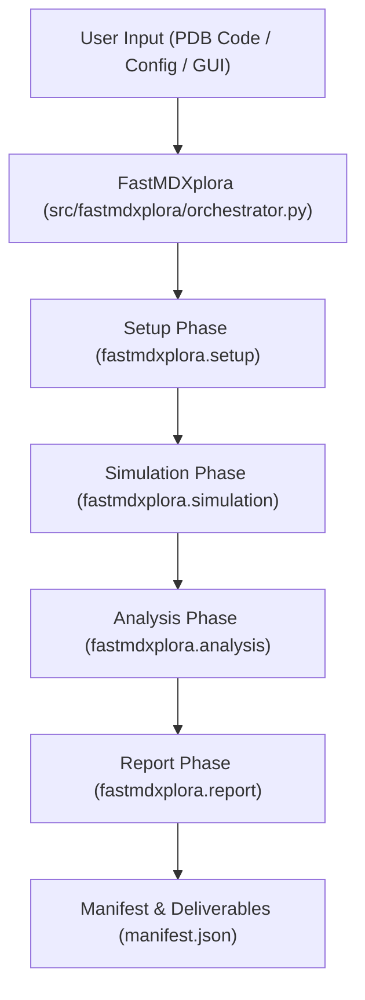
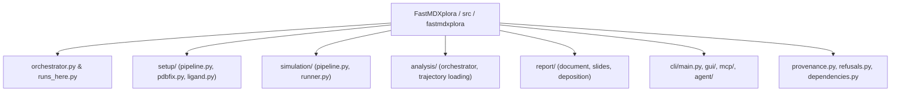

# Overview

Relevant source files

The following files were used as context for generating this wiki page:

- [.github/workflows/publish.yml](.github/workflows/publish.yml)
- [.github/workflows/tests.yml](.github/workflows/tests.yml)
- [README.md](README.md)
- [STRUCTURE.md](STRUCTURE.md)
- [docs/cli.md](docs/cli.md)
- [docs/index.md](docs/index.md)
- [docs/installation.md](docs/installation.md)
- [environment.yml](environment.yml)
- [pyproject.toml](pyproject.toml)
- [src/fastmdxplora/__init__.py](src/fastmdxplora/__init__.py)
- [src/fastmdxplora/cli/main.py](src/fastmdxplora/cli/main.py)
- [tests/_toml.py](tests/_toml.py)
- [tests/test_a_movie_is_encoded_by_the_ffmpeg_found.py](tests/test_a_movie_is_encoded_by_the_ffmpeg_found.py)
- [tests/test_a_structure_is_repaired_once_around_its_ligands.py](tests/test_a_structure_is_repaired_once_around_its_ligands.py)
- [tests/test_docs_examples.py](tests/test_docs_examples.py)
- [tests/test_the_conda_file_installs_what_it_claims.py](tests/test_the_conda_file_installs_what_it_claims.py)
- [tests/test_the_declarations_agree.py](tests/test_the_declarations_agree.py)
- [tests/validation/conftest.py](tests/validation/conftest.py)

FastMDXplora (**F**ully **A**utomated **Sy**s**T**em for **M**olecular **D**ynamics e**Xplora**tion) is a project-level orchestrator designed to automate end-to-end molecular dynamics (MD) studies [src/fastmdxplora/__init__.py:1-6, docs/index.md:1-3](). Given a structure file or a 4-character PDB code, the software handles system preparation, production simulation, trajectory analysis, and deliverable report generation within a unified framework [README.md:31-37](). 

This page provides a high-level overview of the FastMDXplora architecture, pipeline structure, repository layout, and core design principles.

*Figure 1: High-level architectural pipeline mapping user inputs and phase orchestration to code modules.*

Sources: `[src/fastmdxplora/__init__.py:1-6](), [docs/index.md:1-3](), [README.md:31-37](), [src/fastmdxplora/__init__.py:104-105]()`

---

## High-Level Architecture and Repository Layout

FastMDXplora organizes its codebase into modular functional units under `src/fastmdxplora/`, separating orchestrators, phase pipelines, client interfaces, and validation components [STRUCTURE.md:4-32](). 

*Figure 2: Core repository structure mapping directory modules to system components.*

Sources: `[STRUCTURE.md:4-32]()`

---

## Core Philosophy and Design Tenets

FastMDXplora is built on strict determinism and refusal-driven safety. Rather than guessing ambiguous parameters (such as protonation states or missing residue patches), subsystems raise explicit refusals to prevent silent scientific errors [README.md:69-74](). Every study is fully declared via a configuration schema (`resolved_config.yml`) and completely recorded via an execution manifest (`manifest.json`), ensuring absolute reproducibility across local workstations and compute clusters [README.md:76-94]().

Sources: `[README.md:69-94]()`

---

## Child Pages

For detailed information on getting started, installation workflows, and core concepts, refer to the following child pages:

- **1.1. Getting Started and Installation** — Installation via pip and conda-forge, optional package extras, environment configuration using `environment.yml`, container images, first-study walkthroughs, and demo studies [docs/installation.md:3-160](). For details, see [Getting Started and Installation](#1.1).
- **1.2. Core Concepts: Study, Manifest, Refusal** — Detailed breakdown of the study lifecycle, `resolved_config.yml`, `manifest.json`, provenance records, and the refusal philosophy governing subsystem validation [README.md:69-93](). For details, see [Core Concepts: Study, Manifest, Refusal](#1.2).

Sources: `[docs/installation.md:3-160](), [README.md:69-93]()`

---