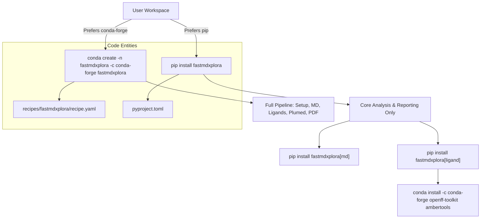
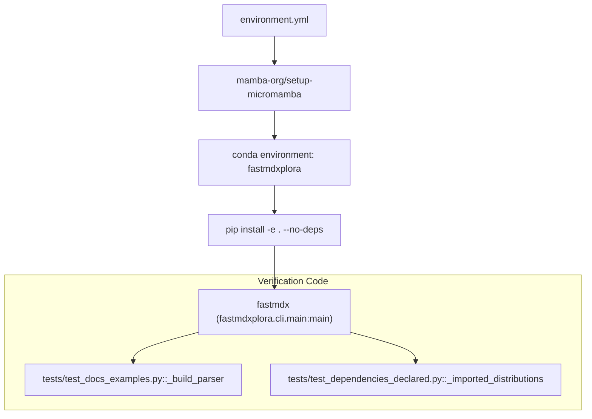

# Getting Started and Installation

<details>
<summary>Relevant source files</summary>

The following files were used as context for generating this wiki page:

- [.github/workflows/container.yml](.github/workflows/container.yml)
- [.github/workflows/publish.yml](.github/workflows/publish.yml)
- [.github/workflows/tests.yml](.github/workflows/tests.yml)
- [README.md](README.md)
- [container/docker_from_def.py](container/docker_from_def.py)
- [container/fastmdx.def](container/fastmdx.def)
- [docs/hosting.md](docs/hosting.md)
- [docs/index.md](docs/index.md)
- [docs/installation.md](docs/installation.md)
- [environment.yml](environment.yml)
- [pyproject.toml](pyproject.toml)
- [recipes/fastmdxplora/recipe.yaml](recipes/fastmdxplora/recipe.yaml)
- [scripts/make_demo.py](scripts/make_demo.py)
- [shim-package/pyproject.toml](shim-package/pyproject.toml)
- [src/fastmdxplora/__main__.py](src/fastmdxplora/__main__.py)
- [src/fastmdxplora/analysis/ligand_chemistry.py](src/fastmdxplora/analysis/ligand_chemistry.py)
- [src/fastmdxplora/demo/__init__.py](src/fastmdxplora/demo/__init__.py)
- [src/fastmdxplora/gui/hosting.py](src/fastmdxplora/gui/hosting.py)
- [tests/_toml.py](tests/_toml.py)
- [tests/test_a_movie_is_encoded_by_the_ffmpeg_found.py](tests/test_a_movie_is_encoded_by_the_ffmpeg_found.py)
- [tests/test_a_structure_is_repaired_once_around_its_ligands.py](tests/test_a_structure_is_repaired_once_around_its_ligands.py)
- [tests/test_analysis_scope.py](tests/test_analysis_scope.py)
- [tests/test_dependencies_declared.py](tests/test_dependencies_declared.py)
- [tests/test_docs_examples.py](tests/test_docs_examples.py)
- [tests/test_forcefield_selector.py](tests/test_forcefield_selector.py)
- [tests/test_ligand.py](tests/test_ligand.py)
- [tests/test_the_command_runs_once_as_main.py](tests/test_the_command_runs_once_as_main.py)
- [tests/test_the_conda_file_installs_what_it_claims.py](tests/test_the_conda_file_installs_what_it_claims.py)
- [tests/test_the_container_carries_the_ligand_path.py](tests/test_the_container_carries_the_ligand_path.py)
- [tests/test_the_declarations_agree.py](tests/test_the_declarations_agree.py)
- [tests/test_the_demo_study_opens.py](tests/test_the_demo_study_opens.py)
- [tests/test_the_docker_image_is_the_apptainer_image.py](tests/test_the_docker_image_is_the_apptainer_image.py)
- [tests/test_the_lab_mark_and_the_pinned_sidebar.py](tests/test_the_lab_mark_and_the_pinned_sidebar.py)
- [tests/test_the_perimeter_and_the_declared_stack.py](tests/test_the_perimeter_and_the_declared_stack.py)
- [tests/test_the_workers_start_clean.py](tests/test_the_workers_start_clean.py)
- [tests/test_windows_is_said_to_be_unsupported.py](tests/test_windows_is_said_to_be_unsupported.py)
- [tests/validation/conftest.py](tests/validation/conftest.py)

</details>


## Purpose and Scope
This section covers the complete installation and initial execution lifecycle of FastMDXplora. It details the recommended `conda-forge` distribution [docs/installation.md:3-24](), granular `pip` optional dependencies [pyproject.toml:87-160](), reproducible development environments via `environment.yml`, containerized deployments using Apptainer/Docker [.github/workflows/container.yml:28-142](), environment inspection through `fastmdx info` [README.md:52-56](), and the first study walkthrough [README.md:26-37]().

Sources: [README.md:26-57](), [pyproject.toml:64-160](), [docs/installation.md:1-122](), [.github/workflows/container.yml:28-142]()

---

## Installation Pathways: Conda-Forge vs PyPI
FastMDXplora relies on heavy scientific packages for molecular mechanics (`openmm`), structural repair (`pdbfixer`), small-molecule charging (`openff-toolkit`, `ambertools`, `rdkit`, `propka`), and enhanced sampling (`openmm-plumed`) [recipes/fastmdxplora/recipe.yaml:40-94](). Because several critical dependencies lack PyPI binary distributions (specifically `openff-toolkit` dependencies and `openmm-plumed`), `conda-forge` is the primary recommended distribution channel [docs/installation.md:14-17]().


*Figure 1: Installation Routing bridging user installation choices to package manager specifications (`pyproject.toml` and `recipe.yaml`).*

Sources: [pyproject.toml:64-160](), [recipes/fastmdxplora/recipe.yaml:40-94](), [docs/installation.md:3-65]()

### Pip Optional Dependencies Matrix
When installing via `pip`, capabilities are partitioned into optional extras defined in `pyproject.toml`:

| Extra Name | Target Functionality | Included Packages | Source / Note |
| :--- | :--- | :--- | :--- |
| `[md]` | Setup and Simulation | `pdbfixer`, `openmm >=8.2` | Requires OpenMM wheel availability [pyproject.toml:101-108]() |
| `[ligand]` | Small molecule prep | `openmmforcefields`, `rdkit`, `propka` | Requires external `conda-forge` for `openff-toolkit` & `ambertools` [docs/installation.md:43-48]() |
| `[pdf]` | Publication PDF reports | `weasyprint >=60` | Requires system libraries `libpango`, `libcairo` [docs/installation.md:56-61]() |
| `[amber]` | Fast AMBER trajectory reading | `netCDF4 >=1.6` | Speeds up trajectory parsing via `netCDF4` [pyproject.toml:128-132]() |
| `[umap]` | Dimensionality reduction | `umap-learn >=0.5` | Optional projection space algorithm [pyproject.toml:133-137]() |
| `[movies]` | Browser-based frame rendering | `playwright >=1.40` | Requires `playwright install chromium` [docs/installation.md:118-120]() |

Sources: [pyproject.toml:87-160](), [docs/installation.md:27-64]()

---

## Environment Configuration and Developer Setup
For developers modifying the FastMDXplora source tree, the repository provides a complete conda environment definition file (`environment.yml`) containing all necessary binary dependencies and scientific stacks [docs/installation.md:68-77]().

```bash
git clone https://github.com/aai-research-lab/FastMDXplora.git
cd FastMDXplora
conda env create -f environment.yml
conda activate fastmdxplora
pip install -e ".[dev]"
pytest -q
```

The test suite validates dependency declarations automatically to ensure that no module is imported without a corresponding declaration in `pyproject.toml` or conda manifests [tests/test_dependencies_declared.py:1-11]().


*Figure 2: Development bootstrap and validation flow connecting `environment.yml` to CLI entry points (`fastmdxplora.cli.main:main`) and test suites (`tests/test_docs_examples.py`).*

Sources: [recipes/fastmdxplora/recipe.yaml:31-39](), [tests/test_docs_examples.py:15-65](), [tests/test_dependencies_declared.py:1-45](), [docs/installation.md:68-96]()

---

## Container Images and Cluster Execution
For high-performance computing clusters or environments without direct `conda-forge` network access, FastMDXplora provides automated container build pipelines for Apptainer (`.sif`) and Docker [container/fastmdx.def](), [.github/workflows/container.yml:1-35]().

The workflow automatically validates that the specified version is indexed on `conda-forge` before invoking `apptainer build --fakeroot` against `container/fastmdx.def` [.github/workflows/container.yml:68-142]().

```bash
# Building an Apptainer image manually from the definition file
apptainer build --fakeroot fastmdx-2.6.0.sif container/fastmdx.def

# Running an explore workflow inside the container
apptainer exec --nv fastmdx-2.6.0.sif fastmdx explore --system 181L
```

Sources: [.github/workflows/container.yml:28-142](), [container/fastmdx.def:1-50]()

---

## Environment Inspection and Backends: `fastmdx info`
To verify that all simulation platforms, force fields, analysis toolkits, and reporting binaries are correctly bound, use the built-in diagnostic command:

```bash
fastmdx info
```

This command interrogates the active Python runtime, probes OpenMM platforms (`CUDA`, `OpenCL`, `CPU`, `Reference`), checks small-molecule parameterization backends (`ambertools`, `openff-toolkit`), and checks PDF rendering dependencies (`weasyprint`), printing missing dependencies along with precise installation instructions [README.md:52-56](), [docs/installation.md:124-134]().

Sources: [README.md:52-56](), [docs/installation.md:124-134]()

---

## First Study Walkthrough and Demo Execution
A first study can be executed immediately via the command-line interface or the local GUI dashboard. 

### 1. Command-Line Exploration
The simplest end-to-end command fetches T4 lysozyme (`181L`), parameterizes the bound benzene ligand, runs minimization and production MD, calculates structural properties, and compiles a comprehensive PDF report [README.md:26-37](), [tests/test_docs_examples.py:20-38]():

```bash
fastmdx explore --system 181L
```

### 2. Graphical Dashboard Walkthrough
To launch the localhost zero-dependency interactive dashboard for study configuration and live telemetry tracking [README.md:39-43](), [docs/index.md:10-16]():

```bash
fastmdx gui
```

This starts a local Tornado/HTTP dashboard server where users can input a PDB code (e.g., `1L2Y`), inspect phase configuration schemas, adjust production step counts, monitor live GPU telemetry, and render Mol* molecular viewer scenes.

Sources: [README.md:26-44](), [docs/index.md:10-18](), [tests/test_docs_examples.py:20-47]()

---