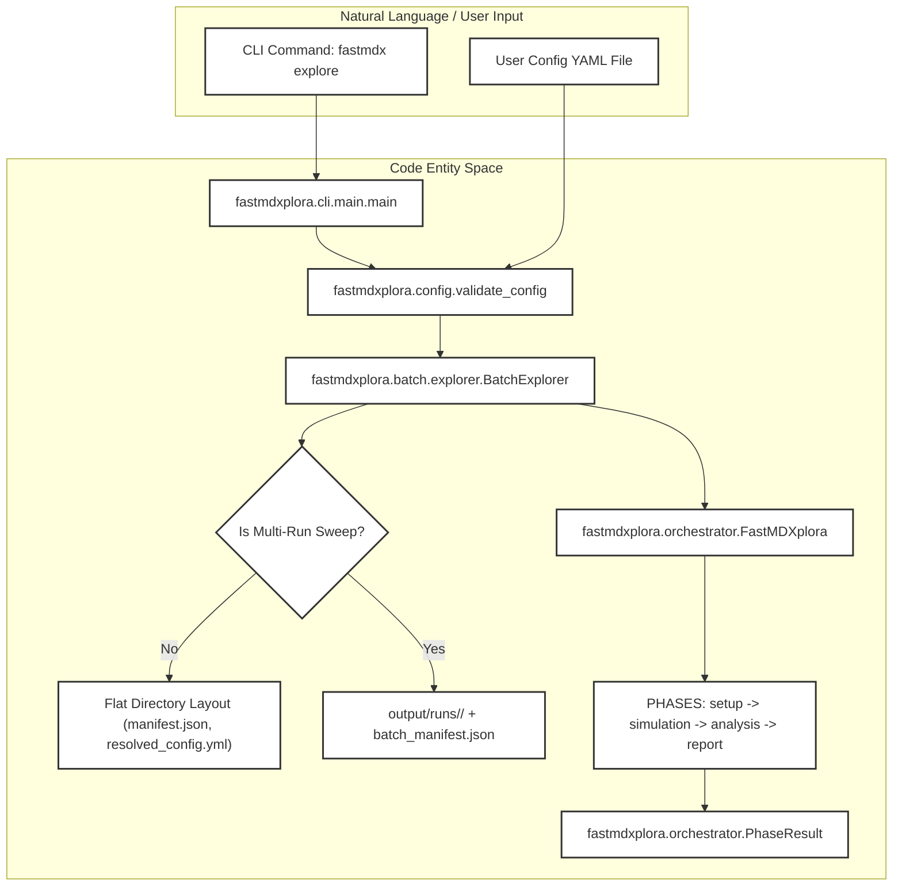
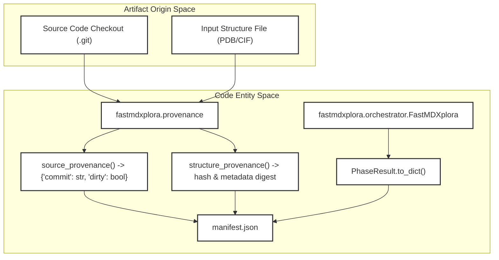

# Core Concepts: Study, Manifest, Refusal

Relevant source files

The following files were used as context for generating this wiki page:

- [docs/manifest.md](docs/manifest.md)
- [docs/refusals.md](docs/refusals.md)
- [src/fastmdxplora/advisories.py](src/fastmdxplora/advisories.py)
- [src/fastmdxplora/batch/explorer.py](src/fastmdxplora/batch/explorer.py)
- [src/fastmdxplora/orchestrator.py](src/fastmdxplora/orchestrator.py)
- [src/fastmdxplora/provenance.py](src/fastmdxplora/provenance.py)
- [src/fastmdxplora/refusals.py](src/fastmdxplora/refusals.py)
- [src/fastmdxplora/simulation/umbrella.py](src/fastmdxplora/simulation/umbrella.py)
- [tests/test_a_report_names_what_produced_each_phase.py](tests/test_a_report_names_what_produced_each_phase.py)
- [tests/test_a_short_pilot_sizes_the_study.py](tests/test_a_short_pilot_sizes_the_study.py)
- [tests/test_a_window_can_be_held_at_its_own_constant.py](tests/test_a_window_can_be_held_at_its_own_constant.py)
- [tests/test_batch.py](tests/test_batch.py)
- [tests/test_cli.py](tests/test_cli.py)
- [tests/test_environment_record.py](tests/test_environment_record.py)
- [tests/test_only_the_packages_own_changes_count.py](tests/test_only_the_packages_own_changes_count.py)
- [tests/test_orchestrator.py](tests/test_orchestrator.py)
- [tests/test_perceived_chemistry_is_deposited.py](tests/test_perceived_chemistry_is_deposited.py)
- [tests/test_the_agent_says_what_it_can_be_asked.py](tests/test_the_agent_says_what_it_can_be_asked.py)
- [tests/test_the_methods_disclose_an_ai_model.py](tests/test_the_methods_disclose_an_ai_model.py)
- [tests/test_umbrella.py](tests/test_umbrella.py)

## Purpose and Scope
This page defines the foundational data structures, execution lifecycles, and design philosophies underpinning FastMDXplora. It details how studies are structured, how configurations are frozen into `resolved_config.yml`, how runs report their history via `manifest.json` and provenance records, and how the **refusal philosophy** prevents invalid scientific claims across all subsystems.

Sources: `src/fastmdxplora/batch/explorer.py:1-38`, `src/fastmdxplora/orchestrator.py:1-174`, `src/fastmdxplora/refusals.py:1-57`

---

## 1. Study Lifecycle and Output Layout

FastMDXplora unifies single-run execution and multi-system parameter sweeps under a single execution path managed by `BatchExplorer` (`src/fastmdxplora/batch/explorer.py:1-6`). There is no separate "single run" path; a single-system configuration is simply treated as a batch of one (`src/fastmdxplora/batch/explorer.py:3-6`).

The output layout adapts dynamically to the run count (`src/fastmdxplora/batch/explorer.py:8-15`):
- **One run**: A flat, direct layout written to the target output directory containing `output/setup/`, `output/simulation/`, `output/analysis/`, `output/report/`, accompanied by `manifest.json` and `resolved_config.yml`. No `runs/` wrapper or `batch_manifest.json` is generated.
- **Many runs**: Each run is isolated in `output/runs/<id>/` as a complete, independent study directory, indexed by a top-level `batch_manifest.json`.

Every run executes sequentially through the canonical phase sequence defined in `PHASES` (`src/fastmdxplora/orchestrator.py:58`):
1. `setup`: System preparation, protonation, and force field application.
2. `simulation`: OpenMM-backed runner execution, equilibration, and production sampling.
3. `analysis`: Trajectory parsing, statistical evaluations, and structural measurements.
4. `report`: Methods prose generation, statistical validation, and report bundling.

*Figure 1: Bridging user invocation space to the core orchestration pipeline.*

Sources: `src/fastmdxplora/batch/explorer.py:1-38`, `src/fastmdxplora/orchestrator.py:1-60`, `tests/test_cli.py:124-133`

---

## 2. Resolved Configuration (`resolved_config.yml`)

Before any study phase executes, raw user configurations undergo strict validation against the schema registry (`src/fastmdxplora/config/`) and normalization. Once validated, the final effective configuration—incorporating all default values, merged overrides, and sweep expansions—is serialized to `resolved_config.yml` in the run directory.

This file guarantees reproducibility by capturing the absolute state of all parameters (force field choices, step counts, restraint constants, and solvent padding) without relying on transient CLI arguments or user memory.

Sources: `src/fastmdxplora/batch/explorer.py:1-16`, `src/fastmdxplora/config/__init__.py`

---

## 3. Manifest (`manifest.json`) and Provenance Records

Each completed or errored run produces a `manifest.json` file. The manifest acts as the machine-readable ledger of the study, aggregating `PhaseResult` and `RunResult` records (`src/fastmdxplora/orchestrator.py:95-174`).

### Provenance Tracking
To ensure complete reproducibility, FastMDXplora captures two orthogonal dimensions of provenance via `src/fastmdxplora/provenance.py`:
1. **Source Provenance (`source_provenance`)**: Inspects the package's underlying git checkout (walking up from the package path rather than the working directory) to record the exact git commit hash, branch, and a `dirty` flag indicating whether uncommitted modifications were present (`src/fastmdxplora/provenance.py:55-128`).
2. **Structure Provenance (`structure_provenance`)**: Computes cryptographic hashes and metadata digests of input PDB/CIF files so that structural inputs remain uniquely identifiable even if source files are moved or renamed (`src/fastmdxplora/provenance.py:158-172`).

*Figure 2: Provenance aggregation flowing from physical inputs and source code checkpoints into the structured manifest.*

Sources: `src/fastmdxplora/orchestrator.py:95-174`, `src/fastmdxplora/provenance.py:55-172`, `src/fastmdxplora/provenance.py:105-128`

---

## 4. The Refusal Philosophy

Every subsystem in FastMDXplora is governed by an explicit **refusal philosophy**: when a study lacks sufficient biological definition, proper input parameters, or statistical sampling, the software stops immediately and explains why, rather than generating plausible but incorrect numerical outputs (`docs/refusals.md:3-7`).

### Core Principle
> **The validator may say what the schema permits. It may never say what the chemistry requires.** (`docs/refusals.md:96-97`)

### The Four Refusal Kinds
Refusals are classified into four distinct categories (`src/fastmdxplora/refusals.py:94-123`) to dictate who or what can resolve the issue:

| Kind | Meaning | Remedy |
|---|---|---|
| `structural` | The configuration violates schema constraints or omits required fields | Correct the configuration and retry (`docs/refusals.md:76`) |
| `semantic` | The study is well-formed, but the biological system is under-determined (e.g., ambiguous protonation states) | Make a scientific decision about the system (`docs/refusals.md:77`) |
| `environmental` | A required backend (such as OpenMM or PDBFixer) or service is missing | Fix the environment or machine setup (`docs/refusals.md:78`) |
| `insufficient` | The study is sound, but collected trajectory data is statistically insufficient to support the requested claim | Perform additional sampling (`docs/refusals.md:79`) |

### Disclosure Levels
To prevent automated agents or programmatic callers from guessing scientific parameters while allowing configuration corrections, each refusal specifies a disclosure level (`src/fastmdxplora.refusals.Disclosure`):
- `permitted_values`: The complete legal set is known and may be disclosed (e.g., valid box shapes) (`src/fastmdxplora/refusals.py:140-141`).
- `field_only`: The offending setting may be named, but no value may be suggested (`src/fastmdxplora/refusals.py:143-145`).
- `action`: An exact non-scientific remedy exists, such as an installation command (`src/fastmdxplora/refusals.py:147-149`).
- `nothing`: The software does not possess the chemical answer and refuses to guess (`src/fastmdxplora/refusals.py:151-152`).

Programmatic callers can inspect refusals uniformly using `refusal_of()` (`docs/refusals.md:22-35`), which wraps any standard exception into a structured `Refusal` object containing a hierarchical dot-separated code (`<phase>.<family>.<what>`) (`docs/refusals.md:47`).

Sources: `docs/refusals.md:1-187`, `src/fastmdxplora/refusals.py:1-154`, `src/fastmdxplora/refusals.py:94-123`

---