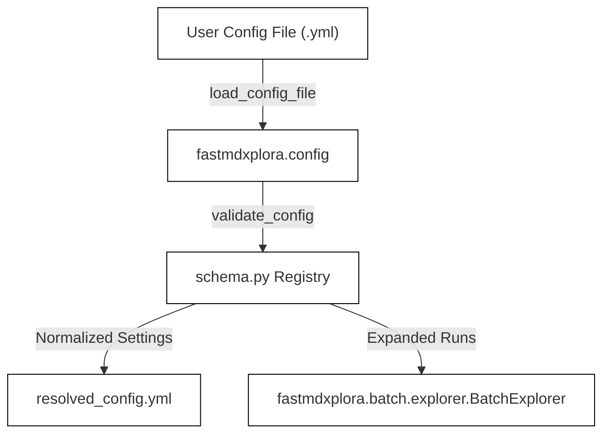
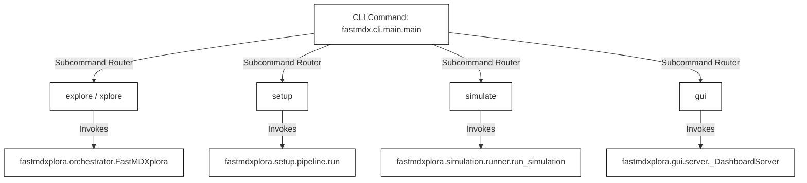

# Orchestration and Configuration

Relevant source files

The following files were used as context for generating this wiki page:

- [STRUCTURE.md](STRUCTURE.md)
- [docs/cli.md](docs/cli.md)
- [docs/manifest.md](docs/manifest.md)
- [src/fastmdxplora/batch/explorer.py](src/fastmdxplora/batch/explorer.py)
- [src/fastmdxplora/cli/main.py](src/fastmdxplora/cli/main.py)
- [src/fastmdxplora/orchestrator.py](src/fastmdxplora/orchestrator.py)
- [src/fastmdxplora/simulation/umbrella.py](src/fastmdxplora/simulation/umbrella.py)
- [tests/test_a_short_pilot_sizes_the_study.py](tests/test_a_short_pilot_sizes_the_study.py)
- [tests/test_a_window_can_be_held_at_its_own_constant.py](tests/test_a_window_can_be_held_at_its_own_constant.py)
- [tests/test_batch.py](tests/test_batch.py)
- [tests/test_cli.py](tests/test_cli.py)
- [tests/test_orchestrator.py](tests/test_orchestrator.py)
- [tests/test_umbrella.py](tests/test_umbrella.py)

This section provides an overview of how molecular dynamics studies are declared through structured configurations, validated against rigorous schemas, exposed via a rich command-line interface (CLI), and driven through sequential or batch exploration phases by the core orchestrator. 

As a parent page, this document outlines the high-level architecture and relationships between configuration management, command-line verbs, and batch orchestration campaigns. For deep technical details, refer to the child pages:
- Configuration System and Schema: [Configuration System and Schema](#2.1)
- Command Line Interface: [Command Line Interface](#2.2)
- Orchestrator and Batch Campaigns: [Orchestrator and Batch Campaigns](#2.3)

---

## 2.1. Configuration System and Schema

Declarative configuration files (`.yml`) specify all parameters required to drive a study across its scientific lifecycle. The configuration architecture relies on a registry system defined in `schema.py` (see [STRUCTURE.md: src/fastmdxplora/](STRUCTURE.md)()), which manages `Field` and `PhaseSchema` definitions. The config loader normalizes user inputs, applies intelligent defaults, supports template generation, and detects setting diffs.

The configuration system enforces strict schema validation using `validate_config` [src/fastmdxplora/batch/explorer.py:61-61] and `load_config_file` [src/fastmdxplora/batch/explorer.py:61-61]. Every parameter is bound to a specific phase (`setup`, `simulation`, `analysis`, `report`, or `execution`), ensuring that ill-formed entries or unrecognized keys are immediately rejected rather than silently ignored.

For comprehensive documentation on schema registries, field normalization, template generation, diffing, and type definitions, see [Configuration System and Schema](#2.1).

*Figure 1: Configuration loading, validation, and schema resolution flow mapping user input files to internal execution structures.*

**Sources:** `src/fastmdxplora/batch/explorer.py:61-61`, `STRUCTURE.md:1-89`

---

## 2.2. Command Line Interface

The command-line interface (`fastmdx` or `fastmdxplora`, implemented in `src/fastmdxplora/cli/main.py`) exposes all configuration options as schema-derived command flags. Every CLI verb corresponds to a core pipeline action or utility:

| Verb / Subcommand | Target Code / Role | Description |
|-------------------|--------------------|-------------|
| `explore` / `xplore` | `FastMDXplora` | Runs the full pipeline (`setup` → `simulation` → `analysis` → `report`) [src/fastmdxplora/cli/main.py:6-6] |
| `setup` | `fastmdxplora.setup.pipeline` | Prepares the molecular system (PDB fix, protonation, solvation, ionization) [src/fastmdxplora/cli/main.py:7-7] |
| `simulate` | `fastmdxplora.simulation.runner` | Executes OpenMM-backed molecular dynamics stages [src/fastmdxplora/cli/main.py:8-8] |
| `analyze` | `fastmdxplora.analysis` | Computes structural, energetic, and dynamic trajectories properties [src/fastmdxplora/cli/main.py:9-9] |
| `report` | `fastmdxplora.report` | Generates summary documents, statistics, and publication assets [src/fastmdxplora/cli/main.py:10-10] |
| `agent` | `fastmdxplora.agent` | Natural language study generation and proposal loops [docs/cli.md:28-28] |
| `gui` | `fastmdxplora.gui` | Serves the dependency-free localhost dashboard [docs/cli.md:29-29] |
| `mcp` | `fastmdxplora.mcp` | Model Context Protocol server for AI application integration [docs/cli.md:30-30] |

Flags are dynamically derived from phase schemas, allowing fine-grained control via prefixed arguments (e.g., `--setup-ph`, `--simulate-duration-ns`) [src/fastmdxplora/cli/main.py:14-18]. 

For detailed command references, argument parsing rules, and defaults files, see [Command Line Interface](#2.2).

*Figure 2: CLI execution routing mapping natural language command-line verbs to underlying Python entry points and pipeline modules.*

**Sources:** `src/fastmdxplora/cli/main.py:1-45`, `docs/cli.md:18-39`

---

## 2.3. Orchestrator and Batch Campaigns

The project-level orchestrator (`FastMDXplora` in `src/fastmdxplora/orchestrator.py`) manages shared state, registered phases (`PHASES = ("setup", "simulation", "analysis", "report")`) [src/fastmdxplora/orchestrator.py:58-58], and sequential execution. 

Every study—whether a single system or a massive parameter sweep—is handled uniformly through `BatchExplorer` [src/fastmdxplora/batch/explorer.py:1-4]:
- **Single run:** Writes flat outputs directly to the target directory alongside `manifest.json` and `resolved_config.yml` [src/fastmdxplora/batch/explorer.py:11-13].
- **Batch campaigns:** Expands parameter sweeps across multiple systems, storing each individual study under `output/runs/<id>/` indexed by a top-level `batch_manifest.json` [src/fastmdxplora/batch/explorer.py:14-15].

Execution modes support sequential processing or parallel process pools with device pinning (`devices: [0, 1, ...]`) for multi-GPU hardware distribution [src/fastmdxplora/batch/explorer.py:17-23]. Each phase records lightweight status objects (`PhaseResult` and `RunResult`) capturing execution artifacts, timing, and refusal states [src/fastmdxplora/orchestrator.py:95-174].

For full details on phase progression, run results, process pool execution, and GPU sharing, see [Orchestrator and Batch Campaigns](#2.3).

**Sources:** `src/fastmdxplora/batch/explorer.py:1-38`, `src/fastmdxplora/orchestrator.py:1-60`

---