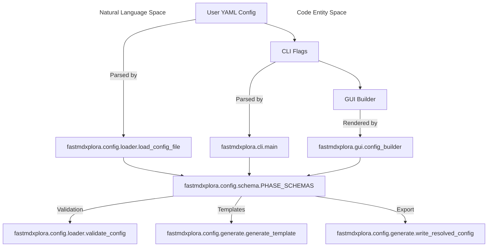
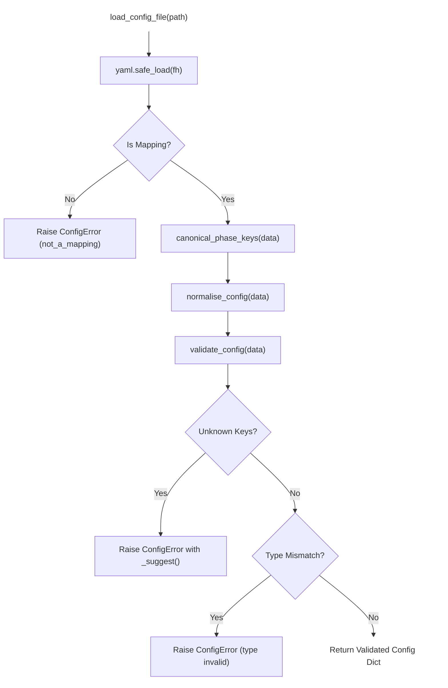
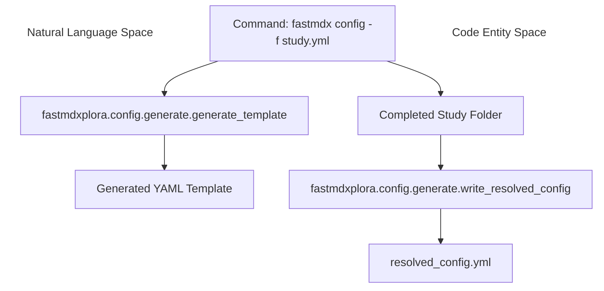

# Configuration System and Schema

Relevant source files

The following files were used as context for generating this wiki page:

- [docs/config.md](docs/config.md)
- [docs/config_reference.md](docs/config_reference.md)
- [src/fastmdxplora/config/__init__.py](src/fastmdxplora/config/__init__.py)
- [src/fastmdxplora/config/describe.py](src/fastmdxplora/config/describe.py)
- [src/fastmdxplora/config/generate.py](src/fastmdxplora/config/generate.py)
- [src/fastmdxplora/config/languages.py](src/fastmdxplora/config/languages.py)
- [src/fastmdxplora/config/loader.py](src/fastmdxplora/config/loader.py)
- [src/fastmdxplora/config/phase_settings_types.py](src/fastmdxplora/config/phase_settings_types.py)
- [src/fastmdxplora/config/schema.py](src/fastmdxplora/config/schema.py)
- [src/fastmdxplora/gui/preview.py](src/fastmdxplora/gui/preview.py)
- [src/fastmdxplora/simulation/pipeline.py](src/fastmdxplora/simulation/pipeline.py)
- [src/fastmdxplora/simulation/runner.py](src/fastmdxplora/simulation/runner.py)
- [tests/_interfaces.py](tests/_interfaces.py)
- [tests/test_a_loaded_study_keeps_its_phases.py](tests/test_a_loaded_study_keeps_its_phases.py)
- [tests/test_a_study_of_several_systems_opens_whole.py](tests/test_a_study_of_several_systems_opens_whole.py)
- [tests/test_an_entry_is_fetched_once.py](tests/test_an_entry_is_fetched_once.py)
- [tests/test_config.py](tests/test_config.py)
- [tests/test_every_interface_offers_the_same_study.py](tests/test_every_interface_offers_the_same_study.py)
- [tests/test_every_study_in_every_interface.py](tests/test_every_study_in_every_interface.py)
- [tests/test_one_study_three_languages.py](tests/test_one_study_three_languages.py)
- [tests/test_the_command_says_every_flag_it_has.py](tests/test_the_command_says_every_flag_it_has.py)
- [tests/test_the_form_sweeps.py](tests/test_the_form_sweeps.py)
- [tests/test_the_guide_says_how_to_name_a_structure.py](tests/test_the_guide_says_how_to_name_a_structure.py)
- [tests/test_the_schema_describes_itself.py](tests/test_the_schema_describes_itself.py)
- [tests/test_which_phases_were_checked.py](tests/test_which_phases_were_checked.py)
- [tests/validation/test_the_docs_are_honest.py](tests/validation/test_the_docs_are_honest.py)

## Purpose and Scope

The FastMDXplora configuration system acts as the single source of truth for the entire study configuration surface. Every parameter a user can specify—whether project-level (`output`, `include`/`exclude`, `verbose`) or phase-specific (`setup`, `simulation`, `analysis`, `report`)—is declared in a centralized schema registry. Four major subsystems read directly from this registry to prevent drift: strict validation loaders, YAML template generators, resolved-config dumpers for provenance, and static documentation validators.

Sources: `[src/fastmdxplora/config/schema.py:1-25]`, `[src/fastmdxplora/config/loader.py:1-23]`, `[src/fastmdxplora/config/generate.py:1-14]()`

---

## The Schema Registry (`schema.py`)

The core of the schema system is defined in `[src/fastmdxplora/config/schema.py:1-155]()`. It centers around two primary dataclasses: `Field` and `PhaseSchema`.

- **`Field`**: Represents a single configurable option. It tracks attributes including `name`, `type`, `default`, `help`, `example`, `choices`, numeric bounds (`minimum`, `maximum`), and `phase_sentinel`. The `phase_sentinel` attribute allows an option's effective user-facing default to differ from the internal phase initialization value (e.g., `pressure_bar` defaulting to 1 bar while initializing as `None` to detect explicit user overrides via `pressure_atm`) [src/fastmdxplora/config/schema.py:80-143]().
- **`PhaseSchema`**: Groups an ordered tuple of `Field` objects together with a phase `name` and `description` [src/fastmdxplora/config/schema.py:145-155]().

Sources: `[src/fastmdxplora/config/schema.py:1-155]()`

---

## Loading, Validation, and Normalization (`loader.py`)

Configuration files are ingested through `load_config_file()` in `[src/fastmdxplora/config/loader.py:50-91]()`. The loading pipeline performs strict validation to prevent silent failures caused by typos or invalid types [src/fastmdxplora/config/loader.py:7-14]().

### Validation Workflow

1. **Top-Level and Phase-Level Checks**: Validates that all keys present in the YAML mapping belong to recognized top-level properties or phase blocks (`setup`, `simulation`, `analysis`, `report`).
2. **Did-You-Mean Suggestions**: Unknown keys trigger `ConfigError` exceptions carrying fuzzy-match and case-insensitive suggestions via `_suggest()` and `_suggestion_only()` [src/fastmdxplora/config/loader.py:96-150]().
3. **Type Coercion**: `_check_type()` handles YAML parsing idiosyncrasies (e.g., permitting integer values for float fields like `temperature_K: 300` while strictly rejecting Python `bool` subclasses where numeric types are required) [src/fastmdxplora/config/loader.py:169-181]().

Sources: `[src/fastmdxplora/config/loader.py:1-181]()`

---

## Template Generation and Resolved-Config Dumping (`generate.py`)

Template generation and reproducibility logs are managed by `[src/fastmdxplora/config/generate.py:1-173]()`.

- **Template Generation (`generate_template`)**: Powers the `fastmdx config` command [docs/config.md:12](). It programmatically loops through `TOP_LEVEL` and `PHASE_SCHEMAS`, formatting field defaults, examples, and help strings into a fully commented YAML file [src/fastmdxplora/config/generate.py:111-165](). Users can request a `minimal` layout or a comprehensive template where phase blocks are commented out by default [src/fastmdxplora/config/generate.py:111-124]().
- **Resolved-Config Dump (`write_resolved_config`)**: Upon executing a study, the fully merged configuration (comprising built-in defaults, loaded configuration file values, and explicit runtime overrides) is serialized to `resolved_config.yml` in the study output directory, ensuring complete auditability and reproducibility [docs/config.md:68]().

Sources: `[src/fastmdxplora/config/generate.py:1-173]`, `[docs/config.md:12-21]`

---

## Phase Setting Types and Documentation Reference

To bridge runtime configuration parsing with static analysis and IDE tooling, FastMDXplora automatically maintains type definitions and consistency tests.

- **Phase Setting Types (`phase_settings_types.py`)**: Defines `TypedDict` structures (`SetupSettings`, `SimulateSettings`, `AnalyzeSettings`, `ReportSettings`) corresponding to each phase's configuration options [src/fastmdxplora/config/phase_settings_types.py:1-163]().
- **Documentation Integrity (`test_the_docs_are_honest.py`)**: Tests such as `TestEveryAnalysisIsDocumented` and `TestTheCollectiveVariablesAreAllNamed` inspect both the schema registry (`_REGISTRY`) and Markdown documentation files under `docs/` to guarantee that published counts, analyses, and collective variable lists never drift from codebase implementations [tests/validation/test_the_docs_are_honest.py:42-122]().

Sources: `[src/fastmdxplora/config/phase_settings_types.py:1-164]`, `[tests/validation/test_the_docs_are_honest.py:42-122]`

---