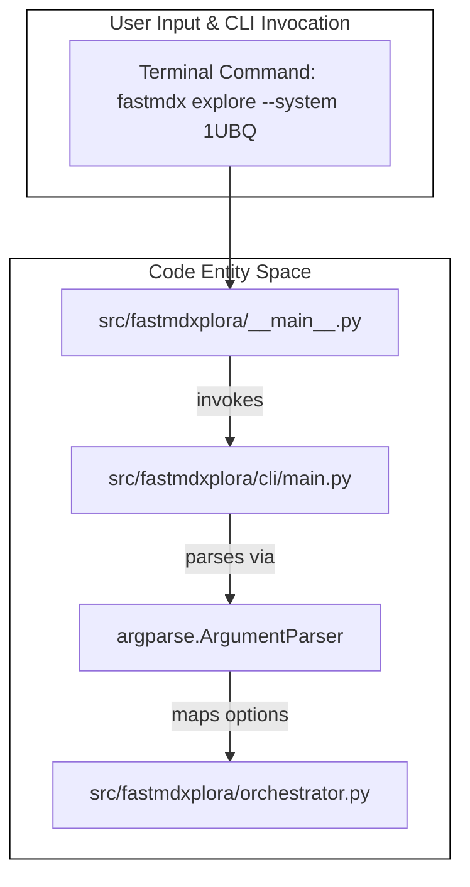
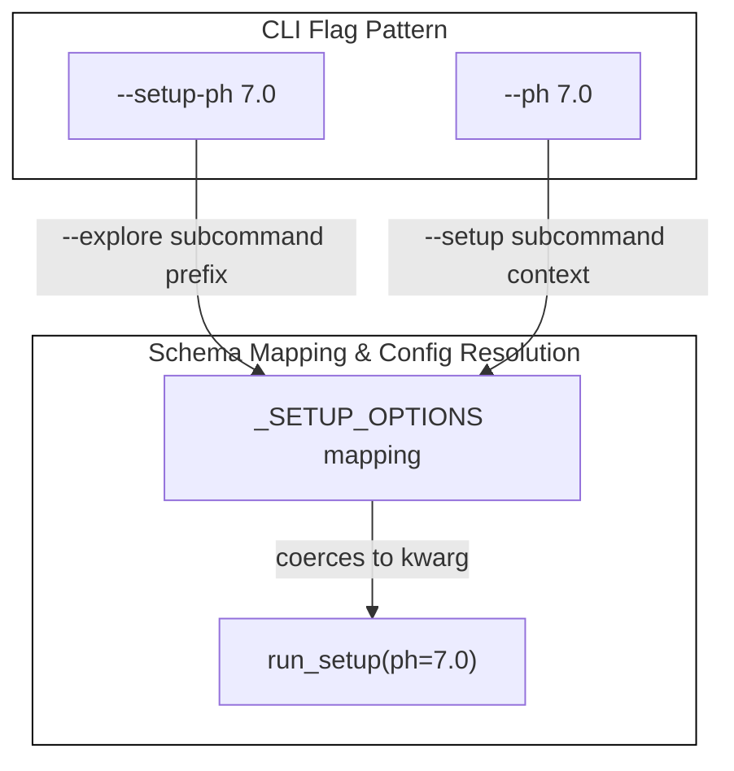

# Command Line Interface

Relevant source files

The following files were used as context for generating this wiki page:

- [STRUCTURE.md](STRUCTURE.md)
- [docs/cli.md](docs/cli.md)
- [examples/README.md](examples/README.md)
- [examples/pdb_list.txt](examples/pdb_list.txt)
- [scripts/run_pdb_smoke_campaign.py](scripts/run_pdb_smoke_campaign.py)
- [src/fastmdxplora/cli/main.py](src/fastmdxplora/cli/main.py)
- [src/fastmdxplora/marking.py](src/fastmdxplora/marking.py)
- [src/fastmdxplora/utils/__init__.py](src/fastmdxplora/utils/__init__.py)
- [src/fastmdxplora/utils/logging.py](src/fastmdxplora/utils/logging.py)
- [src/fastmdxplora/utils/presenter.py](src/fastmdxplora/utils/presenter.py)
- [tests/test_logging.py](tests/test_logging.py)
- [tests/test_pdb_smoke_campaign.py](tests/test_pdb_smoke_campaign.py)
- [tests/test_presenter.py](tests/test_presenter.py)
- [tests/test_running_a_study_does_not_own_your_logging.py](tests/test_running_a_study_does_not_own_your_logging.py)
- [tests/test_what_nothing_checked_says_so.py](tests/test_what_nothing_checked_says_so.py)

The Command Line Interface (CLI) serves as the primary terminal-based control plane for FastMDXplora, exposed via the console scripts `fastmdx` and `fastmdxplora` [docs/cli.md:13-14](). Its core responsibility is parsing command-line flags, mapping them into structured configuration dictionaries [src/fastmdxplora/cli/main.py:15-18](), and driving execution through the orchestrator.

---

## 1. CLI Entry Point and Argument Parser Architecture

The CLI is rooted in `src/fastmdxplora/__main__.py` [STRUCTURE.md:41-41](), which invokes the main entry point defined in `src/fastmdxplora/cli/main.py` [STRUCTURE.md:42-45](). Argument parsing is implemented using Python's standard `argparse` library, translating phase-specific option tuples (such as `_SETUP_OPTIONS` and `_SIMULATION_OPTIONS`) into command-line flags.

*Diagram 1: CLI execution flow bridging invocation to core orchestration.*

Sources: `src/fastmdxplora/cli/main.py:1-45` [src/fastmdxplora/cli/main.py:1-45](), `STRUCTURE.md:41-45` [STRUCTURE.md:41-45]()

---

## 2. Command Verbs and Subcommands

FastMDXplora exposes a modular set of verbs. Each subcommand either drives a specific phase, inspects the environment, or launches external helper modes (such as GUI or MCP servers).

| Subcommand | Function / Purpose |
| :--- | :--- |
| `explore` / `xplore` | Run the full four-phase pipeline (`setup` $\rightarrow$ `simulation` $\rightarrow$ `analysis` $\rightarrow$ `report`) [src/fastmdxplora/cli/main.py:6-6](), [docs/cli.md:22-23]() |
| `setup` | Execute system preparation (PDB fixing, protonation, solvation, ionization) and terminate [src/fastmdxplora/cli/main.py:7-7](), [docs/cli.md:24-24]() |
| `simulate` | Run molecular dynamics equilibration and production phases on a prepared system [src/fastmdxplora/cli/main.py:8-8](), [docs/cli.md:25-25]() |
| `analyze` | Perform trajectory analyses (RMSD, RMSF, hydrogen bonds, etc.) [src/fastmdxplora/cli/main.py:9-9](), [docs/cli.md:26-26]() |
| `report` | Generate document/slide summaries and metrics reports [src/fastmdxplora/cli/main.py:10-10](), [docs/cli.md:27-27]() |
| `gui` | Launch the localhost web dashboard server [docs/cli.md:29-29]() |
| `info` | Print local environment, hardware, and dependency diagnostic info [src/fastmdxplora/cli/main.py:11-11](), [docs/cli.md:36-36]() |
| `remote` | Inspect and manage remote execution nodes over SSH [src/fastmdxplora/cli/main.py:12-13](), [docs/cli.md:37-37]() |
| `agent` | Invoke the AI Agent proposal and generation loop [docs/cli.md:28-28]() |
| `mcp` | Serve FastMDXplora tools via the Model Context Protocol [docs/cli.md:30-30]() |
| `config` | Write a heavily-commented default configuration template [docs/cli.md:31-31]() |
| `select` | Evaluate and print atom selections prior to execution [docs/cli.md:32-32]() |
| `diff` | Compute differences between two configuration files or studies [docs/cli.md:33-33]() |
| `scene` | Export a molecular view as a MolViewSpec (`.mvsx`) scene file [docs/cli.md:34-34]() |
| `movie` | Render trajectory frames into movie files via local `ffmpeg` [docs/cli.md:35-35]() |
| `resume` | Continue an interrupted or prematurely stopped study [docs/cli.md:38-38]() |

Sources: `src/fastmdxplora/cli/main.py:1-24` [src/fastmdxplora/cli/main.py:1-24](), `docs/cli.md:18-39` [docs/cli.md:18-39]()

---

## 3. Schema-Derived Flags and Naming Conventions

The CLI constructs options programmatically to mirror phase configuration schemas. Flag names follow a strict prefix convention based on whether they are invoked globally via `explore` or locally via phase-specific subcommands [docs/cli.md:51-64]().

*Diagram 2: Mapping natural language CLI options to internal phase keyword arguments.*

When using `explore`, settings are prefixed by their target phase name (`--setup-`, `--simulate-`, `--analyze-`, `--report-`, `--execution-`) [docs/cli.md:61-64](). When running a single-phase subcommand directly, the prefix is omitted [docs/cli.md:57-58]().

Sources: `src/fastmdxplora/cli/main.py:50-105` [src/fastmdxplora/cli/main.py:50-105](), `docs/cli.md:51-78` [docs/cli.md:51-78]()

---

## 4. Configuration, Defaults Files, and Execution Modifiers

Execution behavior can be modified through input declarations, override rules, and defaults files (`fastmdx-defaults.yml`) [docs/cli.md:105-113]().

- **Input Declaration**: `-s` / `--system` accepts local PDB/CIF paths or 4-character PDB identifiers, automatically resolving structure sources [docs/cli.md:107-107]().
- **Configuration Override**: `-c` / `--config` loads a base YAML configuration file, which is subsequently overridden by explicit CLI flags [docs/cli.md:108-108]().
- **Defaults Suppression**: `--no-defaults` disables the automatic discovery and application of nearest `fastmdx-defaults.yml` profile files [docs/cli.md:112-112]().
- **Execution Dry-Runs**: `--dry-run` validates all parameters, prints the resolved execution plan, and terminates without creating output artifacts [docs/cli.md:135-135]().

Sources: `docs/cli.md:92-150` [docs/cli.md:92-150]()

---