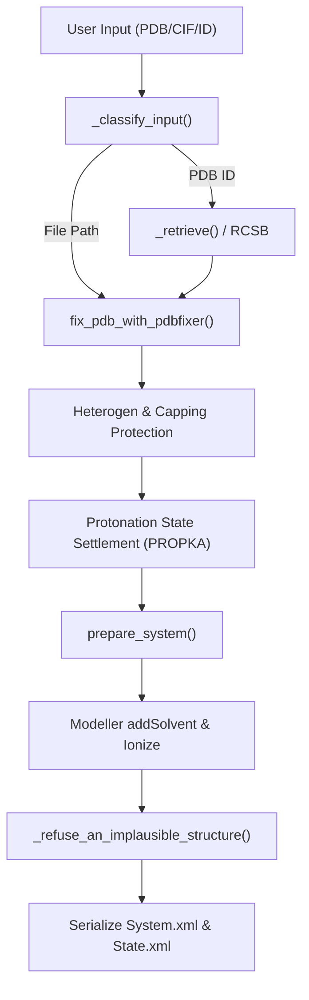
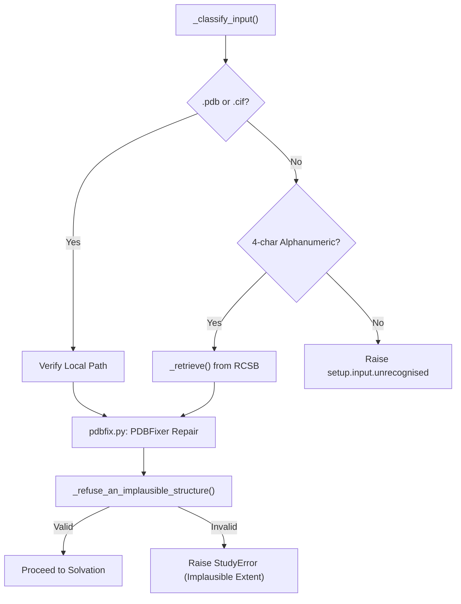

# Setup Phase: System Preparation

Relevant source files

The following files were used as context for generating this wiki page:

- [docs/examples.md](docs/examples.md)
- [docs/first_study.md](docs/first_study.md)
- [scripts/compare_heterogen_policies.py](scripts/compare_heterogen_policies.py)
- [src/fastmdxplora/setup/ccd.py](src/fastmdxplora/setup/ccd.py)
- [src/fastmdxplora/setup/estimate.py](src/fastmdxplora/setup/estimate.py)
- [src/fastmdxplora/setup/forcefields.py](src/fastmdxplora/setup/forcefields.py)
- [src/fastmdxplora/setup/heterogens.py](src/fastmdxplora/setup/heterogens.py)
- [src/fastmdxplora/setup/ligand.py](src/fastmdxplora/setup/ligand.py)
- [src/fastmdxplora/setup/membrane.py](src/fastmdxplora/setup/membrane.py)
- [src/fastmdxplora/setup/membrane_fit.py](src/fastmdxplora/setup/membrane_fit.py)
- [src/fastmdxplora/setup/pdbfix.py](src/fastmdxplora/setup/pdbfix.py)
- [src/fastmdxplora/setup/pipeline.py](src/fastmdxplora/setup/pipeline.py)
- [src/fastmdxplora/setup/prepare.py](src/fastmdxplora/setup/prepare.py)
- [src/fastmdxplora/setup/protonation.py](src/fastmdxplora/setup/protonation.py)
- [tests/_the_phase.py](tests/_the_phase.py)
- [tests/test_a_coordinated_ion_reaches_the_prepared_system.py](tests/test_a_coordinated_ion_reaches_the_prepared_system.py)
- [tests/test_a_cutoff_belongs_to_its_force_field.py](tests/test_a_cutoff_belongs_to_its_force_field.py)
- [tests/test_a_fetched_ligand_is_prepared_offline.py](tests/test_a_fetched_ligand_is_prepared_offline.py)
- [tests/test_a_file_of_ligands_is_read_as_several.py](tests/test_a_file_of_ligands_is_read_as_several.py)
- [tests/test_a_pose_chosen_on_purpose.py](tests/test_a_pose_chosen_on_purpose.py)
- [tests/test_a_pose_is_matched_atom_for_atom.py](tests/test_a_pose_is_matched_atom_for_atom.py)
- [tests/test_a_protein_is_placed_for_its_bilayer.py](tests/test_a_protein_is_placed_for_its_bilayer.py)
- [tests/test_an_ion_is_one_atom.py](tests/test_an_ion_is_one_atom.py)
- [tests/test_an_occupancy_tie_is_one_rule.py](tests/test_an_occupancy_tie_is_one_rule.py)
- [tests/test_ccd.py](tests/test_ccd.py)
- [tests/test_explain.py](tests/test_explain.py)
- [tests/test_heterogens.py](tests/test_heterogens.py)
- [tests/test_heterogens_are_decided_copy_by_copy.py](tests/test_heterogens_are_decided_copy_by_copy.py)
- [tests/test_hydrogens_follow_the_atom_they_are_bonded_to.py](tests/test_hydrogens_follow_the_atom_they_are_bonded_to.py)
- [tests/test_interface_parity.py](tests/test_interface_parity.py)
- [tests/test_membrane.py](tests/test_membrane.py)
- [tests/test_membrane_fit.py](tests/test_membrane_fit.py)
- [tests/test_protonation.py](tests/test_protonation.py)
- [tests/test_setup_layer.py](tests/test_setup_layer.py)
- [tests/test_simulation_phase.py](tests/test_simulation_phase.py)
- [tests/test_the_builder_says_what_setup_will_build.py](tests/test_the_builder_says_what_setup_will_build.py)
- [tests/test_the_pose_comes_from_the_structure.py](tests/test_the_pose_comes_from_the_structure.py)
- [tests/test_the_rarely_taken_branches_hold.py](tests/test_the_rarely_taken_branches_hold.py)
- [tests/test_the_refusals_are_being_named.py](tests/test_the_refusals_are_being_named.py)
- [tests/test_what_setup_will_build_is_said_before_it_runs.py](tests/test_what_setup_will_build_is_said_before_it_runs.py)
- [tests/validation/__init__.py](tests/validation/__init__.py)
- [tests/validation/methods.py](tests/validation/methods.py)
- [tests/validation/structures.py](tests/validation/structures.py)
- [tests/validation/test_a_method_produces_its_result.py](tests/validation/test_a_method_produces_its_result.py)
- [tests/validation/test_setup_builds_a_molecule.py](tests/validation/test_setup_builds_a_molecule.py)
- [tests/validation/test_the_corpus_is_honest.py](tests/validation/test_the_corpus_is_honest.py)
- [tests/validation/test_the_methods_are_honest.py](tests/validation/test_the_methods_are_honest.py)

The setup phase transforms raw structural inputs (PDB files, RCSB PDB IDs, or sequences) into a fully-parameterized, solvated, and ionized molecular system ready for simulation. Declared under the setup schema registry [src/fastmdxplora/config/schema.py:37-37](), this phase executes a robust chemistry pipeline that enforces structural plausibility, governs heterogen retention, determines ligand protonation states *in complex* via PROPKA, loads small molecules via OpenFF, assigns force fields, handles membrane bilayers, and serializes OpenMM artifacts (`system.xml`, `state.xml`, and `topology.pdb`).

*Sources: [src/fastmdxplora/setup/pipeline.py:7-13](), [src/fastmdxplora/setup/prepare.py:73-88](), [src/fastmdxplora/setup/pdbfix.py:17-25]()*

---

## Input Resolution, Fetching and PDB Repair

The entry point for system preparation is managed by `src/fastmdxplora/setup/pipeline.py` [src/fastmdxplora/setup/pipeline.py:1-25](), which classifies the system input into `pdb_file`, `pdb_id`, or `sequence` using `_classify_input` [src/fastmdxplora/setup/pipeline.py:74-81](). If a 4-character alphanumeric PDB ID is supplied, structures are fetched from the RCSB data bank using `_retrieve` [src/fastmdxplora/setup/pipeline.py:154-156](), complete with transient error recovery and retry delays (`_FETCH_WAITS_S`) [src/fastmdxplora/setup/pipeline.py:118-122]() for reset or busy connections handled by `_passes` [src/fastmdxplora/setup/pipeline.py:126-132]().

Once raw structural coordinates are acquired, `src/fastmdxplora/setup/pdbfix.py` executes structural repair via PDBFixer. This includes:
1. Removing unwanted heterogens while sparing recognized ligands and capping groups (`_protect_capping_groups`) [src/fastmdxplora/setup/pdbfix.py:69-98]().
2. Detecting and filling missing residues and heavy atoms [src/fastmdxplora/setup/pdbfix.py:21-23]().
3. Adding missing hydrogens at the user-specified pH using `addMissingHydrogens` [src/fastmdxplora/setup/pdbfix.py:24-24]().

Prior to solvation, `src/fastmdxplora/setup/prepare.py` runs `_refuse_an_implausible_structure` [src/fastmdxplora/setup/prepare.py:73-88](). This prevents wasted computation on broken or expanded coordinates by estimating maximum expected spatial extent based on residue counts:

$$\text{plausible} = 4.0 \times N_{\text{residues}}^{1/3}$$

If the structural bounding box extent exceeds this threshold—typically caused by terminal loops walking off into infinity without anchor points—preparation halts with `StudyError` (`setup.structure.implausible_extent`) [src/fastmdxplora/setup/prepare.py:110-123]().

*Sources: [src/fastmdxplora/setup/pipeline.py:74-115](), [src/fastmdxplora/setup/pdbfix.py:17-25](), [src/fastmdxplora/setup/prepare.py:73-123病毒]*

---

## Heterogen Classification and Filtering

Crystal structures frequently contain crystallization buffers, salts, polyols, cryoprotectants, and extraneous molecules alongside biological polymers. `src/fastmdxplora/setup/heterogens.py` classifies non-standard residues into three strict outcomes under the `Action` enumeration: `SIMULATE`, `DISCARD`, or `STOP` [src/fastmdxplora/setup/heterogens.py:36-42]().

To avoid silent substitution of apo trajectories for holo runs or accidental simulation of cryoprotectants, heterogens are filtered according to curated sets:
- **Solvent & Ions**: Standard water names (`WATER_NAMES`) and monatomic ions (`ION_NAMES`) are stripped or treated systematically [src/fastmdxplora/setup/heterogens.py:44-53]().
- **Crystallization Additives**: Additives like glycerol (`GOL`), PEG, and buffer molecules (`EPE`, `MES`, `TRS`) in `CRYSTALLIZATION_ADDITIVES` are safely discarded [src/fastmdxplora/setup/heterogens.py:60-77]() with explicit reporting (`_heterogen_residue_counts`) [src/fastmdxplora/setup/pdbfix.py:157-166]() so that no ligand or buffer deletion occurs silently [tests/test_setup_layer.py:39-45]().
- **Ambiguous Sugars & Cofactors**: Glycosylation residues and unparameterizable cofactors (`UNPARAMETERIZABLE` such as `HEM`, `FAD`, iron-sulfur clusters) trigger explicit stops if they lack force-field template support [src/fastmdxplora/setup/heterogens.py:79-114]().

*Sources: [src/fastmdxplora/setup/heterogens.py:1-125](), [src/fastmdxplora/setup/pdbfix.py:157-166]()*

---

## Protonation State Determination

Predicting ligand protonation states using isolated in-water rule tables frequently misrepresents buried or pocket-bound chemical states where pKa shifts of 2–3 units occur [src/fastmdxplora/setup/protonation.py:1-9](). `src/fastmdxplora/setup/protonation.py` delegates this task to PROPKA, evaluating ionizable groups directly within the 3D atomic environment of the protein-ligand complex [src/fastmdxplora/setup/protonation.py:10-18]().

The settlement logic (`decide`) inspects calculated `GroupPka` records against the simulation `pH`:
1. **Determined States**: If computed pKas lie comfortably outside the buffer band defined by `POISED_MARGIN` (default `1.0` pH unit) [src/fastmdxplora/setup/protonation.py:43-58](), the protonation state (`ProtonationState`) is assigned with explicit provenance reasons [src/fastmdxplora/setup/protonation.py:101-107]().
2. **Poised Groups**: If a group's pKa falls within $\pm 1.0$ of the simulation pH, both protonated and deprotonated forms are appreciably populated; preparation halts and raises a `ProtonationError` [src/fastmdxplora/setup/protonation.py:53-58]().
3. **Undetermined Inputs**: If an ionizable ligand yields no PROPKA output, preparation refuses to fall back to generic rule tables, guaranteeing chemical safety [tests/test_protonation.py:62-70]().

*Sources: [src/fastmdxplora/setup/protonation.py:1-76](), [tests/test_protonation.py:52-77]()*

---

## Ligand Parameterization and CCD

Small-molecule ligands and cofactors are loaded and validated via `src/fastmdxplora/setup/ligand.py` [src/fastmdxplora/setup/ligand.py:1-18](). SDF and MOL2 are the sole supported input formats because they supply complete bond-order and explicit charge data required by the OpenFF toolkit (`SystemGenerator`) [src/fastmdxplora/setup/ligand.py:35-59](). PDB `HETATM` extractions are intentionally rejected due to missing bond topology [src/fastmdxplora/setup/ligand.py:55-58]().

Key functions in the ligand module include:
- `detect_ligand_format()`: Validates file suffixes against `SUPPORTED_LIGAND_FORMATS` (`sdf`, `mol2`) [src/fastmdxplora/setup/ligand.py:43-59]().
- `am1bcc_provider()`: Detects available charging backends (`AmberTools` via `sqm` or `OpenEye`) to assign AM1-BCC charges for OpenFF/GAFF force fields [src/fastmdxplora/setup/ligand.py:85-120]().
- `pose_by_policy()`: Implements coordinate source selection policies (`auto`, `structure`, `file`), ensuring that control runs (such as unbound docking poses) are chosen explicitly rather than introduced by accident [src/fastmdxplora/setup/ligand.py:122-160]().

*Sources: [src/fastmdxplora/setup/ligand.py:1-160]()*

---

## Force Field Selection and System Preparation

System preparation culminates in `src/fastmdxplora/setup/prepare.py` [src/fastmdxplora/setup/prepare.py:1-39](), where OpenMM Modeller builds periodic boundary boxes, adds water, and neutralizes charges with counter-ions.

- **Default Force Field**: `forcefield: auto` resolves to `amber-openff` (`amber14-all.xml` + `amber14/tip3p.xml` combined with OpenFF small-molecule parameterization) [src/fastmdxplora/setup/prepare.py:21-31](). 
- **Solvation and Ionization**: Modeller places the solute inside a configurable box shape (`cube`, `dodecahedron`, `octahedron`) with padding (`DEFAULT_PADDING_NM = 1.0` nm) [src/fastmdxplora/setup/prepare.py:66-66] and sets ionic strength (`DEFAULT_IONIC_STRENGTH_M = 0.15` M) [src/fastmdxplora/setup/prepare.py:67-67]().
- **Serialization**: The pipeline outputs four canonical artifacts consumed by simulation and analysis phases:
  - `solvated.pdb` (and its alias `topology.pdb`) [src/fastmdxplora/setup/prepare.py:34-36]()
  - `system.xml` (serialized OpenMM `System`) [src/fastmdxplora/setup/prepare.py:37-37]()
  - `state.xml` (serialized initial OpenMM `State`) [src/fastmdxplora/setup/prepare.py:38-38]()

*Sources: [src/fastmdxplora/setup/prepare.py:1-39](), [src/fastmdxplora/setup/prepare.py:66-67]*

---

## Membrane Insertion and Size Estimation

Embedding membrane proteins requires specialized lipid parameterization and anisotropic barostat configuration. `src/fastmdxplora/setup/membrane.py` and `src/fastmdxplora/setup/membrane_fit.py` detect lipid environments from topologies (`is_membrane_system`, `is_bilayer`) [tests/test_membrane.py:93-119]() and automatically inject missing lipid XML parameters into force-field file lists (e.g., adding `charmm36.xml` when lipid tags are present) [tests/test_membrane.py:33-55](). 

Simultaneously, `src/fastmdxplora/setup/estimate.py` estimates system dimensions, memory footprints, and expected wall-clock durations based on atom and water counts prior to heavy resource allocation.

*Sources: [src/fastmdxplora/setup/membrane.py](), [src/fastmdxplora/setup/estimate.py](), [tests/test_membrane.py:1-160]()*

---