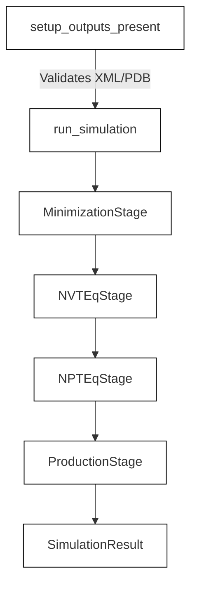
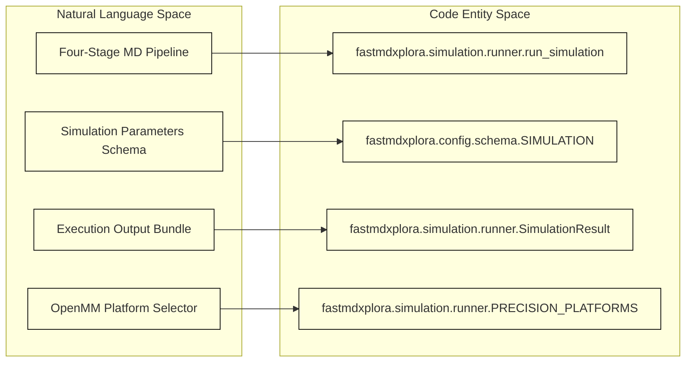

# Simulation Phase

Relevant source files

The following files were used as context for generating this wiki page:

- [src/fastmdxplora/config/schema.py](src/fastmdxplora/config/schema.py)
- [src/fastmdxplora/simulation/pipeline.py](src/fastmdxplora/simulation/pipeline.py)
- [src/fastmdxplora/simulation/runner.py](src/fastmdxplora/simulation/runner.py)

## Purpose and Scope

The Simulation Phase is responsible for executing molecular dynamics (MD) simulations using the OpenMM backend [src/fastmdxplora/simulation/runner.py:1-18](). It consumes serialized preparation artifacts (`system.xml`, `state.xml`, and `topology.pdb`) produced during the setup phase and executes a standardized four-stage integration pipeline: energy minimization, NVT equilibration, NPT equilibration, and production MD [src/fastmdxplora/simulation/pipeline.py:1-12](). 

This page provides a high-level overview of the simulation subsystem, its stage planning, configuration resolution, and ties to enhanced-sampling methodologies. For deep technical details on execution flags, barostats, checkpointing, and advanced free-energy methods, refer to the child pages:
- [MD Runner, Platforms and Checkpoints](#3.2.1)
- [Enhanced Sampling and Free Energy](#3.2.2)

Sources: `src/fastmdxplora/simulation/runner.py:1-18`, `src/fastmdxplora/simulation/pipeline.py:1-44`

---

## Simulation Pipeline Architecture

The orchestration-facing pipeline module (`fastmdxplora.simulation.pipeline`) coordinates asset verification before invoking the core OpenMM runner (`fastmdxplora.simulation.runner`) [src/fastmdxplora/simulation/pipeline.py:1-12](). It checks for prepared system geometries across standard layout paths via `where_a_prepared_system_sits()` [src/fastmdxplora/simulation/pipeline.py:112-136]() and handles graceful degradation if OpenMM or preparation files are absent [src/fastmdxplora/simulation/pipeline.py:37-44]().

*Figure 1: High-level pipeline stage transitions managed by the simulation subsystem.*

Sources: `src/fastmdxplora/simulation/pipeline.py:1-105`, `src/fastmdxplora/simulation/runner.py:1-150`

---

## Configuration and Parameter Resolution

Simulation options are declared centrally within the configuration schema registry (`fastmdxplora.config.schema`) [src/fastmdxplora/config/schema.py:1-25](). The pipeline reads these defaults via `SIMULATION.defaults()` and merges user overrides through `_resolve_params()` [src/fastmdxplora/simulation/pipeline.py:64-82](). 

Standard default parameters include:
- **Minimization**: Conducted until convergence with a default tolerance of `10.0` kJ/mol/nm [src/fastmdxplora/runner.py:116]() (`DEFAULT_MINIMIZE_TOLERANCE_KJMOL_PER_NM`).
- **NVT Equilibration**: Default duration of `500` ps (250,000 steps at a 2 fs timestep) using a Langevin thermostat.
- **NPT Equilibration**: Default duration of `1` ns (500,000 steps at 2 fs) with a Monte Carlo barostat.
- **Production MD**: Default duration of `2` ns (1,000,000 steps at 2 fs), producing trajectory frames consumed by the analysis phase [src/fastmdxplora/simulation/pipeline.py:15-35]().

Sources: `src/fastmdxplora/config/schema.py:1-25`, `src/fastmdxplora/simulation/pipeline.py:64-82`, `src/fastmdxplora/simulation/runner.py:116-123`

---

## Natural Language to Code Entity Mapping

To bridge conceptual simulation terminology with the underlying codebase implementation, the following mapping associates high-level domain concepts with their concrete code symbols:

*Figure 2: Mapping from natural language simulation concepts to FastMDXplora code symbols.*

Sources: `src/fastmdxplora/simulation/runner.py:1-160`, `src/fastmdxplora/config/schema.py:1-30`, `src/fastmdxplora/simulation/pipeline.py:1-70`

---

## Child Pages

For comprehensive technical specifications, implementation details, and advanced workflows, proceed to the child documentation:
- [MD Runner, Platforms and Checkpoints](#3.2.1) — Covers `run_simulation` internals, integrators, barostat coupling, telemetry, checkpoint seals, stop grace periods, and resume extensions.
- [Enhanced Sampling and Free Energy](#3.2.2) — Covers umbrella sampling, WHAM, metadynamics, steered MD, PLUMED integration, and adaptive stopping criteria.

Sources: `src/fastmdxplora/simulation/runner.py:1-3533`, `src/fastmdxplora/simulation/pipeline.py:1-956`

---