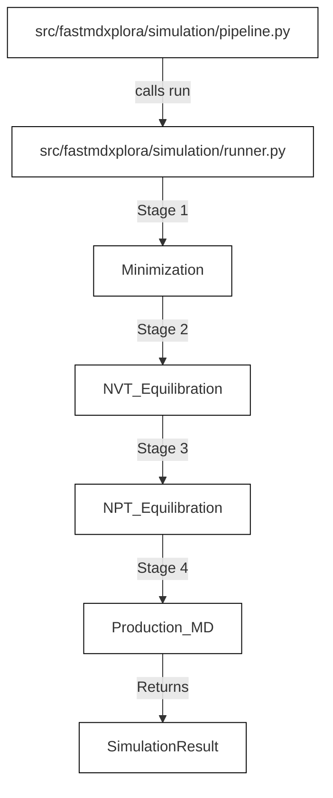

# MD Runner, Platforms and Checkpoints

<details>
<summary>Relevant source files</summary>

The following files were used as context for generating this wiki page:

- [docs/production.md](docs/production.md)
- [pytest.ini](pytest.ini)
- [src/fastmdxplora/config/schema.py](src/fastmdxplora/config/schema.py)
- [src/fastmdxplora/simulation/pipeline.py](src/fastmdxplora/simulation/pipeline.py)
- [src/fastmdxplora/simulation/restraints.py](src/fastmdxplora/simulation/restraints.py)
- [src/fastmdxplora/simulation/resume.py](src/fastmdxplora/simulation/resume.py)
- [src/fastmdxplora/simulation/runner.py](src/fastmdxplora/simulation/runner.py)
- [src/fastmdxplora/simulation/seeding.py](src/fastmdxplora/simulation/seeding.py)
- [tests/test_a_browser_test_is_skipped_without_playwright.py](tests/test_a_browser_test_is_skipped_without_playwright.py)
- [tests/test_a_cone_is_measured_from_the_pull.py](tests/test_a_cone_is_measured_from_the_pull.py)
- [tests/test_a_cone_makes_the_reference_measurable.py](tests/test_a_cone_makes_the_reference_measurable.py)
- [tests/test_a_replica_sweep_shares_its_water.py](tests/test_a_replica_sweep_shares_its_water.py)
- [tests/test_a_study_stopped_before_its_extension_s_checkpoint_is_carried_on.py](tests/test_a_study_stopped_before_its_extension_s_checkpoint_is_carried_on.py)
- [tests/test_a_study_stopped_twice_is_carried_on.py](tests/test_a_study_stopped_twice_is_carried_on.py)
- [tests/test_restraints.py](tests/test_restraints.py)
- [tests/test_seeding.py](tests/test_seeding.py)
- [tests/test_seeding_end_to_end.py](tests/test_seeding_end_to_end.py)
- [tests/test_the_console_is_not_told_twice.py](tests/test_the_console_is_not_told_twice.py)
- [tests/test_the_overview_is_read_again_as_analyze_again_ends.py](tests/test_the_overview_is_read_again_as_analyze_again_ends.py)

</details>


This leaf page details the implementation of FastMDXplora's OpenMM-backed molecular dynamics runner, covering the execution of the four-stage simulation pipeline (`src/fastmdxplora/simulation/runner.py:1-18]`), platform configuration, integrators, barostats, restraint schedules, telemetry emission, checkpoint seals, and the resumption/extension engine (`src/fastmdxplora/simulation/resume.py:1-41]`).

---

## 1. The Four-Stage Simulation Pipeline

The simulation phase takes the serialized OpenMM `System`, `State`, and `Topology` files generated during setup and executes a standardized four-stage pipeline:
1. **Minimization**: Local energy minimization using a specified force-tolerance (`src/fastmdxplora/simulation/runner.py:6-6`).
2. **NVT Equilibration**: Constant volume equilibration using a Langevin thermostat (`src/fastmdxplora/simulation/runner.py:7-7`).
3. **NPT Equilibration**: Constant pressure equilibration introducing a Monte Carlo barostat (`src/fastmdxplora/simulation/runner.py:8-8`).
4. **Production**: Long-duration sampling generating trajectory frames consumed by downstream analysis phases (`src/fastmdxplora/simulation/runner.py:9-9`).

The orchestrator interfaces via `src/fastmdxplora/simulation/pipeline.py` which verifies setup artifacts (`src/fastmdxplora/simulation/pipeline.py:85-93]`) and delegates execution to `fastmdxplora.simulation.runner.run_simulation` (`src/fastmdxplora/simulation/pipeline.py:8-8`). The output metadata and paths are encapsulated within the immutable `SimulationResult` data class (`src/fastmdxplora/simulation/runner.py:128-160]`).


*Figure 1: Pipeline stage execution flow mapping orchestrator entry points to OpenMM runner routines.*

Sources: `src/fastmdxplora/simulation/runner.py:1-18]`, `src/fastmdxplora/simulation/runner.py:128-160]`, `src/fastmdxplora/simulation/pipeline.py:1-44]`

---

## 2. Integrators, Platforms and Barostats

OpenMM operations rely on hardware backends resolved dynamically via CLI or configuration flags (`docs/production.md:13-16]`). 

### Platforms and Precision
- Supported precision-aware GPU platforms are defined in `PRECISION_PLATFORMS` (`src/fastmdxplora/simulation/runner.py:49-52]`): `CUDA`, `OpenCL`, and `HIP`.
- OpenMM is imported lazily to ensure project-level imports do not fail in environments lacking simulation dependencies (`src/fastmdxplora/simulation/runner.py:15-18]`, `src/fastmdxplora/simulation/runner.py:164-171]`).

### Integrators
The runner supports multiple integration schemes (`SUPPORTED_INTEGRATORS`), defaulting to `langevin_middle` for enhanced configurational sampling stability compared to legacy Langevin algorithms (`src/fastmdxplora/simulation/runner.py:63-81]`):
- Fixed-step integrators (`langevin`, `langevin_middle`, `brownian`, `verlet`).
- Variable-step integrators (`variable_langevin`, `variable_verlet`) grouped under `VARIABLE_STEP_INTEGRATORS` (`src/fastmdxplora/simulation/runner.py:73-74]`). Variable-step runs determine elapsed times dynamically; helper functions such as `chose_its_own_step()` inspect simulation parameter records to handle trajectory timing metrics (`src/fastmdxplora/simulation/runner.py:84-112]`).

### Barostats and Ensembles
Constant-pressure stages (NPT) configure Monte Carlo barostats (`DEFAULT_BAROSTAT_FREQUENCY`, `src/fastmdxplora/simulation/runner.py:61-62]`), tracking metrics such as `pressure_bar_used` and `barostat` (isotropic or membrane coupling) inside `SimulationResult` (`src/fastmdxplora/simulation/runner.py:143-148]`).

```mermaid
graph TD
    sub7[""ResolvedConfig/CLI""] -->|"selects platform"| P[""PRECISION_PLATFORMS: CUDA/OpenCL/HIP""]
    sub7 -->|"selects integrator"| I[""SUPPORTED_INTEGRATORS: langevin_middle""]
    I -->|"variable step check"| V[""VARIABLE_STEP_INTEGRATORS""]
    sub7 -->|"selects ensemble"| E[""NPT / NVT Resolution""]
    E -->|"barostat config"| B[""MonteCarloBarostat (isotropic/membrane)""]

    classDef default fill:none,stroke:#000,stroke-width:1px;
```
*Figure 2: Configuration routing for simulation hardware platforms, numerical integrators, and thermodynamic ensembles.*

Sources: `src/fastmdxplora/simulation/runner.py:49-112]`, `src/fastmdxplora/simulation/runner.py:128-160]`, `docs/production.md:13-16]`

---

## 3. Restraints and Release Schedules

Equilibration protocols incorporate position or geometry restraints to stabilize solute conformations while solvent molecules relax (`tests/test_restraints.py:1-9]`). 

### Restraint Parsing
The parser validates restraint configurations via `parse_restraints()` (`tests/test_restraints.py:62-117]`):
- Short-form inputs parse positional selections using default force constants (`DEFAULT_POSITION_FORCE`, `tests/test_restraints.py:68-71]`).
- Complex restraint lists (`position`, `distance`, `torsion`) enforce explicit force constant declarations where conventional defaults do not apply (`tests/test_restraints.py:79-98]`).
- Units are validated according to physical dimensions (`kJ/mol/nm^2` for positions/distances versus `kJ/mol/rad^2` for torsions) (`tests/test_restraints.py:105-117]`).

### Release Schedules
`ReleaseSchedule` governs the gradual attenuation of restraint forces during equilibration stages to prevent energetic shocks or structural lurches (`tests/test_restraints.py:119-140]`):
- The schedule monotonically decreases forces across fractions of staging intervals, concluding at zero force (`tests/test_restraints.py:124-131]`).

```mermaid
graph TD
    R[""parse_restraints()""] -->|"kind: position"| P[""Positional Restraints (kJ/mol/nm^2)""]
    R -->|"kind: distance"| D[""Distance Restraints (explicit force)""]
    R -->|"kind: torsion"| T[""Torsion Restraints (kJ/mol/rad^2)""]
    P & D & T -->|"managed by"| RS[""ReleaseSchedule.force_at(fraction)""]
    RS -->|"decays to 0.0"| U[""Unrestrained Production State""]

    classDef default fill:none,stroke:#000,stroke-width:1px;
```
*Figure 3: Restraint parsing workflow and force attenuation managed by `ReleaseSchedule`.*

Sources: `tests/test_restraints.py:1-140]`, `src/fastmdxplora/simulation/restraints.py`

---

## 4. Telemetry, Checkpoints, and Seals

The runner emits progress and system states at strict intervals defined in step counts:
- Trajectory interval: `DEFAULT_TRAJECTORY_INTERVAL_STEPS` (`src/fastmdxplora/simulation/runner.py:120-120`)
- State interval: `DEFAULT_STATE_INTERVAL_STEPS` (`src/fastmdxplora/simulation/runner.py:121-121`)
- Checkpoint interval: `DEFAULT_CHECKPOINT_INTERVAL_STEPS` (`src/fastmdxplora/simulation/runner.py:122-122`)

### Checkpoint Seals and Interruption Detection
Checkpoint files (`checkpoint.chk`) preserve exact phase states for recovery. When executions are prematurely terminated (e.g., process crashes or manual interrupts), lack of a completion manifest or sealing record flags the segment as unsealed (`tests/test_a_study_stopped_twice_is_carried_on.py:93-107]`). The recovery engine isolates unsealed segments to protect downstream data integrity.

```mermaid
graph TD
    S[""Simulation Execution Loop""] -->|"every 10k steps"| C[""checkpoint.chk written""]
    S -->|"every 1k steps"| T[""Trajectory & State Reporters""]
    S -->|"Normal Completion"| M[""Manifest.json Sealed""]
    S -->|"Abrupt Interruption"| U[""Unsealed Segment / Missing Manifest""]
    U -->|"Handled by"| R[""resume_study() Engine""]

    classDef default fill:none,stroke:#000,stroke-width:1px;
```
*Figure 4: Data flow for telemetry reporting, periodic checkpoints, and seal validation.*

Sources: `src/fastmdxplora/simulation/runner.py:119-123]`, `tests/test_a_study_stopped_twice_is_carried_on.py:93-107]`

---

## 5. Stop Grace, Resume and Extension

To maximize hardware utilization, studies can be split into segments or extended dynamically, provided the underlying thermodynamic method permits it (`src/fastmdxplora/simulation/resume.py:1-41]`).

### Segmentability Evaluation
`segmentability()` evaluates whether a configuration can be safely split or resumed (`src/fastmdxplora/simulation/resume.py:102-110]`):
- **Metadynamics**: Refused for segmentation (`simulation.resume.bias_not_carried`), because PLUMED history files (`HILLS`) are required to preserve biasing states across resumes (`src/fastmdxplora/simulation/resume.py:112-120]`).
- **Steered MD**: Refused (`simulation.resume.time_dependent_bias`) because time-dependent moving restraints break when resumed mid-pull (`src/fastmdxplora/simulation/resume.py:122-130]`).
- **Unbiased Runs and Umbrella Windows**: Allowed; unbiased runs rely solely on checkpoint velocities and positions, while umbrella windows maintain coordinate-based restraints (`src/fastmdxplora/simulation/resume.py:132-158]`).

### Extension and Interrupted Segment Management
When a run is interrupted before an extension segment writes its first checkpoint, the resume framework (`resume_study` / `extend_study`) sets aside the corrupted segment (e.g., renaming it with `-stopped-before-its-checkpoint`) and resumes cleanly from the latest valid preceding checkpoint (`tests/test_a_study_stopped_before_its_extension_s_checkpoint_is_carried_on.py:85-110]`).

```mermaid
graph TD
    CFG[""Study Configuration""] --> S[""segmentability(config)""]
    S -->|"Metadynamics / Steered"| REF[""Refused: Bias State Lost""]
    S -->|"Unbiased / Umbrella"| ACC[""Allowed: Checkpoint Carry-over""]
    ACC --> K[""Interruption Check""]
    K -->|"Valid Checkpoint Found"| CONT[""extend_study() / resume_study()""]
    K -->|"Missing Checkpoint in Segment"| ASIDE[""Set Aside Corrupt Segment & Roll Back""]

    classDef default fill:none,stroke:#000,stroke-width:1px;
```
*Figure 5: Decision tree for segmentability validation, interruption recovery, and study extension routines.*

Sources: `src/fastmdxplora/simulation/resume.py:1-158]`, `tests/test_a_study_stopped_before_its_extension_s_checkpoint_is_carried_on.py:85-110]`, `tests/test_a_study_stopped_twice_is_carried_on.py:1-107]`

---